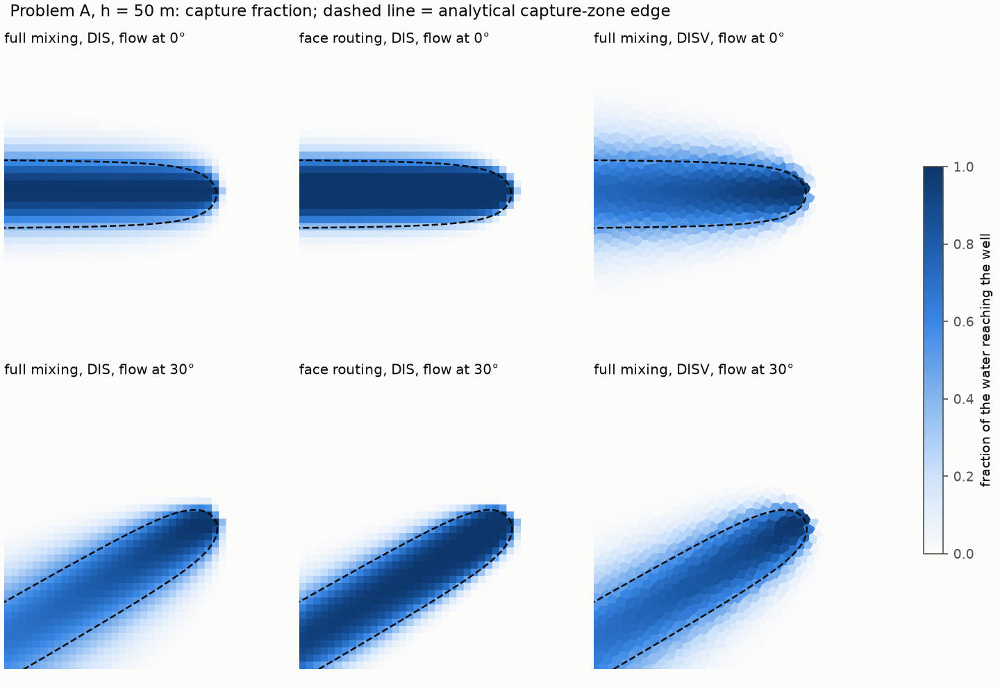
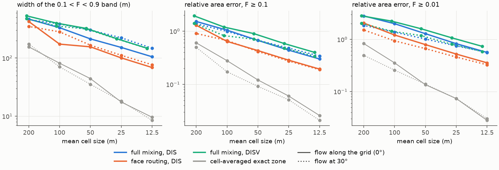
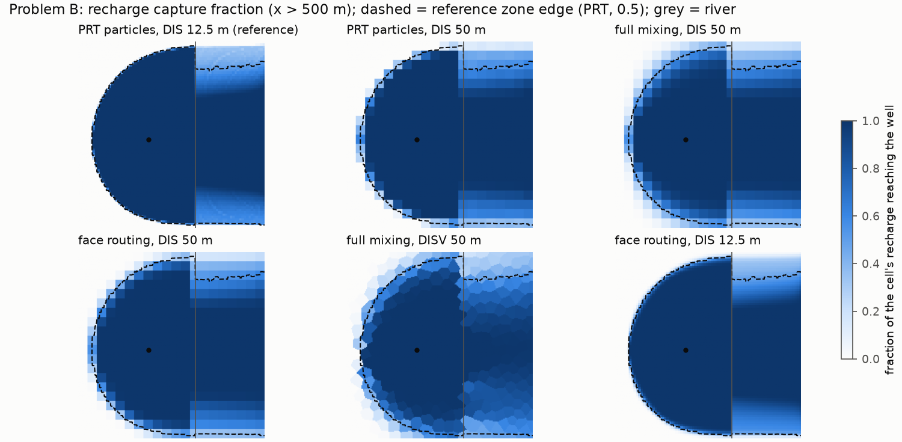
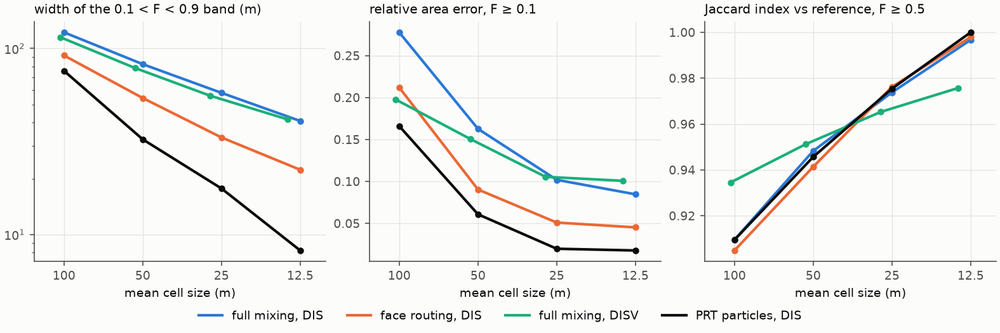
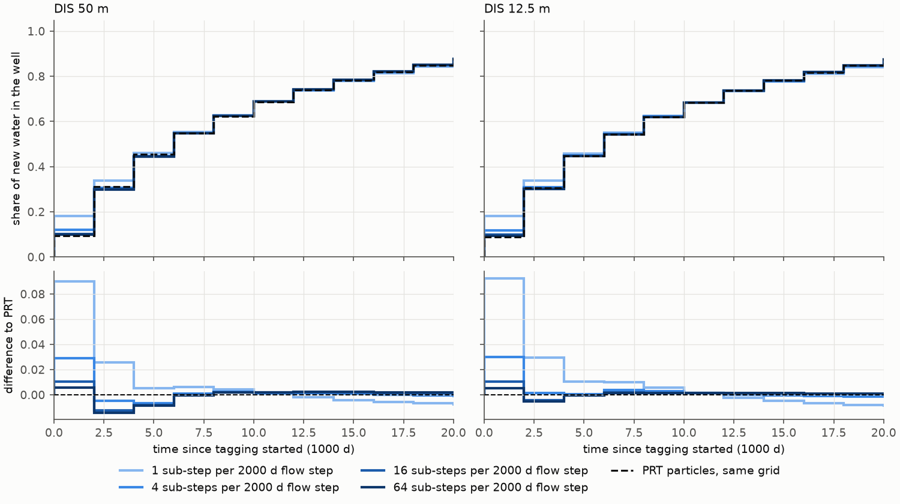

# Numerical dispersion of full-mixing tracing, and face-to-face routing

Phase 5 research note, 2026-10-02. Code: `studies/dispersion/` (study) and
`src/gwsource/experimental/face_routing.py` (prototype). Generated tables: `studies/dispersion/output/summary.md`.

## Summary

- Full mixing [FB13, BF13] smears the edge of a capture zone over a band of intermediate fractions. On the problems tested, the band between F = 0.1 and F = 0.9 is 1.2 to 12 cells wide. In metres it narrows only as about h^0.5 (fitted rates 0.4 to 0.6). The finer the grid, the more cells the band spans.
- The F = 0.5 contour is an unbiased estimate of the advective capture zone. At cell sizes of 50 m or less its area is within 5 % of the analytical or particle zone (Jaccard index 0.89 to 0.98; 0.97 to 1.00 at about 13 m). Low thresholds are conservative: the zone F ≥ 0.1 contained the whole reference zone in every run. That safety costs area. For flow converging on a well from a regional gradient, the zone F ≥ 0.1 is 30 to 90 % too large at h = 12.5 to 50 m, and the zone F ≥ 0.01 is 56 to 160 % too large. For a recharge-fed zone these overestimates are 8 to 16 % and 14 to 25 %.
- Integral outputs barely depend on the grid. The shares of the well water by source package are identical to three digits under mixing, routing and particles on the same DIS grid. For h ≤ 50 m the flux-weighted mean travel time is within 2 % of particle tracking (problem B) and within 4 % of the analytical value (problem A).
- The Voronoi DISV grids showed no less dispersion than DIS. For flow at 30° to the rows the band widths were equal; for flow along the rows DISV was wider (147 m vs 105 m at about 13 m cells).
- Face-to-face routing (Chowdhury 2016) removes 35 to 70 % of the excess spreading. It roughly matches full mixing on a grid two to four times finer. It does not change the convergence rate, because water is still mixed across each cell face.
- Transient tracking: with 2000-day flow steps, implicit time stepping roughly doubles the share of new water reaching the well in the first step (0.18 vs 0.09 for particles). Transport sub-steps (new option `TrackingConfig.substeps`) remove this without touching the flow model. With 16 sub-steps (125 d) what remains is the grid effect.

## 1. Questions and set-up

Full mixing assumes that water entering a cell leaves through all its outflow faces in proportion to their flows, whatever face it came in by. Water near the edge of a capture zone is therefore split between "captured" and "not captured" at every cell it passes. The resulting spreading depends on the grid [MC09, CHO16, EA19]. The study measures it against references that do not mix, and it asks three practical questions:

1. Which threshold on F reproduces an advective (particle) capture zone, and within what error?
2. When is full mixing conservative?
3. How much of the effect does face-to-face routing remove?

### Problem A: uniform flow and a well, with an analytical reference

- Confined aquifer, T = 500 m²/d, regional gradient 0.002 (U = T i = 1 m²/d), one well pumping Q = 500 m³/d, domain 2000 m × 2000 m.
- The perimeter cells are constant heads set to the analytical head h = h0 − i s + Q/(4πT) ln r², so the interior flow approaches uniform flow plus a well.
- The reference is the capture zone of Javandel and Tsang (1986). Its divide is s = n / tan(2πUn/Q), it is Q/U = 500 m wide far upstream, and its stagnation point lies 80 m downstream of the well.
- Two regional flow directions: along the grid rows (0°) and at 30° to them.
- Grids: DIS with h = 200, 100, 50, 25 and 12.5 m (100 to 25,600 cells), and Voronoi DISV grids made with Triangle at maximum triangle area h². Their mean cell sizes are 210, 107, 55, 28 and 14 m.

### Problem B: test model 1 physics, with a particle reference

- One unconfined layer (1500 m × 1000 m) with recharge (1e-3 m/d), a river line, a constant-head west edge and a well pumping 800 m³/d.
- This is test model 1, without inactive cells. The well and river sit at points that are inside cells for every cell size, and the river conductance is given per metre of river.
- Grids: DIS with h = 100, 50, 25 and 12.5 m (150 to 9600 cells), and Voronoi DISV grids of 104 to 14 m mean size.
- The reference is MF6 PRT through the Phase 3 helper on the finest DIS grid: 94,000 particles released at the water table, weighted by flux. Its per-cell capture fraction of recharge is compared with the fraction of each cell's recharge that reaches the well. For full mixing that fraction is F of the cell. For face routing it is F of the top-face recharge term.
- PRT was also run on every coarser DIS grid.
- East of the river, all water passes the gaining river, which is a weak sink. The PRT helper also treats weak sinks by full mixing (it thins particle weights by 1 − Snk/O). The zone metrics are therefore taken west of the river only (x < riv_x − 50 m), where no method mixes at weak sinks.

### Metrics

Each grid's field is sampled on a shared 2.5 m raster, inside a window that leaves out a band along the boundary: 200 m for problem A, 25 m for problem B.

| Metric | Definition |
|---|---|
| area error at t | area(F ≥ t) / reference area − 1, for t = 0.01, 0.1, 0.5 |
| Jaccard index | overlap / union of {F ≥ 0.5} and the reference zone |
| missed at t | share of the reference zone where F < t |
| band width | area(0.1 < F < 0.9) / length of the reference zone edge: the mean distance between the F = 0.1 and F = 0.9 contours across the edge; also given in cells (÷ mean cell size) |
| travel time (A) | ∫F dA / analytical zone area − 1; for full mixing in a constant-thickness layer this is the relative error of the flux-weighted mean travel time, since that time equals Σ V F / Q (Phase 3 identity) |

The "cell-averaged exact zone" (the analytical indicator averaged over each cell) is the best any per-cell field can do. It sets the floor: a band of about 0.7 to 0.9 cells.

## 2. Results: steady capture zones



*Figure 1. Problem A at h = 50 m. Fraction of the water in each cell that reaches the well, with the analytical divide (dashed).*



*Figure 2. Problem A against cell size: band width and area errors. Solid lines: flow along the rows; dotted: flow at 30°.*

**Table 1. Problem A, selected grids** (the full table is in `output/summary.md`)

| flow | grid | h (m) | method | area err F≥0.01 | area err F≥0.1 | area err F≥0.5 | Jaccard F≥0.5 | missed F≥0.5 | band width (m) | band (cells) | travel time err |
|---|---|---|---|---|---|---|---|---|---|---|---|
| 0° | DIS | 50 | full mixing | +1.29 | +0.67 | +0.016 | 0.887 | 0.052 | 214 | 4.3 | +0.037 |
| 0° | DIS | 50 | face routing | +0.79 | +0.43 | +0.021 | 0.891 | 0.048 | 156 | 3.1 | +0.027 |
| 0° | DIS | 12.5 | full mixing | +0.56 | +0.30 | +0.000 | 0.980 | 0.010 | 105 | 8.4 | +0.007 |
| 0° | DIS | 12.5 | face routing | +0.36 | +0.19 | +0.002 | 0.980 | 0.009 | 69 | 5.5 | +0.005 |
| 0° | DIS | 12.5 | cell-averaged exact | +0.03 | +0.03 | −0.000 | 0.984 | 0.008 | 10 | 0.8 | 0 |
| 0° | DISV | 14 | full mixing | +0.74 | +0.40 | −0.007 | 0.967 | 0.020 | 147 | 10.5 | −0.000 |
| 30° | DIS | 50 | full mixing | +1.01 | +0.67 | +0.045 | 0.922 | 0.019 | 304 | 6.1 | −0.025 |
| 30° | DIS | 50 | face routing | +0.67 | +0.41 | +0.032 | 0.929 | 0.021 | 167 | 3.3 | +0.004 |
| 30° | DIS | 12.5 | full mixing | +0.56 | +0.34 | +0.009 | 0.984 | 0.004 | 148 | 11.8 | −0.012 |
| 30° | DIS | 12.5 | face routing | +0.33 | +0.19 | +0.005 | 0.986 | 0.005 | 77 | 6.1 | −0.002 |
| 30° | DISV | 14 | full mixing | +0.59 | +0.34 | −0.002 | 0.979 | 0.012 | 147 | 10.5 | −0.017 |

Convergence rates (slope of log metric against log h, five grids):

| | full mixing DIS 0° | face routing DIS 0° | full mixing DISV 0° | full mixing DIS 30° | face routing DIS 30° | full mixing DISV 30° |
|---|---|---|---|---|---|---|
| band width | 0.54 | 0.61 | 0.47 | 0.41 | 0.57 | 0.42 |
| area error F ≥ 0.1 | 0.59 | 0.67 | 0.57 | 0.51 | 0.58 | 0.50 |

The cell-averaged reference converges at first order (band about 0.7 cells at every h). The spreading of full mixing behaves like a diffusion whose coefficient scales with the cell size: the band grows with the square root of h times the travel distance along the zone edge. Face routing narrows the band but keeps the half-order rate. Its band width at h is close to that of full mixing at h/2 for flow along the rows, and at h/4 for flow at 30°. At 12.5 m it removes 38 % (0°) and 51 % (30°) of the band width in excess of the cell-averaged floor, and 39 % and 44 % of the excess area at F ≥ 0.01.



*Figure 3. Problem B. Fraction of each cell's recharge that reaches the well, with the reference zone edge (PRT on 12.5 m, F = 0.5, dashed). The river is the grey line; east of it, partial fractions come from the gaining river (a weak sink) under every method.*



*Figure 4. Problem B against cell size, west of the river. PRT on the coarser DIS grids is included; its band is the floor set by the cell size (about 0.7 cells).*

**Table 2. Problem B (reference: PRT on DIS 12.5 m)**

| grid | h (m) | method | area err F≥0.01 | area err F≥0.1 | area err F≥0.5 | Jaccard F≥0.5 | band width (m) | mean travel time (d) |
|---|---|---|---|---|---|---|---|---|
| DIS | 50 | full mixing | +0.25 | +0.16 | −0.017 | 0.948 | 82 | 9668 |
| DIS | 50 | face routing | +0.16 | +0.09 | −0.040 | 0.941 | 54 | 9686 |
| DIS | 50 | PRT | +0.07 | +0.06 | −0.026 | 0.946 | 33 | 9648 |
| DIS | 12.5 | full mixing | +0.14 | +0.08 | −0.001 | 0.997 | 41 | 9731 |
| DIS | 12.5 | face routing | +0.08 | +0.05 | −0.002 | 0.998 | 22 | 9735 |
| DIS | 12.5 | PRT (reference) | +0.02 | +0.02 | 0 | 1 | 8 | 9750 |
| DISV | 54 | full mixing | +0.25 | +0.15 | +0.007 | 0.951 | 79 | 9555 |
| DISV | 14 | full mixing | +0.16 | +0.10 | +0.018 | 0.976 | 42 | 9787 |

The PRT reference has non-zero area errors at F ≥ 0.01 and F ≥ 0.1 against itself, because its per-cell fractions are graded where the zone edge crosses a cell. Travel times are the Eulerian mean_transit_time for full mixing, Σ V F / Q for face routing and the PRT flux-weighted arrival for particles. PRT stops particles on entering the well cell. The Eulerian time to that point is 9729 d at 12.5 m and 9635 d at 50 m.

Here face routing removes 57 % of the band width that full mixing adds over PRT on the same grid, at both 50 m and 12.5 m. It removes 54 to 72 % of the excess area at F ≥ 0.01 and F ≥ 0.1.

**Shares of the well water by source package.** RIV/RCH were 0.102/0.898 at 50 m and 0.0964/0.904 at 12.5 m, the same under full mixing, face routing and PRT to three digits (PRT 0.0963 at 12.5 m). Spreading moves water across the zone edge in both directions, and on average it cancels. The shares changed with the grid only through the representation of the river, as on the 100 m DISV grid (0.186), not through mixing.

## 3. Results: transient tracking, time steps vs grid

Transient tracking (Phase 4B) is implicit and upstream in time. A time step much longer than the residence time of a cell lets tagged water cross many cells within one step, which adds dispersion in time on top of the spatial mixing.

To separate the two effects, problem B's steady flows were held for 30 flow steps of 2000 d. All water entering after t = 0 was tagged (forward tracking from RCH, RIV and CHD). The tracked share of new water leaving through the well, averaged over each step, was compared with the step-averaged flux-weighted PRT arrival-time distribution on the same grid. The comparison used 1, 4, 16 and 64 transport sub-steps per flow step.



*Figure 5. Share of the well water that entered after t = 0, per 2000-day flow step (top), and its difference from PRT (bottom).*

| grid | sub-steps | transport step (d) | share in step 1 | share by 4000 d | mean abs. difference to PRT (30 steps) | run time (s) |
|---|---|---|---|---|---|---|
| DIS 12.5 m | 1 | 2000 | 0.181 | 0.337 | 0.0091 | 0.2 |
| | 4 | 500 | 0.119 | 0.309 | 0.0021 | 0.3 |
| | 16 | 125 | 0.099 | 0.303 | 0.0009 | 1.1 |
| | 64 | 31 | 0.093 | 0.302 | 0.0009 | 3.7 |
| | PRT | – | 0.088 | 0.307 | – | – |
| DIS 50 m | 1 | 2000 | 0.183 | 0.338 | 0.0083 | 0.05 |
| | 64 | 31 | 0.098 | 0.298 | 0.0024 | 0.8 |
| | PRT | – | 0.093 | 0.312 | – | – |

With one step per flow step, the early arrival is overestimated by a factor of two on both grids. Time stepping dominates the grid effect. From 16 sub-steps (125 d) on, the curve stops changing. The remaining difference to PRT is then the spatial mixing: about 0.001 at 12.5 m and 0.002 at 50 m. The step size changes the spread of the arrival distribution, not its mean: summed over all steps, the implicit-Euler step responses give the same first moment as the continuous system.

**Sub-stepping implementation.** `TrackingConfig.substeps = m` splits every flow step into m equal transport steps. The flows are constant within a flow step, and the volumes are interpolated linearly between V^old and V^new. Outputs stay at flow-step boundaries; flow-weighted totals are summed over the sub-steps. The adjoint is that of the sub-stepped scheme.

Checks:

- m = 1 reproduced the previous outputs bit for bit (every field of the forward and backward results, random cyclic networks with storage and MF6 model 6, both volume modes).
- Duality, closure and the tagged-water balance stay exact with sub-steps.
- m sub-steps equal a flow model with m times more steps of the same flows to 1e-12 (hand-built steps without storage).

## 4. Face-to-face routing prototype

`gwsource.experimental.face_routing` is outside the stable API. Its module docstring gives the full method.

**Cell partition.**

- In a rectilinear cell, Pollock's (1988) velocity field is linear along each axis and independent between axes. The time for a particle to reach a face along one axis therefore depends only on its start position along that axis.
- For water entering a lateral face spread uniformly over it, all particles need the same time T to cross the cell. The positions whose particles reach a side face sooner form an interval with a closed-form length.
- This gives the partition W[inflow face, outflow face] without tracking particles.
- It reproduces Chowdhury's (2016) closed-form formulas for cells with two inflow and two outflow faces, for both stagnation-point and corner cases (400 random cells, to 1e-12). It also covers one-inflow and one-outflow cells.
- It agrees with per-particle Pollock exit times (200,000 particles per face) to within sampling error.

**Internal sources and sinks.** Treated as follows:

- *Distributed recharge* enters through the top face (Pollock's and MODPATH's IFACE 6 treatment, the default). A routed cell may have flow through one vertical face only, and it must be an inflow. Lateral water then never reaches a vertical face, and the top inflow takes what the lateral inflows leave of each outflow face. That is exact mass balance for Pollock's field.
- *Other terms* can be assigned to a face with MODPATH IFACE codes, for example boundary inflow or outflow on a model edge.
- *Every cell with an internal (IFACE 0) source or sink with non-zero flow is fully mixed*: wells, river, drain and GHB leakage, constant heads. Water passing a weak sink is still split as under full mixing. The same applies to cells with flow through both vertical faces or out through a vertical face.

The prototype is therefore 2D. In test model 2 (three layers) no cell of layers 1 and 2 is routed; 91 % of the bottom layer is.

**Graph and closure.**

- The unknowns are one value per positive-flow connection (the water crossing that face) plus one per mixed cell.
- The system is solved with the existing solvers (topological or block LU).
- It is mapped back to a per-cell fraction through: the outflow-weighted mean over the cell's outflow faces. This equals F in mixed cells.
- Closure Σ q_k F_k − Σ r F = destination inflow holds to round-off. The residual term carries each routed cell's flow residual on its outflow faces.

**Tests** (`tests/test_face_routing.py`):

- Chowdhury's planar 3×3 case: his Figure 4.6 values are reproduced exactly. Cells A and I are 0, B, D, F and H are 0.5, and C, E and G are 1, where full mixing gives 0.25 to A and I.
- 45° uniform flow: one boundary face's water stays in a one-face-wide staircase, with no lateral spreading.
- Single-outflow drainage trees with recharge and a weak-sink well: identical to full mixing.
- With routing switched off: identical to `gwsource.backward` on model 1.
- Model 1: closure to 1e-10, boundary control (fractions to all sinks sum to 1), bounds, a narrower zone.
- Model 2: closure.

**Why the gain is moderate.** Face routing keeps which face the water crossed, but not where on the face. On the next cell the water is spread uniformly over that face again. For flow oblique to the grid this is a smaller, face-scale mixing, so spreading still grows as about √(hL). The only exceptions are flow along a grid axis or at exactly 45° (Chowdhury's example), where face and streamline geometry coincide. Recovering the full advective limit would need the position along each face, which is particle tracking.

**Cost.** The cell partition is a Python loop: 3 s for 25,600 cells, against 0.03 s for the full-mixing solve. The graph has about three times as many unknowns.

## 5. Practical guidance

- **Delineating an advective capture zone from F:** use the F = 0.5 contour. With cells of 50 m or less, its area was within 5 % of the analytical or particle zone and missed at most about 5 % of it (2.5 % at 25 m, 2 % at about 13 m). Coarser grids are much worse: at 200 m it was off by 30 to 50 %.
- **Conservative envelope:** the zone F ≥ 0.1 under full mixing contained the whole reference zone in every run (missed ≤ 0.1 %), so it is a safe outer bound. It overestimates the zone area by 30 to 90 % (problem A) or 8 to 16 % (problem B) at h = 12.5 to 50 m. Refinement reduces this only slowly; halving h removes about 30 % of the overestimate. The overestimate is largest when the zone edge is a long streamline fed by lateral inflow (problem A). It is smallest when the edge is a recharge divide close to where water enters (problem B). F ≥ 0.01 roughly doubles these overestimates and is not useful as a zone boundary.
- **Full mixing is conservative** for the questions "could water from here reach the well?" (low thresholds) and "what share of the well water comes from each source?" (exact to three digits here). It is not conservative for the core of a zone: F ≥ 0.9 shrinks towards the well, and at h = 200 m F ≥ 0.5 missed half the zone.
- **Integral outputs** (shares by source, volumes from, flux-weighted mean travel time) depend little on the grid. Here they were within 2 % for h ≤ 50 m, provided the boundary conditions are represented equally.
- **Voronoi grids** do not by themselves reduce mixing dispersion. They make it nearly independent of flow direction.
- **Transient tracking:** keep the transport step to a small fraction of the time window over which arrivals are read (here 1/16 of a 2000 d step). Use `substeps` rather than refining the flow model. Here, 16 sub-steps of 125 d removed the time-stepping error for about 1 s of extra run time.
- **For small zones** (spreading width comparable to the zone), combine the F = 0.5 zone with particle tracking, as [EA19] does.

## 6. Recommendation on face routing

Keep face routing in `gwsource.experimental` for now. It is correct and tested, and on single-layer DIS models it narrows capture-zone edges by roughly the effect of halving or quartering the cell size. However:

1. It does not change the convergence rate.
2. It does nothing in cells with weak sinks or vertical through-flow. That covers most cells of multi-layer models.
3. It lacks forward mode, travel time and transient tracking.
4. Its cell partition is not vectorised.

Before it graduates, it needs:

- the 3D partition (lateral inflows racing two varying exit times; the integrals appear to have closed forms in powers of the linear velocity);
- a vectorised plan;
- forward mode with a duality test.

Better guidance on thresholds (Section 5) may deliver most of the practical benefit at no cost.

## Reproducing

```
python studies/dispersion/workflow.py
```

The run takes about 3 minutes on a 16-core laptop (MF6 nightly, 2026-10-02): problem A 29 s, problem B 129 s (the 12.5 m PRT run with 94,000 particles takes 100 s of it), transient 9 s, figures 2 s. Models and tables are written to `studies/dispersion/output/`, which is not tracked by git.

## References

Black & Foley (2013) [BF13]; Foley & Black (2013) [FB13]; Chowdhury (2016) [CHO16]; Environment Agency (2019) [EA19]; McLane & Cecan (2009) [MC09]; Pollock (1988) [POL88]; Pollock (2016) [POL16]; full entries in `references/bibliography.md`. Javandel, I. & Tsang, C.-F. (1986). Capture-zone type curves: a tool for aquifer cleanup. *Ground Water* 24(5), 616–625.
