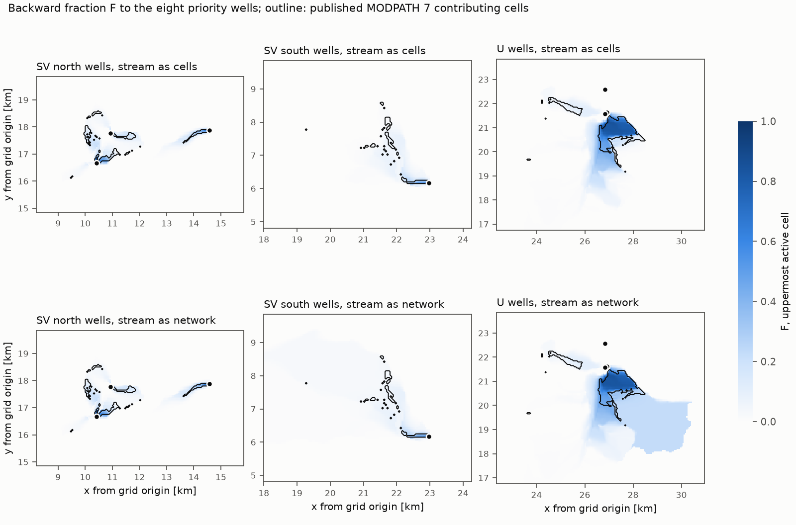
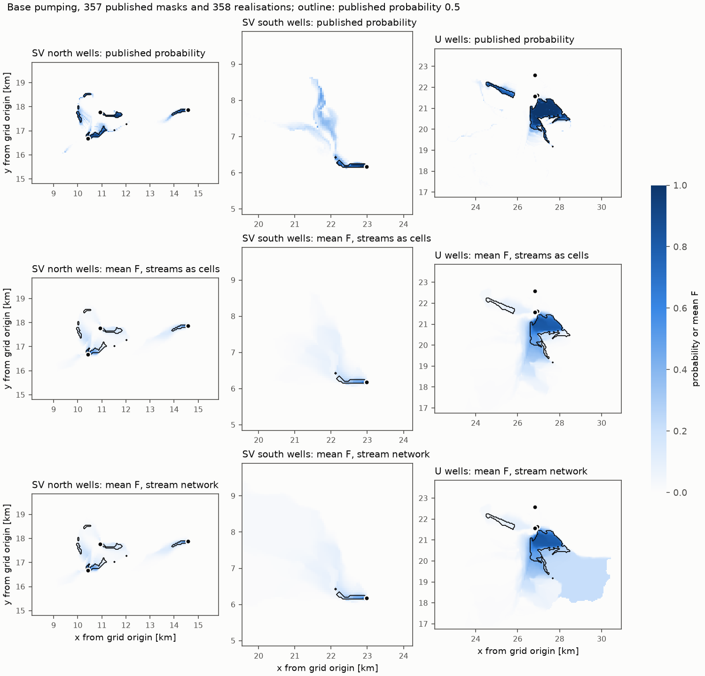
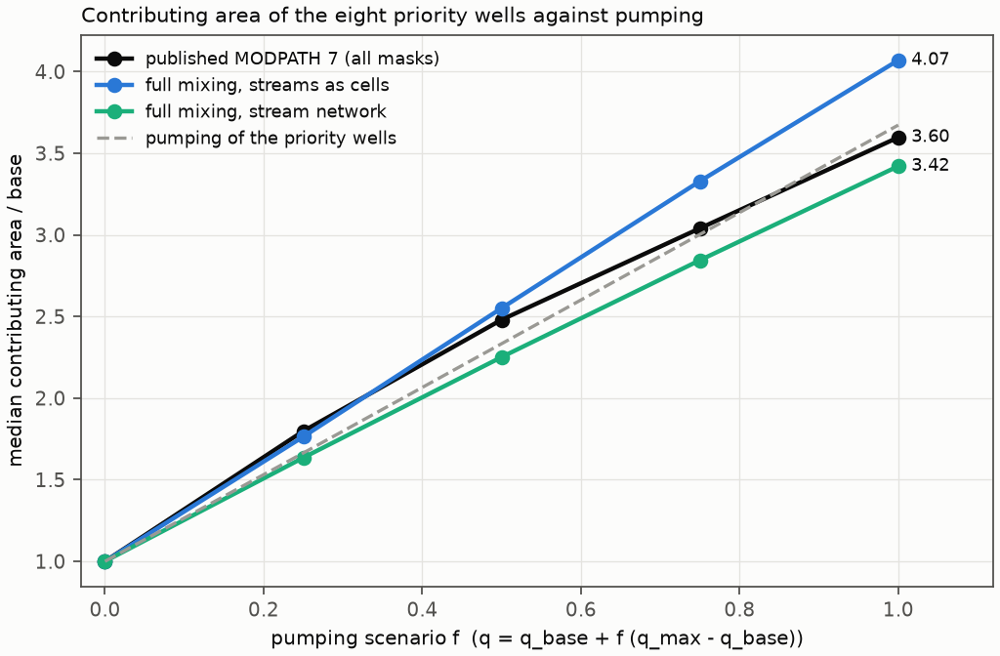

# Case study: priority-well capture in the Neversink/Rondout model

Phase 5 case study, 2026-10-02: stage 1 (calibrated model), stage 2 (358-realisation ensemble) and stage 3 (pumping scenarios). Code: `studies/neversink/workflow.py` (stage 1), `studies/neversink/pest_rebuild.py` (realisations), `studies/neversink/ensemble_run.py` and `studies/neversink/scenarios.py` (stages 2 and 3), `studies/neversink/figures.py`. Generated tables: `studies/neversink/output/` (not tracked).

## Summary

- **Model and benchmark.** The study runs full-mixing backward tracing [FB13, BF13] on the USGS Neversink/Rondout MODFLOW 6 model (1.68 million cells, 50 m) from the eight priority wells (3,671 m³/d). It compares the result with the published MODPATH 7 areas contributing recharge to the same wells.
- **Counts.** The cell counts are close: the sum of F over the particle start cells is 910, against 980 contributing cells in the published runs. 96 % of the well water enters the model in cells where the published particles start.
- **Cell by cell, agreement is moderate.** The Jaccard index with the published cells is 0.30 for F > 0.1, 0.41 for F > 0.5 and 0.41 for the same number of cells ranked by F. Particle tracking on the same flow field gives 0.29 to 0.62 depending on weak-sink treatment and release depth, and with thinning it captures the wells' inflow to 2 %. The published mask is one particle convention, not ground truth at cell level.
- **Streams.** With streams as cells, 43 % of the priority-well water is stream-reach leakage. With the 12,316 SFR reaches as nodes of the graph, all of it traces back to recharge. The contributing area then extends upstream along the streams, outside what a recharge-cell mask can show.
- **Ensemble.** Over the 358 realisations at base pumping, the mean F correlates with the published probability of contribution at 0.76 and gives 90 % of its expected area; the zones above 0.5 overlap with a Jaccard index of 0.43. The published masks could not be paired with single realisations (Section 6).
- **Pumping scenarios.** With the scenario rule inferred from the published masks, the median full-mixing area is within 10 % of the published median from base to maximum pumping (911 against 998 cells at base, 3,707 against 3,590 at maximum).
- **Cost.** The trace takes 2 to 3 s for nine destination groups; MODFLOW 6 takes 44 s. The ensemble (358 realisations, two traces each) took 76 min on six processes.

## 1. Model, benchmark and method

**Model.** The model is the calibrated ("optimal", base-parameter) USGS Neversink/Rondout model [FIE21, COR22]. It is public domain (CC0), from `github.com/usgs/neversink_workflow` and the USGS data release doi 10.5066/P9HWSOHP.

- MODFLOW 6, steady state, NEWTON, DIS 4 layers × 680 rows × 619 columns of 50 m (1,683,680 cells).
- Packages: RCHA, CHD, WEL (34 entries with boundnames) and SFR (12,316 reaches, with its own budget file).
- The input is from 2021 (MF6 6.2). It was re-run here with MF6 6.9 (development build) after renaming the IMS keywords `OUTER_HCLOSE`/`INNER_HCLOSE` to `*_DVCLOSE` and dropping `OUTER_RCLOSEBND`. `SAVE_SPECIFIC_DISCHARGE` and `SAVE_SATURATION` were added to the NPF package for the particle check.

**Benchmark.** The published MODPATH 7 runs are forward runs with weak sinks stopping particles, in three regions (NE, S, W) around the well clusters. One particle starts at the centre of each cell of the uppermost active layer (122,021 particles). A cell counts as contributing if its particle ends in one of the eight priority wells (SV_193, SV_227, SV_407, SV_487, U_917, U__55, U___7, U___8). Their total pumping is 3,671 m³/d.

**Comparison.** Each particle start cell is given the backward fraction F of that cell, the share of its water that reaches the wells. The MODPATH mask and F > threshold are then compared cell by cell. PRT checks use the Phase 3 helper (`gwsource.track_particles`) on the same flow field, with porosity 0.3 as in the published MODPATH files. Each particle carries the gross accounting along its path: in every cell it passes, the wells take their share of the cell's outflow from the particle's remaining weight. With `thin_weak_sinks=True` the cell's other sinks remove their share too; with `False` they do not, as in a plain particle run.

**Checks.**

| run | time (s) | max head difference to the published run (mm) |
|---|---|---|
| published solver settings | 44 | 8.6 |
| tight (OUTER_DVCLOSE 1e-4, INNER_DVCLOSE 1e-6) | 75 | 5.6 |

Both are below the model's own convergence criterion (0.01 m). The tight run is used only for the stream network (Section 4). The backward closure check (`gwsource.diagnostics.backward_closure`) is 1e-12 m³/d or smaller for every group, with streams as cells and as nodes.

## 2. Results: contributing cells



*Figure 1. F of the uppermost active cell for the eight priority wells (blue), with the published MODPATH 7 contributing cells (outline) and the wells (dots). Top: streams as cells. Bottom: SFR reaches as nodes. Windows: the north SV wells, the southern SV well, the U cluster.*

**Table 1. Priority wells together, versus the published cells (980)**

| measure | cells | Jaccard index |
|---|---|---|
| F > 0 | 50,703 | 0.02 |
| F > 0.1 | 2,139 | 0.30 |
| F > 0.5 | 445 | 0.41 |
| 980 cells with the largest F (F ≥ 0.28) | 980 | 0.41 |
| sum of F over start cells | 910 | – |

Every published cell has F > 0. Their mean F is 0.42. Of the 445 cells with F > 0.5, 417 (94 %) are published cells, which are 43 % of the published area. The F > 0.1 zone has 2,139 cells, about twice the published area, and contains 711 of the 980 published cells (73 %). Only 5 published cells have F > 0.9.

**Source water in the published cells.** The published cells receive 4,278 m³/d of source water (recharge 2,297 and stream leakage 1,981 m³/d), 17 % more than the wells pump. Not all of it can reach the wells. This is consistent with the stopping rule of the published runs: a cell contributes if its particle ends in a priority well, and a particle stops at the first weak sink it meets. The well takes only part of its cell's outflow where the cell also passes water on, for example 44 % in the cell of U___7 and 69 % in the cell of SV_487 (85 to 100 % in the other six). Full mixing lets the rest continue downstream.

**Table 2. Per well**

| well | pumping (m³/d) | published cells | sum of F | Jaccard F > 0.1 | Jaccard F > 0.5 | Jaccard, same number of cells |
|---|---|---|---|---|---|---|
| SV_193 | 63 | 48 | 26 | 0.37 | 0.00 | 0.30 |
| SV_227 | 203 | 115 | 69 | 0.29 | 0.16 | 0.25 |
| SV_407 | 94 | 32 | 34 | 0.29 | 0.16 | 0.60 |
| SV_487 | 381 | 97 | 65 | 0.18 | 0.04 | 0.17 |
| U_917 | 1,054 | 351 | 313 | 0.56 | 0.53 | 0.68 |
| U__55 | 250 | 116 | 81 | 0.06 | 0.00 | 0.13 |
| U___7 | 516 | 58 | 94 | 0.20 | 0.00 | 0.05 |
| U___8 | 1,110 | 163 | 229 | 0.10 | 0.00 | 0.22 |
| all eight | 3,671 | 980 | 910 | 0.30 | 0.41 | 0.41 |

The wells of the U cluster share cells and capture areas, and a published cell belongs to the one well its particle reaches. A cell that sends water to several wells therefore scores for one of them in the benchmark, and for all of them under full mixing. Per-well agreement is correspondingly low, and the union of the wells is the fair comparison. The sum of F is above the published count for U___7 and U___8 and below it for the other wells.

**Coverage.** 96 % of the priority-well water (95 to 100 % per well) enters in the start cells of the published particles. Water entering elsewhere (deeper layers, outside the three regions) is invisible to the published runs; it is small here.

## 3. Results: particle tracking on the same flow field

**Table 3. Agreement with the published cells (Jaccard, priority wells)**

| method | Jaccard | cells expected | captured flow (m³/d) |
|---|---|---|---|
| full mixing, F > 0.5 | 0.41 | 910 (sum of F) | 3,671 |
| PRT, spread over the cell volume, thinned, P > 0.5 | 0.62 | 794 | 3,736 |
| PRT, spread over the cell volume, plain, P > 0.5 | 0.29 | 2,857 | 9,555 |
| PRT, released at the water table, thinned, P > 0.5 | 0.39 | 592 | 2,413 |
| PRT, released mid-cell, thinned, P > 0.5 | 0.62 | 781 | 3,722 |

P is the flow-weighted share of the water released in a cell that reaches the wells, evaluated at the published start cells (uppermost active layer). "Plain" means no weak-sink thinning. Particles were released from every source term (flux-weighted) of the 30,180 cells with F > 0 that have one, in all layers, with one plan sub-division per cell (4 points), at four heights through the saturated thickness ("spread over the cell volume", 488,448 particles) or at one (122,112). Together these cells receive 90,349 m³/d. The captured flow is the PRT total, to be compared with the inflow of the wells, 3,671 m³/d.

- With the points spread over the cell volume and thinning, the particles capture 3,736 m³/d, 1.8 % more than enters the wells, and each well gets within 11 % of its rate (SV_227 180 of 203 m³/d, U___8 1,171 of 1,110, the others closer). That is the agreement the duality of the gross method leads one to expect: the totals match and the paths differ.
- Plain particles over-count the wells' water by a factor of 2.6 (2.1 to 2.5 for single-height releases). They pass every weak sink other than the wells without losing weight, so water that streams and other sinks take on the way is counted as reaching the wells. Thinning corrects this.
- The mean absolute difference between F and P over the seeded cells is 0.025 to 0.027 for thinned particles and 0.09 for plain ones; the maximum is 0.81 to 1.00.
- Which source supplies the wells differs between the methods: under full mixing 57 % of the water is recharge and 43 % stream leakage, along the particle paths 49 % and 51 %. A likely reason, not tested here, is that water from the losing reaches next to the U wells keeps to its streamlines along the particle paths, while under full mixing it mixes with recharge in each cell it passes. Either way it is a difference of method, not an error of either.
- Release depth matters at the water table only. Released there, particles in the top layer never leave it: the top face carries no flow, so their vertical velocity is zero. Wells in deeper layers then get little (U__55 28 of 250 m³/d, SV_193 none of 63), and the total is 2,413 m³/d. Mid-cell release and release spread over the volume agree (3,722 and 3,736 m³/d, Jaccard 0.62 for both).
- Thinning changes the agreement with the published cells more than anything else (0.62 thinned against 0.29 plain), because the benchmark stops particles at every weak sink. Thinned particles at mid-cell or spread over the volume agree best with it (0.62).

**Why the first PRT runs captured too little.** An earlier version of the PRT helper captured 1,940 m³/d (53 %, water table) and 3,005 m³/d (82 %, mid-cell) with thinning. Running PRT without a stop zone and evaluating both rules on the same tracks separates two defects of that version, both in the helper rather than in either method. This was a one-off evaluation, not part of `workflow.py`; its summaries are in `studies/neversink/output/prt_diagnosis/`.

| release | first well cell only (earlier rule) | weight followed on (current) |
|---|---|---|
| water table | 1,940 (53 %) | 2,413 (66 %) |
| mid-cell | 3,005 (82 %) | 3,722 (101 %) |
| four heights through the cell | 3,015 (82 %) | 3,736 (102 %) |

- **Weight dropped in partial well cells** (+720 m³/d, 20 % of the inflow). The earlier rule stopped a particle in the first well cell it entered and credited the well with the share d/O that the well takes of the cell's outflow; the rest was dropped. The well of U___7 takes 44 % of its cell's outflow, but 97 % of the water in that cell reaches a priority well (F = 0.97): most of what passes on flows to U___8 and U_917. Followed on, the particles credit U___8 with 609 m³/d and U_917 with 111 m³/d more. The helper now applies the gross accounting along the whole path: in each cell, the destination takes d/O of the remaining weight and the cell's sinks remove Snk/O; there is no stop zone.
- **Particles trapped at the water table** (−1,300 m³/d at the water table against mid-cell). MF6 spreads recharge and the other boundary sources over the cell volume, and PRT's velocity field matches that. The helper now releases at several heights through the saturated thickness by default.
- Ruled out: every particle ended in a cell with no exit face (status 5) with no weight left after its last cell, so no water was lost to other termination states, and no particle entered a cell twice, so thinning was applied once per cell.

On the 3-layer test model with a weak well upstream of a strong one, the same two defects gave 266 of 405 m³/d. The current helper gives 402.6 m³/d (a regression test, `tests/test_prt.py`).

Full mixing (0.41 for F > 0.5) lies inside the range of particle results (0.29 to 0.62) that the same flow field yields under different conventions. Its gap to the best particle convention is the difference between mixing and advective paths at cell level. It is not a shortfall of water: both close on the wells' inflow.

## 4. Streams

With streams as cells, SFR cells are just cells that exchange water with the aquifer. Of the priority-well water, 2,100 m³/d (57 %) traces to recharge, and 1,571 m³/d (43 %) to SFR leakage. By well, SFR provides a large share of the water of SV_487 (51 %), U_917 (38 %), U___7 (63 %) and U___8 (57 %), and almost none of that of SV_193, SV_227 and SV_407.

With the SFR reaches as nodes of the graph (`package_nodes=("SFR",)` in `gwsource.read_network`), leakage is traced up the stream to where its water entered. All 3,671 m³/d then traces to recharge, none to the stream's external inflow or to CHD. This is consistent with stream leakage being groundwater that discharged upstream and re-infiltrates. The contributing area extends upstream along the streams. In Figure 1 (bottom), this is the pale area south-east of the U wells, with F of about 0.2, and the larger low-F area around the southern SV well. A mask built from recharge cells' particle ends does not contain it.

**Network reader tolerance.** `read_network` requires the GWF and SFR budgets to agree on the aquifer exchange of every reach to a tolerance of 1e-4 of the largest reach flow. With the published convergence criterion (0.01 m), 3 of the 12,316 reaches miss it (largest disagreement 1.9e-4 of the largest exchange, 869 m³/d). A tighter solve (OUTER_DVCLOSE 1e-4, INNER_DVCLOSE 1e-6, heads within 5.6 mm of the published run) meets it. `open_simulation` and `read_network` take an `aquifer_rtol` option for this; the difference then stays in the reaches' budget residuals, which the closure check includes. With `aquifer_rtol=5e-4` the published run reads directly and gives the same result (all 3,671 m³/d from recharge). Closure of the network trace is 1e-12 m³/d. The closure error that would remain if the cells' budget residuals were ignored falls from 4e-3 m³/d (streams as cells, published solve) to 1.5e-5 m³/d (network, tight solve) for the eight wells together.

**Cycles.** With streams as cells the flow graph has no cycles, so the solve is a single topological sweep. With reaches as nodes it has 8 small cycles of 4 to 130 nodes (reaches mixed with the cells they exchange water with), which the block solver handles exactly. The trace takes 2.6 s.

## 5. Interpretation and guidance

- **The published mask is a convention.** It uses one particle at each cell centre and stops at every weak sink. It is a valid delineation, but at the scale of single cells it is not a reference that full mixing, or any other method, should reproduce exactly. On the same flow field, particles span 0.29 to 0.62 agreement with it, depending on weak-sink treatment and release depth, and full mixing (0.30 to 0.41) is inside that range.
- **Thresholds.** `docs/dispersion_study.md` Section 5 recommends F = 0.5 for an advective zone and F ≥ 0.1 as a conservative envelope. Here, the F > 0.5 zone (445 cells) is a core that lies almost entirely inside the published area (980 cells) and covers 43 % of it. The F > 0.1 zone (2,139 cells) is about twice the size of the published area and still misses 27 % of its cells, so it was not a conservative envelope at cell level, unlike in the dispersion study (one well, analytical or particle reference zone). The published area sits between the two. That guidance was derived against references that do not stop at weak sinks, and this case does not test it in that sense.
- **State the conventions.** Release depth and weak-sink treatment both change the agreement with the published mask substantially (Section 3). A comparison with it should state where particles start and what stops them.
- **Streams.** With streams as cells, 43 % of the wells' water is attributed to stream leakage and the contributing area stops at the streams. Whether that is the intended reading depends on the question: it is correct for "which source package delivers the water", and incomplete for "where does the water come from".

## 6. Stage 2: the ensemble at base pumping

**Ensemble.** The published PEST interface (`run_data/`) is not in the source repository, so it was rebuilt from the notebooks in `studies/neversink/pest_rebuild.py` without PEST++ or pyemu (pilot-point kriging of K, K33 and recharge, geology-zone multipliers, caps, streambed K, well multipliers). The rebuilt base realisation equals the published calibrated input. Realisations base, 0 and 280 reproduce the stored iES heads to 2 cm (median 0.3 mm) and the flows exactly; the published calibrated run differs from its own stored values by the same 2 cm. The Monte Carlo ensemble is the notebook's rejection sample of iES iteration 4: 358 realisations.

**Runs.** `studies/neversink/ensemble_run.py` writes, runs and traces every realisation in six processes (76 min in total; per realisation about 50 s of MF6 and 9 s for both traces) and keeps F of the uppermost active layer. Both traces use the published solver criterion; the stream network is read with `aquifer_rtol=1e-3` (Section 4). Closure holds in every realisation to 3e-12 m³/d. The wells' inflow ranges from 3,586 to 3,756 m³/d and the stream-leakage share (streams as cells) from 30 to 45 %.

**The published masks cannot be paired with the realisations.** The published masks were assumed to be in the order of the parameter table (mask i = row i). Under that pairing, F of a realisation agrees with its own mask no better than with its neighbour's (176 of 357 realisations agree better with their own, area-matched Jaccard 0.374 for both). In the S region, where the published area varies by 28 % between masks and the sum of F by 16 %, the two are uncorrelated (r = 0.002). The masks do follow the realisations in some other order: assigning masks to realisations independently from the NE region and from the W and S regions gives the same partner for 73 of 357 masks (about 1 by chance). That order was set by the scenario parameter files of the original Monte Carlo runs, which are not archived, and could not be recovered reliably. Comparisons of single realisations with single masks are therefore not reported; the comparisons below are between the two ensembles. The index order of the masks is consistent across the six pumping scenarios (Section 7), so comparisons between scenarios are unaffected.

**Table 4. Ensemble comparison at base pumping (357 published masks, 358 realisations, published start cells)**

| gwsource map | correlation with published probability | sum ratio | Jaccard, both > 0.5 |
|---|---|---|---|
| mean F, streams as cells | 0.76 | 0.90 | 0.43 |
| share of realisations with F > 0.5, streams as cells | 0.71 | 0.47 | 0.43 |
| mean F, stream network | 0.70 | 1.51 | 0.44 |

The sum ratio compares the expected number of contributing cells (sum of the map over the start cells). The mean F, the full-mixing counterpart of the published probability, gives 90 % of the published expected area, as in the calibrated model (Section 2). With the stream network the area is 1.5 times larger, because it includes the upstream area that feeds the losing reaches.



*Figure 2. Published probability of contribution (top) and gwsource's ensemble mean F with streams as cells (middle) and as a network (bottom), base pumping. Outline: published probability 0.5.*

The core zones agree; the differences are where the published probability follows narrow paths: the strip north-west of the U wells, where it is about 0.8 and mean F is low, and the band north-west of the southern SV well. These look like single-particle paths through cells that, under full mixing, send most of their water elsewhere. That reading has not been tested.

## 7. Stage 3: pumping scenarios

**Scenario rule.** The scripts that built the scenario ensembles are not archived. `studies/neversink/scenarios.py` infers the rule from the 6 × 357 published masks: only the eight priority wells change, with q = q_base + f (q_max − q_base), f = 0, 0.25, 0.5, 0.75 and 1 (baserat to maxrat) and, for maxrange, f drawn from U(0, 1) per well and realisation. In every realisation and region the published area grows monotonically from baserat to maxrat. The median area ratios fit this rule with a log rms of 0.05, against 0.36 for f × q_max (which would cut the U-cluster pumping below base at f = 0.25 while the published U area grows 1.7 times) and 0.18 for a geometric interpolation. The spread of the area in maxrange matches independent draws per well. The table footnote of the source repository says maximum rates were simulated only at the priority wells. Open: whether each realisation's own priority-well multiplier (0.93 to 1.08) was kept (the code replaces it), and the maxrange draws, which can be reproduced only in distribution.

**Runs.** The five scenarios were run on the same 60 realisations, evenly spread over the parameter table (300 runs, about 55 min).

**Table 5. Median contributing area (start cells) against pumping**

| scenario | f | pumping (m³/d) | published | full mixing, streams as cells | full mixing, stream network |
|---|---|---|---|---|---|
| baserat | 0 | 3,663 | 998 | 911 | 1,534 |
| 0.25rat | 0.25 | 6,095 | 1,794 | 1,607 | 2,508 |
| 0.5rat | 0.5 | 8,548 | 2,475 | 2,324 | 3,454 |
| 0.75rat | 0.75 | 11,001 | 3,034 | 3,033 | 4,365 |
| maxrat | 1 | 13,453 | 3,590 | 3,707 | 5,248 |
| maxrange | U(0, 1) | 8,632 | 2,413 | 2,319 | 3,464 |

Published: median over the 357 masks of the scenario; gwsource: median sum of F over the start cells (358 realisations at base, 60 otherwise).



*Figure 3. Median contributing area relative to base pumping. Dashed: the pumping ratio.*

With streams as cells, the full-mixing area is within 10 % of the published median in every scenario (−11 % at 0.25rat, +3 % at maxrat). It grows somewhat faster than pumping (4.07 times at 3.67 times the pumping), the published area and the network area a little slower (3.60 and 3.42 times). A likely reason, not tested, is the stream share: at higher pumping more of the wells' water comes from recharge in the capture area than from stream leakage near the wells. Against the published probability maps of the scenarios, the correlation of mean F rises from 0.76 at base to 0.80 to 0.82, and the Jaccard index of the zones above 0.5 lies between 0.43 and 0.49.

## 8. Limitations and open points

- The published masks cannot be paired with the rebuilt realisations (Section 6), so the comparison is between ensembles only.
- 4,470 of the 122,021 MODPATH particles of the calibrated model end with status 5. By the MODPATH 7 status convention this is a stop in a cell with no exit face; 514 of the 980 contributing particles are among them. This was not investigated.
- `baserat.zip` contains 357 masks against 358 realisations: the base realisation, the last row of the parameter table, has no mask.
- The scenario rule is inferred (Section 7); maxrange is reproduced in distribution only, and the scenarios were run on 60 of the 358 realisations.
- The comparison is on the uppermost active layer. Contributing areas in deeper layers are not compared.

## Reproducing

```
python studies/neversink/workflow.py
```

Stage 1 is `workflow.py`; the ensemble and the scenarios need `python studies/neversink/pest_rebuild.py` (about 3 min, rebuilds the interface) and then `python studies/neversink/ensemble_run.py` (about 2 h on 6 processes; resumable; outside the Claude Code sandbox, which blocks process pools). In each script the gates in `__main__` select the parts to run; in `workflow.py` they are the two MF6 runs, the MODPATH comparison, the PRT checks and the figures. The two MF6 runs take 44 s and 75 s. The two PRT runs released at four heights (488,448 particles) take about 13 minutes each and write a track file of about 6 GB; the two single-height runs (122,112 particles) take about 5 minutes and 1.5 GB. The workflow deletes the track files after use. Output goes to `studies/neversink/output/`, which is not tracked by git. The USGS repository goes in `studies/neversink/external/neversink_workflow/` (also not tracked) as a sparse checkout:

```
git clone --filter=blob:none --sparse https://github.com/usgs/neversink_workflow.git studies/neversink/external/neversink_workflow
cd studies/neversink/external/neversink_workflow
git sparse-checkout set neversink_optimal output/neversink_mf6_optimal_output \
  output/neversink_mp7_optimal_output output/modpath_mc output/parallel scripts \
  notebooks_workflow_complete neversink_mf6 processed_data python_packages_static
```

## References

Black & Foley (2013) [BF13]; Foley & Black (2013) [FB13]; full entries in `references/bibliography.md`. Pollock (2016) [POL16] for MODPATH 7.

[COR22] Corson-Dosch, N.T., Fienen, M.N., Finkelstein, J.S., Leaf, A.T., White, J.T., Woda, J. & Williams, J.H. (2022). *Areas contributing recharge to priority wells in valley-fill aquifers in the Neversink River and Rondout Creek drainage basins, New York.* USGS Scientific Investigations Report 2021–5112, 50 p. https://doi.org/10.3133/sir20215112

[FIE21] Fienen, M.N., Corson-Dosch, N.T., White, J.T., Leaf, A.T. & Hunt, R.J. (2021). Risk-based wellhead protection decision support: a repeatable workflow approach. *Groundwater*. https://doi.org/10.1111/gwat.13129

Model, workflow and data: U.S. Geological Survey, `github.com/usgs/neversink_workflow` (public domain, CC0-1.0) and its data release, doi 10.5066/P9HWSOHP.
