# Where does it come from and where does it go? Fast, open-source flow tracing for MODFLOW 6 models

**Article Impact Statement:** Open-source code turns saved MODFLOW 6 flows into contributing areas, water sources and travel times for any well or stream, in steady-state or transient flow, fast enough for ensembles.

**Abstract:** Groundwater studies often ask where water comes from and where it goes. Which land feeds a well, spring or stream? How much of a well's water is river water? Where does recharge under a polluted field end up? We present open-source code, `gwsource`, that answers such questions from the flows a MODFLOW 6 model saves. The code treats the water in each cell as fully mixed, like earlier methods. It computes the share of each cell's water that ends at a well, a stream or another outlet. The same trace splits a well's water by source and gives mean travel times. The code extends the method to every MODFLOW 6 grid type, stream network and linked model. It handles weak sinks. It carries tagged water through storage between time steps, forward and backward in time. Every result is checked against the flow model's water budget. The paper presents ten worked examples. Each checks an output a practitioner would use against other commonly used approaches. Results matched MODFLOW 6 transport to its solver tolerance with the same water volumes. They matched particle tracking in totals and mean travel times, not cell by cell at area edges. On a regional model of 1.68 million cells, tracing nine well groups took 2–3 s. That is small next to the model run itself. Tracing is cheap enough to include in history matching and similar analyses. Full-mixing areas are wider than particle-tracked areas. Particle tracking remains better where a sharp edge or first arrival matters.

**Key words:** flow tracing; full mixing; MODFLOW 6; contributing area; sources of water; travel time; transient tracking; ensemble; source protection

# 1. Introduction

Groundwater studies often ask where water comes from and where it goes. Which land feeds a supply well, a spring or a stream? How much of a well's water comes from a river, and how much was already stored in the aquifer? Where does the recharge under a polluted field end up? How old is the water when it arrives? Practitioners also need to know how the answers change through the year. They need to know how sure they can be of them.

Methods that answer these questions from a groundwater flow model fall into four families. Particle tracking follows particles of water along flow paths. Transport with tagged water follows the water from one source through time. Adjoint and age methods solve their own transport equations. Full-mixing flow tracing splits each cell's mixed water among its outflows.

Particle tracking is the standard tool for mapping a well's contributing area. This is the land where water enters the aquifer and later reaches the well. In MODFLOW models it runs in MODPATH (Pollock 2016) or in the particle-tracking model built into MODFLOW 6 (PRT; Langevin et al. 2026). Particles can also give the sources of a sink's water (Pryet et al. 2022). But particles need a rule at weak sinks. Sink terms are the boundaries that remove water from a cell, such as a pumping well or a gaining stream. A weak sink is a cell whose sink terms take only part of the cell's outflow. Because a particle cannot split, it must either stop at a weak sink or pass on. If it stops, all its water is counted as reaching the sink. If it passes, none of it is. The rule chosen changes the contributing area, as we show for a regional model in Section 5. Backward particle tracking through transient flows can also be awkward to set up and hard to interpret (Environment Agency 2019).

In transport with tagged water, the unit-concentration method gives the water from one source a concentration of 1 and all other water a concentration of 0. A cell's concentration is then the share of its water that came from that source (Bedekar et al. 2024). In MODFLOW 6 this runs in the Groundwater Transport (GWT) Model (Langevin et al. 2022). Each source needs its own transport model. As documented, the method steps forward in time only. So it gives the share of each cell's water that came from a source, but not the share that will later reach the well.

Adjoint and backward-transport methods give the probability that water at a well came from each location (Neupauer and Wilson 1999; Frind et al. 2002). Age methods give mean travel times (Goode 1996; Cornaton and Perrochet 2006). Both solve transport equations of their own, rather than working from the flows a MODFLOW model has saved.

Full-mixing flow tracing works from the flows a MODFLOW model has saved. It assumes that the water in each cell is fully mixed. A weak sink therefore needs no stop-or-pass rule. The sink takes its share of the cell's water. The rest passes on to the neighbouring cells. When the method works backward from a well, it gives each cell's backward fraction F. F is the share of the cell's water that ends at the well. A contributing area is the set of cells where F exceeds a chosen threshold, such as one half. When the method works forward from a source, such as recharge, it gives the share of each cell's water that came from that source.

To our knowledge, two full-mixing programs have been published. FlowSource (Foley and Black 2013; Black and Foley 2013) is used to draw source protection zones in England (Environment Agency 2019). These zones restrict activities that could pollute the water a supply well pumps. It counts all the water passing through a weak-sink well's cell as the well's water. We refer to this as net accounting. For transient models, FlowSource traces each time step as a steady-state flow field, with no water carried from one step to the next. We refer to such a trace as a snapshot. MODALL (Potter et al. 2008) computes full-mixing fractions for steady-state MODFLOW-88 models. At a weak-sink well it counts only the water the well pumps. We refer to this as gross accounting. As published, neither program reads MODFLOW 6 output. The FlowSource source code is available for academic use on request (Foley and Black 2013). A comparison of all these methods, with a source for each statement, is given separately (Supporting Information, Table S1).

This paper presents open-source code, `gwsource`, that extends the full-mixing method of FlowSource to the flows a MODFLOW 6 Groundwater Flow (GWF) model saves. It reads every MODFLOW 6 grid type and simulations made of several linked models. It also traces water through package networks, such as the stream reaches of the Streamflow Routing (SFR) package. We define gross accounting as the default. Net accounting is kept so that FlowSource studies can be reproduced. Every result comes with budget checks. For example, the traced volumes must add up to the well's pumping. For transient models, the code carries tagged water through storage from step to step, as GWT does. We refer to this as transient tracking. It can also run backward in time, from the end of the simulation to its start. It then maps the area whose water reaches the well within a stated time. With a porosity, the code also gives the mean travel time of the water to the well. The method is also fast. One trace of a regional model of 1.68 million cells takes seconds. This matters for risk-based studies, which run an ensemble of model versions that fit the measurements about equally well (Fienen et al. 2022). The code traces every version in an ensemble and summarises the results as it goes. One summary is the share of versions in which each cell sends water to a well.

Sections 2 and 3 describe the method and the software. Section 4 then works through ten small examples. Each answers one of the questions above and shows the output a practitioner would use. Where another approach can answer the same question, the example compares the two. Section 5 applies the code to a published regional model (Corson-Dosch et al. 2022; Fienen et al. 2022). Section 6 sets out the trade-offs of full mixing, including when particle tracking or transport is the better choice.

# 2. Method in brief

This section defines the quantities the code computes. The derivations and the solution of the equations are given in the Supporting Information (Supporting Information, Text S1).

## 2.1 Full mixing and the cell budget

Full mixing treats each active model cell as one well-mixed volume of water (Section 1). The water in a cell leaves through each of its outflows in proportion to the size of that outflow.

Cells exchange water through the cell-to-cell flows of the MODFLOW 6 budget file (FLOW-JA-FACE; Langevin et al. 2017). The flow from cell $i$ to its neighbour $j$ is $q_{ij} \ge 0$. All other budget terms, such as recharge, wells, rivers and storage, are kept separate by package and boundary. A term that brings water into a cell is a source term. A term that takes water out is a sink term. If $\mathrm{Src}_i$ and $\mathrm{Snk}_i$ are the totals of a cell's source and sink terms, its total inflow, total outflow and cell budget error are (Fig. 1a)

$$I_i = \sum_j q_{ji} + \mathrm{Src}_i, \qquad O_i = \sum_j q_{ij} + \mathrm{Snk}_i, \qquad r_i = I_i - O_i. \tag{1}$$

The cell budget of a MODFLOW model never balances exactly, so $r_i$ is small but not zero.

A trace follows water to or from the boundary conditions the user selects. Water can be traced backward to a destination, such as the pumping of one well. Several wells, such as those of a wellfield, can be treated as one destination group. Water can also be traced forward from a source, such as recharge. The outflow of cell $i$ through the destination is $d_i$. The inflow of cell $i$ through the source is $s_i$.

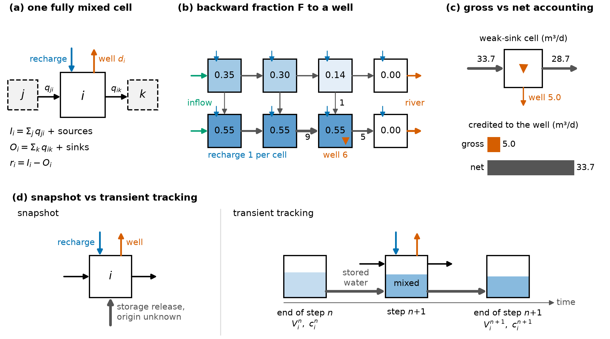

**Figure 1.** Full-mixing flow tracing. (a) A fully mixed cell $i$ with cell-to-cell flows, recharge (source term) and a well (sink term, $d_i$). These define $I_i$, $O_i$ and $r_i$ (Eq. 1). (b) Backward fractions $F$ (in cells) to a 6 m³/d well in an eight-cell example (gross accounting). Water enters on the west and as recharge. It leaves through the well and a river. Arrow widths show flows. Only the well cell's flows are numbered (m³/d). In the well cell, $F = 6/11 = 0.55$. (c) Water attributed to a weak-sink well pumping 5.0 m³/d in a three-layer example model: 5.0 m³/d (gross accounting) or 33.7 m³/d (net accounting; Section 2.4). (d) Left: a snapshot traces one step on that step's flows. Storage release is a source of unknown origin. Right: transient tracking carries a cell's water volume $V_i$ and tagged fraction $c_i$ (shading) from step $n$ to $n+1$ (Section 2.7).

## 2.2 Backward and forward fractions

The backward fraction $F_i$ tells where a destination's water comes from. It is the share of the water leaving cell $i$ that later leaves the model through the destination. Because the cell is fully mixed, all its outflows carry the same water. So

$$F_i = \sum_j \frac{q_{ij}}{O_i}\, F_j + \frac{d_i}{O_i}. \tag{2}$$

In words: the share of a cell's water that reaches the destination is the share that leaves directly through it plus the outflow-weighted mean of the shares of its downstream neighbours. Fig. 1b works through an eight-cell example.

Let $P_{ij} = q_{ij}/O_i$ be the share of cell $i$'s outflow that goes to cell $j$. Written for every cell at once, Eq. (2) becomes

$$(\mathbf{I} - \mathbf{P})\,\mathbf{F} = \mathbf{S}\,\mathbf{D}. \tag{3}$$

Here $\mathbf{I}$ is the identity matrix. $\mathbf{S}$ holds the share of each cell's outflow that leaves through each of its sink terms. $\mathbf{D}$ marks which sink terms belong to which destination group. Each column of $\mathbf{F}$ holds the fractions to one destination group, so one solve gives every group.

The forward fraction $G_i$ tells where a source's water goes. It is the share of the water entering cell $i$ that came from the source. It follows in the same way from the inflow shares $Q_{ij} = q_{ji}/I_i$ as

$$(\mathbf{I} - \mathbf{Q})\,\mathbf{G} = \mathbf{R}\,\mathbf{T}. \tag{4}$$

$\mathbf{R}$ holds the share of each cell's inflow that enters through each source term. $\mathbf{T}$ marks which source terms belong to which source group.

Equations (3) and (4) are each one system, with one equation per cell. Because of the way water flows, the code does not need a general solver for them. A cell's F depends only on the F of the cells its water flows into. If the cells are ordered from the destination upstream, each cell depends only on cells that are already solved. The system can then be solved one cell at a time, by substitution. This gives the same F as a general solver of the whole system. G is solved in the same way, from the sources downstream. The ordering fails only in a flow loop. A flow loop is a small group of cells in which water circulates and returns to where it started. Loops can occur, for example, with the XT3D option of MODFLOW 6 (Provost et al. 2017). The cells of a loop depend on each other. The code therefore solves them together, as one small set of equations. It solves the rest one cell at a time. The result is still the exact solution of the whole system (Supporting Information, Text S1). In Section 4.4 it agrees with a general solver to 3.3 × 10⁻¹⁶.

## 2.3 Volumes

A fraction says what share of a cell's water reaches the destination, but not how much water that is. A fraction times a flow gives a volume of water per unit time. The volume through cell $i$ is $F_i O_i$. It is the part of the water passing through the cell that reaches the destination.

The volume from cell $i$ is $F_i$ times the cell's inflow through its source terms. It is the water entering the model in that cell that reaches the destination. Summing the volume from over all cells, package by package, splits the destination's water by source (Section 4.1). A forward trace gives the matching volumes from $G$. They split a source's water by where it leaves the model (Section 4.3).

## 2.4 Gross and net accounting

At a weak sink, Eq. (2) needs a rule for how much of the cell's water to attribute to the sink (Section 1). The code uses gross accounting by default. Each sink term then takes its share of the cell's total outflow. The rest passes on to the neighbours. Only the water a well pumps is counted as the well's water, as in a transport model.

Net accounting attributes to a sink all the water that passes through its cell. The destination cells are then fixed at $F = 1$. In the example of Fig. 1b, gross accounting gives the well the 6 m³/d it pumps. Net accounting adds the 5 m³/d that flow on through the well cell to the river. At a small well, the difference can be several times the pumping (Fig. 1c; Section 4.2).

## 2.5 Water-budget checks

Each trace comes with checks that the traced volumes agree with the flows the model saved. Each check must hold exactly, because it follows from adding up the cell equations. The first is the backward closure check

$$\sum_i F_i\, \mathrm{Src}_i - \sum_i F_i\, r_i = \sum_i d_i. \tag{5}$$

It says that the source water traced to the destination, corrected for the cell budget errors, adds up to the water the destination takes. The forward closure check is its mirror image for a source. The forward–backward check is

$$\sum_i F_i\, s_i - \sum_i G_i\, d_i = \sum_i F_i\, G_i\, r_i. \tag{6}$$

So the volume from a source to a destination is the same whether it is traced backward or forward, once the cell budget errors are included. A third check, the boundary-control check, is described with the example of Section 4.2.

The checks test that the fractions were solved correctly from the flows that were read. A large error in a check points to a fault in the tracing. The checks cannot show that the flow model is right. Nor can they show that full mixing describes how water moves in the aquifer.

## 2.6 Mean travel time

Fractions say how much water arrives, not when. Let $V_i$ be the volume of water in cell $i$. It is porosity times the saturated volume of the cell. Fractions need no porosity, but travel times do. The mean residence time of cell $i$ is $\tau_i = V_i/O_i$. The mean travel time from entering cell $i$ to leaving the model through the destination is then $m_i/F_i$, where

$$(\mathbf{I} - \mathbf{P})\,\mathbf{m} = \boldsymbol{\tau} \circ \mathbf{F}. \tag{7}$$

Here $\circ$ is the cell-by-cell product. Each cell adds its own residence time, weighted by its $F$. The sum then passes upstream with the outflow shares. A mean travel time averages fast and slow water that have mixed in the cells, so it is not a first-arrival time (Section 4.6).

## 2.7 Transient flow: snapshots and transient tracking

In a transient model, the water reaching a well depends on what happened in earlier time steps. A snapshot ignores this. It traces each time step on its own flows, as if they were a steady-state flow field. It treats storage release as a source term and storage gain as a sink term (Fig. 1d, left). A snapshot therefore assumes that water reaches the well in the same step it entered. Water recharged in the wet season cannot appear at the well in the dry season. We refer to this as having no travel lag. Snapshots also cannot say where the water released from storage came from. Section 4.5 shows snapshots of a seasonal model.

Transient tracking extends full mixing through time. Water from the chosen sources is tagged, as a tracer would be. The tagged water is carried through storage from step to step (Fig. 1d, right). Storage terms change a cell's water volume from $V_i^{\mathrm{old}}$ at the start of a step to $V_i^{\mathrm{new}}$ at its end. Let $c_i$ be the share of a cell's water that is tagged. Step $n$ of length $\Delta t$ is then

$$V_i^{\mathrm{new}} c_i^n - V_i^{\mathrm{old}} c_i^{n-1} = \Delta t \Big[ \sum_j q_{ji}\, c_j^n + s_i^n - (O_i + r_i)\, c_i^n \Big], \tag{8}$$

where $O_i$ now leaves out storage. A cell's tagged water at the end of a step is its tagged water at the start, plus arrivals from upstream cells and source terms, less what leaves at the cell's end-of-step mix. The step is solved as in GWT, without dispersion (Langevin et al. 2022). Transient tracking needs porosity and the budget of every time step. The water in the model at the start of the simulation can be tagged as its own group. We refer to it as initial water.

Forward tracking cannot tell which of the water now in the aquifer will reach the destination, and by when. Backward tracking in time answers that question. For each time step, it solves the backward counterpart of Eq. (8). It starts at the last step of the simulation and ends at the first (Supporting Information, Text S1). This differs from MODPATH backward tracking, in which particles start at the sink and move against the flow. The result is the backward fraction in time $w_i^n$. It is the share of the water in cell $i$ at the start of step $n$, or entering it during the step, that leaves through the destination before the simulation ends. A map of $w$ is a time-limited contributing area (Sections 4.8 and 4.10).

# 3. The software

The method of Section 2 is implemented in `gwsource`. It is an open-source Python package (MIT licence) that works on the output of a MODFLOW 6 run. Table 1 lists its inputs, selections and outputs, each with the example in Section 4 that shows it.

**Table 1.** What the code reads, how destinations and sources are chosen, and what it returns. The last column gives the worked example in Section 4 that shows each item. MODFLOW 6 option names are given where a user must set them.

| | Item | What it is or needs | Shown in |
|---|---|---|---|
| **Inputs** | Binary grid file | Cell connections of a DIS, DISV or DISU grid. Written by MODFLOW 6 by default | §4.1, §4.4 |
| | GWF budget file | Cell-to-cell flows and every source and sink term. SAVE_FLOWS in each package, budget saved in Output Control | §4.1 |
| | Every time step saved | Needed for transient tracking (SAVE BUDGET ALL) | §4.8, §4.10 |
| | Saturated thickness | For travel times and transient tracking. NPF SAVE_SATURATION, or the head file | §4.6, §4.8 |
| | Porosity | Given by the user. Needed for travel times and transient tracking, not for fractions | §4.6, §4.8 |
| | Package budget files | SFR, LAK, MAW, UZF and MVR budgets (BUDGET FILEOUT), to trace through package networks | §4.7 |
| | Linked models | GWF models joined by exchanges, read as one system (SAVE_FLOWS in the exchange) | §4.7 |
| **Selections** | Package | All terms of a package, such as all recharge or all wells | §4.1, §4.3 |
| | Boundname | Terms with a given boundname, such as one well. Read from the package input files | §4.1 |
| | Boundary number | Terms with given boundary numbers in a package | – |
| | Cells | All terms in the given cells (gross accounting), or the cells themselves (net accounting) | §4.2 |
| | Zone | Cells with a given zone value, alone or with a package, such as the recharge on one field | §4.3, §4.4 |
| **Outputs** | Backward fraction F | Share of each cell's water that ends at the destination | §4.1 |
| | Forward fraction G | Share of each cell's water that came from the source | §4.3 |
| | Volumes | Volume through, volume from and volume to, and their split by package | §4.1, §4.3 |
| | Gross and net accounting | Water attributed to a weak-sink well under each rule. Boundary-control maps | §4.2 |
| | Budget checks | Closure, forward–backward and boundary-control checks with every trace | §4.1–§4.3 |
| | Mean travel time | Mean time to the destination under full mixing | §4.6 |
| | Snapshot statistics | Minimum, mean and maximum F over time steps. Cells always, sometimes or never above a threshold | §4.5 |
| | Transient tracking | Tagged fractions c (forward) and w (backward in time). Destination's water by source, time step and initial water | §4.8, §4.10 |
| | Ensemble statistics | Mean, probability of exceeding a threshold, and exact or histogram quantiles over realisations | §4.9 |
| | PRT release points | Particle runs on the same flows, for comparison | §4.6 |
| | Export | NumPy and netCDF files (§4.1). GeoPackage polygons for GIS (§4.4) | §4.1, §4.4 |

## 3.1 Workflow

In a typical session, the user runs MODFLOW 6 with the flows saved and reads one time step of the flows into Python. The user then selects the destinations or sources and traces them. The trace returns the outputs with their budget checks. The lines below trace the well of Section 4.1 back to its sources.

```python
import gwsource as gs

step = gs.read_step("model", boundnames=True) # grid and flows of one time step
well = gs.select(step, boundnames=["supply_well"]) # the destination
res = gs.backward(step, {"supply_well": well}) # backward trace
F = res.fraction_through["supply_well"] # F in every cell
by_source = {p: v.sum() for p, v in res.volume_from_by_term["supply_well"].items()}
check = gs.diagnostics.backward_closure(step, res, "supply_well")
print(by_source, check.relative_error) # m3/d by package; closure check
gs.export.to_netcdf("supply_well.nc", step, res)
gs.export.to_geopackage("supply_well.gpkg", step, res)
```

A forward trace from a source uses `gs.forward` in the same way. Transient snapshots, transient tracking and ensembles have functions of their own that take the same selections (Table 1).

## 3.2 Inputs and selections

The code reads MODFLOW 6 output, not the model's input files. It needs the binary grid file and the budget file of the GWF model, on any grid type. The flows are saved with the SAVE_FLOWS option in each package and with the budget saved in the Output Control file. Transient tracking needs the budget of every time step (SAVE BUDGET ALL). Travel times need the saturated thickness of each cell, taken from the saturation saved by the Node Property Flow package or from the head file.

Where a package passes water to the water mover (MVR), the code reads both of its budget records. A budget term that is not read shows up as a large cell budget error. Stream reaches (SFR), lakes (LAK), multi-aquifer wells (MAW) and unsaturated-zone cells (UZF) can be added as extra cells from their own budget files. Water is then traced along streams and through lakes and wells. The code checks that the budget of each such package agrees with the aquifer budget. GWF models joined by exchanges are read as one system.

Destinations and sources can be chosen by package, by boundary number, by boundname, by cells or by a zone array. They can be combined, for example to trace the recharge on one zone forward as one source (Section 4.3). Any number of groups can be traced together. Boundnames are read from the package input files, because the budget file does not hold them.

## 3.3 Outputs

A trace of one time step returns $F$ or $G$ in every cell, the volumes of Section 2.3 split by package, and the budget checks. With a porosity, it also returns mean travel times. Snapshots, transient tracking and ensembles add statistics over time steps or over the model versions of an ensemble (Table 1). Outputs export to NumPy files, to netCDF files with units and a record of the model files and options, and to GeoPackage polygons for GIS. The code can also write release points for MODFLOW 6 particle tracking (PRT). Full mixing and particles can then be compared on the same flows (Section 4.1).

## 3.4 Compute cost and testing

Cost decides whether a trace can be repeated for every realisation of an ensemble. Section 5 gives the run time on a regional model. Memory grows with the number of cells and of destination groups. On the model of Section 5, with 1.68 million cells, a trace of nine destination groups peaked at 2.5 GB (Apple M4 Max, 64 GB). Each further group added about 0.19 GB. Wells can be traced in batches on smaller machines.

The package comes with automated tests on ten small test models and on two published examples. These are the worked example of Foley and Black (2013) and the unit-concentration example of Bedekar et al. (2024). A further test runs all ten example notebooks of Section 4. The tests run the budget checks of Section 2.5. They also compare the results with MODFLOW 6 GWT and PRT, between grid types, and between one model and the same model split into several (Supporting Information, Figure S1).

# 4. Worked examples

Each example in this section answers one question about a supply well. All of them start from one small example model, so that results can be compared from one example to the next. The model is a single unconfined layer, 2 km × 2 km, made of 40 × 40 cells of 50 m. Its top is at 20 m and its bottom at −30 m. The hydraulic conductivity is 5 m/d. Recharge of 5 × 10⁻⁴ m/d falls on every cell. A constant head of 10 m along the west edge brings in regional groundwater. A river with a stage of 6 m runs north–south through column 31. A supply well pumps 800 m³/d from row 21, column 29, 100 m west of the river. Rows and columns are counted from 1, from the north-west corner. Each example changes this model only where its question needs it. The full set-up of every example model is given separately (Supporting Information, Text S2). Each example ships as a runnable notebook that reproduces its numbers and figure (Section 8). Each subsection gives the change to the shared model, the output a practitioner would use, a check against another approach and a limit that the example shows.

## 4.1 Where does the well's water come from?

A protection zone starts from the land whose water reaches the well. This example traces the well backward on the unchanged shared model. The trace gives F in every cell. F is the share of a cell's water that ends at the well (Section 2.2).

Fig. 2a maps F. The contributing area runs from the well back to the west edge. Cells with F > 0.5 send more than half their water to the well. They cover 1.143 km². Cells with F > 0.1 send more than a tenth. They cover 1.575 km². Between the two contours, full mixing spreads the area's edge over a few cells. A narrow tail of F also crosses the river. In this one-layer model the river cells are weak sinks (Section 1). Full mixing passes the water they do not take on toward the well. A threshold-free measure of size is the sum over all cells of F times the cell area. We refer to it as the expected area. Here it is 1.173 km².

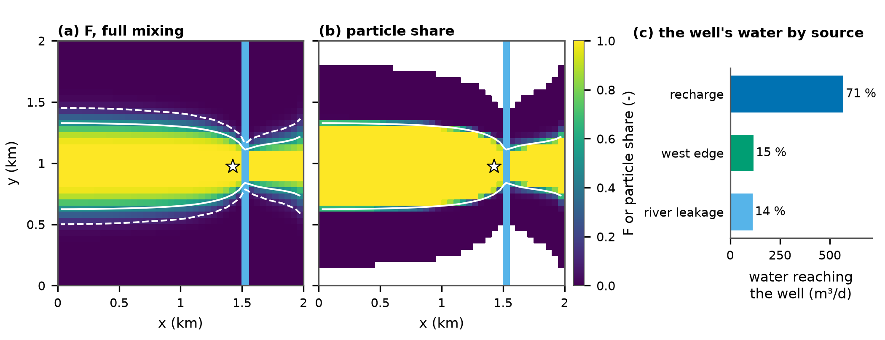

**Figure 2.** Where the well's water comes from in the shared example model (Section 4.1). F is the share of a cell's water that ends at the well. Star: supply well. Blue cells: river. (a) F in every cell, from 0 (dark purple) to 1 (yellow). Dashed white line: F = 0.1. Solid white line: F = 0.5. (b) Particle share in each release cell, on the colour scale of (a). The particle share is the share of the water released in a cell that weight-losing PRT particles deliver to the well. White line: F = 0.5 from (a), for comparison. Cells without particles are blank. (c) The well's water by source: recharge, inflow at the west edge and river leakage. Labels give each source's share.

The same trace splits the pumped water by source (Fig. 2c). Of the 800 m³/d, 71 % is recharge, 15 % enters at the west edge and 14 % leaks from the river. The river share is the number a study of riverbank filtration would need. The traced sources add up to the 800 m³/d pumped, as the closure check requires (Section 2.5). That check tests the solve but not the position of the area's edge.

Particle tracking with PRT answers the same question by another method, on the same flows. Particles start from every source term in cells with F > 0. Each particle carries a share of its source's flow as a weight. It loses weight at every other sink it passes, in proportion to the flow that sink takes. Visser et al. (2009) split particles at weak sinks in a similar way to derive travel times. Winston et al. (2018) reduce particle weights at sinks in a solute-transport method. We refer to these as weight-losing particles. They are a feature of gwsource. One function, `track_particles`, seeds them from a backward trace, runs MODFLOW 6 PRT on the same flows and returns the particle share of each cell. A user can therefore check a full-mixing area against particles without setting up PRT by hand. The particle share of a cell is the weight that reaches the well over the weight released there. The particles deliver 799.9 of the 800 m³/d pumped. That total says little about the area, because particles that conserve water must deliver what the well pumps. The cells with a particle share above 0.5 cover 1.168 km². The F > 0.5 area is 2.1 % smaller. The F > 0.1 area is 35 % larger and contains every cell of the particle area. Cell by cell, the particle share and F differ by 0.058 on average. In the 372 cells with F between 0.05 and 0.95, they differ by 0.164 on average (Fig. 2b). In those cells, most particles either reach the well or miss it. Full mixing gives the cell an in-between value.

Because full mixing spreads the edge, the threshold on F that draws an area is a choice. Tests on two simple problems compared full-mixing areas with reference areas (Supporting Information, Figure S2). The first is a well in uniform regional flow. Its capture zone is known analytically (Javandel and Tsang 1986). The second is a one-layer model with recharge, a river and a well. Its reference area comes from PRT particles. Each problem was run on regular and Voronoi grids with cells of 12.5 to 200 m. On cells of 50 m or less, the F > 0.5 area was within 5 % of the size of the reference area. On cells of 12.5 to 50 m, the F > 0.1 area missed at most 0.1 % of the reference area. It was 8 to 90 % larger. Section 6 discusses how to choose.

## 4.2 How much water should be attributed to a small well?

The two accountings of Section 2.4 differ only at weak sinks. A small well in strong regional flow is a weak sink. Its cell passes most of its water on to the neighbouring cells. This example shows how much the choice of accounting changes the water attributed to such a well. The shared model is split into three layers, of which the middle one is the least permeable (Supporting Information, Text S2). The supply well pumps 800 m³/d from layer 3. A second, small well pumps 5 m³/d from layer 3 at row 17, column 13, upgradient of the supply well.

The small well's cell carries 33.7 m³/d. The well pumps 5 m³/d of it. Gross accounting counts only these 5 m³/d as the well's water. F in its cell is then 5/33.7 = 0.149. Net accounting fixes F = 1 in the cell. It attributes all 33.7 m³/d to the well. This is 6.7 times what the well pumps. Both accountings find the same flow path, a narrow strip along row 17 from the west edge to the well (Fig. 3b, c). Under net accounting, 93–99 % of the water in layer 3 along that strip is assigned to the small well. Under gross accounting, 82 % of the water in the small well's cell flows on to the supply well. The supply well pumps all the water that flows into its cell. It is therefore not a weak sink. For this well the two accountings agree. Gross accounting treats the well as a transport model does. Net accounting remains an option, for comparison with studies that used it.

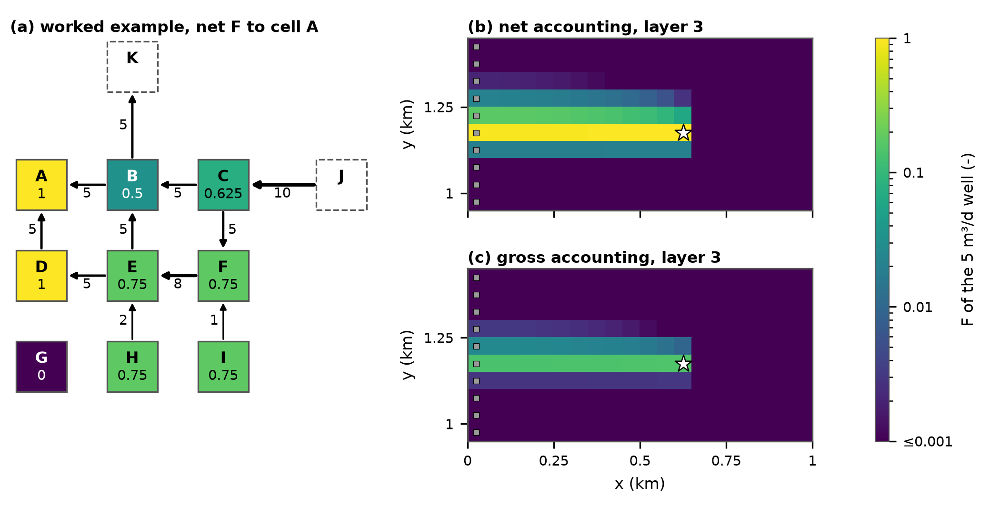

**Figure 3.** The worked example of Foley and Black (2013) and a small well in the three-layer example model (Section 4.2). (a) The worked example: a block of 3 × 3 cells, A to I, with flows between them (arrows) and cell A as the destination. J and K (dashed) stand for the area outside the block. Shading: F under net accounting, as in the published example. (b, c) F of the 5 m³/d well in layer 3, under net accounting (b) and gross accounting (c), in a window around the well. Both panels use the same logarithmic colour scale, from dark purple to yellow. Values below 0.001 take the darkest colour. Star: the 5 m³/d well. Square: constant-head cells on the west edge.

Two checks test the code. The first is independent. It uses the worked example that Foley and Black (2013) give to explain FlowSource. It is a block of 3 × 3 cells with given flows and one destination cell (Fig. 3a). Net accounting reproduces their published fractions, volumes through and volumes from in every cell to 1 × 10⁻¹⁴. The second check is internal. Each sink package is traced as its own destination. The fractions to all sinks must then add up to 1 in every cell with outflow. We refer to this as the boundary-control check. Here the fractions add up to 1 within 1 × 10⁻¹⁵. The same traces give boundary-control maps. Each map shows the share of every cell's water that leaves through one sink.

## 4.3 Where does each source's water go?

Some questions start at a source rather than at a receptor, such as a well, a spring or a stream. A water-quality study may ask how much river water, or how much recharge from one field, reaches a receptor. A forward trace answers it. It gives G in every cell. G is the share of a cell's water that came from the source (Section 2.2). The model is the shared model, unchanged.

River water enters the aquifer only through the reaches in rows 19 to 23, where pumping draws the water table below the river stage. From there it spreads to the well (Fig. 4a). All 113 m³/d that the river loses reaches the well. Of the regional inflow at the west edge, 37 % reaches the well. Of the recharge, 29 % reaches the well and 71 % drains to the river (Fig. 4c). G in the well cell gives the pumped water by source. The shares are 14 % river water, 15 % regional inflow and 71 % recharge, as the backward trace of Section 4.1 found.

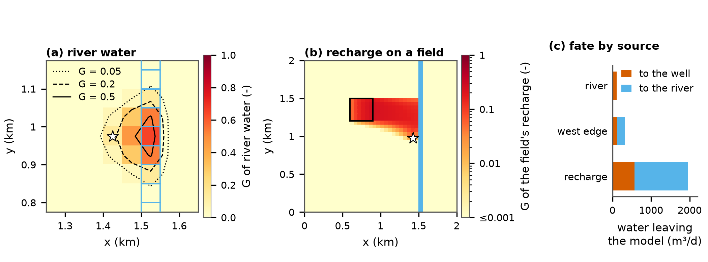

**Figure 4.** Where the water from each source goes in the shared example model (Section 4.3). G is the share of a cell's water that came from the source. Star: supply well. River cells: blue outline in (a), blue fill in (b). (a) G of river water near the well, from 0 (pale yellow) to 1 (dark red). Contours at G = 0.05, 0.2 and 0.5. (b) G of the recharge on a 300 m × 300 m field (black square), on a logarithmic scale from pale yellow to dark red. Values below 0.001 take the lightest colour. (c) Fate of the water from each source: the volume that leaves through the well and the volume that leaves through the river.

A source can also be one zone. Here it is the recharge on a 300 m × 300 m field in rows 11 to 16 and columns 13 to 18. The field receives 45 m³/d of recharge. Of this, 39 % reaches the well and the rest drains to the river (Fig. 4b). For a solute that does not react, G is the ratio of the concentration in a cell to the concentration at the source. Suppose the field's recharge carried 50 mg/L of nitrate. The well would then pump 1.11 mg/L at equilibrium. Several sources mix in the same way. With invented chloride concentrations of 80 mg/L in the river, 25 mg/L at the west edge and 5 mg/L in recharge, the well would pump 18.6 mg/L. These are long-run values. G gives no arrival time and ignores reactions.

The forward–backward check requires the volume from each source to the well to be the same from either direction (Section 2.5). Here the two directions agree to better than 1 × 10⁻⁶ m³/d. The difference equals the cell budget error term of Eq. (6). The independent check is MODFLOW 6 GWT. A GWT model gave river leakage a concentration of 1 and all other inflow a concentration of 0. It used upstream weighting and no dispersion. It ran for 10⁶ days, until the concentrations stopped changing. Its final concentrations equal G in every cell to 4.2 × 10⁻¹³.

## 4.4 Does it work on my grid?

MODFLOW 6 models are not limited to regular grids. Some use Voronoi grids refined around wells and rivers (DISV) or fully unstructured grids (DISU). Some use the XT3D option of MODFLOW 6 for anisotropy. This example builds the shared model on four grids. The first is the regular grid (DIS). The second is a Voronoi grid (DISV) made with vorflow (Hugman and Sanchez 2026), a Python package that builds Voronoi grids for MODFLOW 6. Away from the well and the river, its cells are about 50 m across, like the regular cells. They shrink to about 10 m at the well and to 12.5 m along the river. The grid has 3,241 cells. The last two grids hold the regular cells written as DISU, with and without cell vertices. The same lines of code trace the well on each grid.

The two DISU models have the same cells and connections as the DIS model. Their F is identical to the DIS result in every cell. Without cell vertices, a DISU model gives fractions and volumes but no maps or GIS polygons. PRT runs only on DIS and DISV grids. A particle check of the edge is therefore not available on DISU grids. The Voronoi model is a different model of the same aquifer (Fig. 5a, b). Its contributing area has the same shape and reach. Its expected area is 0.4 % larger, 1.178 against 1.173 km². On the north side of the area at x = 0.5 km, F falls from 0.5 to 0.1 over 186 m on the Voronoi grid, against 121 m on the regular grid. Because the water flows along the rows of the regular grid, each of its cells passes nearly all its water to one neighbour. Each Voronoi cell splits its water among two or three downstream cells, because its faces lie at many angles to the flow. We read the wider edge as a sideways spread of F by these splits. This numerical dispersion comes from the grid, not from the aquifer (Section 6). On a grid of 47 m squares turned by 45° to the flow, the edge of the same model is 215 m wide. On a Voronoi grid with cells of about 25 m, it is 126 m wide. On both grids the well's cell is centred on the well. The river cells are centred on the river line on both grids too. So the nearest river cell centre is 100 m from the well's cell centre on both grids. The river supplies 14 % of the pumped water on both grids. The largest difference is at the west edge. The regular grid holds the fixed heads in a column of 50 m cells, with their centres 25 m inside the edge. The Voronoi grid holds them in narrow cells centred on the edge itself. On the Voronoi grid the west edge supplies 13 % of the pumped water instead of 15 %. Its inflow to the aquifer is 290 m³/d instead of 324 m³/d. We read this difference as a result of where each grid places the fixed heads. We did not test this reading by moving the west edge alone.

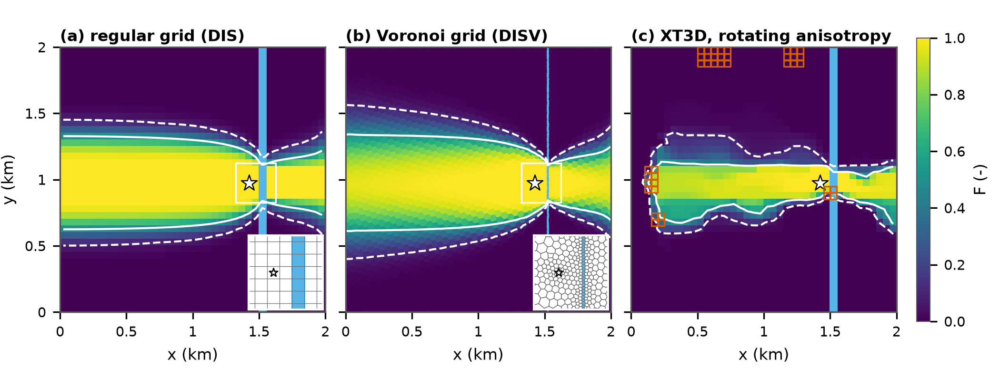

**Figure 5.** The same trace on different grids (Section 4.4). F is the share of a cell's water that ends at the well. Dashed line: F = 0.1. Solid line: F = 0.5. Star: supply well. Blue cells: river. (a) F on the regular grid of 40 × 40 cells (DIS). (b) F on a Voronoi grid (DISV) made with vorflow (Hugman and Sanchez 2026). Its cells are about 50 m across and shrink to about 10 m at the well and 12.5 m along the river. Insets in (a) and (b): the cells around the well and the river. The band between the dashed and solid lines is wider in (b) than in (a). The two DISU grids give the map of (a) cell for cell and are not shown. (c) F on the regular grid with XT3D and a rotating anisotropy. Red squares: cells in flow loops. All panels use one colour scale from 0 (dark purple) to 1 (yellow).

XT3D computes the flow across a face from the heads of the surrounding cells as well. Flow can then run against the head difference between two cells. Water can go round in flow loops (Section 2.2). The example uses a heterogeneous hydraulic conductivity with 20:1 anisotropy. The axes of the anisotropy rotate across the model. The trace found five groups of cells with flow loops, 40 cells in all (Fig. 5c). Together they circulate 4.4 m³/d. That is 0.016 % of the summed outflow of all cells in the model. The code solves the cells of each group together as one small block. The result equals a plain sparse solve of the whole system to 3.3 × 10⁻¹⁶. Foley and Black (2013) found flow loops rare, mostly in models with convergence problems. They delete the smallest flow in each loop. In their tests the effect was negligible. With XT3D, the loops are part of the flow solution. Under net accounting, deleting those flows on this model changes F by up to 0.155.

## 4.5 How does the contributing area change through the seasons?

Recharge is highest in the wet season. Many supply wells pump most in the dry season. So the contributing area moves through the year. This example makes the shared model transient. It adds storage, with a specific yield of 0.2 and a specific storage of 1 × 10⁻⁵ m⁻¹. Recharge is scaled by 1.8 in the wet season, 1.0 in the wet-to-dry transition, 0.1 in the dry season and 1.1 in the dry-to-wet transition. The well pumps 640, 800, 1,120 and 640 m³/d in the same seasons. After a 1-day steady-state start, the model runs for 3 years, with three steps of about 30 days in each season. Each of the 36 seasonal steps is traced as a snapshot (Section 2.7).

Fig. 6a–d maps F in the middle step of each season of the last year. The F > 0.5 area is smallest in the wet season, at 0.59 km². In the wet season the well pumps least. The rising water table also puts water into storage. Storage then acts as a sink that takes part of each cell's water. In the dry season the F > 0.5 area grows to 1.35 km². Its western end moves 350 m, out to the west edge. The well's sources change too. In the dry season, water released from storage supplies 52.5 % of the pumped water. In the wet season, recharge supplies 91 %.

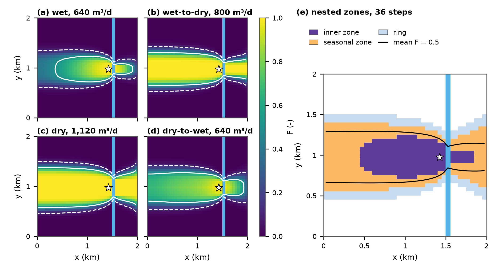

**Figure 6.** Snapshots of the seasonal example model (Section 4.5). F is the share of a cell's water that ends at the well. Star: supply well. Blue cells: river. (a–d) F in the middle time step of the wet, wet-to-dry, dry and dry-to-wet seasons of the last year, from 0 (dark purple) to 1 (yellow). Dashed white line: F = 0.1. Solid white line: F = 0.5. Panel titles give the pumping rate. (e) Nested zones from statistics over the 36 seasonal steps. Inner zone: F > 0.5 in every step. Seasonal zone: F > 0.5 in some steps but not all. Ring: F > 0.1 in at least one step but F > 0.5 in none. The three together form the outer envelope. Black line: time-weighted mean F = 0.5.

Statistics over the 36 steps summarise the seasons in one map (Fig. 6e). Cells with F > 0.5 in every step form an inner zone of 0.52 km². Cells with F > 0.5 in some steps but not all add a seasonal zone of 0.93 km². Cells with F > 0.1 in at least one step make up an outer envelope of 1.86 km². Of that envelope, 0.41 km² lies outside the other two zones. These nested zones are one way to combine the maps. They are not a rule for drawing protection zones.

The code builds the statistics one step at a time, so that its memory does not grow with the number of steps. They agree with statistics recomputed from all 36 stored maps to 1 × 10⁻¹⁴. In every snapshot, the traced sources add up to the pumping within 1 × 10⁻⁶ m³/d. Both checks test the code, not the snapshot method. The snapshot method itself has no travel lag (Section 2.7). Section 4.8 compares snapshots with transient tracking of a 30-year run of the same model.

## 4.6 How old is the water reaching the well?

Protection zones are often drawn by travel time as well as by area. A spill 50 days upgradient of a well calls for a different response from a spill 50 years upgradient. This example adds the mean travel time of Section 2.6 to the backward trace of the shared model (Section 4). The only new input is a porosity of 0.3. In a steady-state model every travel time is proportional to porosity, so a range of porosities needs no new run.

The mean travel time of all the water reaching the well is 46 years. River water reaches the well in about 2 years, because the losing river cells lie next to it. Recharge takes 42 years on average. Inflow from the west edge takes 108 years, because it enters at the far end of the contributing area. A time-of-travel zone holds the cells with F > 0.5 whose mean travel time is shorter than a stated limit (Fig. 7a). The 5-year zone covers 0.098 km² and the 25-year zone 0.455 km². Water spends about a month in the well cell, so 50 m cells cannot draw a 50-day zone.

Particle tracking with PRT gives a purely advective answer on the same flows. The particles are the weight-losing particles of Section 4.1. A particle stops when it enters the well cell, so the full-mixing times are also taken to the well cell. Over all the water, the mean particle time is 45.7 years, 0.5 % below the full-mixing time of 45.9 years. This agreement is not an independent test. In both methods, the mean travel time of all the water is close to the volume of water that will end at the well divided by the pumping rate. That volume is nearly the same in both.

The comparison cell by cell is the informative one (Fig. 7b). In the 456 cells with F > 0.5, apart from the well cell itself, the median ratio of particle time to full-mixing time is 0.96. In the 676 cells with F < 0.5, it is 5.7. A particle from a cell with small F follows one slow path around the edge of the zone. Full mixing averages over all the paths that the cell's water takes. The particle time-of-travel zone is 26 % larger at 5 years and 2.2 % larger at 25 years. A mean travel time is not the first arrival of a contaminant, so short time-of-travel zones still need particles on a grid refined near the well.

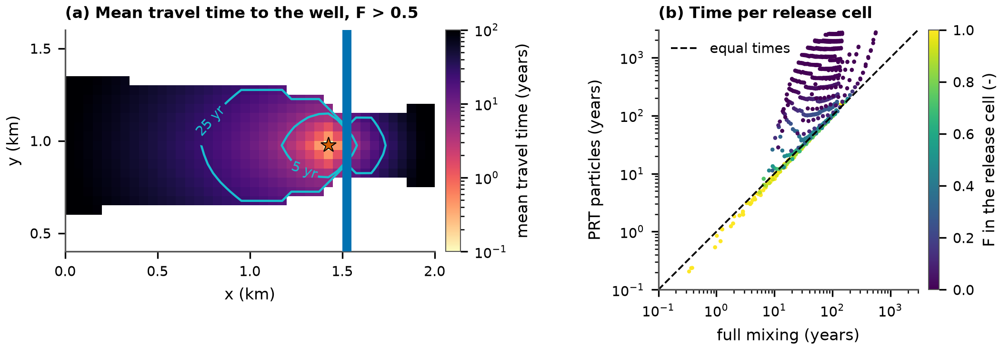

**Figure 7.** Mean travel time to the supply well under full mixing, on the shared model with a porosity of 0.3 (Section 4.6). (a) Mean travel time from each cell to the well, in years, shown only where F > 0.5, on a logarithmic colour scale from 0.1 years (pale yellow) to 100 years (black). Cyan lines: the 5-year and 25-year time-of-travel zones. The river and the well are marked. (b) Mean travel time per release cell, from weight-losing PRT particles (vertical axis) and from full mixing (horizontal axis). Both times end where the water enters the well cell. Both axes are logarithmic. The dashed line marks equal times. Colour gives F in the release cell, from 0 (dark purple) to 1 (yellow). Cells with F near 1 lie close to the line. Cells at the edge of the area, with small F, lie well above it.

## 4.7 What if the water passes through streams, drains, wells or other models?

In many models water leaves the aquifer cells and comes back. A drain may pass its water to a stream through the water mover (MVR). The stream may then lose that water to the aquifer near a well. A trace on the aquifer cells alone stops at the stream. It reports the leakage as a source with no history. This example shows what changes when stream reaches and wells are traced as cells of their own (Section 3.2).

The river of the shared model becomes a stream of the SFR package, with one reach per row, flowing from north to south. The first reach receives 300 m³/d from upstream. Two drains lie 800 m west of the stream. Through the mover, one passes 80 % of its water to the first reach and the other all of it. The upper reaches lose water to the aquifer. The reaches below the well gain water from it.

On the aquifer cells alone, 32 % of the well's water is stream leakage (Fig. 8a). With the reaches traced as cells, that water splits into 129 m³/d of upstream stream inflow and 126 m³/d of recharge. That recharge reached the stream through the drains and the mover. The land drained by each drain therefore joins the contributing area (Fig. 8b). Of the 800 m³/d pumped, 188 m³/d passed through the mover. The F of each reach shows which part of the stream feeds the well (Fig. 8c). Only the first 21 reaches do.

A multi-aquifer well (MAW) can carry water between layers in a similar way. A three-layer version of the shared model has an aquitard as its middle layer. The supply well draws from the bottom layer. A MAW screened in all three layers pumps 10 m³/d. Its borehole takes 24.3 m³/d from the upper two layers and passes 14.3 m³/d into the bottom layer. On the cells alone, those 14.3 m³/d of the supply well's water have no origin. With the borehole traced as a cell, they are recharge that fell near the MAW. On the cells alone, the water that the borehole takes from the upper layers leaves the trace. In the MAW's cell of the top layer, F is then 0.06. With the borehole traced, it is 0.53 (Fig. 8d, e).

On the stream model, the traced volumes add up to the pumping to round-off, with and without the reaches as cells. Large models are sometimes split into several linked models, for example with the FloPy model splitter (Hughes et al. 2024). The shared model, split into three models, gives F to within 2 × 10⁻¹³ of the single model. Both simulations solve the same flow equations, so this is a consistency test. It shows that no water is lost where the models meet. Movers between models are not read yet, so water moved between models still appears as a sink in one model and a source in the other.

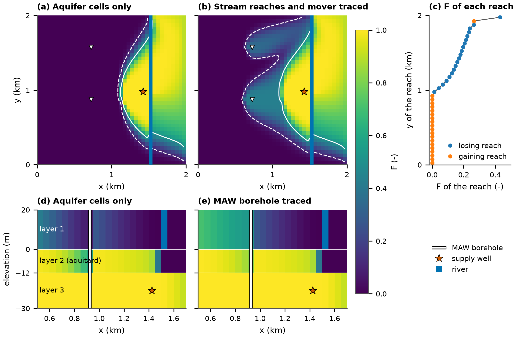

**Figure 8.** Backward fraction F to the supply well when water leaves the aquifer cells and comes back (Section 4.7). (a–c) A stream fed by drains replaces the river of the shared model. (a) The trace stops at the aquifer cells. Stream leakage is then a source term. The drains are sinks. (b) The stream reaches and the transfers of the water mover from the drains to the stream are traced as cells. In (a) and (b), colour gives F from 0 (dark purple) to 1 (yellow). Dashed white line: the F > 0.1 area. Solid white line: the F > 0.5 area. The stream, the two drains and the supply well are marked. (c) F of each stream reach against its position, from the first reach in the north to the last in the south. Blue dots mark reaches that lose water to the aquifer. Orange dots mark reaches that gain water from it. (d, e) A three-layer version of the shared model with a multi-aquifer well (MAW). The MAW is a borehole screened in all three layers. The middle layer is an aquitard. Each section runs from west to east along the model row that holds the MAW and the supply well. The vertical scale is exaggerated. (d) The trace stops at the aquifer cells. The MAW is then a sink in the upper two layers and a source in the bottom layer. (e) The MAW borehole is traced as a cell. Colour gives F as in (a) and (b). The MAW borehole (white line), the river and the supply well are marked.

## 4.8 How much of the pumped water arrived since the start?

Snapshots of the seasonal model (Section 4.5) cannot say where the water released from storage came from. A manager may ask how much of the water pumped over the next decades is water already in the aquifer today. Forward transient tracking answers this (Section 2.7). Backward tracking in time also says which of today's water will reach the well within 30 years.

The seasonal model of Section 4.5 runs here for 30 years, with one time step per season. The run starts with a 1-day steady-state period in which the well already pumps. Initial water is therefore not water from before pumping began. Porosity is 0.3, against a specific yield of 0.2. Each 91-day flow step is split into four transport sub-steps. Sub-steps shorten the transport step without changing the flow model. Longer transport steps bring tagged water to the well too early.

Averaged over time, snapshots give the well's water as about 60 % recharge and 15 % storage release. The rest is river leakage and west-edge inflow (Fig. 9a). In the last season of year 30, the well's water is 51.6 % initial water, 32.9 % recharge and 15.5 % river water (Fig. 9b). Of all the water pumped in the first 10 years, 81 % was initial water. New recharge mixes into a large volume of older water, because a column of this aquifer holds about 64 years of recharge. With one layer, the model cannot hold young water above old water, so a layered model may give other shares.

Backward tracking in time splits the water in each cell at the start into the fractions that the well pumps within 30 years, that the river takes and that are still stored (Fig. 9d–f). Only the water near the well and along the main flow path reaches the well within 30 years. Most of the water in the steady-state contributing area is still on its way at the end. The steady-state trace of the first step's flows, with no time limit, has F > 0 out to the west edge (Fig. 9c).

With GWT's water volumes, transient tracking matched a MODFLOW 6 GWT run with tagged recharge to 9.8 × 10⁻¹⁴ in all 1,600 cells and 121 steps. GWT uses the flow model's time steps, so this run used one transport step per flow step. The default water volumes keep every cell's water balance exact. Where porosity differs from specific yield, they differ from GWT's volumes. Here that changes the fractions by less than 0.004 (Supporting Information, Text S1). Forward and backward tracking gave the same volumes to 4.3 × 10⁻¹⁶. This internal check shows only that both directions solve the same equations. Transient tracking needs the budget of every time step, so its files and memory grow with the length of the run.

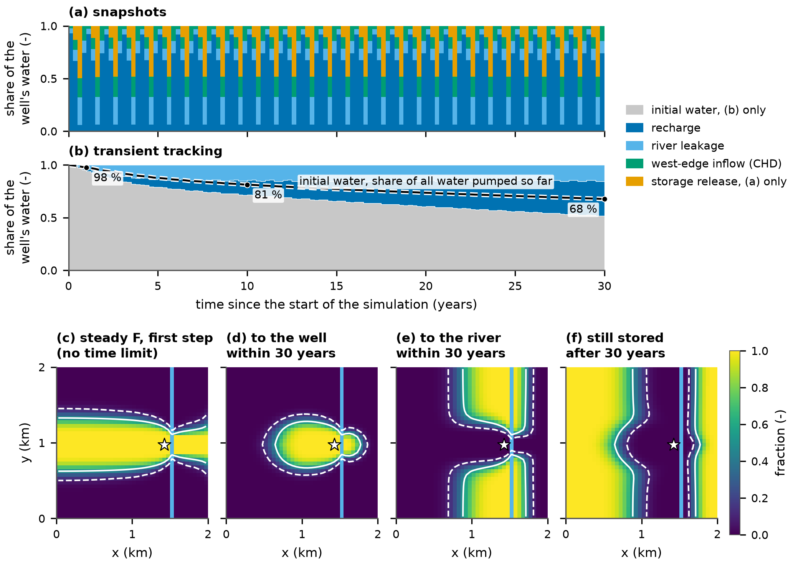

**Figure 9.** Snapshots and transient tracking on the seasonal example model (Section 4.8). Star: supply well. In (c–f), sky-blue cells mark the river. The colour scale runs from 0 (dark purple) to 1 (yellow). White contours mark fractions of 0.1 (dashed) and 0.5 (solid). (a) Snapshots: the well's water by source, each step traced on its own flows. (b) Forward transient tracking: the well's water by tagged source, including initial water. The dashed line is the initial water's share of all water pumped so far. Its labels give the cumulative share after 1, 10 and 30 years. (c) Steady-state F for the first step's flows. F extends east of the river because the river cells take only part of the water flowing through them. (d–f) Backward tracking in time: for the water in each cell at the start, the fractions that leave through the well (w) or the river within 30 years, and the fraction still stored. Numbers are in Supporting Information, Text S3.

## 4.9 How sure can we be of the contributing area?

Every example so far used one set of parameters. Many sets can fit the measured heads about equally well. We refer to each set as a realisation. A set of realisations is an ensemble.

The ensemble here holds 50 realisations of the shared model (Section 4). Each has its own hydraulic conductivity (K) field. In each field, K is set at 100 pilot points, 200 m apart. Pilot points are values of K at fixed points. The model interpolates between them by kriging. The pilot-point values are drawn at random, with a spatial correlation. No measurements have shaped these fields. We refer to such an ensemble as a prior. For each cell, the probability of contribution is the share of realisations in which F > 0.5. A protection zone can then be drawn at a stated risk. In the middle 90 % of realisations, the river supplies 0 to 33 % of the pumped water. The mean travel time lies between 36 and 52 years. The shared model gives 14 % and 46 years (Sections 4.1 and 4.6).

Full mixing spreads the edge of the area even in a single model (Section 4.1). In this prior, the unknown K blurs the edge more than full mixing does. The realisations disagree over 1.10 km², where the probability of contribution lies between 0.1 and 0.9. In the shared model, the cells with 0.1 < F < 0.9 cover 0.80 km².

History matching adjusts a model's parameters until it fits measurements. PEST++ IES does this for every realisation of an ensemble (White 2018; White et al. 2020). Here it adjusts the 100 pilot-point values of each realisation of the prior. The history-matched ensemble is the posterior. A separate random field stands for the true aquifer. It is not built from pilot points. Its heads in 40 cells, with added noise, are the measurements. The set-up and the history-matching runs are described separately (Supporting Information, Text S4).

History matching narrows the probability of contribution (Fig. 10). The posterior realisations disagree over 0.35 km², against 1.10 km² for the prior. The posterior band is narrower than the 0.80 km² band of full mixing in the shared model. The cells with a probability of at least 0.9 grow from 0.56 to 0.98 km². The middle 90 % of river shares narrows from 0–33 % to 5–13 %. The true share is 9.4 %.

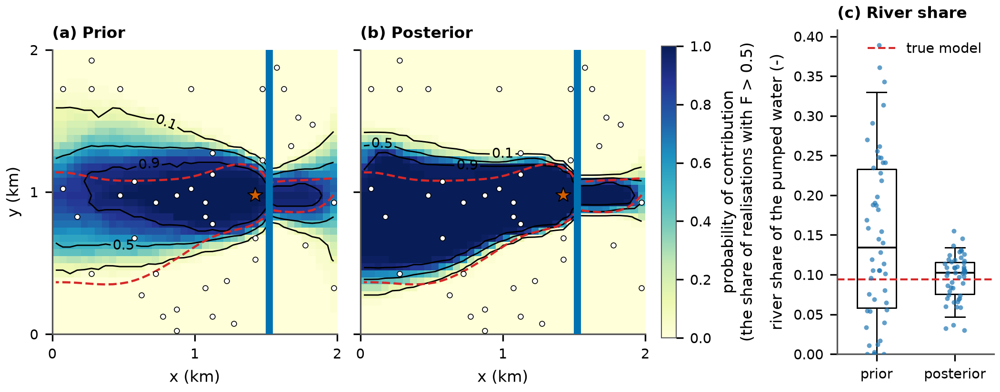

**Figure 10.** Probability of contribution before and after history matching on the shared example model (Section 4.9). The probability of contribution of a cell is the share of realisations with F > 0.5. In these realisations, more than half of the cell's water ends at the well. (a) Probability of contribution over 50 prior realisations of the hydraulic conductivity field. (b) Probability of contribution over the same 50 realisations after history matching to heads with PEST++ IES. In (a) and (b), colour gives the probability of contribution from 0 (pale yellow) to 1 (dark blue). Black lines: probabilities of 0.1, 0.5 and 0.9. Red dashed line: F = 0.5 in the synthetic true model, which supplied the measured heads. White circles: the 40 cells with head measurements. The river and the well are marked. (c) Share of the pumped water that comes from the river, in each prior and posterior realisation. Each dot is one realisation. Boxes span the 25 to 75 % range and whiskers the 5 to 95 % range. Red dashed line: the river share of the true model.

A narrower posterior is not necessarily a correct one. The maps can be checked against the true aquifer's F > 0.5 area. The posterior gives a probability of at least 0.5 to 93 % of that area, against 79 % for the prior. In both ensembles, 86 to 87 % of the cells with a probability of at least 0.9 lie inside the true area. That share did not improve. One synthetic case cannot show how reliable posteriors are in general. Here the trace ran on each history-matched realisation after PEST++ had finished. It could also run at the end of each PEST++ model run. We have not tested that route.

Ensembles can also need a lot of memory. An exact percentile map needs every realisation's value in every cell. For 1,000 realisations of a model with 1 million cells, that is 4 GB for each output and each well. The code can instead sort each cell's values into a histogram as it goes. The memory then stays the same however many realisations there are. The percentiles become approximate, to within one histogram bin, as long as the values fall inside the histogram's range.

## 4.10 How does a new well's source mix change in its first years?

When a new well starts pumping, its water changes over the years from mostly stored water to water from the sources that feed it. Bedekar et al. (2024) showed this with the unit-concentration method on a synthetic MODFLOW-2005 and MT3D-USGS model (Section 1). Forward transient tracking solves the same transport equation without dispersion, as their example does. Their example therefore also tests transient tracking against a published result made with other codes.

We rebuilt the model in MODFLOW 6 from the paper's description. It has three layers of 10 m, each with 101 × 101 cells of 10 m. Water enters as lateral inflow along the west edge and as recharge. A stream bounds the east edge. A well 150 m from the stream pumps 700 m³/d for 25 years. The paper leaves some values open, such as the time steps and the layer of the well screen. Our choices are listed in Supporting Information, Text S2.

One forward run with four tags gives the share of the pumped water from each source (Fig. 11a). The fourth tag is the stored water, which is the initial water of Section 2.7. Stream water arrives within the first year. Lateral inflow enters 850 m from the well and first appears after about 7 years. At year 25 the well's water is 48.2 % lateral inflow, 29.2 % recharge and 22.5 % stream water. The paper gives 48 %, 29 % and 23 %.

Backward tracking in time adds the time-limited contributing area (Fig. 11b–e). The maps show layer 2, where the well is screened. Within 1 year, the well pumps more than half the water of 841 cells in that layer, between the well and the stream. Within 25 years the area covers 6,825 cells of the layer. That is nearly the 6,829 cells of the steady-state F > 0.5 area of the final flows (Fig. 11f). We expect that a forward unit-concentration model would need one run per zone of the aquifer to give such a map.

Four MODFLOW 6 GWT runs, one per source, give the same fractions to 1.5 × 10⁻¹⁰ in every cell and step, when the tracking uses GWT's water volumes. The two codes solve the same equations, so this is a consistency test. The independent check is Figure 2 of the paper, read off to about one percentage point. Over 15 read-off times, the largest difference is 1.3 percentage points, on the lateral-inflow front at year 10.

The timing of each front depends on the length of the transport step. With 30-day steps, the stream share after 6 months is 1.1 %. With transport sub-steps of 7.6 days it is 0.4 %. Where arrival times matter, the transport step should be checked by refining it (Section 4.8).


**Figure 11.** The unit-concentration example of Bedekar et al. (2024), rebuilt in MODFLOW 6 (Section 4.10). (a) Share of the pumped water from stored water, lateral inflow, recharge and the stream, against time since pumping started. Lines: forward transient tracking. Open circles: values read off Figure 2 of Bedekar et al. (2024). Colours as in the published figure: grey for stored water, orange for lateral inflow, green for recharge and blue for the stream. (b–e) Backward tracking in time. The maps show layer 2, where the well is screened. For the water in each cell at the start, colour gives the fraction that the well pumps within 1, 5, 10 and 25 years, from 0 (dark purple) to 1 (yellow). (f) Steady-state backward fraction F for the flows of the last time step, for comparison. The well is marked in (b–f).

# 5. A regional model: Neversink

This section shows the cost and outputs of the method on a published regional model. The USGS Neversink/Rondout model (Fienen et al. 2022; Corson-Dosch et al. 2022) is a steady-state model of 1.68 million cells, with 12,316 SFR reaches. Its 358 realisations come from history matching with PEST++ IES (White 2018; White et al. 2020). We refer to the realisation with the base parameters as the calibrated model. The published study mapped the contributing areas of eight priority wells with MODPATH 7 (Pollock 2016). One particle started in the uppermost active cell of each column near the wells. We refer to these cells as the start cells. The published contributing cells are the 980 start cells whose particle ends in a priority well.

One trace of nine destination groups (each well alone and all eight together) took 2–3 s. The traced source water matched the wells' inflow within 1 × 10⁻¹² m³/d.

The published study also ran particles on 357 of the realisations. The published probability of contribution of a cell is the share of these runs whose contributing area holds the cell. Our counterpart is F averaged over the realisations. We refer to it as the ensemble mean F. Cell by cell, mean F correlates with the published probability at r = 0.80 (Fig. 12d). As in Section 4.1, the expected area of a map is the sum over cells of the map times the cell area. Here the sum runs over the start cells. The expected area of mean F is 90 % of that of the published probability (Supporting Information, Table S2). With streams as cells, stream leakage supplies 43 % of the wells' water in the calibrated model. With the stream network (Section 4.7), all of this water traces back to recharge. Fig. 12 shows F and mean F around four closely spaced wells.

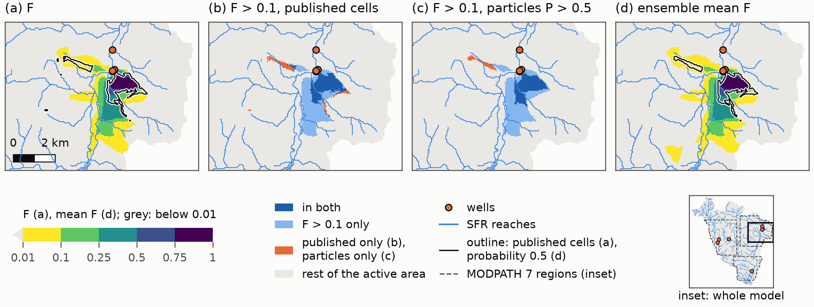

**Figure 12.** Full-mixing maps for the eight priority wells of the Neversink/Rondout model (Fienen et al. 2022; Corson-Dosch et al. 2022), in a 7.1 × 9.25 km window around four closely spaced wells. F is the share of a cell's water that ends at the wells. All panels show the uppermost active cell, with streams as cells and gross accounting. (a) F in the calibrated model. Colours: five classes of reversed viridis (light = low F), with edges at 0.01, 0.1, 0.25, 0.5, 0.75 and 1. Grey: F < 0.01 in the active area. Black outline with white halo: the published contributing cells, 688 of the 980 in all. (b) The F > 0.1 area against the published contributing cells. Dark blue: in both (538 cells in this window). Orange: published only (150). Light blue: F > 0.1 only (1,090). (c) The F > 0.1 area against the area where the particle share exceeds 0.5. The particles are PRT particles that lose weight at each sink as full mixing does. They were released over the cell volume. The particle share of a start cell is the share of its water that they deliver to the wells. Dark blue: in both (495). Orange: particles only (86). Light blue: F > 0.1 only (1,133). (d) Ensemble mean F over 358 realisations, in the classes of (a). Black outline with white halo: published probability of contribution 0.5, from 357 published Monte Carlo contributing areas. The stored published areas lie one row south of their cells. We moved them one row north (Supporting Information, Text S5). Inset: the active model area, the three regions of the published particle runs and the window. Orange dots: wells. Blue lines: SFR reaches. White: inactive. Scale bar (a): 2 km.

## Why the areas differ

Our areas differ from the published ones. We measure the difference with an overlap score. It is the number of cells in both areas divided by the number in either. It is 1 for identical areas and 0 for areas with no cell in common.

The published area comes from one reasonable choice of particle settings. Recharge and stream flows enter through the top face of a cell. A particle stops in the first weak-sink cell it enters. A particle that starts in a dry cell is moved down to the first active cell below (draping). PRT on the same flow field reproduces the published area (overlap 0.998) only with all three settings. Among particle runs that conserve water, the settings alone move the overlap from 0.62 to 0.998 (Supporting Information, Table S3).

The full-mixing areas where F exceeds 0.5 and 0.1 agree less, with overlaps of 0.41 and 0.30 (Fig. 12a, b). We infer that the main reason is that full mixing splits each cell's water among all its outflows, while a particle follows one path. Full-mixing areas are therefore wider and more diffuse. On average, the published cells send 42 % of their water to the wells. The F > 0.1 area holds 73 % of them, against 43 % for the F > 0.5 area. A like-for-like test uses the weight-losing particles of Section 4.1. They lose water at each sink as full mixing does. Their particle share exceeds 0.5 in 691 start cells. The F > 0.1 area holds 87 % of these cells (Fig. 12c).

Weak sinks add to the difference. A buried stream cell has an SFR reach and another active cell above it. A particle cannot leave such a cell through its top face. Where the reach gains water, the stream is a weak sink. A published particle then stops in the cell. All its water counts as reaching the stream. Published particles stop in the same way at weak-sink wells. Full mixing passes the rest of the cell's water on (Supporting Information, Text S6).

With the stream network, the area extends upstream along the streams. The expected area of the ensemble mean F is then 1.5 times the published one. Section 6 turns these differences into advice on thresholds and particle checks.

# 6. Trade-offs and limitations

Full mixing answers most questions of Section 4 in seconds. This section sets out what that costs, which choices it leaves to the modeller and when particles or transport answer a question better.

Full mixing splits each cell's water among all its outflows. A particle instead follows one path through the velocity field of each cell (Pollock 1988). So full-mixing areas are wider and more diffuse than particle areas. Their edge is a band of cells where F lies between 0.1 and 0.9. Finer cells narrow this band, but slowly. In the two test problems of Section 4.1, halving the cell size made the band only about 30 % narrower (Fig. 13; Supporting Information, Figure S2). Potter et al. (2008) and McLane and Cecan (2009) also found wider spreading on coarser grids. The band also depends on how the cell faces lie relative to the flow. Where the flow runs along the rows of a regular grid, each cell passes nearly all its water to one neighbour. Where the flow crosses the faces at an angle, each cell splits its water among several neighbours. The band then widens. On squares turned by 45° to the flow, the band was 1.8 times as wide as on squares aligned with it (Section 4.4). Voronoi grids have faces at many angles. In our tests they spread the edge at least as much as regular grids with cells of the same size (Section 4.4; Supporting Information, Figure S2). Where the edge of an area matters, refining the cells along it narrows the band. A regular grid aligned with the main flow also helps. Thick layers spread an area vertically as well, because each cell mixes over its saturated thickness. Face-to-face routing passes water from each inflow face of a cell to its outflow faces, instead of mixing it across the whole cell (Chowdhury 2016). The code includes it as an experimental option. It works on single-layer regular grids, for steady-state backward traces only. Cells with wells, rivers or other weak sinks stay fully mixed. In the same test problems it removed 35 to 70 % of the excess spreading. Totals depend much less on mixing than edges do (Section 4.6). We would therefore use particles where a sharp edge or a first arrival matters, such as a short time-of-travel zone (Section 4.6). Full mixing suits questions about many sinks, unstructured grids, package networks or many realisations.

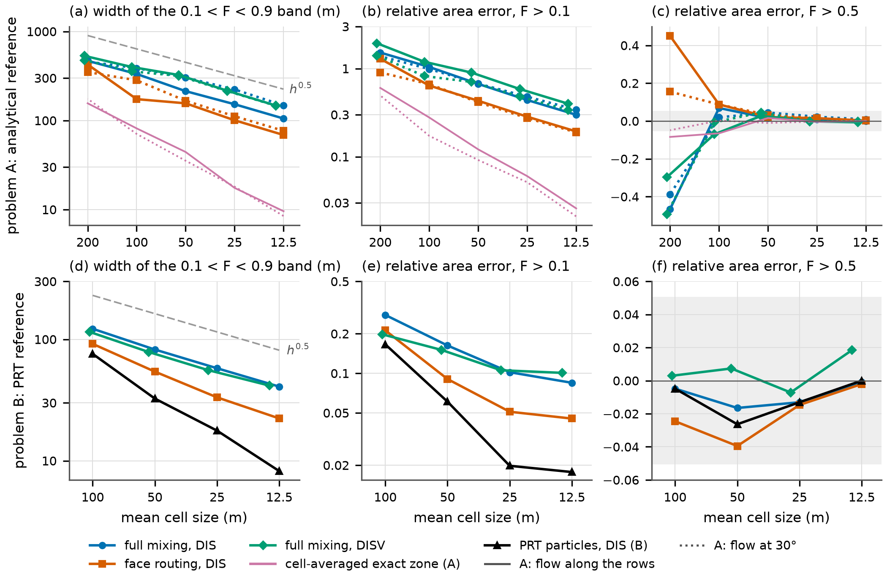

**Figure 13.** Numerical dispersion of full mixing against cell size h. Top row: problem A, uniform flow to a well, with the analytical capture zone (Javandel and Tsang 1986) as reference. Flow runs along the grid rows (solid) or at 30° to them (dotted). Bottom row: problem B, an aquifer like test model 1 (Supporting Information, Text S2). The reference is PRT on the finest grid, compared west of the river. (a, d) Width of the transition band (0.1 < F < 0.9). Dashed guide: $h^{0.5}$. Face routing: an experimental 2D option that passes water between cell faces instead of mixing it (Chowdhury 2016; Section 6). The exact zone averaged onto the grid (A) and PRT on the same grid (B) show the narrowest band the grid allows. (b, e) Relative error in the size of the F > 0.1 area. (c, f) The same for the F > 0.5 area. Grey band, ±5 %. Section 4.1 compares the F > 0.1 and F > 0.5 areas from these tests. The test problems and the numbers behind the panels are given in Supporting Information, Figure S2.

Because mixing blurs the edge, no single threshold on F reproduces a particle area everywhere. The threshold is a judgement about the purpose of the area. It should be reported with the area. On the simple test problems of Section 4.1, the F > 0.5 area came close to the size of the reference area. The F > 0.1 area contained the reference area, at the cost of more area. On Neversink, the F > 0.1 area missed 27 % of the published contributing cells (Section 5). It also missed 13 % of the cells where weight-losing particles deliver more than half their water to the wells. We infer that these misses come from the spreading between sinks, because those particles lose weight at sinks as full mixing does. So a low threshold does not guarantee a cautious area on a regional model. Where an area ends at a weak sink, such as a buried stream cell, we would check its edge with particles that stop there and with particles that pass. In the prior ensemble of Section 4.9, the unknown K blurred the edge more than mixing did in one model. In that synthetic case, history matching to heads narrowed the edge band of the ensemble below the band of mixing.

Weak sinks raise a second choice, between gross and net accounting (Section 2.4). Gross accounting answers where the pumped water comes from. Its volumes match those of a transport model. Net accounting answers which water reaches the well's cell, much as particles that stop at weak sinks do. At a small well the two can differ several times over (Section 4.2). We would use gross accounting by default. Net accounting is the choice for reproducing a FlowSource study. The accounting should be reported with the area, because it changes the area upstream of every weak-sink well.

Transient models need a further choice, among snapshots, transient tracking and GWT. Snapshots trace each time step on its own flows in seconds without a porosity (Section 4.5). But a snapshot has no travel lag. Water released from storage also appears in it as a source with no origin. Transient tracking carries tagged water through storage, as hydraulic mixing cells do in integrated surface water–groundwater models (Partington et al. 2011, 2013). Forward, it gives the share of pumped water that was already stored. Backward in time, it gives the area whose water reaches the well within a stated time (Sections 4.8 and 4.10). It needs a porosity, the budget of every time step and, where arrival times matter, transport sub-steps (Section 4.8). With GWT's water volumes, transient tracking matched MODFLOW 6 GWT within GWT's solver tolerance (Sections 4.8 and 4.10). GWT needs one transport model per source. We would use GWT where dispersion, sorption or decay matter (Langevin et al. 2022). Transient tracking moves water by advection only. It has so far been tested on synthetic models only.

Time series and ensemble percentiles need more memory than a single trace (Section 3.4). Transient tracking keeps by default one value per cell and time step for each group and output. At 1.68 million cells and 121 steps, we estimate about 1.6 GB per array. The code can instead keep only the last step, at the price of the time series. For ensembles, histograms bound the memory of percentile maps (Section 4.9).

Two parts of a MODFLOW 6 simulation are not fully supported yet. Movers between models (the MVE package) are not read (Section 4.7). DISU grids without cell vertices give no maps. PRT does not run on DISU grids (Section 4.4).

# 7. Conclusions

We present `gwsource`. It is open-source code that traces where the water in a MODFLOW 6 model comes from and where it goes. It works from the cell-by-cell flows the model already saves. For a well, a spring, a stream or any other outlet, it maps the contributing area, splits the water by source and gives mean travel times. From a source, such as recharge or a river, it follows the water to where it leaves the model. Ten worked examples, each a runnable notebook, show how to use it.

The code builds on the full-mixing method of FlowSource (Foley and Black 2013). It extends that method to every MODFLOW 6 grid type, to package networks such as streams, movers and multi-aquifer wells, and to simulations made of several linked models. At weak sinks it uses gross accounting by default. Each sink term then takes only its share of the cell's water, as in a transport model. In transient models, tagged water is carried through storage from step to step. Backward in time, the same tracking maps the area whose water reaches a well within a stated time.

Every result comes with water-budget checks that must hold exactly. Each example also compares an output a practitioner would use with another common approach. The code reproduced the worked example of Foley and Black (2013) and the unit-concentration study of Bedekar et al. (2024). With GWT's water volumes, its fractions matched MODFLOW 6 GWT to 1.5 × 10⁻¹⁰ or better in transient runs. Particles in MODFLOW 6 PRT delivered the same water to the well, with nearly the same mean travel time. Any method that conserves water should agree in these totals. Cell by cell, the two methods differ at the edge of a contributing area, where full mixing gives in-between values.

On small models the answers come in seconds. On a published regional model of 1.68 million cells, one trace of nine destination groups took 2–3 s. That is small next to the model run itself. Tracing is therefore cheap enough for ensembles of hundreds of realisations and for history matching.

Full mixing has costs. Its areas are wider and more diffuse than particle areas. How much wider depends on the cell size and on how the cell faces lie relative to the flow. The threshold that draws an area therefore needs judgement and should be reported with it. Particle tracking is the better tool where a sharp edge or a first arrival matters. Transport models are better where dispersion or reactions matter (Section 6).

# 8. Code and Data Availability

The code, `gwsource`, is open source under the MIT licence at https://github.com/rhugman/gw-source [check: public URL]. This paper uses version 0.0.1 [check: release version and tag]. Each example of Section 4 ships with the code as a Jupyter notebook (Supporting Information, Text S2). The notebook builds the example model, runs MODFLOW 6 and reproduces the numbers and figure of its section. Most notebooks run in under 20 s. The ensemble and unit-concentration notebooks take about 1.5 and 2 min. The test models ship with the code as automated tests. The scripts for the Neversink model of Section 5 are in `studies/neversink`. The model and its MODPATH 7 outputs (Corson-Dosch et al. 2022) are public domain (CC0). They are in a USGS data release (Fienen and Corson-Dosch 2021; doi:10.5066/P9HWSOHP). A release with the files behind every table and figure will be archived on Zenodo [check: DOI]. The runs used a development build of MODFLOW 6 version 6.9 and the FloPy development branch (Bakker et al. 2016; Hughes et al. 2024) [check: pin to released versions].

# References

Bakker, M., V. Post, C.D. Langevin, J.D. Hughes, J.T. White, J.J. Starn, and M.N. Fienen. 2016. Scripting MODFLOW model development using Python and FloPy. *Groundwater* 54, no. 5: 733–739. https://doi.org/10.1111/gwat.12413

Barlow, P.M., S.A. Leake, and M.N. Fienen. 2018. Capture versus capture zones: Clarifying terminology related to sources of water to wells. *Groundwater* 56, no. 5: 694–704. https://doi.org/10.1111/gwat.12661

Bedekar, V., C. Neville, M.J. Tonkin, R.D. Bartlett, and P. Plato. 2024. A unit-concentration method to quantify source contribution. *Groundwater* 62, no. 2: 303–309. https://doi.org/10.1111/gwat.13333

Black, A., and C. Foley. 2013. FlowSource: A program to efficiently delineate volumetric capture areas, pathways and source areas in groundwater models. In *Proceedings of MODFLOW and More 2013: Translating Science into Practice*, Golden, Colorado, June 2–5, 2013, 652–663. Golden, Colorado: IGWMC, Colorado School of Mines. https://groundwater-science.co.uk/wp-content/uploads/2013_FSv6_ApplicationPaper.pdf

Campana, M.E., and E.S. Simpson. 1984. Groundwater residence times and recharge rates using a discrete-state compartment model and C-14 data. *Journal of Hydrology* 72, no. 1–2: 171–185. https://doi.org/10.1016/0022-1694(84)90190-2

Chowdhury, M.A. 2016. Assessing the connectivity of groundwater wells to surface-water using a volumetric capture delineation tool. MASc thesis, University of Waterloo, Waterloo, Ontario, Canada. http://hdl.handle.net/10012/10981

Cornaton, F., and P. Perrochet. 2006. Groundwater age, life expectancy and transit time distributions in advective–dispersive systems: 1. Generalized reservoir theory. *Advances in Water Resources* 29, no. 9: 1267–1291. https://doi.org/10.1016/j.advwatres.2005.10.009

Corson-Dosch, N.T., M.N. Fienen, J.S. Finkelstein, A.T. Leaf, J.T. White, J. Woda, and J.H. Williams. 2022. Areas contributing recharge to priority wells in valley-fill aquifers in the Neversink River and Rondout Creek drainage basins, New York. U.S. Geological Survey Scientific Investigations Report 2021–5112. Reston, Virginia: USGS. https://doi.org/10.3133/sir20215112

Environment Agency. 2019. *Manual for the Production of Groundwater Source Protection Zones*. Bristol, UK: Environment Agency. https://assets.publishing.service.gov.uk/media/5d41a020e5274a0a0bf7757c/Manual-for-the-production-of-Groundwater-Source-Protection-Zones.pdf

Fienen, M.N., and N.T. Corson-Dosch. 2021. Groundwater model archive and workflow for Neversink/Rondout Basin, New York, source water delineation. U.S. Geological Survey data release. https://doi.org/10.5066/P9HWSOHP

Fienen, M.N., N.T. Corson-Dosch, J.T. White, A.T. Leaf, and R.J. Hunt. 2022. Risk-based wellhead protection decision support: A repeatable workflow approach. *Groundwater* 60, no. 1: 71–86. https://doi.org/10.1111/gwat.13129

Foley, C., and A. Black. 2013. Efficiently delineating volumetric capture areas and flow pathways using directed acyclic graphs and MODFLOW; description of the algorithms within FlowSource. In *Proceedings of MODFLOW and More 2013: Translating Science into Practice*, Golden, Colorado, June 2–5, 2013, 571–581 [check: pages against the proceedings]. Golden, Colorado: IGWMC, Colorado School of Mines. https://groundwater-science.co.uk/wp-content/uploads/2013_FSv6_DAGPaper.pdf

Frind, E.O., D.S. Muhammad, and J.W. Molson. 2002. Delineation of three-dimensional well capture zones for complex multi-aquifer systems. *Ground Water* 40, no. 6: 586–598. https://doi.org/10.1111/j.1745-6584.2002.tb02545.x

Goode, D.J. 1996. Direct simulation of groundwater age. *Water Resources Research* 32, no. 2: 289–296. https://doi.org/10.1029/95WR03401

Hughes, J.D., C.D. Langevin, S.R. Paulinski, J.D. Larsen, and D. Brakenhoff. 2024. FloPy workflows for creating structured and unstructured MODFLOW models. *Groundwater* 62, no. 1: 124–139. https://doi.org/10.1111/gwat.13327

Hugman, R., and O. Sanchez. 2026. vorflow: Voronoi mesh generation for MODFLOW 6. Version 0.2.0. Software, released 5 October 2026. https://github.com/rhugman/vorflow

Javandel, I., and C.-F. Tsang. 1986. Capture-zone type curves: A tool for aquifer cleanup. *Ground Water* 24, no. 5: 616–625. https://doi.org/10.1111/j.1745-6584.1986.tb03710.x

Langevin, C.D., J.D. Hughes, E.R. Banta, R.G. Niswonger, S. Panday, and A.M. Provost. 2017. Documentation for the MODFLOW 6 Groundwater Flow Model. U.S. Geological Survey Techniques and Methods, book 6, chap. A55. Reston, Virginia: USGS. https://doi.org/10.3133/tm6A55

Langevin, C.D., A.M. Provost, S. Panday, and J.D. Hughes. 2022. Documentation for the MODFLOW 6 Groundwater Transport Model. U.S. Geological Survey Techniques and Methods, book 6, chap. A61. Reston, Virginia: USGS. https://doi.org/10.3133/tm6A61

Langevin, C.D., J.D. Hughes, A.M. Provost, M.J. Russcher, M.J. Reno, W.P. Bonelli, E.D. Morway, S. Titus, R.G. Niswonger, S. Panday, D. Merrick, and E.R. Banta. 2026. MODFLOW 6 Modular Hydrologic Model version 6.8.1. U.S. Geological Survey Software Release, 23 September 2026. https://doi.org/10.5066/P1PGE9XW

Leake, S.A., H.W. Reeves, and J.E. Dickinson. 2010. A new capture fraction method to map how pumpage affects surface water flow. *Ground Water* 48, no. 5: 690–700. https://doi.org/10.1111/j.1745-6584.2010.00701.x

McLane, C., and L. Cecan. 2009. Comment on "MODALL: A practical tool for designing and optimizing capture systems," by S.T. Potter, E. Moreno-Barbero, and C.E. Divine. *Ground Water* 47, no. 2: 172–173. https://doi.org/10.1111/j.1745-6584.2008.00527_1.x

Neupauer, R.M., and J.L. Wilson. 1999. Adjoint method for obtaining backward-in-time location and travel time probabilities of a conservative groundwater contaminant. *Water Resources Research* 35, no. 11: 3389–3398. https://doi.org/10.1029/1999WR900190

Nogueira, G.E.H., C. Schmidt, D. Partington, P. Brunner, and J.H. Fleckenstein. 2022. Spatiotemporal variations in water sources and mixing spots in a riparian zone. *Hydrology and Earth System Sciences* 26, no. 7: 1883–1905. https://doi.org/10.5194/hess-26-1883-2022

Partington, D., P. Brunner, C.T. Simmons, R. Therrien, A.D. Werner, G.C. Dandy, and H.R. Maier. 2011. A hydraulic mixing-cell method to quantify the groundwater component of streamflow within spatially distributed fully integrated surface water–groundwater flow models. *Environmental Modelling & Software* 26, no. 7: 886–898. https://doi.org/10.1016/j.envsoft.2011.02.007

Partington, D., P. Brunner, C.T. Simmons, A.D. Werner, R. Therrien, H.R. Maier, and G.C. Dandy. 2012. Evaluation of outputs from automated baseflow separation methods against simulated baseflow from a physically based, surface water–groundwater flow model. *Journal of Hydrology* 458–459: 28–39. https://doi.org/10.1016/j.jhydrol.2012.06.029

Partington, D., P. Brunner, S. Frei, C.T. Simmons, A.D. Werner, R. Therrien, H.R. Maier, G.C. Dandy, and J.H. Fleckenstein. 2013. Interpreting streamflow generation mechanisms from integrated surface-subsurface flow models of a riparian wetland and catchment. *Water Resources Research* 49, no. 9: 5501–5519. https://doi.org/10.1002/wrcr.20405

Pollock, D.W. 1988. Semianalytical computation of path lines for finite-difference models. *Ground Water* 26, no. 6: 743–750. https://doi.org/10.1111/j.1745-6584.1988.tb00425.x

Pollock, D.W. 2016. User guide for MODPATH Version 7—A particle-tracking model for MODFLOW. U.S. Geological Survey Open-File Report 2016–1086. Reston, Virginia: USGS. https://doi.org/10.3133/ofr20161086

Potter, S.T., E. Moreno-Barbero, and C.E. Divine. 2008. MODALL: A practical tool for designing and optimizing capture systems. *Ground Water* 46, no. 2: 335–340. https://doi.org/10.1111/j.1745-6584.2007.00410.x

Provost, A.M., C.D. Langevin, and J.D. Hughes. 2017. Documentation for the "XT3D" option in the Node Property Flow (NPF) Package of MODFLOW 6. U.S. Geological Survey Techniques and Methods, book 6, chap. A56. Reston, Virginia: USGS. https://doi.org/10.3133/tm6A56

Pryet, A., P. Matran, Y. Cousquer, and D. Roubinet. 2022. Particle tracking as a vulnerability assessment tool for drinking water production. *Frontiers in Earth Science* 10: 975156. https://doi.org/10.3389/feart.2022.975156

Rushton, K.R. 2003. *Groundwater Hydrology: Conceptual and Computational Models*. Chichester, UK: John Wiley and Sons.

Schilling, O.S., C. Gerber, D.J. Partington, R. Purtschert, M.S. Brennwald, R. Kipfer, D. Hunkeler, and P. Brunner. 2017. Advancing physically-based flow simulations of alluvial systems through atmospheric noble gases and the novel ³⁷Ar tracer method. *Water Resources Research* 53, no. 12: 10465–10490. https://doi.org/10.1002/2017WR020754

Tosco, T., A. Di Molfetta, and R. Sethi. 2010. Automatic delineation of capture zones for pump and treat systems: A case study in Piedmont, Italy. *Ground Water Monitoring & Remediation* 30, no. 2: 46–52. https://doi.org/10.1111/j.1745-6592.2010.01276.x

Visser, A., R. Heerdink, H.P. Broers, and M.F.P. Bierkens. 2009. Travel time distributions derived from particle tracking in models containing weak sinks. *Ground Water* 47, no. 2: 237–245. https://doi.org/10.1111/j.1745-6584.2008.00542.x

White, J.T. 2018. A model-independent iterative ensemble smoother for efficient history-matching and uncertainty quantification in very high dimensions. *Environmental Modelling & Software* 109: 191–201. https://doi.org/10.1016/j.envsoft.2018.06.009

White, J.T., R.J. Hunt, M.N. Fienen, and J.E. Doherty. 2020. Approaches to highly parameterized inversion: PEST++ Version 5, a software suite for parameter estimation, uncertainty analysis, management optimization and sensitivity analysis. U.S. Geological Survey Techniques and Methods 7C26. Reston, Virginia: USGS. https://doi.org/10.3133/tm7C26

Winston, R.B., L.F. Konikow, and G.Z. Hornberger. 2018. Volume-weighted particle-tracking method for solute-transport modeling; Implementation in MODFLOW–GWT. U.S. Geological Survey Techniques and Methods, book 6, chap. A58. Reston, Virginia: USGS. https://doi.org/10.3133/tm6A58

# Supporting Information (draft)

## Text S1. Method in full

Section 2 of the main text gives what a reader needs to use the outputs of the code. This text gives the rest of the method. It derives the equations of Section 2, shows how they are solved and why the water-budget checks must hold. It then gives net accounting, the mean travel time and transient tracking in full. Equation numbers without an S refer to the main text.

### The backward and forward fractions

The symbols are those of Section 2.1. Cell $i$ has the total inflow $I_i$, the total outflow $O_i$ and the cell budget error $r_i = I_i - O_i$ (Eq. 1). The flow from cell $i$ to its neighbour $j$ is $q_{ij} \ge 0$. The outflow of cell $i$ through the destination is $d_i$, and its inflow through the source is $s_i$.

Full mixing means that all water leaving a cell has the same mix of origins and fates. Take the water that leaves cell $i$ in one day. The part $d_i$ leaves through the destination directly. The part $q_{ij}$ goes to neighbour $j$, and a share $F_j$ of it later leaves through the destination. So the volume of water leaving cell $i$ that ends at the destination is

$$F_i\, O_i = \sum_j q_{ij}\, F_j + d_i . \tag{S1}$$

Dividing by $O_i$ gives Eq. (2). Written for all cells, with the outflow shares $P_{ij} = q_{ij}/O_i$, it gives Eq. (3). Under gross accounting, a sink term $k$ in cell $i$ takes the share $|q_k|/O_i$ of the cell's outflow. These shares are the entries of $\mathbf{S}$ in Eq. (3). A cell with no outflow is given $F = 0$.

The forward fraction follows from the inflow in the same way. The water entering cell $i$ in one day comes from the neighbours and from the source and sink terms. A share $G_j$ of the water from neighbour $j$ came from the source. All of $s_i$ came from it. So

$$G_i\, I_i = \sum_j q_{ji}\, G_j + s_i . \tag{S2}$$

Dividing by $I_i$ gives Eq. (4), with the inflow shares $Q_{ij} = q_{ji}/I_i$. A cell with no inflow is given $G = 0$.

### Why the water-budget checks hold exactly

The four checks of Section 2.5 follow from adding up Eqs. (S1) and (S2) over all cells. Adding Eq. (S1) over all cells gives $\sum_i F_i O_i$ on the left. On the right, each flow $q_{ij}$ appears once, multiplied by the $F$ of the cell it enters. Summed over the cells it leaves, the flow into cell $j$ is $\sum_i q_{ij} = I_j - \mathrm{Src}_j$. So

$$\sum_i F_i\, O_i = \sum_j F_j \left(I_j - \mathrm{Src}_j\right) + \sum_i d_i .$$

Moving terms and using $r_i = I_i - O_i$ gives the backward closure check, Eq. (5). Adding Eq. (S2) over all cells gives the forward closure check in the same way:

$$\sum_i G_i\, \mathrm{Snk}_i + \sum_i G_i\, r_i = \sum_i s_i . \tag{S3}$$

The forward–backward check is a duality identity of the two systems. Multiply Eq. (S1) by $G_i$ and Eq. (S2) by $F_i$, and add each over all cells. Both results then hold the same double sum of the cell-to-cell flows, $\sum_i \sum_j q_{ij}\, G_i\, F_j$. It cancels when one result is subtracted from the other. What remains is Eq. (6).

The boundary-control check traces every sink term of the model, each as its own destination. The sum of their fractions solves Eq. (2) with $d_i$ replaced by the total sink outflow $\mathrm{Snk}_i$. A value of 1 in every cell solves that equation, because $\sum_j q_{ij} + \mathrm{Snk}_i = O_i$. The solution is unique outside closed recirculation loops, which are described below. So the fractions to all sinks add up to 1 in every other cell with outflow.

The checks include the cell budget errors $r_i$. So they hold exactly for any flow field, also one that does not balance. The errors reported by the code are then round-off, unless the tracing itself is wrong. Without the error terms, the checks would hold only to within the budget error of the flow model. The code reports both values.

### Solution of the linear systems

Equation (2) gives a cell's $F$ from the $F$ of the cells downstream of it. Where water never returns to a cell it has left, the cells can be solved one at a time along the flow paths, as in FlowSource (Foley and Black 2013).

Flow loops break this order. A flow loop is a group of cells among which water circulates, so that water leaving a cell can return to it. No order of the cells in a loop is purely downstream, so a single pass cannot solve a loop exactly. Loops arise with the XT3D option of MODFLOW 6 (Provost et al. 2017) and where stream reaches and aquifer cells exchange water in both directions. Foley and Black (2013) report loops as rare, mostly in unstable multilayer models. FlowSource deletes the smallest flow in each loop. Foley and Black (2013) expect this to change the results very little. We keep every flow and solve each loop exactly.

Equations (3) and (4) are solved in flow order. Where the cell-to-cell flows contain no loop, the matrix is reordered to triangular form, with every cell after the cells it depends on. It is then solved by substitution. This is the flow-order algorithm of FlowSource in matrix form. Where there are loops, the matrix is reordered to block-triangular form. Each block is one strongly connected component of the flows, which is either one flow loop or one single cell. The blocks are in flow order. The matrix is then factorised once by sparse LU decomposition in that order. The extra non-zero entries that a factorisation creates stay inside the loop blocks. So a model of a million cells with thousands of small loops is factorised in well under a second.

Each cell's outflow shares add up to at most 1. So $\mathbf{I} - \mathbf{P}$ is a weakly row-diagonally dominant M-matrix. Its factorisation therefore needs no pivoting, the row swaps that otherwise guard against the growth of round-off. The matrix is singular only on a closed recirculation loop. This is a set of cells with no outflow to any sink or to a cell outside the set. Water in such a loop never reaches a sink. These loops are found before the solve, given $F = 0$ and reported. No flows are deleted. Under gross accounting, one factorisation serves every destination group. It is reused for the travel-time system of Eq. (7).

The code also reports every flow loop, with the flow that goes round it and its share of the flow through the model. A large loop, or one that carries much water, may point to a problem in the flow model, such as poor convergence or extreme anisotropy.

### Net accounting

Net accounting reproduces the bookkeeping of FlowSource (Foley and Black 2013). It works from the cell-to-cell flows only. Each cell's source and sink terms are replaced by one net term, equal to its cell-to-cell outflow minus its cell-to-cell inflow. With $I^e_i$ and $O^e_i$ the cell-to-cell inflow and outflow of cell $i$, the net term is $n_i = O^e_i - I^e_i$. The water passing through the cell is then $T_i = I^e_i + \max(n_i, 0)$. Outside the destination cells, the backward fraction is

$$f_i = \frac{1}{T_i} \sum_j q_{ij}\, f_j . \tag{S4}$$

The destination cells are fixed at $f = 1$. Their outflows to other cells are ignored. A forward trace works in the same way on the reversed flows, with the source cells fixed at $g = 1$.

Which cells are fixed depends on how the group was selected. A pure cell or zone selection fixes all its cells, as FlowSource defines groups (Foley and Black 2013). A selection by package, boundary name or term fixes only the cells where a selected term flows in the traced direction. In a backward trace, these are the cells where a selected term is a sink. In a forward trace, they are the cells where it is a source. This also holds when a term criterion is combined with cells or a zone. A cell with selected terms of both signs is fixed in both directions. A group with no such term fixes no cell, so every fraction is 0. A well listed at zero rate, a drain above the water table, or a losing river cell in a backward trace is therefore not fixed. On a stream network, a package selection fixes only the reaches whose records flow in the traced direction. To fix a whole stream, select its reaches as cells.

Net accounting has no cell budget error term. The water it attributes to a group counts each passage once. It is the water passing through the fixed cells, less the water passing from one fixed cell to another, and less the water that leaves the group and reaches it again. Its closure check compares the volume from the sources with this net inflow. The check tests the sum of the equations over the cells outside the group, not each cell. Its error is exactly the sum of those cells' equation errors. Net accounting solves one destination group at a time, because each group fixes its own cells. As an option, it can delete the smallest flow in each flow loop, as FlowSource does. This option exists only to compare with studies made with FlowSource.

### Mean travel time

A parcel of water that enters a fully mixed cell stays there for a random time. The mean of that time is $\tau_i = V_i/O_i$. Under full mixing, the time a parcel spends in a cell does not depend on the route by which it leaves. Let $m_i$ be the mean travel time from entering cell $i$ to leaving the model, counted only for water that leaves through the destination, and weighted by $F_i$. A parcel spends on average $\tau_i$ in cell $i$ and then moves to cell $j$ with probability $P_{ij}$. So

$$m_i = \tau_i\, F_i + \sum_j P_{ij}\, m_j ,$$

which is Eq. (7). The mean travel time of the water that reaches the destination is $m_i/F_i$. It is defined only under gross accounting, and only where $F_i$ is above a small threshold.

Multiplying each cell's travel-time equation (Eq. 7) by its outflow and adding over all cells gives, with the cell budget errors $r_i$,

$$\sum_i \mathrm{Src}_i\, m_i - \sum_i r_i\, m_i = \sum_i V_i F_i . \tag{S5}$$

Divided by the destination inflow $\sum_i d_i$, the right-hand side is the turnover time. This is the volume of water that ends at the destination divided by the destination's inflow. By the backward closure check (Eq. 5), the left-hand side divided by the same inflow is the flow-weighted mean travel time of all water reaching the destination. The two are therefore equal once the cell budget errors are included.

The mean travel time $m_i/F_i$ includes the time spent in the cell where the water leaves, for a well its own cell. The time until the water enters that cell is $(m_i - x_i)/F_i$, where $x$ solves $(\mathbf{I} - \mathbf{P})\,\mathbf{x} = \boldsymbol{\tau} \circ (\mathbf{S}\,\mathbf{D})$. Here $x$ is the mean time spent in the cell of exit, weighted by the share leaving there through the destination. Particle trackers that stop particles on entering a sink cell (MODFLOW 6 PRT, MODPATH) measure this second time. It is the full-mixing time that is compared with particles in Table S4 and in Section 4.6. On test model 1, the water reaching the well takes 9,607 d on average including its time in the well cell, and 9,574 d to enter that cell.

### Transient tracking

Transient tracking carries tagged water from step to step (Section 2.7). Each cell, and each reach, lake or well added as an extra cell (Section 3.2), is a fully mixed volume of water. The storage terms of the flow model are not traced as source or sink terms. They change the volume of water in the cell instead. In step $n$, of length $\Delta t$, the volume changes from $V_i^{\mathrm{old}}$ to $V_i^{\mathrm{new}}$. The change equals the storage release over the step. The tagged water in the cell at the end of the step is the tagged water at the start, plus what arrives, less what leaves. This gives Eq. (8).

As in MODFLOW 6 GWT, the scheme is implicit in time. So outflows over the step carry the cell's mix at the end of the step. It is upstream weighted. So inflows carry the mix of the cell they come from. It adds no dispersion. It runs on the flow model's own time steps, so the budget of every step must be saved (SAVE BUDGET ALL in the Output Control file).

The cell budget error $r_i$ leaves the cell, or enters it, at the cell's own mix of water. GWT treats the error in the same way, which Langevin et al. (2022) call the flow-imbalance correction. With this correction, Eq. (8) leaves every tagged fraction at 1 when every source and the initial water are tagged.

For all cells, step $n$ is one set of linear equations,

$$\mathbf{A}^n \mathbf{c}^n = \mathbf{B}^n \mathbf{c}^{n-1} + \Delta t\, \mathbf{s}^n . \tag{S6}$$

$\mathbf{B}^n$ is a diagonal matrix of the start volumes $V_i^{\mathrm{old}}$. $\mathbf{A}^n$ has $V_i^{\mathrm{new}} + \Delta t\,(O_i + r_i)$ on its diagonal and $-\Delta t\, q_{ji}$ in row $i$, column $j$. Each row of $\mathbf{A}^n$ adds up to $V_i^{\mathrm{old}} + \Delta t\, \mathrm{Src}_i$, which is not negative. So $\mathbf{A}^n$ is an M-matrix, like $\mathbf{I} - \mathbf{P}$. Each step is solved in flow order as above. Because every cell holds water, no flow loop makes the matrix singular. One factorisation per step serves every tagged group.

The water in the model at the start of the simulation can be tagged as its own group, the initial water. It starts with $c = 1$ in every cell and has no source.

#### Water volume options

Transient tracking needs the water volume of every cell at the start and end of each step. The code offers two options. In the default, called "flow", each volume starts at porosity times saturated volume. It then changes only by the storage flows of the flow model. Every cell's water balance and tagged-water balance then close exactly. In the "gwt" option, the volume is reset to porosity times saturated volume at the end of each step, as in MODFLOW 6 GWT. Forward transient tracking with this option is unit-concentration transport in GWT (Bedekar et al. 2024; Langevin et al. 2022). Where porosity differs from specific yield, the reset volume does not match the storage flows. Tagged water then appears or disappears at step boundaries. The code reports this volume. On the 30-year seasonal example model, with one transport step per flow step, the forward fractions of the two options differ by up to 1.9 × 10⁻⁴ and the backward fractions by up to 3.7 × 10⁻³. The volume that appears or disappears on that model is given in Text S3. We recommend the default unless a result must match a GWT run.

With "flow" volumes, a cell whose volume would fall below zero stops the run with an error. This can happen where porosity is much smaller than the specific yield.

#### Transport sub-steps

Implicit time steps spread tagged water in time, by an amount that grows with the step length. Long steps therefore make tagged water arrive too early (Section 4.8). Sub-steps reduce this effect without a change to the flow model. Each flow step is split into $m$ equal transport sub-steps of length $\Delta t/m$. The flows stay constant within the flow step. The water volumes change linearly between $V^{\mathrm{old}}$ and $V^{\mathrm{new}}$, which is what a constant storage flow gives. Outputs are reported at the ends of the flow steps. With $m = 1$ the scheme is the one above.

### Backward tracking in time

Backward tracking in time is the discrete adjoint of Eq. (S6) (Neupauer and Wilson 1999; Cornaton and Perrochet 2006). The tagged water that the destination takes over the whole simulation is $J = \sum_n \Delta t^n\, \mathbf{d}^n \cdot \mathbf{c}^n$, where $\mathbf{d}^n$ holds the destination outflow of each cell in step $n$. The backward fraction in time $\mathbf{w}^n$ solves, from the last step $N$ back to the first,

$$\left(\mathbf{A}^n\right)^{\mathsf T} \mathbf{w}^n = \Delta t^n\, \mathbf{d}^n + \mathbf{B}^{n+1} \mathbf{w}^{n+1}, \qquad \mathbf{w}^{N+1} = \mathbf{0} . \tag{S7}$$

The transpose swaps the roles of inflow and outflow. So the solve runs against the flow, from the end of the simulation back to the start. $w_i^n$ is the share of the water in cell $i$ at the start of step $n$, together with the water entering the cell during the step, that leaves through the destination before the simulation ends. The implicit scheme mixes these two kinds of water alike, so one value describes both.

The same backward equations give the other fates of the water. With every remaining sink as the destination, they give the fraction that leaves through any sink. With no destination, and the end volumes as the condition at the last step, they give the fraction still stored at the end. The fraction to the destination, the fraction to other sinks and the fraction still stored add up to 1 in every cell and step. The flow-imbalance correction and, with "gwt" volumes, the step-boundary changes remove a small remainder. The code reports this remainder.

The transient forward–backward check follows from Eqs. (S6) and (S7). Multiply Eq. (S6) by $\mathbf{w}^n$ and Eq. (S7) by $\mathbf{c}^n$, and add each over all steps. The terms in $\mathbf{A}^n$ are equal and cancel. The terms in $\mathbf{B}$ cancel from one step to the next, except at the first step. What remains is

$$\sum_n \Delta t^n\, \mathbf{d}^n \cdot \mathbf{c}^n = \sum_n \Delta t^n\, \mathbf{s}^n \cdot \mathbf{w}^n + \sum_i V_i^{\mathrm{old},1}\, c_i^0\, w_i^1 . \tag{S8}$$

The check says that the tagged water the destination takes, found by forward tracking, equals the tagged inflow and the tagged initial water, each multiplied by its share that later reaches the destination. It holds exactly for either volume option and with or without sub-steps. With every source and the initial water tagged, the right-hand side splits the destination's outflow by source term, time step and initial water.

With flows held constant for long enough, the tagged fraction $c$ tends to the steady forward fraction $G$, and $w$ at the first step tends to the steady backward fraction $F$. The storage terms are then zero, so the tracked system and the steady system have the same flows. Test model 10 checks this limit (Table S4).

## Text S2. Example and test models

This text describes every model behind the worked examples of Section 4 and the tests of Section 3.4, so that a reader can rebuild them without the code. All models are small and synthetic. The example models ship with the code as the example notebooks (Section 8). The test models and the hand-built networks ship as automated tests. Lengths are in metres and times in days. Rows and columns are counted from 1, from the north-west corner, and layers from the top.

### Common settings of the example models

Every example model is a MODFLOW 6 model built with FloPy. Each saves what the code needs: the binary grid file, the budget of every time step with SAVE_FLOWS in every package, the heads, the saturation and the specific discharge. Packages that are traced as extra cells (SFR, MAW and MVR) also write their own budget files. The flow solver (IMS) uses the simple complexity option, BiCGSTAB acceleration, a head change criterion of 10⁻⁹ m for the outer iterations and 10⁻¹⁰ m for the inner iterations, and a residual criterion of 10⁻⁸ m³/d. Steady-state models have one stress period of 1 day with one time step.

### The example notebooks (Section 8)

Each example of Section 4 ships with the code as a Jupyter notebook. The notebook builds the example model, runs MODFLOW 6 and reproduces the numbers and figure of its section. The table gives the run time that each notebook printed in its stored run. The run time of the ensemble notebook includes the PEST++ IES run on eight local workers.

| section | notebook | run time |
|---|---|---|
| 4.1 | 01 Quickstart | 4 s |
| 4.2 | 02 Accounting | 2 s |
| 4.3 | 03 Forward mode | 1 s |
| 4.4 | 04 Grids | 4 s |
| 4.5 | 05 Transient snapshots | 4 s |
| 4.6 | 06 Travel time | 4 s |
| 4.7 | 07 Networks and multi-model | 3 s |
| 4.8 | 08 Transient tracking | 16 s |
| 4.9 | 09 Ensembles | 71 s |
| 4.10 | 10 Unit concentration | about 2 min |

### The shared example model (Sections 4.1, 4.3 and 4.6)

The shared model is one convertible layer (DIS) of 40 × 40 cells of 50 m, 2 km on each side. The top is at 20 m and the bottom at −30 m. The hydraulic conductivity is 5 m/d everywhere. The starting head is 10 m. Constant heads of 10 m (CHD) fill the 40 cells of column 1. A river (RIV) fills the 40 cells of column 31, with a stage of 6 m, a bottom of 4 m and a conductance of 500 m²/d per cell. Its reaches in rows 1–20 carry the boundary name river_north, and those in rows 21–40 the name river_south. Recharge of 5 × 10⁻⁴ m/d (RCH) falls on every cell. The supply well (WEL, boundary name supply_well) pumps 800 m³/d from row 21, column 29. Its cell centre is 100 m west of the river cell centres and 1.4 km east of the constant heads. The model is steady state.

The traces of Sections 4.1 and 4.6 use the unchanged model. Section 4.6 adds a porosity of 0.3 for the mean travel times.

### Particle tracking on the example models (Sections 4.1 and 4.6)

The particle comparisons use MODFLOW 6 PRT on the flows of the shared model, with a porosity of 0.3. Particles are released from every source term of every cell with $F > 10^{-6}$. Each source term gets 16 release points, spread over the cell in plan. Each point carries an equal share of the term's flow as its weight. In a one-layer model there is no vertical flow, so the points are released at one height. The particles lose weight at every sink they pass, in proportion to the flow that the sink takes from the cell's outflow. On the shared model this gives 18,208 particles from 1,133 cells. The particle share P of a cell is the weight that reaches the well divided by the weight released in the cell.

### The three-layer model with a small well (Section 4.2 and Fig. 1c)

This model splits the shared model into three layers. The layer bottoms are at 0, −12 and −30 m. The horizontal hydraulic conductivity is 10, 1 and 15 m/d from the top. The vertical conductivity is one tenth of the horizontal. Layer 1 is convertible and layers 2 and 3 are confined. The constant heads of 10 m fill column 1 of every layer. The river and the recharge act on layer 1 only, as in the shared model. The supply well pumps 800 m³/d from layer 3 at row 21, column 29. A small well (boundary name weak_well) pumps 5 m³/d from layer 3 at row 17, column 13. That is 800 m west and 200 m north of the supply well. Its cell carries 33.7 m³/d, so it is a weak sink.

### The worked example of Foley and Black (2013) (Section 4.2)

This is not a MODFLOW model. It is a block of 3 × 3 cells, labelled A to I, with the flows between them given by Foley and Black (2013). Two further nodes stand for the area outside the block. Node J sends 10 flow units into cell C. Node K receives the 5 units that cell B sends out of the block. Cell A is the destination. Under net accounting, the net sources inside the block are cells F, H and I. The published fractions, volumes through and volumes from are those of Figs 5 to 8 of Foley and Black (2013).

### The field and the GWT run (Section 4.3)

Section 4.3 uses the shared model unchanged. The field is a zone of 6 × 6 cells, 300 m × 300 m, in rows 11–16 and columns 13–18. Only the recharge on the field is traced. It is 45 m³/d over 36 cells. The nitrate and chloride concentrations of Section 4.3 are invented values that show how $G$ converts to concentrations.

The GWT model reads the saved heads and flows of the shared model. Its single stress period is 10⁶ days long, in 10 equal time steps. Porosity is 0.3. Advection is upstream weighted, with no dispersion. The flow-imbalance correction is on. The river leakage has a concentration of 1, and all other inflow and the initial water a concentration of 0. MODFLOW 6 reuses the flows of the single steady-state step for every transport step. So the run carries the concentrations to equilibrium on unchanged flows. The GWT solver uses a concentration change criterion of 10⁻¹⁰ for the outer and 10⁻¹² for the inner iterations, and a residual criterion of 10⁻¹⁰.

### The grids (Section 4.4)

**Voronoi grid (DISV).** The Python package vorflow (Hugman and Sanchez 2026), version 0.2.0, builds the Voronoi grid. It first meshes the 2 km × 2 km square with triangles. It then turns the triangle mesh into Voronoi cells. The mesh size is 50 m away from the well and the river, as in the DIS grid. It is 10 m at the well and 12.5 m along the river. Between these sizes the mesh grows by about 20 % from one cell to the next, the default of vorflow. The well point and the river line x = 1,525 m are part of the mesh. So the well point is the centre of the well's cell. The river cells are centred on the river line. The grid has 3,241 cells in one layer, with the top, bottom, hydraulic conductivity and recharge of the shared model. The cell centres are the points the Voronoi cells are built around. So each connection between two cells is perpendicular to the face they share. The stresses are placed by geometry. The constant heads fill every cell with a vertex on the west edge. These cells are centred on the edge itself. The river fills every cell that the line x = 1,525 m crosses. This line is the centre line of the river column of the DIS model. The river conductance per cell is scaled so that the total conductance equals that of the DIS model. The well is in the cell centred on x = 1,425 m and y = 975 m, the centre of the DIS well cell.

**Unstructured grids (DISU).** Two DISU models hold the 1,600 cells of the shared model and their connections, written as an unstructured grid. One includes the cell vertices and one does not. Without vertices the model has no geometry for maps or specific discharge. The code then reads the cell areas from the DISU input.

**XT3D model.** This model is the shared model with the XT3D option of the flow package and an anisotropic, heterogeneous hydraulic conductivity. The conductivity along the main axis is $K = 5 \exp(z)$, where $z$ is drawn independently in each cell from a standard normal distribution (random seed 20131). The conductivity across the main axis is 0.05 times $K$, an anisotropy of 20:1. The main axis is rotated in plan by the angle $45° \sin(2\pi c/12) \cos(2\pi r/10)$, where $r$ and $c$ are the row and column counted from 0. So the rotation varies across the model between −45° and 45°.

### The seasonal model for snapshots (Section 4.5)

This model is the shared model with storage. The layer is convertible, with a specific yield of 0.2 and a specific storage of 10⁻⁵ m⁻¹. The first stress period is a steady state of 1 day, with the well pumping 800 m³/d and the mean recharge of 5 × 10⁻⁴ m/d. Twelve transient seasons of 365.25/4 = 91.3 days follow, for 3 years. Each season has three equal time steps of about 30.4 days, so the model has 37 time steps. The recharge is multiplied by 1.8 in the wet season, 1.0 in the wet-to-dry transition, 0.1 in the dry season and 1.1 in the dry-to-wet transition. The pumping is multiplied by 0.8, 1.0, 1.4 and 0.8 in the same seasons. The well therefore pumps 640, 800, 1,120 and 640 m³/d. The 36 seasonal steps are traced as snapshots.

### Streams, drains, the water mover and other models (Section 4.7)

**Stream, drains and mover.** In this model the river of the shared model becomes a stream of the SFR package. The stream has one reach in each of the 40 cells of column 31 and flows from north to south. Each reach is 50 m long and 5 m wide. Its streambed is 1 m thick, with a hydraulic conductivity of 0.5 m/d. The channel has a slope of 0.001 and a Manning roughness of 0.03. The streambed top is 6.0 m at the first reach and falls by 0.08 m per reach, to 2.88 m at the last. The upper reaches therefore lose water to the aquifer, and the lower ones gain water from it. The first reach receives an inflow of 300 m³/d. Two drains (DRN) lie in column 15, 800 m west of the stream. Drain A is at row 9, with an elevation of 6.2 m. Drain B is at row 23, with an elevation of 6.0 m. Both have a conductance of 50 m²/d. The water mover (MVR) passes 80 % of the outflow of drain A and all the outflow of drain B to the first reach of the stream. All other parts of the model are those of the shared model. The flow solver uses the moderate complexity option with up to 500 outer iterations.

**Multi-aquifer well.** This model is the three-layer model with a vertical conductivity of one hundredth of the horizontal, so that layer 2 acts as an aquitard. Only the supply well of the three-layer model is kept, pumping 800 m³/d from layer 3. A multi-aquifer well (MAW) at row 21, column 19 is screened over the full thickness of all three layers. Its radius is 0.15 m, its bottom is at −30 m and its conductance follows the Thiem equation. It pumps 10 m³/d.

**Split model.** The FloPy model splitter (Hughes et al. 2024) cuts the shared model into three models joined by exchanges, with the exchange flows saved. Columns 1–20 form the first model. Columns 21–40 form the second model in rows 1–20 and the third in rows 21–40. The supply well and the river therefore lie in different models.

### The 30-year seasonal model for transient tracking (Section 4.8)

This model is the seasonal model of Section 4.5 run for 30 years, with one time step per season. After the 1-day steady-state period, 120 seasons of about 91 days follow, so the model has 121 time steps. The well already pumps at its mean rate in the steady-state period. So the initial water is the water of a pumped steady state, not water from before pumping began. Porosity for transport is 0.3. The tagged groups are the recharge, the river leakage, the inflow from the west edge and the initial water. The main runs split each 91-day flow step into four transport sub-steps and use the default "flow" water volumes. The comparison with MODFLOW 6 GWT tags the recharge only, with one transport step per flow step and the "gwt" water volumes. The GWT model has the settings of the GWT run of Section 4.3, on the flow model's own time steps.

### The ensemble (Section 4.9)

The ensemble holds 50 realisations of the shared model. They differ only in their hydraulic conductivity. Each conductivity field is set at 100 pilot points and interpolated to every cell by kriging. The pilot points, the kriging and the random draws are described in Text S4. Mean travel times use a porosity of 0.3.

Percentile maps need memory. Exact percentiles keep every realisation's value of each cell, at 4 bytes per value. For 1,000 realisations of 1 million cells, that is 4 GB for each output of each destination. The code can instead keep a histogram of 200 bins in each cell. The histograms then need about 0.8 GB for each output of each destination, whatever the number of realisations.

### The rebuilt model of Bedekar et al. (2024) (Section 4.10)

Bedekar et al. (2024, pp. 305–306 and Fig. 1) describe their model in MODFLOW-2005. We rebuilt it in MODFLOW 6 from that description. The grid has 101 × 101 cells of 10 m and three layers of 10 m, with the top at 30 m. The horizontal hydraulic conductivity is 10 and the vertical conductivity 1. The specific storage is 10⁻⁵ m⁻¹, the specific yield 0.1 and the porosity 0.1. Lateral inflow of 1.5 m³/d enters every cell of the west column in all three layers, as a well package, 454.5 m³/d in all. Recharge of 3 × 10⁻⁴ m/d falls on every cell of layer 1, 306.0 m³/d in all. A stream (RIV) fills the east column of all three layers, with a stage of 30 m and a conductance of 1,000 m²/d per cell. The pumping well takes 700 m³/d. The first stress period is a steady state of 1 day without pumping. The second is 25 years of pumping.

The paper leaves some values open. We made the following choices.

- **Units.** The paper gives the hydraulic conductivity in feet per day and every other input in metric units. We read the conductivity as 10 and 1 m/d. A rerun with the conductivity in feet per day lowered the head in the well cell from 26.8 to 19.1 m. It moved the long-run shares of the sources by at most 0.1 percentage points, because the inflow, recharge and pumping are fixed rates.
- **Layer type.** All three layers are convertible. Only the cells near the well fall below the top of their layer.
- **Stream bottom.** The river bottom is at the bottom of each cell, so the exchange with the stream stays linear in head.
- **Well screen.** The well is in layer 2, where Fig. 1 of the paper draws its screen. It is at row 51, column 86, on the centre row and 150 m west of the stream cell centres.
- **Time steps.** The paper gives neither the length of the pumping period nor its time steps. The pumping period is 25 years, the time axis of the paper's Fig. 2, in 300 equal steps of 30.4 days. Section 4.10 also reruns the first 15 years with four transport sub-steps, 7.6-day transport steps. With these shorter steps, the largest difference from the read-off curves of the paper's Fig. 2 over the first 15 years falls from 1.3 to 0.6 percentage points.
- **Stored water.** The paper fixes the concentration of the stored water at 1 during the first period. We tag all the water in the model at the start of the first period as initial water. In that 1-day period, about 760 m³ of water enters from the sources, against about 3.06 million m³ of water in the aquifer.

The tagged groups are the lateral inflow, the recharge, the stream and the stored water. The tracking uses a porosity of 0.1 and the "gwt" water volumes. For the comparison, four MODFLOW 6 GWT models carry one group each. They have the settings of the GWT run of Section 4.3, except a porosity of 0.1 and looser solver criteria (10⁻⁸ for the outer and 10⁻⁹ for the inner iterations, and a residual criterion of 10⁻⁸). The stored-water model starts with a concentration of 1 in every cell and has no tagged inflow.

After 25 years of pumping the storage terms are close to zero. The flows are then nearly steady. The tracked shares at year 25 then lie within 0.2 percentage points of the shares from a steady-state backward trace of the last step's flows. The 0.2 % of stored water that the well still pumps makes up the difference.

### The eight-cell example (Fig. 1b)

The eight-cell example is a hand-built network of two rows of four cells, not a MODFLOW 6 model. Boundary inflow of 4 m³/d enters each of the two western cells. Recharge of 1 m³/d enters every cell. A well takes 6 m³/d from one cell of the third column. A river takes 4 and 6 m³/d from the two eastern cells. Inflow and outflow are both 16 m³/d.

### Test models (Section 3.4)

The automated tests run on ten test models and two hand-built networks. Their results are in Figure S1. Models 1 to 10 are MODFLOW 6 models built with FloPy. Each writes the binary grid file and a budget file with SAVE_FLOWS on every package. Two further cases are not MODFLOW 6 models. All cells are 50 m wide in plan, except on the Voronoi grid of model 3.

| model | grid and size | packages | flow | what it tests |
|---|---|---|---|---|
| 1 | DIS, 1 layer of 20 × 30 cells, top 20 m, bottom −30 m; 6 inactive cells in one corner (594 active) | CHD on the west edge (5 m); RIV along one column (stage 6 m); WEL (800 m³/d); RCH (1 × 10⁻³ m/d); K 10 m/d | steady state | the base case: closure, forward–backward and boundary-control checks, GWT at equilibrium, PRT, split into three models; the inactive cells test the mapping of cell numbers |
| 2 | DIS, 3 layers of 15 × 25 cells (1,125 cells), top 10 m, layer bottoms −10, −30 and −60 m | CHD on the west (9 m) and east (2 m) edges of every layer; RCH (5 × 10⁻⁴ m/d) on layer 1; two WEL in layer 3 (400 and 5 m³/d); K 10, 2 and 15 m/d, vertical K one tenth of it | steady state | a weak-sink well (5 m³/d) under gross accounting, GWT at equilibrium, PRT; a copy with recharge on the top cell face (IFLOWFACE = −1) tests PRT release on a face |
| 3 | DISV Voronoi grid over model 1's area, from a Triangle mesh with triangles of at most 2,500 m²; all cells active | as model 1, placed by geometry; river conductance scaled to model 1's total | steady state | reading a vertex grid, PRT on a vertex grid, split into two models |
| 4 | DISU, a cell-for-cell copy of model 1, with and without cell vertices | as model 1 | steady state | DISU results equal DIS results exactly |
| 5 | as model 1 | as model 1, with XT3D; log-normal K (median 10 m/d), K across the main axis 0.05 times K, main axes rotated by up to 45° | steady state | flow loops |
| 6 | as model 1 | as model 1, with STO (specific yield 0.2, specific storage 10⁻⁵ /m); a 1-day steady-state period, then three 100-day periods of four steps with a time-step multiplier of 1.2 (13 steps); pumping 800, 1,200, 400 and 1,000 m³/d; recharge 1, 0.3, 1.5 and 0 times model 1's | transient | 13 snapshots with storage as source and sink terms; transient tracking against GWT; transient forward–backward check; water balances; split into four models |
| 7 | as model 1 | model 1 with the river replaced by an SFR stream of 20 reaches (inflow 500 m³/d at the first reach); two DRN drains feeding the first reach through MVR (70 % and 100 % of their outflow); named wells whose list changes between two periods | steady state (two periods) | a package network (SFR and MVR); GWT at equilibrium and transient tracking against GWT with stream and mover transport (SFT and MVT) |
| 8 | as model 2 | model 2's grid, with the 400 m³/d well replaced by a MAW well (30 m³/d) screened in all three layers; the 5 m³/d WEL kept; vertical K one hundredth of K | steady state | a multi-aquifer well that moves water between layers |
| 9 | as model 2, with the layer-1 cells of two lakes removed | LAK with two lakes (lake A spills into lake B, lake B out of the model); UZF on a block of layer-1 cells, whose rejected infiltration MVR moves into lake A; RCH (4 × 10⁻⁴ m/d) elsewhere; WEL (150 m³/d) in layer 3; CHD on the west (9 m) and east (4 m) edges; STO | transient: a 1-day steady-state period, then a 50-day period of two steps | a lake and unsaturated-zone network; transient forward–backward check; water balances |
| 10 | as model 1 | as model 1, without STO; a 1-day period, then 4 × 10⁵ d in 120 equal steps of unchanged flows | steady-state flows over many time steps | transient tracking reaches the steady-state fractions |
| worked example | hand-built network of 3 × 3 cells and two outside nodes (Foley and Black 2013) | none (flows given between cells) | steady state | net accounting against the published values |
| sub-step network | hand-built network of 15 cells with flow loops, no storage, 6 time steps | none | steady-state flows over time steps | transport sub-steps equal a flow model with proportionally more time steps |

## Text S3. Transient checks on the seasonal example model

All values are for the 30-year seasonal model of Section 4.8, described in Text S2. Unless stated otherwise, they use the default "flow" volumes and four transport sub-steps per flow step, as Fig. 9 does. In the last season of year 1 alone, the well's water was 95 % initial water, 3 % river leakage and under 2 % recharge. The dashed line in Fig. 9b is the cumulative share, 98 % after 1 year. Over 30 years the well pumped 8.77 million m³. Backward tracking in time splits this into 13.8 % river leakage, 18.5 % recharge and 67.7 % initial water, which matches the forward cumulative share of 68 %. Forward transient tracking and backward tracking in time gave the same tagged volumes to ≤ 4.3 × 10⁻¹⁶ for every tag. With GWT's water volumes ("gwt") and one transport step per flow step, the tracked recharge fraction matched a GWT unit-concentration run on the same flows to 9.8 × 10⁻¹⁴. The backward fractions to the well, to the river and still stored added up to 1 in every cell to within 2.5 × 10⁻¹¹, the backward closure error was 0, and the tagged-water balances closed to 8.0 × 10⁻¹⁶ with one transport step per flow step.

With one, four and 16 transport sub-steps per flow step, the river's share of the well's water in the last season of year 1 was 3.6, 3.1 and 3.0 %, and the initial water's share of all water pumped so far after 1 year was 96.9, 97.6 and 97.8 %. From four sub-steps to 16, the year-1 shares moved by at most 0.2 percentage points. Fig. 9 uses four. With "gwt" volumes, about 5,300 m³ of the 45.6 million m³ of initial water is lost over 30 years, so the year-30 share of initial water is 0.5166 against 0.5167 with "flow" volumes. With one transport step per flow step, the two volume options differed by up to 1.9 × 10⁻⁴ in the forward fractions and 3.7 × 10⁻³ in the backward fractions. With one transport step per flow step, the first-step share of new recharge in the well's water was 0.0078, against 0.0042 with 16 sub-steps. Long transport steps make tagged water arrive too early, which sub-steps correct.

## Text S4. Ensemble and history-matching set-up

Section 4.9 traces the well in every realisation of an ensemble. It then history-matches the ensemble to head measurements with the PEST++ iterative ensemble smoother (PEST++ IES) and traces the well again. This text gives the set-up, so that the synthetic test can be repeated.

**Pilot points and kriging.** The hydraulic conductivity of each realisation is set at 100 pilot points. They form a regular grid of 10 × 10 points, 200 m apart, in rows and columns 3, 7, …, 39. Between the pilot points, $\ln K$ is interpolated by simple kriging around $\ln 5$. The correlation between two points a distance $r$ apart is $\exp(-(r/400\ \mathrm{m})^2)$, with a nugget of 10⁻⁴ that keeps the kriging equations well conditioned. The kriging weights are computed once and saved.

**The prior.** The prior ensemble holds 50 realisations. Each draws the 100 pilot-point values as $K = 5 \exp(0.8\, z)$, where $z$ comes from a multivariate normal distribution with the correlation above (seed 3). Over the 50 prior fields, $\ln K$ has a mean of 1.60 and a standard deviation of 0.79, against targets of $\ln 5 = 1.61$ and 0.8.

**The synthetic truth and its measurements.** The true aquifer is a random field with the same statistics as the prior, made in another way. It is not built from pilot points. Its conductivity is $K = 5 \exp(0.8\, z)$. Here $z$ is white noise (seed 2024) smoothed by a Gaussian filter with a width of four cells (200 m), then shifted and scaled to a mean of 0 and a standard deviation of 1. A Gaussian filter of this width gives the correlation $\exp(-(r/400\ \mathrm{m})^2)$ of the prior. A kriged field is smoother between the pilot points than the truth. So no realisation can reproduce the truth exactly. The truth's F > 0.5 area is 1.025 km². The river supplies 9.4 % of its pumped water. Its steady-state heads are measured in 40 cells, drawn at random (seed 11) from all cells except the constant heads, the river and the well. Gaussian noise with a standard deviation of 0.05 m (seed 12) is added to each head. The measured heads range from 6.18 to 10.05 m.

**The PEST++ run.** Each model run of PEST++ writes the kriged conductivity from the pilot-point values, runs MODFLOW 6 and reads the heads at the 40 measurement cells. The 100 parameters are log-transformed. Their bounds are four prior standard deviations either side of the mean, from 0.20 to 123 m/d. Each measurement has the weight 1/0.05 m. PEST++ IES also adds noise of the same size to the measurements of each realisation. The run uses no extra realisation at the prior mean. It stops after three iterations (NOPTMAX = 3). On eight local workers, the run took 320 model runs and 61 s.

**The fit by iteration.** The fit of a realisation is measured by phi, the weighted sum of its squared head residuals. With weights of one over the noise, a realisation that fits the heads within the noise has a phi close to 40, the number of measurements. Each iteration runs the whole ensemble once. It also makes a few test runs on part of the ensemble to choose the size of the update. That is why an iteration takes 90 runs for 50 realisations.

| iteration | model runs so far | mean phi | standard deviation | smallest | largest |
|---|---|---|---|---|---|
| 0 (prior) | 50 | 3,491.7 | 2,282.5 | 550.2 | 11,942.5 |
| 1 | 140 | 223.5 | 108.0 | 95.3 | 578.9 |
| 2 | 230 | 67.2 | 13.4 | 43.9 | 111.8 |
| 3 (posterior) | 320 | 55.5 | 9.8 | 35.2 | 81.5 |

The largest phi of the posterior, 82, is below the smallest phi of the prior, 550. PEST++ IES starts from the 50 prior realisations. These were run and traced before the history matching. PEST++ keeps no model output for each realisation. So the 50 posterior realisations are rerun from their parameter values and traced in the same way as the prior.

## Text S5. Monte Carlo offsets

Two bookkeeping steps of the published workflow first hid the pairing of the published Monte Carlo contributing areas with the realisations. The step that wrote the areas is not archived, so both corrections are inferred.

- **One row south.** The published script computes the row of a particle's start cell as the 1-based row of the cell centre and the column as 0-based, so every area lies one row south of its cells. Row 0 is empty in every published area. Unshifted, 24 published cells at base pumping lie off the published start cells. Moved one row north, none do.
- **Run order.** The published runs are saved under their run numbers, and the areas follow those file names sorted as text, so run 100 comes before run 10 (1, 10, 100, 101, …). This order predicts the best-matching area for all 60 realisations tested. Runs 0–356 have areas. Run 357, the calibrated (base) realisation, has none.

With both corrected, PRT with the published settings on the rebuilt flow fields matches each paired published area at base pumping. The overlap is 0.989–1.000 (median 0.996, 60 realisations), against a median of 0.75 for the second-best area.

## Text S6. End states of the published particles

Each published MODPATH 7 particle on the calibrated model ends in one of three ways (MODPATH status codes 2, 3 and 5). We classed each end cell on the MODFLOW 6 budget: a strong sink sends all of its outflow to boundary sinks, a weak sink only part of it.

**Table.** End states of the 122,021 published particles, calibrated model.

| end state (MODPATH status) | particles | end cells | particles ending in a priority well |
|---|---|---|---|
| leaves the model through a cell face (2) | 89,920 | top face of a stream cell with no active cell above: 88,781; side face next to a dry cell: 1,139 | 0 |
| stopped on entering a weak-sink cell (3) | 27,631 | buried stream cells: 26,828; wells: 612; constant heads: 191 | 466 (SV\_407 32, SV\_487 97, U\_\_55 116, U\_\_\_7 58, U\_\_\_8 163) |
| ends in a cell with no exit face (5) | 4,470 | wells: 2,570; buried stream cells: 1,472; constant heads: 428 | 514 (SV\_193 48, SV\_227 115, U\_917 351) |
| all | 122,021 | | 980 |

Status 5 is the normal end at a strong sink, not an abnormal stop. The 980 published contributing cells are the 514 particles that end in the three priority wells that take all of their cell's outflow, plus the 466 stopped in the five priority wells that take only part of it.

The split between status 2 and status 3 shows a convention that the comparison inherits. The published runs put recharge and stream flows on the top face of the cell. MODPATH 7 does this only where the top face has no active neighbour; elsewhere the flow stays distributed in the cell. A particle that reaches a stream cell with no active cell above therefore leaves through the top face (status 2), while one that reaches a buried stream cell is stopped there as at a weak sink (status 3). Every particle that stops in a stream cell (status 3 or 5) has an active cell above it, and none of those that leave through a stream cell's top face has. The 1,139 particles that leave sideways all leave into a dry neighbour, which the published runs treat as inactive.

At the weak-sink wells the published convention and full mixing part ways. The well of U\_\_\_7 takes 44 % of its cell's outflow. All the water of a published particle that enters the cell still counts as reaching U\_\_\_7. Under full mixing the other 56 % of the cell's outflow passes on, most of it to U\_\_\_8 and U\_917, so that 97 % of the water in the cell reaches a priority well (F = 0.97).

## Text S7. Notes and sources for the comparison of methods

This text gives fuller notes on the entries of Table S1 that the footnotes of the table shorten or leave out. The notes are ordered by table row and then by column. The sources for each entry follow, column by column. A year in parentheses in the table dates a statement to the 2013 papers. We found no published description of later versions of FlowSource.

### Notes on the cells

- **What is solved, and how (this paper's code).** There is one set of equations for the backward fraction F and one for the forward fraction G. Without flow loops, the equations are solved cell by cell in flow order. With flow loops, they are solved loop by loop in flow order. Net accounting solves one destination group at a time. In transient tracking, each time step is one set of linear equations, implicit in time. When the water volumes change within a flow step, each sub-step is one set instead. The equations of a step or sub-step are solved for all tagged groups at once.
- **What is solved, and how (GWT unit concentration).** Langevin et al. (2022) state that GWT "does not have an option to calculate steady-state transport solutions". According to them, steady state is reached by running transient steps until the concentrations stabilise. The GWT Model needs the storage (MST) package. Without it, MODFLOW 6 (6.9.0.dev0) stops at input with the message "Mass storage and transfer (MST6) package not specified". In our test we set the MST porosity to 0. This use is not described in the parts of Langevin et al. (2022) that we read. One transport step on the flows of test model 1 then gave a steady-state unit concentration equal to G to within 9.5 × 10⁻¹³ with recharge tagged. With the river tagged, the difference was 9.7 × 10⁻¹³. The list file showed no warning.
- **What is solved, and how (hydraulic mixing cells).** The fractions at each step are computed from the previous step's fractions and the volumes moved over the step. No system of equations is solved. The update is stable only if the volume entering or leaving a cell over a step does not exceed the cell's storage. Small cells and long steps cause oscillations.

  Later versions change the method in steps. Partington et al. (2012, Section 2.2) apply the method of Partington et al. (2011) unchanged, built into a version of HydroGeoSphere. Partington et al. (2013, Section 3.3) add overland-flow fractions, sub-time-steps and cell resets. They define the HMC ratio as the outflow over a step divided by the cell's storage at the start of the step (Eq. 2). This ratio must stay below 1. Where it exceeds 1 in any cell, each flow step is split into s = [max. HMC ratio] + 1 sub-steps. The fluxes and storage changes are split among the sub-steps (Eqs 3–9). A cell is reset if it meets any of five criteria, such as an HMC ratio above 10⁴ or |1 − Σf| > 0.5. Its fractions are then set to 0. Its water is assigned to a tracked "reset" fraction (Section 3.3.3). The mixing cells of 2013 are still surface cells only. They are stream and overland cells (Section 3.3.1). Partington et al. (2013) recommend tracking in the subsurface as future work (Section 6, para. 73).

  Fractions in aquifer cells came later. Schilling et al. (2017, Section 2.4.2.1) run the mixing cells on a HydroGeoSphere model of the alluvial river–aquifer system around a drinking-water wellfield in the Emme valley, Switzerland (Section 2.2). Water entering through each boundary condition is tagged. Its fraction is tracked "in each of the model cells". Figure 5 maps the river-water fraction in the aquifer. They give no update equation, stability limit or reset criterion. They keep numerical dispersion small with a fine grid and a sub-time-stepping scheme that sets the step size automatically. They cite Partington et al. (2011) for this scheme. In our reading, sub-steps first appear in Partington et al. (2013). Fractions are computed for steady-state and transient runs (Section 2.4.1). The river-water fraction in the pumped water is compared with fractions from noble-gas recharge temperatures and helium isotope ratios (Eqs 8–9; Section 3.4, Fig. 8). This fraction is then used to choose the riverbed conductivity and aquifer porosity. No water-balance check of the fractions is reported. No transport run is reported either. Nogueira et al. (2022, Sect. 2.2, Eq. 1) track fractions in every model cell, surface and subsurface, of a riparian zone. All the versions we read step forward in time only.
- **Mixing in a cell (GWT unit concentration).** GWT also offers central-in-space and TVD advection, dispersion and reactions (Langevin et al. 2022). With upstream weighting and no dispersion, its steady-state limit equals G (Section 4.3; Figure S1). Bedekar et al. (2024) ran their examples in MT3D-USGS. They do not name the advection scheme. They left mechanical dispersion out of their synthetic example. They left dispersion and diffusion out of their field example. They warn that numerical dispersion changes the timing of source contributions. Numerical dispersion is the spreading added by the numerical scheme.
- **Mixing in a cell (hydraulic mixing cells).** The method follows the modified mixing cell of Campana and Simpson (1984). Water leaving a cell over a step carries the previous step's mix. Water entering a cell stays there until the next step.
- **Accounting at weak sinks (FlowSource).** Foley and Black (2013) define all water starting in or passing through a destination cell as reaching the destination. All the water passing through a weak-sink well's cell therefore counts as the well's water.
- **Flow loops (this paper's code).** A closed recirculation loop has no outflow to any sink or to a cell outside the loop. Such a loop is given F = 0 and reported. With net accounting, the smallest-flow connection in each loop can instead be deleted, as in FlowSource. The option for this is `remove_cycles`.
- **Outputs (FlowSource).** The outputs are the volume through, the volume from (by budget term) and the fraction from. They also include statistics over time steps.
- **Outputs (this paper's code).** The outputs also include boundary-control maps. These are the fractions to all sinks, which add up to 1 in every cell. The outputs further include the mean travel time and statistics over steps. In transient tracking, they include the fractions leaving through other sinks and the fractions still stored.
- **Outputs (hydraulic mixing cells).** The method tracks K flow components. These are groundwater, unsaturated flow, overland flow, preferential flow and direct rainfall. Their fractions are updated together. They sum to 1 in each cell. Initial fractions are assumed. A dummy fraction holds the initial water until it is flushed out.
- **Backward in time (GWT unit concentration).** Langevin et al. (2022) document no backward-in-time option. A backward steady-state run would need a flow field with reversed flows, with sources and sinks swapped. Such a run is possible but awkward. Potter et al. (2008) made such a run in MT3DMS for one well in uniform flow. They reversed the flow and turned the well into an injection well of concentration 1. Bedekar et al. (2024) list well capture analysis among the uses. In their example the share of each source at the well is read forward in time, from the concentration simulated there. They describe no backward-in-time or reversed-flow run.
- **Built-in water-budget checks (this paper's code).** The code also reports closed recirculation loops. Transient tracking adds the forward–backward check in time and the water and tagged-water balances.
- **Built-in water-budget checks (GWT unit concentration).** With unit concentration, the solute mass is the tagged water volume. The GWT mass budget, by term and step, is therefore a tagged-water balance. The GWT budget file holds the solute mass flows of each cell by term. The terms are intercell flow, storage, source and sink mixing, and the advanced packages. The list file reports the mass budget of the whole model, with its percent discrepancy, at each saved step. We saw both in our runs. GWT has no backward solve. The backward closure, forward–backward and boundary-control checks of Section 2.5 therefore have no GWT counterpart.
- **Built-in water-budget checks (hydraulic mixing cells).** The relative error e = 1 − Σf follows from the fractions summing to 1. The global volume error compares the groundwater volume in the stream cells at the end with the exfiltration summed over the run, taken from the model's water balance. It holds only on reaches that gain water along their whole length. This comparison of a traced volume with a water-budget total is close to our closure check.
- **Grids and packages (this paper's code).** The code handles DIS, DISV and DISU grids and GWF-GWF exchanges. SFR reaches, lakes, MAW wells and UZF cells are added as extra cells and linked by MVR.
- **Grids and packages (hydraulic mixing cells).** The mixing cells are stream cells of the HydroGeoSphere surface domain. Partington et al. (2011) say the method can be implemented in any code that reports surface–subsurface exchange in a spatially distributed way.
- **MODALL, all rows.** MODALL (Potter et al. 2008) reads the saved cell-by-cell flows of a steady-state MODFLOW-88 model and assumes full mixing in each cell (p. 336). For each extraction well it computes the capture fraction (p. 336). This is the share of each cell's water that the well takes in the end. It is the backward fraction F of Section 2.2. The calculation starts at the well cell. There the fraction is the well's pumping divided by the cell's total inflow (Fig. 1, p. 336). At a weak-sink well the fraction thus counts only what the well pumps. This is gross accounting (Section 2.4). The other cells follow one at a time, working outward from the well. Each cell's fraction is the sum of its outflows to its neighbours, each weighted by that neighbour's fraction, divided by its inflow (Fig. 1). In our reading this is one sweep through the cells, not an iteration or a linear solve. The paper does not say how the cells are put in order. It does not say what happens where water circulates in a flow loop. Foley and Black (2013) state that MODALL does not use graphs. The flow-order sort of FlowSource rests on graphs. Black and Foley (2013) report, from a personal communication, that MODALL did not delineate the capture areas on a model with flow loops. They attribute this to the flow model, not to the MODALL method. Before the sweep, a first pass limits the calculation to the capture envelope. This is the set of cells with some flow from a source or to a sink. The other cells are treated as no-flow cells (p. 336). One output file is written per well. A further file adds them up for the whole system (p. 336). The paper says MODALL can also give the share of each cell's water that came from a source. It names recharge, rivers and drains, besides wells, as sources or sinks (pp. 335–336, 338). The worked calculation covers extraction wells only. No water-budget check is described. For one well in uniform flow, the contour where the fraction is 0.5 matched the capture zone of an analytical solution and of MODPATH (pp. 337–338). MT3DMS run on the reversed flows gave the same contours (p. 338). The fractions spread more widely on coarser grids (p. 338). McLane and Cecan (2009) add that this spread is not hydrodynamic dispersion. They also state that the fractions are not a probability of capture. No run times are given. The authors offer the tool free of charge for unrestricted use (p. 336). The paper does not say whether the source code is available.

### Sources by column

The notes below give the source for each entry of Table S1, column by column. We give page numbers where the source has them. The two 2013 conference papers (Foley and Black 2013; Black and Foley 2013) have no page numbers, so we cite them by section heading. We cite Partington et al. (2011) by section and equation number.

### Read in full, and read as secondary account only

We read the following sources in full. They are Foley and Black (2013), Black and Foley (2013), the authors' manuscript of Partington et al. (2011), Bedekar et al. (2024, pp. 303–309), Partington et al. (2013), the authors' manuscript of Partington et al. (2012), Potter et al. (2008, pp. 335–340) and McLane and Cecan (2009, pp. 172–173). In Partington et al. (2013) we checked Eqs 2–9 on p. 5507. McLane and Cecan (2009) is a comment on Potter et al. (2008). Tosco et al. (2010) was read for what it says on Potter et al. (2008). From Langevin et al. (2022) we read the abstract and chapter 1 (pp. 1–1 to 1–8). We also read the formulation and flow-imbalance correction of chapter 2 (pp. 2–1, 2–6 to 2–7), mobile storage (p. 3–1) and advection weighting (pp. 4–1 to 4–2). Finally, we read the SSM Package (pp. 5–1 to 5–3) and the introduction to chapter 6 (p. 6–1). From Chowdhury (2016) we read Sections 2.3.3 and 2.4 and p. 103. From Nogueira et al. (2022) we read Sect. 2.2 and 4.5. We also read Schilling et al. (2017). We used Nogueira et al. (2022) and Schilling et al. (2017) for the note on hydraulic mixing cells only.

We also read secondary accounts of Potter et al. (2008) alongside its full text. These accounts are in McLane and Cecan (2009), Chowdhury (2016), Bedekar et al. (2024, p. 304), Foley and Black (2013), Black and Foley (2013) and Tosco et al. (2010).

### FlowSource

- **What is solved, and how.** Foley and Black (2013, Method and Evaluation) sort the cells in flow order and then make one arithmetic pass. Earlier versions used recursive scans. Each time step is processed on its own (Foley and Black 2013, Introduction).
- **Mixing in a cell.** In Foley and Black (2013, Description of Calculation), a cell where the flow divides splits its water in proportion to its outflows. Chowdhury (2016, Section 2.4.3) describes this as full mixing.
- **Accounting at weak sinks.** Foley and Black (2013, Description of Calculation) count all water starting in or passing through a destination cell as reaching the destination. Their cell A is assigned 100 %. The volume from uses each cell's excess of outflow over inflow. The outflows of destination cells are detached so that nothing downstream is counted (Foley and Black 2013, Method).
- **Flow loops.** Foley and Black (2013, Method and Evaluation) remove the lowest-volume connection. In the Method section they call the choice of which connection to remove an open research question. Black and Foley (2013, Introduction to Graphs) refer to the "lowest flow volume cell connection(s)". The table dates this entry to 2013 because we found no published description of later versions.
- **Outputs.** Foley and Black (2013, Introduction and Figs 1–4, 6–8) give the volume and fraction through and the volume and fraction from. The volume from is split by recharge, storage and boundary term if other budget records are read. Black and Foley (2013, Introduction) give the minimum, maximum, mean, ASN and probability within a range. They also give a travel time from forward particles, based on MODPATH 6.
- **Transient models.** Foley and Black (2013, Introduction) and Black and Foley (2013, Introduction and Problem Description) treat each time step as a "time-instant steady state" (Rushton 2003). Particles for travel time are tracked through each step's steady-state flows (Black and Foley 2013, Introduction).
- **Backward in time.** Neither Foley and Black (2013) nor Black and Foley (2013) describe tracking backward in time. This follows from the snapshot treatment.
- **Destinations or sources per run.** In Foley and Black (2013, Evaluation) and in the river-catchment and boundary-control examples of Black and Foley (2013), up to about 150,000 destination cells are processed as one group in one calculation. The four boundary-control maps (Figs 18–21) were "processed individually". They sum to 1 in every cell.
- **Built-in water-budget checks.** Foley and Black (2013, Method) report flow loops to the user as a sign of a flaw in the model. No closure or other budget check is described.
- **Grids and packages.** Foley and Black (2013, Abstract and Introduction) read MODFLOW-96 and MODFLOW-2005 CBC files. They say the method applies to MODFLOW-USG and to finite elements. Black and Foley (2013) use MODFLOW-96. Neither paper mentions MODFLOW 6 exchanges, MVR or package networks.
- **Open implementation.** The end matter of Foley and Black (2013) and Black and Foley (2013) states that the program is available on request. The VB.NET source is available on request for academic use.

### This paper's code

The entries rest on Sections 2–4 of this paper, on Text S1 and on the open code. The solvers work in flow order and loop by loop. Closed recirculation loops are found and reported. Net accounting is solved one destination group at a time, with the option `remove_cycles`. Transient tracking and backward tracking in time handle all tagged groups in one solve per step or sub-step. They include the water and tagged-water balances and the forward–backward check in time. The code has closure and forward–backward checks and a flow-loop report. The mean travel time (gross accounting only) comes with its own closure checks. Section 3 and Figure S1 cover the grids, exchanges and package networks. The boundary-control check is a test , not a built-in function. The table therefore does not list it. The licence is MIT.

### GWT unit concentration

- **What is solved, and how.** The abstract of Langevin et al. (2022) describes implicit, iterative methods. It also holds the words on steady state quoted in the notes above. On p. 2–1, the cell balances form a system of linear equations. On p. 1–7 (items 4 and 10), they list central, upstream or TVD advection. They also state that there is "no option to automatically run the GWT Model to steady state using a single time step". Steady state is found by running transient steps until the concentrations stabilise.

  For the note on GWT steady state, we ran a GWT model on the saved flows of test model 1 with MODFLOW 6 6.9.0.dev0. The model used upstream advection and no dispersion, with the flow-imbalance correction on. Either the recharge or the river was tagged. The GWT outer and inner DVCLOSE were 1 × 10⁻¹² and 1 × 10⁻¹³. RCLOSE was 1 × 10⁻⁹. With MST left out, the run stops at input. We then ran one transport step of 1 day with MST porosity 0. The largest |C − G| over the 594 active cells is 9.5 × 10⁻¹³ with recharge tagged. It is 9.7 × 10⁻¹³ with the river tagged. With porosity 10⁻¹², the two values are 3.8 × 10⁻⁸ and 2.4 × 10⁻⁹.
- **Mixing in a cell.** Langevin et al. (2022, pp. 4–1 to 4–2) describe upstream weighting. Dispersion is an option (chapter 4). Bedekar et al. (2024, pp. 303–305) state that transport represents the mixing and dilution of water from different sources. In their view, particle tracking may not represent this mixing (p. 303). Mechanical dispersion is optional. Adsorption, molecular diffusion and reactions are left out. An evapotranspiration boundary must remove solute with the water (p. 305). Weak sinks are not discussed. The match to G is this paper's own check (Section 4.3 and Figure S1). The difference is at most 2.8 × 10⁻¹¹ at equilibrium on models 1 and 2.
- **Accounting at weak sinks.** Langevin et al. (2022, p. 5–3, eq. 5–7) state that, by default, water leaving a cell through a stress package leaves at the cell's concentration. The flow-imbalance correction is on p. 2–6, eq. 2–14.
- **Flow loops.** Langevin et al. (2022) do not discuss flow loops. The table entry is our inference.
- **Outputs.** In the abstract, Bedekar et al. (2024, p. 303) set the concentration to one for the source water assessed and to zero for all other water. They list the uses as source allocation, well capture analysis, and mixing and dilution. On p. 304 they read the concentration as the fraction of a cell's water that comes from the source. Any sources and sinks can be assessed, model boundaries included. On p. 306 and in Fig. 2 they show the share of each of four sources at a pumping well over 25 years. On pp. 306–307 and in Fig. 3 they show the spread of injected water around two recharge wells over 20 years. The agreement with forward tracking is shown in Sections 4.8 and 4.10 and in Figure S1.
- **Transient models.** In Langevin et al. (2022, p. 3–1, eqs 3–2 and 3–3), the storage term holds the dissolved mass in the cell's water volume, using porosity and saturation. It is implicit in time. Bedekar et al. (2024, pp. 305–306) use a steady-state first stress period, followed by 25 years of pumping. The stored water is tagged with C = 1 in every cell during the first period. This gives the share of pumped water that comes from storage (Fig. 2). On p. 307 they note that arrival times scale with the porosity of the transport model. They add that a steady-state answer needs a run long enough for the concentrations to settle.
- **Backward in time.** The parts of Langevin et al. (2022) that we read have no reverse or adjoint option. Bedekar et al. (2024, p. 306) read capture forward in time, from the concentration at the well. They describe no backward-in-time or reversed-flow run (pp. 303–308). A backward steady-state run would need reversed flows.
- **Destinations or sources per run.** A GWT model holds one species (Langevin et al. 2022, p. 1–6, item 1). A simulation can hold several GWT models. Bedekar et al. (2024, p. 306) made four MT3D-USGS runs, one per source. They note that each source could instead be a separate species in one multi-species run. On p. 308 they note that the method may take time to set up. It may also need substantial computer time.
- **Built-in water-budget checks.** The GWT budget file holds the solute mass flows of each cell, in mass per time, by term. The terms are FLOW-JA-FACE, STORAGE-AQUEOUS, SOURCE-SINK MIX, CNC, SRC, LKT, SFT, MWT, UZT and others. The list file holds the "MASS BUDGET FOR ENTIRE MODEL" with its "PERCENT DISCREPANCY". We saw both in the runs of the note on GWT steady state. With unit concentration, the solute mass is tagged water volume. The budget is therefore a tagged-water balance. The parts of Langevin et al. (2022) that we read describe no check of traced volumes between a source and a destination. In Bedekar et al. (2024, p. 306), the shares of the four sources at the well, each from its own run, add to 100 %. This confirms that every source is accounted for. On pp. 305 and 307 they note that numerical dispersion, oscillations and mass balance errors in the flow or transport run can give misleading water budgets.
- **Grids and packages.** Langevin et al. (2022, pp. 1–6 to 1–7, items 3 and 11) list the DIS, DISV and DISU grids. They also list the SFT, LKT, MWT, UZT and MVT packages. Transport in these packages is by advection only, between package features and with the aquifer.
- **Open implementation.** MODFLOW 6 can be downloaded free of charge from the USGS (Langevin et al. 2022, Preface).

### Hydraulic mixing cells

All entries in this column rest on the authors' manuscript of Partington et al. (2011). We read it in full. The column describes the 2011 method itself. In that method the mixing cells are stream cells of the surface domain only. Section 3.1 refers to "a stream cell i". Sections 3.2–3.3 build these cells from pairs of adjacent HydroGeoSphere grid points across the stream. Later versions are described in the note on hydraulic mixing cells under "What is solved, and how". That note draws on the full texts of Partington et al. (2012, 2013), Schilling et al. (2017) and Nogueira et al. (2022).

- **What is solved, and how.** Eqs 8–9 in Section 3.1 give the fraction of component k in cell i at step N. The inputs are the cell's storage at N − 1 and N, the outflow volume over the step at the cell's own fraction at N − 1, and the inflow volumes at the neighbours' fractions at N − 1. No system of equations is solved. The stability limit is given in Section 3.1, after Eq. 9, and in Section 4. The volume entering or leaving a cell over a step must not exceed its storage. Small cells and long steps cause oscillations. Suitable time steps are therefore needed. The volumes over each step come from the flow model's fluxes at the end of the step (Eq. 11). There are no sub-steps.
- **Mixing in a cell.** Sections 3 and 4 base the method on the modified mixing cell of Campana and Simpson (1984). They state that "the modified mixing rule has to be used" unless mixing in the river is simulated. In Section 3.2, the outflow over a step leaves at the previous step's fractions. Water entering a cell stays there until the next step. In Section 3.1, Eq. 9 tends to the perfectly mixed cell of Eq. 10 as the step goes to 0.
- **Accounting at weak sinks.** In Section 3.2 and Eq. 9, every outflow of the cell, downstream or to the subsurface, uses the cell's previous-step fractions. That this amounts to gross accounting is our reading. Partington et al. (2011) do not discuss weak sinks.
- **Flow loops.** Flow loops are not discussed. Sections 3 and 4 state that the coding assumes a constant stream width and a fixed stream flow direction.
- **Outputs.** Section 3.1 (Eqs 5–7) defines K components. These are groundwater, unsaturated flow, overland flow, preferential flow and direct rainfall. Their fractions sum to 1. Section 3.2 adds a "dummy (or undefined) fraction" for the initial water, until the stream water is turned over. The method is applied to give the groundwater component of streamflow at each stream cell (Section 3.3.2, Figs 11–12).
- **Transient models.** Section 3.1 (Eqs 4–6) carries the cell volumes and component volumes from step N − 1 to N. Section 3.2 says the initial fractions are subjective. The dummy fraction falls to zero once the stream water is turned over.
- **Backward in time.** There is no backward option. The method steps forward from initial fractions (Sections 3.1–3.2).
- **Destinations or sources per run.** All K components are updated together (Eqs 5–8).
- **Built-in water-budget checks.** Section 3.3.1 gives two checks. The first is the relative error e from the sum of fractions (Eq. 13). Its maximum is 1.5 × 10⁻³ % in test case 1 and 8.7 × 10⁻³ % in test case 2. The second is the global volume error (Eq. 14). It compares the summed groundwater volume in the stream cells at the end with the summed exfiltration over the run, taken from the model's water balance. It "can only be used along completely gaining sections", where there are no losses (Partington et al. 2011, Table 1). The global volume error compares a traced volume with a water-budget total, as our closure check does.
- **Grids and packages.** Section 3.2 lists the HydroGeoSphere output that the method uses. This output is the surface water depth, the contributing area, the surface–subsurface exchange flux, and the upstream and downstream fluxes. Sections 1 and 3 say the method can be implemented in any code that reports surface–subsurface exchange in a spatially distributed way. Section 3.1 says any finite-difference, finite-volume or finite-element scheme can be used if the cell water balance is mass conservative.
- **Open implementation.** Section 3.2 states that the method is "coded in Visual Basic for Excel and is used as a post-processing tool on HGS outputs". The paper makes no statement on availability.

### MODALL

We read Potter et al. (2008) in full (pp. 335–340). MODALL interfaces with MODFLOW (p. 335). In step 1, a steady-state MODFLOW-88 model is run. MODALL then reads its .cbc, .bas, .bcf and .hds files, together with a user-made .all file of the injection and extraction rates (p. 336). No transient use is described. The flow allocation rests on complete mix theory (p. 336). Step 2 is a first pass that finds the capture envelope. This is the set of cells with some flow from a source or to a sink. The other cells get a "synthetic no-flow boundary condition" (p. 336). Step 3 is a second pass that starts at the sink cell. There the capture fraction CF is the sink's outflow divided by the cell's total inflow. The other cells are computed "explicitly, working from the sink outward" (p. 336, Fig. 1). Each cell's CF is the sum, over its downstream neighbours, of CF times outflow, divided by the cell's inflow. Fig. 1 is drawn for a weak sink. The sink cell's CF is therefore below 1. In our terms this is gross accounting. The paper does not say how the cells are ordered for the sweep. It does not mention flow loops, circulating flow or a water-budget check. One head-save file is written per well, named NODES001.0 to NODES00n.0, with values from 0 to 1. Step 4 adds them by superposition into NODES000.T for the whole system (p. 336).

The abstract and p. 336 describe fractions from a source as well as fractions to a sink. P. 338 names drains and rivers as sinks. It names recharge and rivers as sources. The worked steps cover extraction wells only. The grid is a finite-difference grid. On p. 338 the authors state that MODALL "can compute three-dimensional complex systems". Both examples have one layer. The field model has 307 rows and 487 columns (p. 338).

For verification, one well with Q = 5.5 m³/d is placed in a confined aquifer with T = 18.6 m²/d and a gradient of 0.002. The capture envelopes of an analytical solution (Eq. 1) and of MODPATH match the CF = 0.5 contour (Fig. 2a, pp. 337–338). The flow was then reversed and the well made an injection well of concentration 1.0, with dispersivity 0. The MT3DMS contours from this run are "exactly equivalent" to the CF contours (Fig. 2b, p. 338). The spread of the contours is attributed to numerical dispersion. Finer cells shrink the area of uncertain capture. The 0.5 contour stays essentially the same (p. 338). The field use concerns a TCE plume 5000 m long, with more than 50 extraction and reinjection wells. Total pumping was cut from 3300 to 2000 m³/d (p. 338). The paper gives no run times. It says that MODALL is much more efficient than solute transport codes because it solves no transport equations (p. 338).

MODALL was developed at ARCADIS from the early 1990s. It was first presented at a conference in 2006 (p. 336). The authors offer the tool free of charge for unrestricted use, with no warranty (p. 336). The paper says nothing of the source code or a licence.

In Sections 2.3.3 (pp. 23–24) and 2.4, Chowdhury (2016) describes MODALL as limited to steady-state MODFLOW. In that account, the outputs of MODALL equal the fraction through of FlowSource. On p. 103, Chowdhury (2016) describes full mixing and numerical dispersion on coarse grids, citing McLane and Cecan (2009). The same page describes MODALL as a simpler calculation than FlowSource, without its flow-order sort.

Quoting Potter et al., McLane and Cecan (2009, p. 172 and Fig. 1 on p. 173) state that MODALL works from the MODFLOW cell-by-cell flow terms to "determine the percentage of flow in a particular cell that has either originated from a given source or flows to a specific sink". Their tests found that it "calculates accurately and efficiently". They give no detail. For the simple example of Potter et al. at grid spacings of 25, 50, 100 and 200 ft, they state that "the larger the grid spacing, the broader the spread" of the fractions. They add that this spread "is not related in any way to mass transport hydrodynamic dispersion". They point out that fractions are plotted outside the capture zone (fig. 2a of Potter et al.). They state that the fractions are not a probability of capture. They quote Potter et al. as finding MT3DMS concentration contours with zero dispersivity "exactly equivalent" to the MODALL fractions. They do not use the words numerical dispersion. They do not describe the solution method, weak sinks, flow loops, transient use or how many sources or sinks a run handles.

In their Introduction, Foley and Black (2013) state that MODALL capture fractions are "equivalent" to the fractional volume through of FlowSource. They state that MODALL "does not apply graphs". They also state that MODALL was used to validate FlowSource. In our reading of Potter et al. (Fig. 1), the two differ at weak-sink cells and upstream of them. There FlowSource attributes all the water passing through to the destination. In their Problem Description, Black and Foley (2013) report that MODALL did not delineate the capture areas on a model with flow loops. They cite a personal communication for this. They call it "a deficiency with the underlying groundwater model and not the MODALL method".

Tosco et al. (2010, p. 46) list MODALL among tools for choosing wells and pumping rates. They give no detail. Bedekar et al. (2024, p. 304) describe MODALL as computing cell-by-cell flow terms in MODFLOW for capture zones of pump-and-treat systems. In their account, MODALL is tied to MODFLOW output and steady-state flows. It therefore gives no arrival times. The secondary accounts agree with the full text on steady state, full mixing and the dependence on grid spacing. Only Black and Foley (2013) say anything on flow loops.

## Text S8. Diagnosis of the first PRT runs

The PRT comparisons of Section 5 and Table S3 use flow-weighted release and, unless stated, weight-losing particles. Particles that lose weight only at the eight priority wells pass every other sink with full weight. So water that streams and other sinks take on the way is counted as reaching the wells. Released over the cell volume they delivered 9,555 m³/d, 2.6 times the wells' inflow of 3,671 m³/d (2.1–2.5 times for releases at one height). Weight loss at the other sinks removes this excess.

An earlier version of our PRT helper gave the opposite error for weight-losing particles: it delivered only 53–82 % of the inflow. To find out why, PRT was run without a stop zone and both rules for counting a particle's weight were evaluated on the same particle tracks (gate `diagnose_prt` of `studies/neversink/workflow.py`).

**Table.** Water delivered to the eight priority wells by PRT particles on the calibrated model (m³/d, and share of the wells' inflow of 3,671 m³/d), by release height and rule for counting weight.

| release | weight-losing, first well cell only (earlier rule) | weight-losing, weight followed along the whole path (current) | losing weight only at the wells, whole path |
|---|---|---|---|
| at the water table | 1,940 (53 %) | 2,413 (66 %) | 7,685 (209 %) |
| mid-cell | 3,005 (82 %) | 3,722 (101 %) | 9,182 (250 %) |
| four heights through the cell | 3,015 (82 %) | 3,736 (102 %) | 9,555 (260 %) |

The two defects were in the helper, not in either method.

- **Weight dropped in weak-sink well cells** (+720 m³/d, 20 % of the inflow, for release over the cell volume). The earlier rule stopped a particle in the first well cell it entered, assigned to the well the share of the cell's outflow that the well takes, and dropped the rest. The well of U\_\_\_7 takes 44 % of its cell's outflow, but most of what passes on reaches U\_\_\_8 and U\_917. When the particles are followed along the whole path, they deliver 609 m³/d more to U\_\_\_8 and 111 m³/d more to U\_917. The helper now loses weight along the whole path: in each cell the wells take their share of the remaining weight and the cell's other sinks remove theirs, with no stop zone.
- **Particles held at the water table** (about 1,300 m³/d less at the water table than at mid-cell). MODFLOW 6 spreads recharge and the other boundary flows through the cell volume, and PRT's velocity field matches. A particle released at the water table of a top-layer cell has zero vertical velocity there and never leaves the layer, so wells in deeper layers receive little. The helper now releases at several heights through the saturated thickness by default.

Two other explanations were ruled out. Every particle ended in a cell with no exit face (status 5) with no weight left after its last cell, so no water was lost to other end states, and no particle entered a cell twice, so weight was removed once per cell. On the three-layer test model with a weak-sink well upstream of a strong one, the same two defects gave 266 of 405 m³/d; the current helper gives 402.6 m³/d, which is now a regression test.

## Table S1. Comparison of methods

**Table.** Five ways to compute the share of each cell's water that reaches a destination, or that came from a source, from the flows of a groundwater flow model. The columns are MODALL (Potter et al. 2008), FlowSource (Foley and Black 2013; Black and Foley 2013), this paper's code, unit-concentration transport in GWT (Bedekar et al. 2024; Langevin et al. 2022) and hydraulic mixing cells as published by Partington et al. (2011). Section 2 defines the fractions F, G, c and w, and gross and net accounting. The MODALL and FlowSource columns describe the programs as published in 2008 and 2013. Years in parentheses date a statement to the 2013 papers. We found no published description of later versions. Fuller notes on each entry, and their sources, are given in Text S7.

| | MODALL (Potter et al. 2008) | FlowSource (Foley and Black 2013; Black and Foley 2013) | This paper's code | GWT unit concentration (Bedekar et al. 2024; Langevin et al. 2022) | Hydraulic mixing cells (Partington et al. 2011) |
|---|---|---|---|---|---|
| What is solved, and how | Cell by cell, outward from each well; cell order not described | Fractions cell by cell in flow order; one pass per time step | Linear equations in flow order; transient tracking: implicit steps | Implicit time steps, iterative solver; no documented steady-state option¹ | Explicit, on the flow model's steps; stable only for short steps² |
| Mixing in a cell | Full mixing | Full mixing | Full mixing | Full mixing with upstream weighting and no dispersion | Modified mixing cell; tends to full mixing as steps shorten³ |
| Accounting at weak sinks | Gross: well cell's fraction is pumping over inflow | Net: all water passing through a destination cell counted as reaching it | Gross (default); net as an option | Gross: sinks remove water at the cell's concentration | Outflow at the previous step's mix; gross in effect (our reading) |
| Flow loops | Not described | Smallest-flow connection in each loop deleted (2013) | Solved exactly; closed recirculation loops set to F = 0⁴ | None needed: one implicit solution over all cells (our inference) | Not discussed; fixed stream flow direction assumed |
| Outputs | Capture fraction (F) per well and summed over wells | F, volumes through and from; particle travel time | F, G and volumes by term; transient tracking: c and w | Concentration, read as the share of water from the tagged source | Fractions by flow component per stream cell, plus initial water |
| Transient models: water carried through storage? | No: steady-state MODFLOW-88 models only | No: each step traced as a steady state (snapshots) | Yes, transient tracking (needs porosity); snapshots also | Yes (needs porosity) | Yes: stream-cell water volumes carried step to step |
| Backward in time? | No | No | Yes, solved from the end of the simulation | No⁵ | No |
| Destinations or sources per run | One well per calculation; source fractions said possible, not described | One destination group (any number of cells) per calculation | Gross: all groups in one solve per direction; net: one group per solve | One tagged source per GWT model; several models per simulation | All flow components together; not user-chosen terms |
| Built-in water-budget checks | Not described | None described; flow loops reported (2013) | Closure, forward–backward, travel-time closure; more in transient tracking | Mass budget, a tagged-water balance; no backward closure or forward–backward check | Sum-of-fractions error; global volume error, gaining reaches only |
| Grids and packages | MODFLOW-88 finite-difference grids; wells, drains, rivers, recharge | Structured MODFLOW grids; method said to apply to unstructured grids (2013); package networks not documented | All MODFLOW 6 grid types, multi-model simulations, package networks | DIS, DISV, DISU; SFR, LAK, MAW, UZF and MVR transport | HydroGeoSphere stream cells; said to apply to other codes |
| Open implementation | Free from the authors; source code not mentioned | No; VB.NET source for academic use on request (2013) | Yes (`gwsource`, MIT) | Yes (MODFLOW 6, USGS) | Excel (Visual Basic) post-processor; availability not stated |

¹ Steady state is reached by running transient steps until concentrations stabilise (Langevin et al. 2022). In our test, one step with porosity 0 gave the steady-state G to 1 × 10⁻¹². This use of porosity 0 is not documented.

² Each step's fractions come from the previous step's. The update is stable only while a step's inflow or outflow volume does not exceed the cell's storage. Later versions add overland and aquifer cells and sub-steps. All step forward in time only.

³ After Campana and Simpson (1984): water leaving a cell over a step carries the previous step's mix.

⁴ A closed recirculation loop is a group of cells with no outflow to any sink or to a cell outside the group. Such loops are reported. No connections are deleted.

⁵ No backward option is documented (Langevin et al. 2022). Bedekar et al. (2024) read well capture forward in time, from the concentration simulated at the well.

## Table S2. Ensemble statistics

**Table.** Ensemble maps at base pumping against the published probability of contribution (357 published Monte Carlo contributing areas, 358 realisations, published start cells). Values in brackets are against the published areas as stored, before they were moved one row north (Text S5).

| map | correlation with the published probability (r) | expected area relative to the published | overlap of the areas above 0.5 |
|---|---|---|---|
| mean F, streams as cells | 0.80 (0.76) | 0.90 | 0.48 (0.43) |
| share of realisations with F > 0.5, streams as cells | 0.76 (0.71) | 0.47 | 0.48 (0.43) |
| mean F, stream network | 0.72 (0.70) | 1.51 | 0.49 (0.44) |

Expected area: the sum of the map over the start cells. Mean F is the full-mixing counterpart of the published probability. Figure S7 maps the published probability and the ensemble mean F around each cluster of wells.

Mean F gives 90 % of the published expected area, close to the calibrated model's 910 against 980 cells (Table S3). With the stream network it gives 1.51 times the published expected area, because it includes the area upstream that feeds the losing reaches (Section 5).

Across the 358 realisations the wells' inflow was 3,586–3,756 m³/d and the stream share 30–45 %. Each realisation took about 50 s for the MODFLOW 6 run and 9 s for its two traces (streams as cells and stream network). The 358 realisations took 76 min in all, run in six parallel processes. Closure held to 3 × 10⁻¹² m³/d in every realisation.

Paired with its own published area, each realisation's F at base pumping gives an overlap of 0.42 (F > 0.5) and 0.41 (area-matched), against 0.40 with the neighbouring realisation's area and 0.37 under the uncorrected pairing. It agrees better with its own area than with the neighbour's in 315 of 357 realisations. The published area correlates with the sum of F at r = 0.56 across realisations, against −0.04 under the uncorrected pairing. In the S region the published area varies between realisations with a coefficient of variation of 32 %; PRT with the published conventions follows it (r = 0.997, 60 realisations) and the sum of F does not (r = 0.00).

## Table S3. Delineations on one flow field

**Table.** Delineations of the eight priority wells' contributing area on one flow field (calibrated Neversink model, streams as cells), against the 980 published contributing cells.

| method | delineation | overlap | expected area (cells) | flow attributed to the wells (m³/d) |
|---|---|---|---|---|
| Full mixing, gross accounting | F > 0.1 | 0.30 | 910 | 3,671 |
| | F > 0.5 | 0.41 | 910 | 3,671 |
| | area-matched (980 cells) | 0.41 | 910 | 3,671 |
| Full mixing, net accounting | F > 0.1 | 0.28 | 978 | 3,944 |
| | F > 0.5 | 0.44 | 978 | 3,944 |
| | area-matched (980 cells) | 0.40 | 978 | 3,944 |
| PRT, flow-weighted, weight-losing | released over the cell volume, P > 0.5 | 0.62 | 794 | 3,736 |
| | released mid-cell, P > 0.5 | 0.62 | 781 | 3,722 |
| | released at the water table, P > 0.5 | 0.39 | 592 | 2,413 |
| PRT, flow-weighted, losing weight only at wells | released over the cell volume, P > 0.5 | 0.29 | 2,857 | 9,555 |
| PRT, published starts | MODFLOW 6 default, dry starts dropped to the water table | 0.62 | 730 | – |
| | MODFLOW 6 default, dry starts draped | 0.65 | 754 | – |
| | top face where open, dry starts dropped | 0.96 | 969 | – |
| | top face where open, dry starts draped (published settings) | 0.998 | 982 | – |

Overlap: cells in both areas as a share of cells in either, on the 122,021 start cells. Thresholds are strict (F > 0.1, F > 0.5, P > 0.5). Area-matched: the 980 start cells with the largest F (F ≥ 0.28 gross, F ≥ 0.30 net). Expected area: sum of F over the start cells (full mixing), particle weight reaching the wells in cells (flow-weighted PRT), or number of start cells whose particle ends in a priority well (published starts). Flow attributed to the wells: the wells' inflow is 3,671 m³/d. Gross accounting attributes exactly this flow to the wells. Net accounting attributes 3,944 m³/d to the eight wells as a group. This is more than the inflow because it counts the water passing on from the well cells. The per-well net attributions sum to 4,621 m³/d, because water passing from one well cell to another counts for both wells (Table S5). Weight-losing particles deliver within 2 % of the inflow; particles that lose weight only at the wells keep the weight that streams and other sinks take on the way. Their 9,555 m³/d is 2.6 times the wells' inflow. It is therefore water the particles assign to the wells, not water that flows into them (Text S8). This setting gives the lowest overlap in the table, 0.29. Flow-weighted PRT: particles released from the source terms of the 30,180 cells with F > 10⁻⁶, in all layers; P is the flow-weighted share of the water released in a start cell that particles deliver to the wells. Published starts: one unweighted particle per published start, stopped at every weak sink; "MODFLOW 6 default" spreads recharge and stream flows through the cell, "top face where open" puts them on the top face through IFLOWFACE, the MODFLOW 6 setting that assigns a boundary flow to one cell face, which PRT reads.

Figure S4 maps the model, the three regions of the published particle runs and the 980 published contributing cells. Figure S5 maps F of the calibrated model around each cluster of wells, with streams as cells and with the stream network. Figure S6 maps the F > 0.1 area against the published contributing cells and against the area where the particle share of weight-losing particles exceeds 0.5.

Net accounting counts all the water that reaches the well cells as the wells' water. A published particle that stops in a weak-sink well cell does much the same. It raises the overlap of the F > 0.5 area only from 0.41 to 0.44. The overlap of the F > 0.1 area falls slightly, from 0.30 to 0.28. Table S5 gives the overlaps for each well.

On the calibrated model, the MODFLOW 6 run takes 44 s. One full-mixing trace of the nine destination groups takes 2–3 s. PRT on the same flows took about 30 s for one particle per published start, when it wrote only the end point of each particle. With full particle tracks it took about 5 min for one release height (122,112 particles) and about 13 min for four heights (488,448 particles).

## Table S4. Verification errors per check and model

This item gives the values behind Figure S1. The test models are described in Text S2.

### Largest error per check

Each error is the largest over the groups, group pairs and time steps of a model. Figure S1 plots these values.

| check | largest error | model | test tolerance | error measure |
|---|---|---|---|---|
| ***Steady-state and snapshot checks*** | | | | |
| backward closure | 1.3 × 10⁻¹⁵ | 6 transient, 13 snapshots | 10⁻¹⁰ | relative to destination inflow¹ |
| forward closure | 1.1 × 10⁻¹⁵ | 6 transient, 13 snapshots | 10⁻¹⁰ | relative to source inflow¹ |
| forward–backward | 1.5 × 10⁻¹⁵ | 7 SFR + MVR network | 10⁻¹⁰ | relative to source-to-destination flow¹ |
| boundary control | 1.8 × 10⁻¹⁵ | 6 transient, 13 snapshots | 10⁻¹² | absolute (fraction) |
| steady-state G vs GWT at equilibrium² | 1.0 × 10⁻⁸ | 7 SFR + MVR network | 10⁻⁷ | absolute (fraction) |
| DISU vs DIS | 0 | 4 DISU (both variants) | 10⁻¹² | relative to output maximum |
| split vs single | 7.4 × 10⁻¹⁰ | 1 DIS, three models | 10⁻⁸ | relative to output maximum |
| PRT flow to the well³ | 5.9 × 10⁻³ | 2 DIS, 3 layers, weak sink | 2 × 10⁻² | relative to well inflow |
| Foley and Black (2013) example | 0 | worked example, net accounting | 10⁻¹⁴ | absolute (published values) |
| ***Transient tracking checks*** | | | | |
| transient tracking vs GWT⁴ | 1.0 × 10⁻¹⁴ | 7 SFR + MVR vs SFT + MVT | 10⁻⁸ | absolute (fraction) |
| transient forward–backward | 7.7 × 10⁻¹⁶ | 9 LAK + UZF + MVR network | 10⁻¹⁰ | relative to source-to-destination volume |
| water balance ("flow")⁵ | 9.5 × 10⁻¹⁷ | 9 LAK + UZF + MVR network | 10⁻¹⁰ | relative to the cell's water volume |
| tagged-water balance ("flow") | 1.0 × 10⁻¹⁵ | 6 transient | 10⁻¹⁰ | relative to the largest balance term |
| steady-state limit, c to G⁶ | 9.7 × 10⁻¹⁴ | 10, model 1 flows held 4 × 10⁵ d | 10⁻¹¹ | absolute (fraction) |
| steady-state limit, w to F⁶ | 6.8 × 10⁻¹⁰ | 10, model 1 flows held 4 × 10⁵ d | 10⁻⁸ | absolute (fraction) |
| sub-steps vs refined steps | 1.6 × 10⁻¹⁶ | hand-built 15-cell network | 10⁻¹² | relative to output maximum |

¹ Absolute, in m³/d, where the reference flow is below 1 m³/d.
² Models 1 and 2: ≤ 2.8 × 10⁻¹¹ (tolerance 10⁻¹⁰). Model 7 is limited by the flow solver tolerance: 2.5 × 10⁻¹¹ with the flow model solved about 100 times tighter.
³ 402.6 of 405 m³/d on model 2, and 800.4 of 800 m³/d on models 1 and 3 (tolerance 10⁻²); a release-point error.
⁴ With GWT's water volumes ("gwt"). On model 6, five tagging cases.
⁵ Holds by construction with "flow" volumes; tests the carrying of volumes from step to step, the clipping of volumes at zero and round-off, not the flow solution.
⁶ Limited by the flow solver tolerance: 1.2 × 10⁻¹⁴ (c to G) and 1.4 × 10⁻¹¹ (w to F) with the flow model solved 100 times tighter. With 30 growing time steps instead of 120 equal ones the errors were 1.4 × 10⁻⁸ and 5.9 × 10⁻⁷.

On model 1 the flow-weighted mean time for the water reaching the well to enter its cell is 9,574 d, against 9,590 d for weight-losing PRT particles, which stop on entering it. The mean travel time of Section 2.6, $m/F$, includes the residence in the well cell and is 9,607 d (Text S1).

The split simulations divide model 1 into three models (7.4 × 10⁻¹⁰), model 3 into two (1.4 × 10⁻¹⁰) and model 6 into four (1.5 × 10⁻¹²); the four-model split of model 6 also passes the transient forward–backward check (4.5 × 10⁻¹⁶).

### Steady-state and snapshot checks, per model

| model | backward closure | forward closure | forward–backward | boundary control | steady-state G vs GWT at equilibrium | DISU vs DIS | split vs single | PRT flow to the well | Foley and Black (2013) example |
|---|---|---|---|---|---|---|---|---|---|
| Foley and Black (2013) worked example, net accounting | – | – | – | – | – | – | – | – | 0 |
| 1 DIS | 1.7 × 10⁻¹⁶ | 3.3 × 10⁻¹⁶ | 1.6 × 10⁻¹⁶ | 5.6 × 10⁻¹⁶ | 1.4 × 10⁻¹¹ | – | 7.4 × 10⁻¹⁰ | 5.1 × 10⁻⁴ | – |
| 2 DIS, 3 layers, weak sink | 1.6 × 10⁻¹⁶ | 1.3 × 10⁻¹⁶ | 1.9 × 10⁻¹⁶ | 6.7 × 10⁻¹⁶ | 2.8 × 10⁻¹¹ | – | – | 5.9 × 10⁻³ | – |
| 3 DISV Voronoi | 2.8 × 10⁻¹⁶ | 1.5 × 10⁻¹⁶ | 3.2 × 10⁻¹⁶ | 6.7 × 10⁻¹⁶ | – | – | 1.4 × 10⁻¹⁰ | 4.8 × 10⁻⁴ | – |
| 4 DISU (vertices) | 1.7 × 10⁻¹⁶ | 3.3 × 10⁻¹⁶ | 1.6 × 10⁻¹⁶ | 5.6 × 10⁻¹⁶ | – | 0 | – | – | – |
| 4 DISU (no vertices) | 1.7 × 10⁻¹⁶ | 3.3 × 10⁻¹⁶ | 1.6 × 10⁻¹⁶ | 5.6 × 10⁻¹⁶ | – | 0 | – | – | – |
| 5 XT3D, cycles | 4.1 × 10⁻¹⁶ | 1.9 × 10⁻¹⁶ | 2.7 × 10⁻¹⁶ | 4.4 × 10⁻¹⁶ | – | – | – | – | – |
| 6 transient (STO) | 1.3 × 10⁻¹⁵ | 1.1 × 10⁻¹⁵ | 9.4 × 10⁻¹⁶ | 1.8 × 10⁻¹⁵ | – | – | 1.5 × 10⁻¹² | – | – |
| 7 SFR + MVR network | 6.2 × 10⁻¹⁶ | 3.4 × 10⁻¹⁶ | 1.5 × 10⁻¹⁵ | 1.1 × 10⁻¹⁵ | 1.0 × 10⁻⁸ | – | – | – | – |
| 8 MAW network | 7.5 × 10⁻¹⁶ | 1.3 × 10⁻¹⁶ | 4.8 × 10⁻¹⁶ | 8.9 × 10⁻¹⁶ | – | – | – | – | – |
| 9 LAK + UZF + MVR network | 4.4 × 10⁻¹⁶ | 3.2 × 10⁻¹⁶ | 6.4 × 10⁻¹⁶ | 1.1 × 10⁻¹⁵ | – | – | – | – | – |
| *test tolerance* | 10⁻¹⁰ | 10⁻¹⁰ | 10⁻¹⁰ | 10⁻¹² | 10⁻¹⁰ / 10⁻⁷ | 10⁻¹² | 10⁻⁸ | 10⁻² / 2 × 10⁻² | 10⁻¹⁴ |

Error measures. **backward closure**: relative to destination inflow (absolute in m³/d below 1 m³/d). **forward closure**: relative to source inflow (absolute in m³/d below 1 m³/d). **forward–backward**: relative to forward source-to-destination flow (absolute in m³/d below 1 m³/d). **boundary control**: absolute (fraction). **steady-state G vs GWT at equilibrium**: absolute (fraction). **DISU vs DIS**: relative to output maximum. **split vs single**: relative to output maximum. **PRT flow to the well**: relative to destination inflow. **Foley and Black (2013) example**: absolute (published values).

### Transient tracking checks, per model

| model | tracking vs GWT | transient forward–backward | water balance ("flow") | tagged-water balance ("flow") | steady-state limit, c to G | steady-state limit, w to F | sub-steps vs refined steps |
|---|---|---|---|---|---|---|---|
| 6 transient (STO) | 2.2 × 10⁻¹⁵ | 5.9 × 10⁻¹⁶ | 6.9 × 10⁻¹⁷ | 1.0 × 10⁻¹⁵ | – | – | – |
| 6 transient, split into 4 models | – | 4.5 × 10⁻¹⁶ | – | – | – | – | – |
| 7 SFR + MVR network | 1.0 × 10⁻¹⁴ | 4.7 × 10⁻¹⁶ | – | – | – | – | – |
| 9 LAK + UZF + MVR network | – | 7.7 × 10⁻¹⁶ | 9.5 × 10⁻¹⁷ | 1.8 × 10⁻¹⁶ | – | – | – |
| 10 model 1 flows, held 4 × 10⁵ d | – | – | – | – | 9.7 × 10⁻¹⁴ | 6.8 × 10⁻¹⁰ | – |
| hand-built 15-cell network (not a MODFLOW 6 model) | – | – | – | – | – | – | 1.6 × 10⁻¹⁶ |
| *test tolerance* | 10⁻⁸ | 10⁻¹⁰ | 10⁻¹⁰ | 10⁻¹⁰ | 10⁻¹¹ | 10⁻⁸ | 10⁻¹² |

Error measures. **tracking vs GWT**: absolute (fraction). **transient forward–backward**: relative to forward source-to-destination volume (absolute when zero). **water balance ("flow")**: relative to the cell's water volume. **tagged-water balance ("flow")**: relative to largest term of the tagged-water balance. **steady-state limit, c to G**: absolute (fraction). **steady-state limit, w to F**: absolute (fraction). **sub-steps vs refined steps**: relative to output maximum.

## Table S5. Per-well gross and net

**Table.** Contributing area of each priority well against its published contributing cells, under gross and net accounting (Section 2.4); calibrated Neversink model, streams as cells. Where two values are given, the first is gross accounting and the second net accounting.

| well | pumping (m³/d) | well's share of its cell's outflow | net attribution (m³/d) | published contributing cells | expected area (sum of F) | overlap, F > 0.1 | overlap, F > 0.5 | overlap, area-matched |
|---|---|---|---|---|---|---|---|---|
| SV\_193 | 63 | 1.00 | 63 | 48 | 26 / 26 | 0.37 / 0.37 | 0.00 / 0.00 | 0.30 / 0.30 |
| SV\_227 | 203 | 1.00 | 199 | 115 | 69 / 74 | 0.29 / 0.29 | 0.16 / 0.19 | 0.25 / 0.26 |
| SV\_407 | 94 | 0.91 | 103 | 32 | 34 / 37 | 0.29 / 0.26 | 0.16 / 0.25 | 0.60 / 0.60 |
| SV\_487 | 381 | 0.69 | 545 | 97 | 65 / 94 | 0.18 / 0.10 | 0.04 / 0.15 | 0.17 / 0.17 |
| U\_917 | 1,054 | 1.00 | 1,054 | 351 | 313 / 314 | 0.56 / 0.56 | 0.53 / 0.53 | 0.68 / 0.68 |
| U\_\_55 | 250 | 0.85 | 293 | 116 | 81 / 97 | 0.06 / 0.16 | 0.00 / 0.00 | 0.13 / 0.13 |
| U\_\_\_7 | 516 | 0.44 | 1,167 | 58 | 94 / 214 | 0.20 / 0.08 | 0.00 / 0.00 | 0.05 / 0.05 |
| U\_\_\_8 | 1,110 | 0.93 | 1,197 | 163 | 229 / 249 | 0.10 / 0.10 | 0.00 / 0.00 | 0.22 / 0.22 |
| all eight | 3,671 | – | 3,944 | 980 | 910 / 978 | 0.30 / 0.28 | 0.41 / 0.44 | 0.41 / 0.40 |

Gross accounting counts only each well's pumping as its water. Net attribution is the source water that net accounting assigns to the well. Overlap: cells in both areas as a share of cells in either, on the 122,021 start cells; thresholds are strict. Area-matched: as many start cells as the well has published contributing cells, taken in decreasing order of F.

The per-well overlaps are lower than the group's because the wells of the U cluster share cells. A published cell belongs to the one well its particle reaches, while under full mixing a cell that sends water to several wells counts for each of them; the union of the eight wells is the fairer comparison.

Under gross accounting the per-well expected areas add up to the group's 910 cells. Under net accounting they add up to 1,104 cells against the group's 978, and the per-well net attributions to 4,621 m³/d against 3,944 m³/d, because a trace of one well fixes only that well's cell. The 608 m³/d that passes from U\_\_\_7's cell into U\_\_\_8's, and the 70 m³/d that leaves a well cell and reaches the group again, then count for both wells.

Net accounting changes the expected area most where the well takes a small share of its cell's outflow: from 94 to 214 cells at U\_\_\_7 (44 %) and from 65 to 94 at SV\_487 (69 %). At the three wells that take all of their cell's outflow it changes the area by at most 5 cells. At these three wells gross and net accounting both give about 410 cells against 514 published contributing cells. At the other five, the single-well net traces add up to 690 cells and the gross traces to 502, against 466 published contributing cells: net accounting is above the published count at SV\_407, U\_\_\_7 and U\_\_\_8 and below it at SV\_487 and U\_\_55. One possible reading, not tested, is that stopping a particle at the first weak sink gives the well all the water reaching its cell, as net accounting does; the per-well counts do not support it.

## Figure S1. Verification on the test models

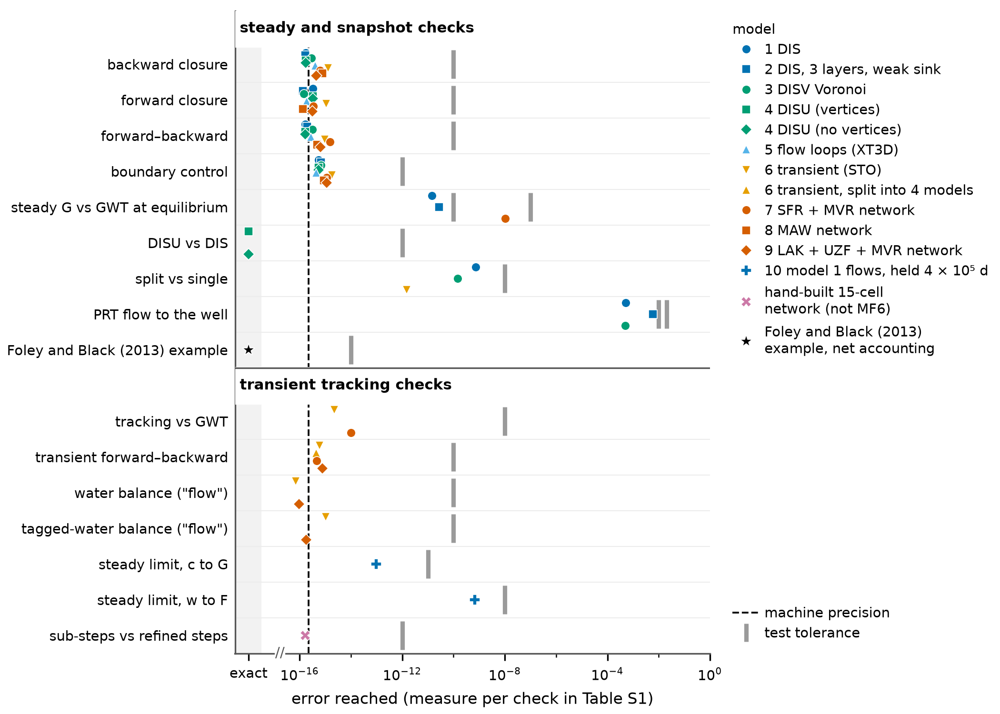

**Figure.** Largest error of each verification check of the automated tests. Each row is one check. Each marker is the largest error of that check on one case. The cases are the ten test models, the worked example of Foley and Black (2013) and a hand-built network of 15 cells. Markers in the "exact" column have an error of zero. The dashed line is machine precision, the size of rounding error. Light grey bars are the tolerances of the automated tests. A row with two bars has a looser tolerance for one model. Markers far above machine precision are limited by the flow solver's tolerance or, for PRT, by the number of release points. Upper block: steady-state and snapshot checks. Lower block: transient tracking checks. Its last row tests transport sub-steps. The test models are described in Text S2. Values, tolerances and error measures are in Table S4.

## Figure S2. Numerical dispersion maps and time steps

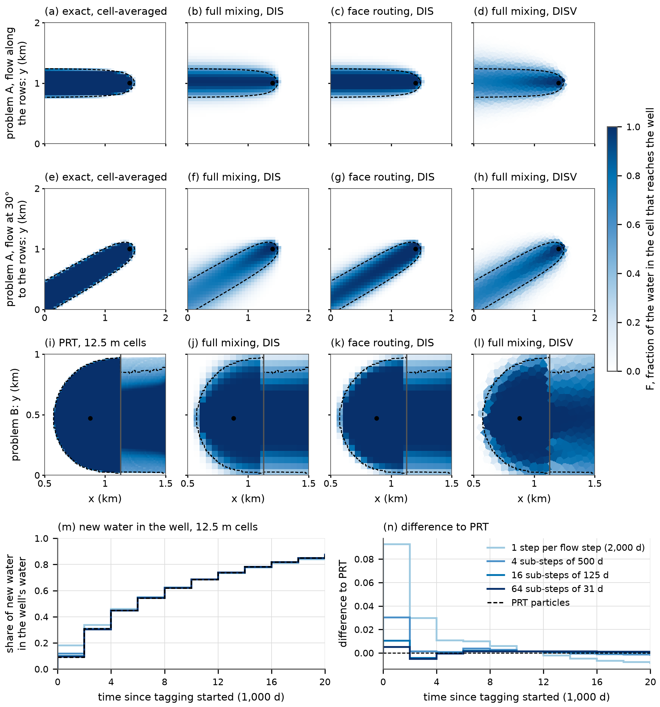

**Figure.** Numerical dispersion maps and time steps. Colour is F, the fraction of a cell's water that reaches the well (dot); the wider the band of intermediate colours across the dashed line, the stronger the numerical dispersion. (a–h) Problem A, uniform flow along the grid rows (a–d) and at 30° to them (e–h), 50 m cells. The first column is the exact capture zone averaged over each cell, the best a cell-based method can do; dashed: analytical capture-zone edge. (i–l) Problem B: PRT on the 12.5 m grid and the three methods on 50 m cells; dashed: the PRT F = 0.5 edge; grey: gaining river. Compared west of the river only. DIS: square cells; DISV: Voronoi cells. (m) Share of the well's water that entered after tagging started, per 2,000-day flow step, 12.5 m grid, for 1 to 64 transport sub-steps and for PRT; (n) difference to PRT.

This item gives the set-up and the numbers behind Fig. 13 and Section 6. Two test problems measure how much full mixing spreads the edge of a contributing area. Problem A is a confined aquifer, 2 km × 2 km, with a transmissivity of 500 m²/d, a regional hydraulic gradient of 0.002 and one well pumping 500 m³/d. The perimeter cells hold the analytical head of uniform flow plus a well. The reference is the analytical capture zone of Javandel and Tsang (1986). The regional flow runs along the grid rows or at 30° to them. The grids have square cells of 200 to 12.5 m (DIS) or Voronoi cells of about the same mean size (DISV). Problem B is test model 1 without its inactive cells. It is one unconfined layer of 1.5 km × 1 km, with recharge, a river, a constant-head west edge and a well pumping 800 m³/d. Its grids have cells of 100 to 12.5 m. Its reference is PRT on the 12.5 m grid, with about 94,000 flow-weighted particles released at the water table. East of the river, all water passes the gaining river, which is a weak sink. So the areas of problem B are compared west of the river only.

Across cell sizes, the transition band (0.1 < F < 0.9) was 1.2–12 cells wide. In metres, it narrowed only as about the square root of the cell size $h$, with fitted rates of 0.4–0.6. For cells of 50 m or less, the size of the F > 0.5 area was within 5 % of the reference area. The F > 0.1 area missed at most 0.1 % of the reference area in every run. For cells of 12.5–50 m, it was 30–90 % larger than the reference area in problem A and 8–16 % larger in problem B. Voronoi grids spread the edge no less than square cells. Face-to-face routing (Chowdhury 2016) is an experimental 2D option that passes water between cell faces instead of mixing it across the whole cell. It removed 35–70 % of the excess spreading. It did not change how fast the band narrows with $h$, because water still mixes across each cell face.

Totals depend much less on mixing. On the same grid, the well's shares by source were the same to three digits under full mixing, face routing and particles. For cells of 50 m or less, the flow-weighted mean travel time of all the water reaching the well was within 2 % of particle tracking in problem B and within 4 % of the analytical value in problem A.

The dispersion study draws areas with non-strict thresholds (F ≥ 0.1, F ≥ 0.5). The main text and the panel titles of Fig. 13 write strict ones (F > 0.1, F > 0.5), as the Neversink study did. A strict threshold leaves out cells with F exactly at the threshold. No full-mixing cell in the dispersion tests has F exactly 0.1 or 0.5, so the two forms give the same full-mixing and face-routing areas there. The comparison zones in Fig. 13 are different. The PRT zones hold cells at exactly 0.5, because a particle fraction is a ratio of particle counts. The cell-averaged exact zones hold cells at exactly 0.1 and 0.5. These comparison zones are drawn with ≥, as in the study. A strict threshold would shrink them by at most about 0.8 % of their area, about 0.007 in area error.

Problem B was also run with 2,000-day flow steps. With one transport step per flow step, the first-step share of new water was roughly doubled, 0.18 against 0.09 for the particles. Sixteen sub-steps of 125 d removed this, leaving a difference of about 0.001 at 12.5 m, averaged over the 30 steps.

## Figure S3. Net attribution and PRT-area maps

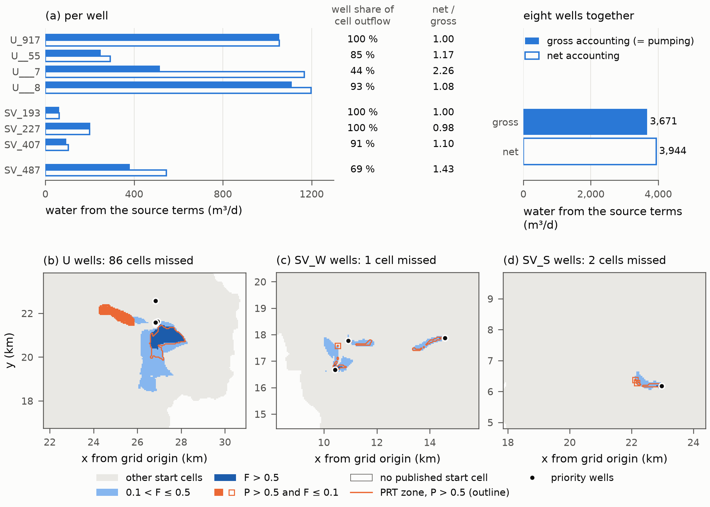

**Figure.** Gross and net accounting, and the full-mixing areas against the PRT area; Neversink calibrated model, streams as cells. (a) Water attributed to each priority well under gross (filled) and net (open) accounting (Section 2.4). The two differ most where the well takes a small share of its cell's outflow (U\_\_\_7, SV\_487). (b–d) Weight-losing particles lose weight at every sink as full mixing does, so the PRT area is not an independent advective area. Start cells in the F > 0.1 and F > 0.5 areas, with the outline of the PRT area (P > 0.5; particles released only where F > 10⁻⁶). Orange cells with open squares: PRT-area cells outside the F > 0.1 area. Of these 89 cells, 86 form a strip about 1.5 km long, 1–2.5 km west of the U wells. White: no published start cell. Coordinates in km from the grid origin.

Numbers behind the figure. U\_\_\_7 takes 44 % of its cell's outflow. Net accounting gives it 2.26 times its pumping. SV\_487 takes 69 % of its cell's outflow and gets 1.43 times its pumping. At SV\_227 net accounting gives 2 % less than the pumping, because it leaves out the 3.7 m³/d source term of the well cell. For the eight wells together, net accounting attributes 3,944 m³/d against 3,671 m³/d pumped. The per-well net values add up to 4,621 m³/d, because single-well traces count some water for two wells. This water is the 608 m³/d that passes directly from U\_\_\_7's cell into U\_\_\_8's, plus the 70 m³/d that leaves a well cell and reaches the group again. PRT particles were released in 29,201 published start cells, including all 2,139 with F > 0.1. Start cells without particles have P = 0. The F > 0.1 area holds 87 % of the PRT area (691 cells). It misses 89 of the PRT-area cells, 74 of them published contributing cells (72 of the 86 in the strip). The particles deliver 227 m³/d to the wells from these 89 cells, 6 % of the 3,736 m³/d they deliver in all. Of the F > 0.5 area (445 cells), 92 % lies inside the PRT area. The flow field has no flow loops.

## Figure S4. Neversink model and published regions

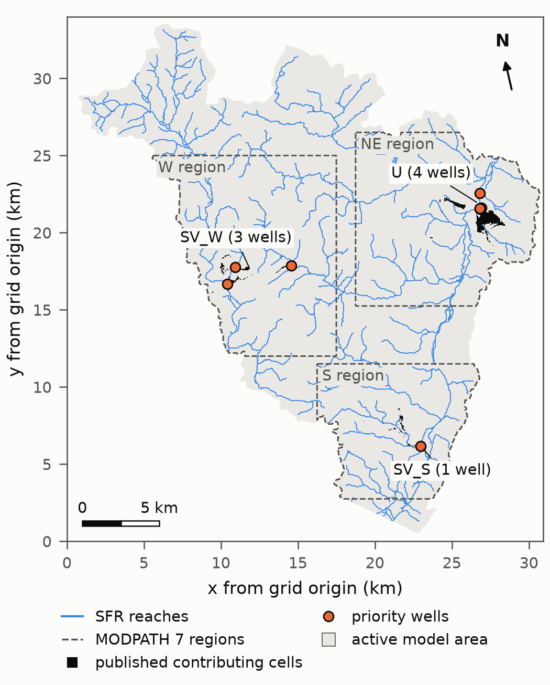

**Figure.** The Neversink/Rondout model (Fienen et al. 2022; Corson-Dosch et al. 2022). Grey: active model area. Blue lines: SFR reaches, each joined to its downstream reach. Dashed: the three regions (NE, W, S) of the published MODPATH 7 runs, whose particles start in the uppermost active cells. Black: the 980 published contributing cells. These are the start cells whose MODPATH 7 particle ends in one of the eight priority wells in the calibrated model. Because each start cell has one particle, these cells form patches and strips up to 4.3 km from their well. Orange dots: wells. The wells form the U cluster (four wells, within about 1 km of each other), SV_W (three wells) and SV_S (one well). Well names are those of the published model. Coordinates are km from the grid origin (EPSG:5070). True north is 12.9° west of grid north. We reran the published model input with MODFLOW 6 version 6.9. Its heads differ from the published run by at most 8.6 mm.

## Figure S5. Neversink backward fractions

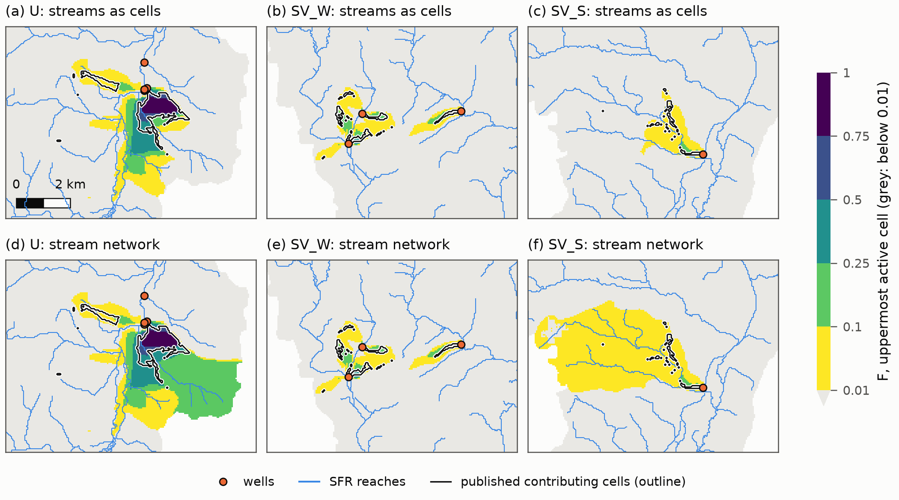

**Figure.** Backward fraction F of the uppermost active cell for the eight priority wells in the calibrated model. F is the share of a cell's water that ends at the wells. Colours: five classes of reversed viridis (light = low F), with edges at 0.01, 0.1, 0.25, 0.5, 0.75 and 1. Grey: F < 0.01 in the active area. White: inactive. Black outline, white halo: published contributing cells. Orange dots: wells. Blue lines: SFR reaches. (a–c) Streams as cells. Stream leakage is a source term of the aquifer cell. The area therefore stops at the streams. (d–f) Stream network. The SFR reaches are extra cells linked by stream routing. The wells' water then traces back to recharge. The area extends upstream along the streams (F 0.1–0.25 south-east of the U wells in d). Each panel is a 7.1 × 9.25 km window around one cluster of wells. Scale bar (a): 2 km.

## Figure S6. Neversink areas against particle tracking

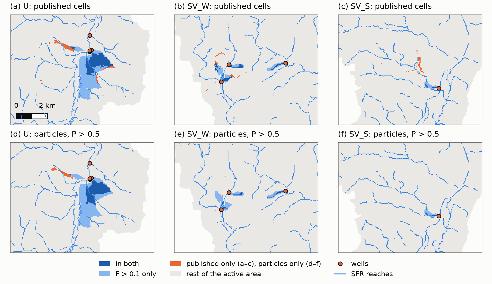

**Figure.** The F > 0.1 area of full mixing against two particle-tracking areas, in the windows of Figure S5. F is taken in the uppermost active cell of the calibrated model, with gross accounting and streams as cells. Dark and light blue together are the 2,139 cells of the F > 0.1 area. (a–c) Against the 980 published contributing cells. Dark blue: in both (711 cells). Orange: published only (269). Light blue: F > 0.1 only (1,428). (d–f) Against the 691 cells with a particle share above 0.5. The particles are weight-losing PRT particles released over the cell volume (Section 5). Dark blue: in both (602 cells, 87 % of the particle area). Orange: particles only (89). Light blue: F > 0.1 only (1,537). The three particles-only cells in (e) and (f) are too small to see. The windows hold every coloured cell. Grey: rest of the active area. White: inactive. Orange dots: wells. Blue lines: SFR reaches. Scale bar (a): 2 km.

## Figure S7. Neversink probability of contribution

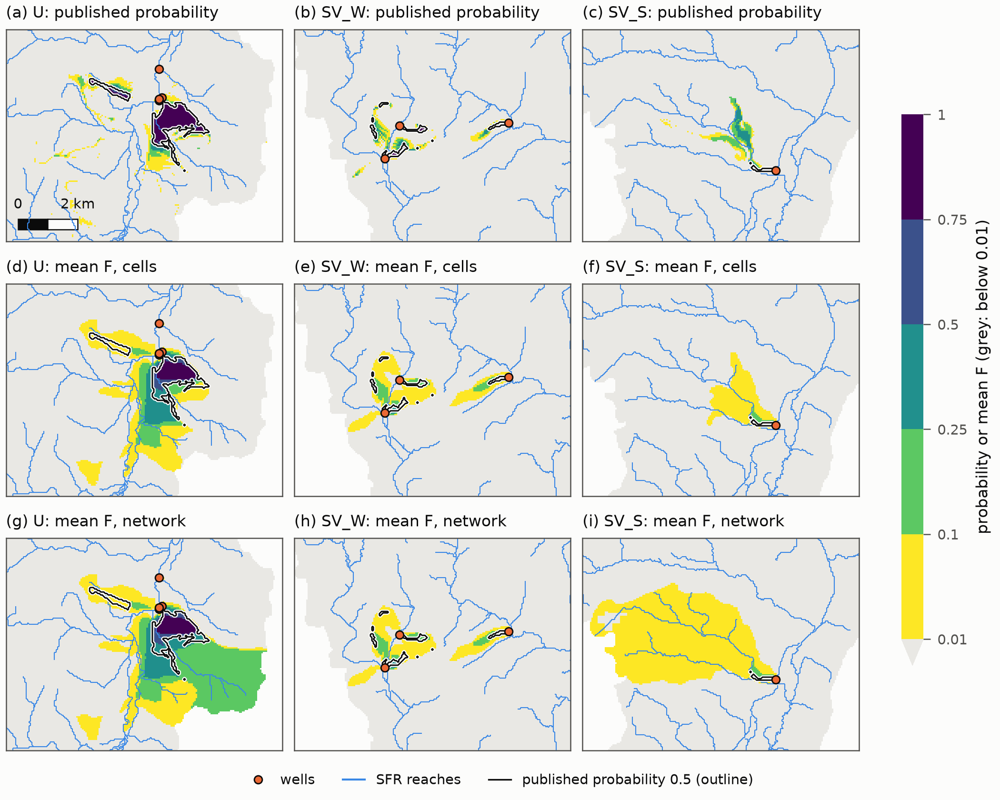

**Figure.** Published probability of contribution and ensemble mean F of the eight priority wells, in the windows of Figure S5. (a–c) Published probability of contribution. It is the share of the 357 published Monte Carlo contributing areas that contain a cell. (d–f) Ensemble mean F over 358 realisations, with streams as cells. (g–i) The same with the stream network. Mean F is a share of water, averaged over the realisations. The published probability is instead a share of realisations. Colours: the five classes of Figure S5. Grey: below 0.01 in the active area. White: inactive. Black outline, white halo: published probability 0.5. Orange dots: wells. Blue lines: SFR reaches. Scale bar (a): 2 km. The stored published areas lie one row south of their cells. We moved them one row north. With this and a second stored offset corrected, PRT with the published settings reproduces each of 60 tested areas (median overlap 0.996; Text S5).
