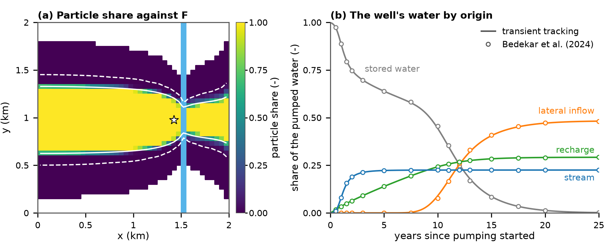
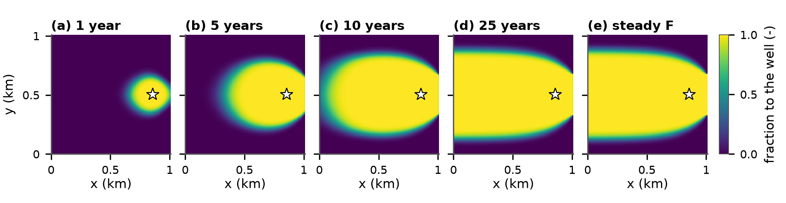

# Where does it come from and where does it go? Open-source flow tracing for MODFLOW 6 models

**Article Impact Statement:** Open-source code turns saved MODFLOW 6 flows into contributing areas, water sources and travel times for any well or stream, in steady-state or transient flow.

**Abstract:** Groundwater studies often ask where water comes from and where it goes. Which land feeds a well, spring or stream? How much of a well's water is river water? Where does recharge under a polluted field end up? Protection zones around water supplies rest on such answers. We present open-source code, `gwsource`, that answers such questions from the flows a MODFLOW 6 model saves. The code treats the water in each model cell as fully mixed. It computes the share of each cell's water that ends at a well, a stream or another outlet. The same trace splits that outlet's water by source and computes mean travel times. The code extends the full-mixing method of FlowSource (Foley and Black 2013) to every MODFLOW 6 grid type, stream networks and linked models. In transient models it carries tagged water through storage, forward and backward in time. Every result is checked against the flow model's water budget. The outputs matched MODFLOW 6 transport of tagged water to round-off when both used the same water volumes. They also reproduced a published transport study. Particle tracking produced the same overall mean travel times, as any method that conserves water should. On a published regional model of 1.68 million cells, a trace of eight wells took 2–3 s. A trace is therefore cheap enough to repeat for every realisation of an ensemble. Full-mixing areas are wider and more diffuse than particle areas, so the threshold that defines an area is a judgement. Particle tracking remains better where a sharp edge or first arrival matters.

**Key words:** flow tracing; full mixing; MODFLOW 6; contributing area; sources of water; travel time; transient tracking; source protection

# 1. Introduction

Practitioners who ask where groundwater comes from and where it goes also need to know how the answers change through the year and how sure they can be of them.

Methods that answer these questions from a groundwater flow model fall into four families. Particle tracking follows particles of water along flow paths. It is the standard tool for mapping a well's contributing area. This is the land where water enters the aquifer and later reaches the well. In MODFLOW models it runs in MODPATH (Pollock 2016) or in the particle-tracking model of MODFLOW 6 (PRT; Langevin et al. 2026). Transport with tagged water assigns the water from one source a concentration of 1 and all other water a concentration of 0. A cell's concentration is then the share of its water that came from that source (Bedekar et al. 2024). In MODFLOW 6 it runs in the Groundwater Transport (GWT) Model, with one model for each source (Langevin et al. 2022). As documented, the unit-concentration method steps forward in time only. It computes the share of each cell's water that came from a source, but not the share that will later reach a well. Adjoint and age methods solve transport equations of their own (Neupauer and Wilson 1999; Goode 1996). Full-mixing flow tracing splits each cell's mixed water among its outflows.

Particle tracking has one difficulty at weak sinks. Sink terms are the boundaries that remove water from a cell, such as a pumping well or a gaining stream. A weak sink is a cell whose sink terms take only part of the cell's outflow. A particle cannot split. It must either stop at a weak sink or pass on. If it stops, all its water is counted as reaching the sink. If it passes, none of it is. The rule chosen changes the contributing area (Section 4).

Under full mixing, a weak sink can take just its share of the cell's water. The rest passes on to the neighbouring cells. Two published full-mixing programs apply different rules at a weak-sink well. FlowSource (Foley and Black 2013) is used to draw source protection zones in England (Environment Agency 2019). These zones restrict activities that could pollute the water a supply well pumps. FlowSource counts all the water passing through a weak-sink well's cell as the well's water. We refer to this as net accounting. For transient models, it traces each time step as a steady-state flow field. MODALL (Potter et al. 2008) applies full mixing to steady-state MODFLOW-88 models. At a weak-sink well it counts only the water the well pumps. We refer to this as gross accounting. All these methods are compared in Supporting Information, Table S1.

This paper presents open-source code, `gwsource`, that extends the full-mixing method of FlowSource (Foley and Black 2013) to MODFLOW 6. It reads every MODFLOW 6 grid type, stream networks and linked models. It uses gross accounting by default. It checks every result against the water budget. In transient models, it carries tagged water through storage, forward and backward in time. A trace of a published regional model takes seconds (Section 4).

Section 2 explains the method and its outputs. Section 3 answers three common questions in worked examples. It then compares the outputs with particle tracking, transport with tagged water and a published study. Table 1, at the end of Section 3, summarises the ten example notebooks that ship with the code. Section 4 applies the code to a published regional model. Section 5 sets out the trade-offs of full mixing and draws the conclusions.

# 2. Method

**Overview.** This section explains how the code traces water and what each of its outputs means. A backward trace follows the water of a destination, such as a well, back to where it entered the model. A forward trace follows the water of a source, such as recharge, to where it leaves. Both work on the cell-by-cell flows that a MODFLOW 6 model saves, for one time step or for every step of a transient model. The backward fraction F maps where a sink's water comes from. A contributing area follows from it (example A in Section 3). The forward fraction G maps where a source's water goes. A trace also splits a sink's water by source, for example into recharge and river water. With a porosity, a trace also computes mean travel times (example C). For transient models, the code either traces each time step on its own flows or carries tagged water through storage (example B). The derivations and the solution of the equations are set out in the Supporting Information (Supporting Information, Text S1).

**Full mixing and the cell budget.** Every output of the code rests on the assumption of full mixing. Full mixing treats each active model cell as one well-mixed volume of water. All the water leaving a cell then has the same mix of origins and the same mix of fates, whichever outflow it takes. At the edge of a contributing area, the water of a cell then splits between the sink and other outlets, where particles from the same cell would mostly either reach the sink or miss it. For this reason, areas traced under full mixing are wider and more diffuse than particle areas. Larger cells widen them further (Section 5).

The code reads the cell-to-cell flows (FLOW-JA-FACE; Langevin et al. 2017) and the source and sink terms from the MODFLOW 6 budget file. The flow from cell $i$ to its neighbour $j$ is $q_{ij} \ge 0$. Source terms, such as recharge or leakage from a river, bring water into a cell. Sink terms, such as wells or drains, take it out. Each term is kept separate by package and by boundary, so that a trace can follow the water of individual boundary conditions. A stream reach, a lake or a multi-aquifer well can stay a source or sink term of the aquifer cells it exchanges water with. It can also be traced as a cell of its own, from its package budget file, so that its flows to the aquifer, to other reaches and through the water mover (MVR) become flows $q_{ij}$ like any other. The cells of models linked by exchanges are treated as one set of cells. The choice between a term and a cell changes how a trace splits a sink's water by source (example C in Section 3).

If $\mathrm{Src}_i$ and $\mathrm{Snk}_i$ are the sums of the source and sink terms of cell $i$, its total inflow, total outflow and cell budget error are

$$I_i = \sum_j q_{ji} + \mathrm{Src}_i, \qquad O_i = \sum_j q_{ij} + \mathrm{Snk}_i, \qquad r_i = I_i - O_i. \tag{1}$$

The cell budgets of a MODFLOW model do not balance exactly, because the solver stops once the heads and residuals meet convergence tolerances. The cell budget error $r_i$ is usually small but not zero. The code reports this error but never forces it to zero. Because F is written with each cell's outflow and G with its inflow, the error enters the water-budget checks that link them (below).

**The backward fraction F.** The backward fraction answers the question of where the water of a sink comes from. We refer to the sink terms that a trace follows as the destination. The destination can be one well, one stream reach or a group of wells traced together. The backward fraction $F_i$ is the share of the water leaving cell $i$ that later leaves the model through the destination. Let $d_i$ be the outflow of cell $i$ through the destination, and $P_{ij} = q_{ij}/O_i$ the share of its outflow that goes to cell $j$. Under full mixing, the water that cell $i$ sends to cell $j$ shares the fate of all the water leaving $j$. In volumes and in shares, this reads

$$F_i\, O_i = \sum_j q_{ij}\, F_j + d_i , \qquad F_i = \sum_j P_{ij}\, F_j + \frac{d_i}{O_i}. \tag{2}$$

A cell's F is the share of its outflow that leaves through the destination directly, plus the outflow-weighted sum of the F of its downstream neighbours. Eq. (2) holds in every cell, so one solve of these linear equations yields the fractions to every destination group at once. Where water circulates among cells, as it can with the XT3D option of MODFLOW 6 for anisotropic flow (Provost et al. 2017), the code solves each such flow loop exactly. FlowSource instead deletes the smallest flow in each loop (Foley and Black 2013; Supporting Information, Text S1).

A map of F shows where a destination's water comes from. A contributing area is the set of cells where F exceeds a threshold that the user chooses, such as 0.5. Because F takes in-between values at the edge of an area, the choice of threshold is a judgement (Section 5). The sum of F times the cell area yields a size of the area without a threshold. We refer to it as the expected area.

Fig. 1a works through an eight-cell example in which water enters at the west edge and as recharge and leaves through a well and a river. The well cell receives 11 m³/d, of which its well pumps 6 m³/d. The other 5 m³/d flow on to the river without returning to the well. Eq. (2) then yields F = 6/11 = 0.55 in the well cell. All the water of the two cells west of the well cell flows into it, so they share its F. The cells of the upper row send part of their water past the well to the river, so their F is lower.

**Figure 1.** (a) Backward fractions F (in cells) to a 6 m³/d well in an eight-cell example (gross accounting). Water enters from the west and as recharge of 1 m³/d per cell. It leaves through the well and a river. Arrow widths show flows. Only the well cell's flows are numbered (m³/d). In the well cell, F = 6/11 = 0.55. (b) One cell i of a transient model. A snapshot (top) traces each time step on its own flows. Water released from storage then enters the cell as a source of unknown origin. Transient tracking (bottom) carries the water stored in the cell at the end of step n into step n + 1. There it mixes with the inflows of that step. V is the cell's water volume and c the share of its water that is tagged. The height of the fill shows V and its shade shows c.

**Gross and net accounting at weak sinks.** The well cell of Fig. 1a is a weak sink, because its well takes only part of the cell's outflow (Section 1). At a weak sink the method needs a rule for how much of the cell's water to attribute to the sink. Eq. (2) applies gross accounting (Section 1). Each sink term takes its share of the cell's total outflow. Only that share counts as the sink's water, while the rest of the cell's outflow passes on to its neighbours. Gross accounting is the default because it attributes to each sink only the water that the sink takes from the model, as the MODFLOW 6 Groundwater Transport (GWT) Model does (Langevin et al. 2022), so that the water traced to a well adds up to what it pumps.

Under net accounting, the destination cells are fixed at F = 1. All the water that flows into them from other cells then counts as the destination's water. This is how FlowSource attributes water at a well (Foley and Black 2013; Supporting Information, Text S1). In Fig. 1a, net accounting adds the 5 m³/d that flow on through the well cell to the river. It leaves out the 1 m³/d of recharge on the well cell itself, because it works from the cell-to-cell flows only. The well is therefore attributed the 10 m³/d that flow into its cell from its neighbours, against the 6 m³/d it pumps. The difference is largest at a small well in a cell that carries much more water than the well pumps (Table 1, row 02).

**The forward fraction G.** The forward fraction answers the opposite question, which is where the water of a source goes. The forward fraction $G_i$ is the share of the water entering cell $i$ that came from the source. Let $s_i$ be the inflow of cell $i$ through the source. The volume of water entering cell $i$ that came from the source is then

$$G_i\, I_i = \sum_j q_{ji}\, G_j + s_i . \tag{3}$$

A cell's G is the share of its inflow that enters directly from the source, plus the inflow-weighted sum of the G of its upstream neighbours. Eq. (3) mirrors Eq. (2), with inflows in place of outflows. A map of G shows how much of each cell's water came from the source (Fig. 2c). G equals the concentration that GWT reaches at equilibrium on the same grid, with upstream weighting and no dispersion, when the source water carries a concentration of 1 and all other water a concentration of 0 (Table 1, row 03).

**Volumes and the water-budget checks.** A fraction says what share of a cell's water reaches the destination, but not how much water that is. A fraction times a flow is a volume of water per unit time. We refer to these rates as volumes. The volume through cell $i$ is $F_i O_i$. It says how much of the water passing through the cell later reaches the destination. The volume from cell $i$ is $F_i$ times the cell's inflow through its source terms. It says how much water enters the model in that cell and later reaches the destination. The volumes from all cells, added up package by package, split the destination's water by source (Fig. 2b). In the same way, the volumes of a forward trace split a source's water by the sink through which it leaves.

Because they are volumes of water, the results of a backward or forward trace can be checked against the flows that MODFLOW 6 simulated. The closure check follows from adding Eq. (2) over all cells. It says that the source water traced to the destination, once corrected for the cell budget errors, adds up to the water the destination takes. The forward–backward check requires the volume from a source to a destination to be the same whether it is traced backward from the destination or forward from the source. The boundary-control check traces every sink of the model at once. It requires the fractions to all sinks to add up to 1 in every cell with outflow, so that the water of every cell leaves the model somewhere. All three checks are met to round-off for any flow field, except in loops where water circulates without ever reaching a sink (Supporting Information, Text S1). As a result, a check error larger than round-off points to a fault in the tracing. The checks test the solution of the equations. They cannot show that the flow model is right, or that full mixing describes how water moves in the aquifer.

**Mean travel time.** Fractions say how much water reaches a destination, but not when it arrives. Travel times, unlike fractions, need a porosity. The water volume $V_i$ of cell $i$ is porosity times the saturated volume of the cell. Water stays in a fully mixed cell for a mean residence time $\tau_i = V_i/O_i$, whichever outflow it then takes. Let $t_i$ be the mean travel time from entering cell $i$ to leaving the model through the destination, for the water that does leave there. The code solves for $m_i = F_i\, t_i$, because $m_i$ obeys an equation of the same form as Eq. (2),

$$m_i = \tau_i\, F_i + \sum_j P_{ij}\, m_j . \tag{4}$$

Each cell adds its own residence time, weighted by its F, to the times of its downstream neighbours. The code reports the mean travel time $t_i = m_i/F_i$ only where F is above a small threshold (Fig. 2d), because where F is close to zero the mean rests on very little water. Mean travel times are defined for gross accounting only. Eq. (4) weights each cell's residence time by the share of its outflow that leaves through the destination. Under net accounting a destination cell has F = 1, although part of its water flows on to other sinks, so this weight no longer matches the water that leaves through the destination. A mean travel time averages fast and slow water that have mixed in the cells, so it is not a first-arrival time.

**Transient flow: snapshots and transient tracking.** FlowSource (Foley and Black 2013) traces a transient model one time step at a time, as if the flows of each step were steady-state (Environment Agency 2019). We refer to such a trace as a snapshot. Water released from storage then counts as a source term. Water taken into storage counts as a sink term (Fig. 1b, top). This is a limitation, because in a transient model the water that reaches a sink in one step may have entered the aquifer in an earlier one. A snapshot cannot show recharge of the wet season reaching a well in the dry season. It also cannot say where the water released from storage came from.

We extend full mixing through time. We refer to this as transient tracking. Water from the chosen sources is tagged, as a tracer would be, and carried from step to step through the water volume of each cell (Fig. 1b, bottom). The hydraulic mixing-cell method of Partington et al. (2011) carries mixed water through storage in a similar way in integrated surface water–groundwater models. Storage terms are not traced as source or sink terms. Instead they change the water volume of a cell over step $n$ from $V_i^{\mathrm{old}}$ to $V_i^{\mathrm{new}}$, with $V_i^{\mathrm{old}} - V_i^{\mathrm{new}} = \Delta t^n S_i$, where $\Delta t^n$ is the length of the step and $S_i$ the net release from storage. Let $c_i^n$ be the share of the water in cell $i$ at the end of step $n$ that is tagged. With all flows taken from step $n$,

$$V_i^{\mathrm{new}} c_i^n - V_i^{\mathrm{old}} c_i^{n-1} = \Delta t^n \Big[ \sum_j q_{ji}\, c_j^n + s_i^n - (O_i + r_i)\, c_i^n \Big]. \tag{5}$$

Here $O_i$ and $s_i$ leave out the storage terms, but $r_i$ is still the cell budget error of Eq. (1), with the storage terms included. In Fig. 1b (bottom), $V_i^n$ stands for $V_i^{\mathrm{new}}$ of step $n$.

Eq. (5) is the balance of tagged water in one cell over one step. The outflows carry the cell's mix at the end of the step, because the scheme is implicit in time, as in GWT (Langevin et al. 2022). The term $r_i c_i$ lets the cell budget error leave the cell at the cell's own mix, as the flow-imbalance correction of GWT does. The code applies this correction by default. Water moves by advection only, with no dispersion, diffusion, sorption or decay. Some spreading still comes from mixing whole cells and from long time steps (Supporting Information, Text S1).

Transient tracking needs a porosity and the budget of every time step. The Output Control setting SAVE BUDGET ALL writes this budget. We refer to the water in the model at the start of the simulation as initial water. It can be tagged as its own group. Two choices also affect the result. By default, the water volume of each cell starts at porosity times saturated volume and then changes only by the storage flows, so that every cell's water balance closes exactly. As an option, the volume is reset to porosity times saturated volume at the end of each step, as in GWT, so that results can be compared with a GWT run. Long implicit time steps make tagged water arrive too early. For this reason, each flow step can also be split into shorter transport sub-steps without a change to the flow model. The SI describes both options (Supporting Information, Text S1). The comparisons in Section 3 show their effect.

**Backward tracking in time.** Forward tracking says how much of each cell's water came from a source. It cannot say which of the water now in the aquifer will reach a sink, or by when. Backward tracking in time answers this question. It solves a balance of the same form as Eq. (5), with the roles of inflow and outflow swapped, from the last step of the simulation back to the first. This differs from MODPATH backward tracking, in which particles start at the sink and move against the flow. Backward tracking in time is the discrete counterpart of the adjoint methods that solve a transport equation backward in time (Neupauer and Wilson 1999; Cornaton and Perrochet 2006).

The backward fraction in time $w_i^n$ is the share of the water in cell $i$ at the start of step $n$, or entering it during the step, that leaves through the destination before the simulation ends. Over step $n$,

$$\Big[ V_i^{\mathrm{new}} + \Delta t^n\, (O_i + r_i) \Big]\, w_i^n = \Delta t^n \Big[ \sum_j q_{ij}\, w_j^n + d_i^n \Big] + V_i^{\mathrm{old},\,n+1}\, w_i^{n+1}. \tag{6}$$

The water in a cell during a step can reach the destination by three routes. It can leave through the destination directly, flow to a neighbour, or stay in the cell into the next step, with the volume at the start of that step. No water can reach the destination after the last step, so the solve starts there with w = 0.

A map of w at the start of the simulation shows the share of each cell's water that the destination takes before the simulation ends, for example within 30 years (Fig. 2f). A threshold on this map delineates a time-limited contributing area. The same backward run also computes the share of each cell's water that leaves through other sinks and the share still stored in the model at the end. The three shares add up to 1, apart from a remainder that the code reports (Supporting Information, Text S1). As in steady-state flow, a forward–backward check links the forward and backward runs (Supporting Information, Text S1). When the flows are held constant for long enough, c tends to the steady-state forward fraction G. In the same limit, w at the first step tends to the steady-state backward fraction F.

# 3. Worked examples

This section shows how a practitioner can use the code to answer three common questions and how far each answer can be trusted. The three worked examples ask where a well's water comes from (example A), how much of it is already in the aquifer (example B), and how much comes from each source and how old it is (example C). A paragraph before Table 1 then compares the outputs with other common approaches, such as particle tracking, transport with tagged water and a published study. The example sink is a well, but each output applies in the same way to a stream reach, a drain, a lake or a group of them. Fig. 2 shows one output of each type. Table 1, at the end of this section, summarises the eleven notebooks that ship with the code.

All examples start from one small example model. It is a single unconfined layer of 40 × 40 cells of 50 m, with recharge of 5 × 10⁻⁴ m/d on every cell. The layer is 50 m thick and has a hydraulic conductivity of 5 m/d. A constant head along the west edge brings in regional groundwater. A river runs north–south 100 m east of a supply well that pumps 800 m³/d. Each example ships with the code as a Jupyter notebook that builds its model, reproduces its numbers and draws its figures (Section 6).

**Figure 2.** Outputs for the example well (Section 3). (a) Backward fraction F. White lines: F = 0.1 (dashed) and 0.5 (solid). (b) The well's water by source (m³/d). (c) Forward fraction G of recharge on the outlined field. (d) Mean travel time where F > 0.5. (e) Cells with F > 0.5 in all (inner zone) or some (seasonal zone) of 36 seasonal snapshots. Ring: F > 0.1 in some snapshots. (f) Share of each cell's water pumped within 30 years. (g) Share of 50 posterior realisations with F > 0.5. Red dashed line: true F = 0.5. (h) F on a Voronoi grid. Panels (f) and (h) use the colours and lines of (a). Star: well. Blue cells: river.

**Example A: where does the well's water come from?** A protection zone around a supply well starts from the land whose water reaches the well. For this reason, a practitioner needs to know how large that area is and how much to trust its edge. Fig. 2a maps F for the supply well. The size of the contributing area depends on the threshold that the user chooses. The area where F > 0.5 is smaller than the area where F > 0.1, because the higher threshold keeps only the cells that send most of their water to the well.

The edge of the area is where full mixing and particle tracking are expected to differ. The comparison with particles before Table 1 tests this edge. For the practitioner, it shows that on this model the F > 0.5 area is a fair estimate of the area that particles delineate. The F > 0.1 area serves here as a cautious outer limit. Section 4 shows that a regional model with a more complex flow system need not behave in the same way.

**Example B: how much of the pumped water is already in the aquifer?** A decision maker may ask how much of the water pumped over the coming decades is already in the aquifer today. The answer matters where new recharge differs in quality from the water already stored, for example where land use has changed. A seasonal version of the example model shows why snapshots cannot answer this question (Section 2). In this version, recharge and pumping vary from season to season over 30 years, with one time step per season. Seasonal snapshots show which cells lie in the contributing area in every season and which in some seasons only (Fig. 2e; Table 1, row 05). Averaged over the 30 years, the snapshots attribute about 60 % of the well's water to recharge and 15 % to storage release (Supporting Information, Figure S1a). A snapshot cannot say where that stored water came from. It may be old water or recharge of the last wet season.

Transient tracking shows that most of the water pumped in the first decades was already in the aquifer. The tracking uses a porosity of 0.3 and four transport sub-steps per flow step. The run starts from a steady state with the well already pumping. Of all the water pumped in the first 10 years, 81 % was initial water. Over 30 years this share is 68 %. Even in the last season of year 30, 51.6 % of the well's water is initial water. In that season recharge supplies about a third of the well's water, against about 60 % averaged over the snapshots.

Backward tracking in time shows which of the water now in the aquifer reaches the well. Only the water near the well and along the main flow path reaches it within 30 years (Fig. 2f). Most of the water in the steady-state contributing area is still on its way at the end. Backward tracking attributes the same share of the water pumped over 30 years to initial water as the forward run, as the forward–backward check requires.

For the practitioner, this means that snapshots and transient tracking answer different questions. A snapshot treats the flows of each step as steady, so it says which sources feed the well but not when their water entered the aquifer. Transient tracking shows that most of the water pumped over the next decade is already in the aquifer. Where new recharge differs in quality from the stored water, we would therefore expect the well's water to change over decades rather than seasons on a model like this one.

**Example C: how much water comes from each source, and how old is it?** Many studies need a sink's water split by source more than the edge of its area. A water-quality study, for example, may need to know how much of a well's water is river water and how old the water from each source is. The backward trace of example A answers the first part of this question. It splits the water that the well pumps by the source term through which that water entered the aquifer. For the supply well, 71 % of the pumped water is recharge. The rest comes in about equal parts from inflow at the west edge and from river leakage (Fig. 2b; Table 1, row 01). These shares describe the mixture that reaches the well. They do not say where the rest of each source's water goes. A forward trace answers this reverse question, for example for the recharge under a field where fertiliser is spread (Fig. 2c; Table 1, row 03).

The split by source also depends on how a stream is traced. In a second version of the example model, the river becomes a stream simulated with the Streamflow Routing (SFR) package, flowing from north to south. When the stream reaches are traced as cells of their own, part of the water that would otherwise count as stream leakage turns out to be recharge that had discharged to drains or to the stream (Table 1, row 07). A study that reports how much of a well's water is stream water should therefore say whether it traced the stream reaches as cells of their own.

The backward trace also estimates the age of the well's water. With a porosity, it computes the mean travel time of each source's water to the well (Fig. 2d). This is the average time that the water takes from where it enters the aquifer to the well. On the example model, water from nearby sources such as the river arrives within a few years, while inflow at the distant west edge takes about a century (Table 1, row 06). A mean travel time is not the time at which the first water arrives. It averages fast and slow water, so it cannot say when the fastest water reaches the well. The comparison with particles before Table 1 shows which of these times depend on how a method treats mixing. For the practitioner, this means that the overall mean travel time and the split by source can be trusted more than the travel time from one cell. We would still check the split with particles where it matters (Section 4). We would also draw a short time-of-travel zone with particles (Section 5).

**How the outputs compare with other methods.** Practitioners may ask how the outputs compare with particle tracking and with transport of tagged water. Table 1 lists the numbers. On the flows of example A, MODFLOW 6 PRT particles that lose weight at each sink by the full-mixing shares deliver most of their water to the well from an area close in size to the F > 0.5 area. We refer to them as weight-losing particles (Supporting Information, Text S2). The F > 0.1 area holds every cell of this particle area. The two methods differ most at the edge, where most particles either reach the well or miss it while full mixing assigns the cell an in-between value (Fig. 3a). Because these particles share the full-mixing rule at sinks, they are not an independent particle reference. For example C, the same particles yield nearly the same overall mean travel time as full mixing (Table 1, row 06). This agreement is not an independent test. A particle run conserves water when the weight its particles deliver to each sink equals the water that sink takes. Any method that conserves water yields the same overall mean, because that mean equals the volume of water bound for the sink divided by the sink's inflow. The agreement therefore tests the volume attributed to the sink. The time compared with PRT is the time to entry of the sink cell, because particle trackers stop particles there (Supporting Information, Text S1). Travel times from single cells differ more, most near the edge of the area. A particle follows one path, while full mixing averages the fast and slow paths that a cell's water takes. In example B, transient tracking with GWT's water volumes matched a GWT run with tagged recharge to round-off (9.8 × 10⁻¹⁴) in every cell and step. This is a consistency test, because both codes solve the same equations. The choice of water volumes changed the fractions by less than 0.004. Four transport sub-steps per flow step removed most of the early arrival of new water that long time steps cause (Supporting Information, Text S2). For an external benchmark, Bedekar et al. (2024) used transport of tagged water in MODFLOW-2005 and MT3D-USGS to show how a new well's water changes from stored water to water from its sources. Our rebuild of their model in MODFLOW 6 reproduces the published curves (Fig. 3b; Table 1, row 10). At year 25, the well's water is 48.2 % lateral inflow, 29.2 % recharge and 22.5 % stream water, against 48 %, 29 % and 23 % in the published study. The largest difference from the published curves is 1.3 percentage points, about the accuracy of values read off a published figure.

**Figure 3.** Comparisons with other methods. (a) Contributing area of worked example A against weight-losing PRT particles on the same flows. The colours show the particle share in each cell of the example model where the particles start. The particle share is the share of the water released in a cell that the particles deliver to the well. Cells without particles are blank. White lines: F = 0.1 (dashed) and F = 0.5 (solid) from full mixing. Star: well. Blue cells: river. (b) The well's water by origin in the unit-concentration study of Bedekar et al. (2024), rebuilt in MODFLOW 6. Stored water is the water in the aquifer at the start of the run, one day before pumping starts. It is the initial water of Section 2. Lines: forward transient tracking. Open circles: values read off Figure 2 of Bedekar et al. (2024).

**Table 1.** The eleven notebooks that ship with the code and how each compares with another approach (Supporting Information, Text S2).

| Notebook | Question | Output | Compared with (agreement) | Fig. 2 panel |
|---|---|---|---|---|
| 01 (A, C) | Where does a well's water come from? | F map, F > 0.5 and F > 0.1 areas, the well's water by source | Weight-losing PRT particles (F > 0.5 area 2.1 % smaller) | a, b |
| 02 | What is computed, and what changes at a weak sink? | Gross and net accounting at a weak sink, fractions to every sink | Foley and Black (2013), reproduced to 1 × 10⁻¹⁴ | – |
| 03 (A, C) | Where does a source's water go? | G maps, fate of the recharge on a field | GWT with tagged water, run to equilibrium (to 4.2 × 10⁻¹³) | c |
| 04 | Does it work on my grid? | F maps and areas on regular (DIS), Voronoi (DISV) and fully unstructured (DISU) grids | The same model on the regular grid (DISU identical, DISV expected area +0.4 %) | h |
| 05 (B) | How does the area change through the seasons? | Seasonal snapshots of the contributing area over a 3-year run | – | e |
| 06 (C) | How old is the water reaching the well? | Mean travel time map, 5- and 25-year zones, mean travel time by source | Weight-losing PRT particles (overall mean travel time within 0.5 %) | d |
| 07 (C) | What if water passes through streams, drains, wells or linked models? | The well's water by source, with the stream reaches of the Streamflow Routing (SFR) package traced as cells of their own or not. A multi-aquifer well. A model split into three linked models | The same model unsplit (to 2.1 × 10⁻¹³) | – |
| 08 (B) | How much of the pumped water was already in the aquifer? | The well's water by origin through time | GWT with tagged recharge (to 9.8 × 10⁻¹⁴) | f |
| 09 | How does parameter uncertainty change the area? | Probability of contribution over 50 parameter sets, before and after history matching with PEST++ IES (White 2018; White et al. 2020) | A synthetic true model (93 % of the true F > 0.5 area covered after history matching, 79 % before) | g |
| 10 (B) | Does it reproduce a published unit-concentration study? | The well's water by source over 25 years. Time-limited contributing areas from backward tracking | Bedekar et al. (2024), Figure 2 (within 1.3 percentage points), and four GWT runs (to 1.5 × 10⁻¹⁰) | – |
| 11 | How wide is the edge of an area, and how does it change with the grid? | Width of the band where F lies between 0.1 and 0.9 against cell size and grid orientation, on two test problems | The analytical capture zone of Javandel and Tsang (1986) and PRT on a fine grid (F > 0.5 area within 4.5 % of the reference area for cells of 50 m or less) | – |

# 4. A regional model: Neversink

This section demonstrates the approach on a real-world published model. We compare the results with the published contributing areas from particle tracking and discuss the differences. The USGS Neversink/Rondout model (Fienen et al. 2022; Corson-Dosch et al. 2022) is a steady-state MODFLOW 6 model of 1.68 million cells. The published study used particle tracking to map the contributing areas of eight priority supply wells on each realisation of an ensemble of parameter sets from history matching. This section compares our results with the published area of one realisation. We refer to it as the calibrated model. We also traced every realisation of the ensemble, but those results are not presented here (Supporting Information, Text S3).

The published study mapped the wells' contributing area in the calibrated model with MODPATH 7 (Pollock 2016). One particle started at the centre of the uppermost active cell of each column within three rectangular blocks of model rows and columns, one around each cluster of priority wells (Fienen and Corson-Dosch 2021). We refer to these cells as the start cells. The 980 start cells whose particle ends in a priority well form the published contributing area. We traced the wells in the calibrated model with gross accounting. The SFR stream reaches stayed source and sink terms of the aquifer cells.

A `gwsource` trace of all the wells took a few seconds, against about 30 s for the fastest PRT run on the same flows. On an Apple M4 Max with 64 GB of memory, one trace of nine destination groups (each well alone and all eight together) took 2–3 s and peaked at 2.5 GB of memory. Each further group added about 0.19 GB (Supporting Information, Text S3). These times do not compare like with like, because a `gwsource` trace computes F in every cell while PRT computes particle shares only where particles are released.

The full-mixing areas differ from the published area. We measure this by how much of the published area each delineated area covers. Coverage alone can mislead, because a larger area covers more of the published area. We therefore also compare the size of each area with the size of the published area. The published area comes from one reasonable set of particle settings for where recharge and stream flows enter a cell, where particles stop and how particles that start in dry cells are handled. PRT with the same settings reproduces the published area. Its area covers all 980 cells of the published area and only 2 more cells. Other reasonable settings for particle runs that conserve water already change the area considerably. With the MODFLOW 6 default settings for these flows and for dry start cells, PRT from the same start cells covers only 67 % of the published area. Its area is also a quarter smaller (Supporting Information, Text S3).

Full mixing matches the published area less well than any of these particle runs. The area where F exceeds 0.5 covers 43 % of the published area and is less than half as large. We infer that the main reason is the one seen in the comparison with particles in Section 3. Both methods use the same flows across cell faces. Inside a cell, a particle follows a velocity interpolated from these flows, so where it enters the cell decides where it leaves. Full mixing does not keep this position. It splits the cell's water among all its outflows in proportion to their size. On average, the cells of the published area send 42 % of their water to the wells. Many of these cells therefore fall below F = 0.5 (Fig. 4a). The F > 0.1 area covers 73 % of the published area, but it is about twice its size. Fig. 4b shows this for a window around four of the wells, where the F > 0.1 area covers 538 of the 688 cells of the published area.

**Figure 4.** F and the published contributing area of the Neversink model, in a 7.1 × 9.25 km window around four of the priority wells. The window holds 688 of the 980 cells of the published area. (a) F in the calibrated model, with the published area outlined. (b) The F > 0.1 area against the published area. Dark blue: in both (538 cells). Orange: published area only (150). Light blue: F > 0.1 only (1,090).

Weak sinks add to the difference. A buried stream cell holds a stream reach and has another active cell above it. Where such a reach gains water, it is a weak sink that stops particles. In the published runs, 26,828 particles stopped in buried stream cells and 466 in the five priority wells that take only part of their cell's outflow. Each stopped particle counts in full as reaching that sink, while full mixing passes the rest of the cell's water on (Supporting Information, Text S3). Net accounting attributes to a weak-sink well all the water that enters its cell. With net accounting, the F > 0.5 area covers 46 % of the published area, against 43 % with gross accounting. At the weak-sink wells, gross accounting comes closer to the size of each well's published area than net accounting does.

Example C (Section 3) showed that a sink's split by source depends on how stream reaches are traced. On this model the split also depends on the method. With the stream reaches left as source and sink terms, full mixing attributes 57 % of the wells' water to recharge and 43 % to stream leakage. With the reaches traced as cells of their own, all of the wells' water traces back to recharge. Particle runs that place particles from the full-mixing trace and lose weight at sinks as full mixing does split the wells' water 49 % recharge and 51 % stream leakage, with the reaches again left as source and sink terms. Both methods deliver the wells' total inflow to within 2 %. We infer, without tracing it cell by cell, that stream water leaking near the wells stays on particle paths that end at a well. Full mixing instead assigns that water the average fate of all the water leaving the cells it passes. A split by source on a regional model should therefore be reported with the method that produced it.

# 5. Trade-offs and conclusions

From the flows that a MODFLOW 6 model saves, `gwsource` maps where the water of any sink comes from and where the water of any source goes. The same trace splits a sink's water by source and computes mean travel times. The code extends the full-mixing method of FlowSource (Foley and Black 2013) to every MODFLOW 6 grid type, to stream networks, to linked models and to transient flow. Every result is checked against the water budget (Section 2). The outputs agree with GWT and with a published unit-concentration study (Section 3). On a published regional model, a trace took less time than the fastest particle-tracking run (Section 4).

The main trade-off is that full-mixing areas are wider and more diffuse than particle areas (Section 2). Their edge is a band of cells where F lies between 0 and 1. Finer cells and a grid aligned with the main flow narrow this band (Supporting Information, Text S4). No single threshold on F therefore reproduces a particle area everywhere. A particle area is not a fixed reference either, because it depends on its particle settings as much as on the flow model (Section 4). The chosen threshold is a judgement about what the area is for. For this reason, the chosen threshold should be reported with the area, along with the accounting and how stream reaches were traced (Section 3).

A sink's overall mean travel time and its split by source are less sensitive to mixing than the edge of its area is. Any method that conserves water yields the same overall mean travel time (Section 3). In a test problem, particles produced the same split by source (Supporting Information, Text S4). On the regional model, with its more complex flow system, the split by source differed between the two methods (Section 4).

We would therefore use particles where a sharp edge or a first arrival matters, such as a short time-of-travel zone. We would use GWT where dispersion, sorption or decay matter, because transient tracking moves water by advection only (Langevin et al. 2022). Full mixing suits many sinks, unstructured grids, package networks and repeated runs, such as one trace for every realisation of an ensemble.

The method also has practical limits. Transient tracking has been tested on synthetic models only. Its memory grows with the number of time steps. Movers between models (the MVE package) are not implemented yet. Without cell vertices, the code cannot map results on a DISU grid.

`gwsource` is an open-source Python package (MIT licence) that reads the binary grid and budget files of a MODFLOW 6 model on any grid type. It is tested on ten small test models and two published examples (Section 6).

# 6. Code and Data Availability

The code, `gwsource`, is open source under the MIT licence at https://github.com/rhugman/gw-source [check: public URL]. This paper uses version 0.0.1 [check: release version and tag]. The eleven notebooks of Table 1 ship with the release under the same numbers. The same release holds the verification tables (docs/verification.md), the test models (tests/models/README.md) and the notes of the Neversink study (docs/neversink_study.md). The Neversink model is in a USGS data release (Fienen and Corson-Dosch 2021). The files behind every figure will be archived on Zenodo [check: DOI].

# References

Bedekar, V., C. Neville, M.J. Tonkin, R.D. Bartlett, and P. Plato. 2024. A unit-concentration method to quantify source contribution. *Groundwater* 62, no. 2: 303–309. https://doi.org/10.1111/gwat.13333

Cornaton, F., and P. Perrochet. 2006. Groundwater age, life expectancy and transit time distributions in advective–dispersive systems: 1. Generalized reservoir theory. *Advances in Water Resources* 29, no. 9: 1267–1291. https://doi.org/10.1016/j.advwatres.2005.10.009

Corson-Dosch, N.T., M.N. Fienen, J.S. Finkelstein, A.T. Leaf, J.T. White, J. Woda, and J.H. Williams. 2022. Areas contributing recharge to priority wells in valley-fill aquifers in the Neversink River and Rondout Creek drainage basins, New York. U.S. Geological Survey Scientific Investigations Report 2021–5112. Reston, Virginia: USGS. https://doi.org/10.3133/sir20215112

Environment Agency. 2019. *Manual for the Production of Groundwater Source Protection Zones*. Bristol, UK: Environment Agency. https://assets.publishing.service.gov.uk/media/5d41a020e5274a0a0bf7757c/Manual-for-the-production-of-Groundwater-Source-Protection-Zones.pdf

Fienen, M.N., and N.T. Corson-Dosch. 2021. Groundwater model archive and workflow for Neversink/Rondout Basin, New York, source water delineation. U.S. Geological Survey data release. https://doi.org/10.5066/P9HWSOHP

Fienen, M.N., N.T. Corson-Dosch, J.T. White, A.T. Leaf, and R.J. Hunt. 2022. Risk-based wellhead protection decision support: A repeatable workflow approach. *Groundwater* 60, no. 1: 71–86. https://doi.org/10.1111/gwat.13129

Foley, C., and A. Black. 2013. Efficiently delineating volumetric capture areas and flow pathways using directed acyclic graphs and MODFLOW; description of the algorithms within FlowSource. In *Proceedings of MODFLOW and More 2013: Translating Science into Practice*, Golden, Colorado, June 2–5, 2013, 571–581 [check: pages against the proceedings]. Golden, Colorado: IGWMC, Colorado School of Mines. https://groundwater-science.co.uk/wp-content/uploads/2013_FSv6_DAGPaper.pdf

Goode, D.J. 1996. Direct simulation of groundwater age. *Water Resources Research* 32, no. 2: 289–296. https://doi.org/10.1029/95WR03401

Javandel, I., and C.-F. Tsang. 1986. Capture-zone type curves: A tool for aquifer cleanup. *Ground Water* 24, no. 5: 616–625. https://doi.org/10.1111/j.1745-6584.1986.tb03710.x

Langevin, C.D., J.D. Hughes, E.R. Banta, R.G. Niswonger, S. Panday, and A.M. Provost. 2017. Documentation for the MODFLOW 6 Groundwater Flow Model. U.S. Geological Survey Techniques and Methods, book 6, chap. A55. Reston, Virginia: USGS. https://doi.org/10.3133/tm6A55

Langevin, C.D., A.M. Provost, S. Panday, and J.D. Hughes. 2022. Documentation for the MODFLOW 6 Groundwater Transport Model. U.S. Geological Survey Techniques and Methods, book 6, chap. A61. Reston, Virginia: USGS. https://doi.org/10.3133/tm6A61

Langevin, C.D., J.D. Hughes, A.M. Provost, M.J. Russcher, M.J. Reno, W.P. Bonelli, E.D. Morway, S. Titus, R.G. Niswonger, S. Panday, D. Merrick, and E.R. Banta. 2026. MODFLOW 6 Modular Hydrologic Model version 6.8.1. U.S. Geological Survey Software Release, 23 September 2026. https://doi.org/10.5066/P1PGE9XW

Neupauer, R.M., and J.L. Wilson. 1999. Adjoint method for obtaining backward-in-time location and travel time probabilities of a conservative groundwater contaminant. *Water Resources Research* 35, no. 11: 3389–3398. https://doi.org/10.1029/1999WR900190

Partington, D., P. Brunner, C.T. Simmons, R. Therrien, A.D. Werner, G.C. Dandy, and H.R. Maier. 2011. A hydraulic mixing-cell method to quantify the groundwater component of streamflow within spatially distributed fully integrated surface water–groundwater flow models. *Environmental Modelling & Software* 26, no. 7: 886–898. https://doi.org/10.1016/j.envsoft.2011.02.007

Pollock, D.W. 2016. User guide for MODPATH Version 7—A particle-tracking model for MODFLOW. U.S. Geological Survey Open-File Report 2016–1086. Reston, Virginia: USGS. https://doi.org/10.3133/ofr20161086

Potter, S.T., E. Moreno-Barbero, and C.E. Divine. 2008. MODALL: A practical tool for designing and optimizing capture systems. *Ground Water* 46, no. 2: 335–340. https://doi.org/10.1111/j.1745-6584.2007.00410.x

Provost, A.M., C.D. Langevin, and J.D. Hughes. 2017. Documentation for the "XT3D" option in the Node Property Flow (NPF) Package of MODFLOW 6. U.S. Geological Survey Techniques and Methods, book 6, chap. A56. Reston, Virginia: USGS. https://doi.org/10.3133/tm6A56

White, J.T. 2018. A model-independent iterative ensemble smoother for efficient history-matching and uncertainty quantification in very high dimensions. *Environmental Modelling & Software* 109: 191–201. https://doi.org/10.1016/j.envsoft.2018.06.009

White, J.T., R.J. Hunt, M.N. Fienen, and J.E. Doherty. 2020. Approaches to highly parameterized inversion: PEST++ Version 5, a software suite for parameter estimation, uncertainty analysis, management optimization and sensitivity analysis. U.S. Geological Survey Techniques and Methods 7C26. Reston, Virginia: USGS. https://doi.org/10.3133/tm7C26

# Supporting Information (draft)

## Table S1. Comparison of methods

**Table.** Five ways to compute the share of each cell's water that reaches a destination, or that came from a source, from the flows of a groundwater flow model. The columns are MODALL (Potter et al. 2008), FlowSource (Foley and Black 2013; Black and Foley 2013), this paper's code, unit-concentration transport in GWT (Bedekar et al. 2024; Langevin et al. 2022) and hydraulic mixing cells as published by Partington et al. (2011). Section 2 and Text S1 define the fractions F, G, c and w, and gross and net accounting. The MODALL and FlowSource columns describe the programs as published in 2008 and 2013. Years in parentheses date a statement to the 2013 papers. We found no published description of later versions. The sources of each column are listed after the footnotes.

| | MODALL (Potter et al. 2008) | FlowSource (Foley and Black 2013; Black and Foley 2013) | This paper's code | GWT unit concentration (Bedekar et al. 2024; Langevin et al. 2022) | Hydraulic mixing cells (Partington et al. 2011) |
|-------------|---------------|-------------------|-----------------|------------------|------------------|
| What is solved, and how | Cell by cell, outward from each well; cell order not described | Fractions cell by cell in flow order; one pass per time step | Linear equations in flow order; transient tracking: implicit steps | Implicit time steps, iterative solver; no documented steady-state option¹ | Explicit, on the flow model's steps; stable only for short steps² |
| Mixing in a cell | Full mixing | Full mixing | Full mixing | Full mixing with upstream weighting and no dispersion | Modified mixing cell; tends to full mixing as steps shorten³ |
| Accounting at weak sinks | Gross: well cell's fraction is pumping over inflow | Net: all water passing through a destination cell counted as reaching it | Gross (default); net as an option | Gross: sinks remove water at the cell's concentration | Outflow at the previous step's mix; gross in effect (our reading) |
| Flow loops | Not described | Smallest-flow connection in each loop deleted (2013) | Solved exactly; closed recirculation loops set to F = 0⁴ | None needed: one implicit solution over all cells (our inference) | Not discussed; fixed stream flow direction assumed |
| Outputs | Capture fraction (F) per well and summed over wells | F, volumes through and from; particle travel time | F, G and volumes by term; transient tracking: c and w | Concentration, read as the share of water from the tagged source | Fractions by flow component per stream cell, plus initial water |
| Transient models: water carried through storage? | No: steady-state MODFLOW-88 models only | No: each step traced as a steady state (snapshots) | Yes, transient tracking (needs porosity); snapshots also | Yes (needs porosity) | Yes: stream-cell water volumes carried step to step |
| Backward in time? | No | No | Yes, solved from the end of the simulation | No⁵ | No |
| Destinations or sources per run | One well per calculation; source fractions said possible, not described | One destination group (any number of cells) per calculation | Gross: all groups in one solve per direction; net: one group per solve | One tagged source per GWT model; several models per simulation | All flow components together; not user-chosen terms |
| Built-in water-budget checks | Not described | None described; flow loops reported (2013) | Closure, forward–backward, travel-time closure; more in transient tracking | Mass budget, a tagged-water balance; no backward closure or forward–backward check | Sum-of-fractions error; global volume error, gaining reaches only |
| Grids and packages | MODFLOW-88 finite-difference grids; wells, drains, rivers, recharge | Structured MODFLOW grids; method said to apply to unstructured grids (2013); package networks not documented | All MODFLOW 6 grid types, multi-model simulations, package networks | DIS, DISV, DISU; SFR, LAK, MAW, UZF and MVR transport | HydroGeoSphere stream cells; said to apply to other codes |
| Open implementation | Free from the authors; source code not mentioned | No; VB.NET source for academic use on request (2013) | Yes (`gwsource`, MIT) | Yes (MODFLOW 6, USGS) | Excel (Visual Basic) post-processor; availability not stated |

¹ Steady state is reached by running transient steps until concentrations stabilise (Langevin et al. 2022). In our test on the saved flows of test model 1, one GWT step of 1 day with the storage package (MST) and a porosity of 0 reproduced the steady-state G to 1 × 10⁻¹². GWT does not run without MST. This use of porosity 0 is not documented.

² The update is stable only while a step's inflow or outflow volume does not exceed the cell's storage (Partington et al. 2011). Later versions add sub-steps (Partington et al. 2013) and aquifer cells (Schilling et al. 2017). All of them step forward in time only.

³ After Campana and Simpson (1984): water leaving a cell over a step carries the previous step's mix.

⁴ A closed recirculation loop is a group of cells with no outflow to any sink or to a cell outside the group. Such loops are reported. No connections are deleted.

⁵ No backward option is documented (Langevin et al. 2022). Bedekar et al. (2024) read well capture forward in time, from the concentration simulated at the well.

## Text S1. Method in full

This section describes the methods in full. It covers the matrix form and solution of the equations, the derivation of the water-budget checks, the details of net accounting and the travel time to where water enters a sink cell. It then presents the matrix form of transient tracking and backward tracking in time, the derivation of the transient check, and the details of the water volume options and transport sub-steps. Equation numbers without an S refer to the main text.

### Matrix form and solution of the linear systems

With the outflow shares $P_{ij} = q_{ij}/O_i$ of Eq. (2), the fraction form of Eq. (2), written for all cells together, is

$$(\mathbf{I} - \mathbf{P})\,\mathbf{F} = \mathbf{S}\,\mathbf{D}. \tag{S1}$$

Here $\mathbf{I}$ is the identity matrix. $\mathbf{S}$ holds the share of each cell's outflow that leaves through each of its sink terms. $\mathbf{D}$ marks which sink terms belong to which destination group. Each column of $\mathbf{F}$ holds the fractions to one destination group, so one solve yields every group. Under gross accounting, a sink term $k$ in cell $i$ takes the share $|q_k|/O_i$ of the cell's outflow. These shares are the entries of $\mathbf{S}$. A cell with no outflow is assigned $F = 0$.

Eq. (3) divided by $I_i$ and written for every cell, with the inflow shares $Q_{ij} = q_{ji}/I_i$, yields in the same way

$$(\mathbf{I} - \mathbf{Q})\,\mathbf{G} = \mathbf{R}\,\mathbf{T}. \tag{S2}$$

$\mathbf{R}$ holds the share of each cell's inflow that enters through each source term. $\mathbf{T}$ marks which source terms belong to which source group. A cell with no inflow is assigned $G = 0$.

Equation (2) expresses a cell's $F$ in terms of the $F$ of the cells downstream of it. Where water never returns to a cell it has left, the cells can be solved one at a time along the flow paths, as in FlowSource (Foley and Black 2013). A flow loop is a group of cells among which water circulates. Loops arise with the XT3D option of MODFLOW 6 (Provost et al. 2017) and where stream reaches and aquifer cells exchange water in both directions. Foley and Black (2013) report loops as rare, mostly in unstable multilayer models. FlowSource deletes the smallest flow in each loop. Foley and Black (2013) expect this to change the results very little. We keep every flow and solve each loop exactly. The matrix is ordered so that the cells come in flow order, with each loop as one block. It is then factorised once by sparse LU decomposition. A model of a million cells with thousands of small loops is factorised in well under a second.

The matrix $\mathbf{I} - \mathbf{P}$ is singular only on a closed recirculation loop. No cell of such a loop has outflow to a sink or to a cell outside the loop, so its water never reaches a sink. These loops are assigned $F = 0$ and reported. The code also reports every other flow loop and the flow that goes round it. Under gross accounting, one factorisation serves every destination group and the travel times of Eq. (4).

### Why the water-budget checks are met to round-off

The checks of Section 2 follow from adding up the volume forms of Eqs. (2) and (3) over all cells. On the right of Eq. (2), each flow $q_{ij}$ appears once, multiplied by the $F$ of the cell it enters. The flows into cell $j$ add up to $I_j - \mathrm{Src}_j$. With $r_i = I_i - O_i$, the sum of Eq. (2) over all cells becomes the backward closure check

$$\sum_i F_i\, \mathrm{Src}_i - \sum_i F_i\, r_i = \sum_i d_i. \tag{S3}$$

It says that the source water traced to the destination, corrected for the cell budget errors, adds up to the water the destination takes. Adding Eq. (3) over all cells yields the forward closure check in the same way:

$$\sum_i G_i\, \mathrm{Snk}_i + \sum_i G_i\, r_i = \sum_i s_i . \tag{S4}$$

The forward–backward check links the two systems. Multiply the volume form of Eq. (2) by $G_i$ and Eq. (3) by $F_i$, and add each over all cells. Both results then hold the same double sum of the cell-to-cell flows, $\sum_i \sum_j q_{ij}\, G_i\, F_j$. It cancels when one result is subtracted from the other. What remains is the forward–backward check

$$\sum_i F_i\, s_i - \sum_i G_i\, d_i = \sum_i F_i\, G_i\, r_i. \tag{S5}$$

So the volume from a source to a destination is the same whether it is traced backward or forward, once the cell budget errors are included.

The boundary-control check traces every sink term of the model, each as its own destination. The sum of their fractions solves the fraction form of Eq. (2) with $d_i$ replaced by the total sink outflow $\mathrm{Snk}_i$. A value of 1 in every cell solves that equation, because $\sum_j q_{ij} + \mathrm{Snk}_i = O_i$. The solution is unique outside closed recirculation loops. The fractions to all sinks therefore add up to 1 in every other cell with outflow.

The travel-time closure check follows in the same way from multiplying Eq. (4) by each cell's outflow and adding over all cells,

$$\sum_i \mathrm{Src}_i\, m_i - \sum_i r_i\, m_i = \sum_i V_i F_i . \tag{S6}$$

The right-hand side is the volume of water in the model that will end at the destination. The term $\mathrm{Src}_i F_i$ is the volume from cell $i$, and by Eq. (S3) these volumes add up to the destination's inflow once the cell budget errors are included. Eq. (S6) therefore says that this volume equals the destination's inflow times the flow-weighted mean travel time of all its water, apart from the cell budget error terms.

The closure, forward–backward and travel-time checks include the cell budget errors $r_i$. The boundary-control check needs no error term, because it follows from the definition of the outflow. All the checks are therefore met to round-off for any flow field, even one that does not balance, outside closed recirculation loops. The errors reported by the code are then round-off, unless the tracing itself is wrong. The code also reports the errors without the budget error terms.

### Net accounting

Net accounting reproduces the way FlowSource attributes water (Foley and Black 2013). It works from the cell-to-cell flows only. With $I^e_i$ and $O^e_i$ the cell-to-cell inflow and outflow of cell $i$, the water passing through the cell is $H_i = I^e_i + \max(O^e_i - I^e_i, 0)$. Outside the destination cells, the backward fraction is

$$f_i = \frac{1}{H_i} \sum_j q_{ij}\, f_j . \tag{S7}$$

The destination cells are fixed at $f = 1$. Their outflows to other cells are ignored. The source terms of the destination cells themselves, such as the recharge on a well's own cell, are also left out, because net accounting uses only the cell-to-cell flows. A forward trace works in the same way on the reversed flows.

Which cells are fixed depends on how the group was selected. A selection by cells or by zone fixes all its cells, as FlowSource does (Foley and Black 2013). A selection by package, boundary name or term fixes only the cells where a selected term flows in the traced direction. In a backward trace these are the cells where the term is a sink. A well listed at zero rate is therefore not fixed in a backward trace. The same holds for a drain above the water table and a losing river cell.

Net accounting has no cell budget error term. It solves one destination group at a time, because each group fixes its own cells. As an option, it can delete the smallest flow in each flow loop, to compare with studies made with FlowSource.

### Travel time to where the water enters the sink cell

The mean travel time $t_i = m_i/F_i$ of Eq. (4) includes the time spent in the cell where the water leaves, for a well its own cell. Particle trackers that stop particles on entering a sink cell (MODFLOW 6 PRT, MODPATH) measure the time until the water enters that cell. The code also computes this time, as $(m_i - x_i)/F_i$, where $x$ solves $(\mathbf{I} - \mathbf{P})\,\mathbf{x} = \boldsymbol{\tau} \circ (\mathbf{S}\,\mathbf{D})$. Here $\circ$ is the cell-by-cell product. It is the full-mixing time that Section 3 compares with particles (Table 1, row 06).

### Matrix form of transient tracking and backward tracking in time

For all cells, step $n$ of Eq. (5) is one set of linear equations,

$$\mathbf{A}^n \mathbf{c}^n = \mathbf{B}^n \mathbf{c}^{n-1} + \Delta t^n\, \mathbf{s}^n . \tag{S8}$$

$\mathbf{B}^n$ holds the start volumes $V_i^{\mathrm{old}}$ on its diagonal. $\mathbf{A}^n$ holds the other terms of Eq. (5). Each step is solved in flow order as above. Because every cell holds water, no flow loop makes the matrix singular. One factorisation per step, or per sub-step when the volumes change, serves every tagged group. The tagged initial water starts with $c = 1$ in every cell and has no source. Because the storage terms change the volume by $V_i^{\mathrm{old}} - V_i^{\mathrm{new}} = \Delta t^n S_i$ under both volume options, a run that tags every source and the initial water yields $c = 1$ in every cell, with the flow-imbalance correction on.

Backward tracking in time solves the adjoint of Eq. (S8) (Neupauer and Wilson 1999; Cornaton and Perrochet 2006). The adjoint holds the same flows with the roles of inflow and outflow swapped. The tagged water that the destination takes over the whole simulation is $J = \sum_n \Delta t^n\, \mathbf{d}^n \cdot \mathbf{c}^n$, where $\mathbf{d}^n$ holds the destination outflow of each cell in step $n$. The backward fraction in time $\mathbf{w}^n$ solves, from the last step $N$ back to the first,

$$\left(\mathbf{A}^n\right)^{\mathsf T} \mathbf{w}^n = \Delta t^n\, \mathbf{d}^n + \mathbf{B}^{n+1} \mathbf{w}^{n+1}, \qquad \mathbf{w}^{N+1} = \mathbf{0} . \tag{S9}$$

Row $i$ of Eq. (S9) is Eq. (6). One value of $w$ describes both the water in a cell at the start of a step and the water entering it during the step, because the implicit scheme mixes the two alike before any water leaves.

The transient forward–backward check follows from Eqs. (S8) and (S9) in the same way as Eq. (S5):

$$\sum_n \Delta t^n\, \mathbf{d}^n \cdot \mathbf{c}^n = \sum_n \Delta t^n\, \mathbf{s}^n \cdot \mathbf{w}^n + \sum_i V_i^{\mathrm{old},1}\, c_i^0\, w_i^1 . \tag{S10}$$

The check says that the tagged water the destination takes equals the tagged inflow and the tagged initial water, each multiplied by its share that later reaches the destination. It is met to round-off for either volume option and with or without sub-steps. In a backward run, the shares to the destination, to other sinks and still in storage at the end add up to 1, apart from a remainder that the code reports. The remainder is the water that the flow-imbalance correction removes and, with "gwt" volumes, the tagged water that appears or disappears at step boundaries. With "gwt" volumes it need not be small. Test model 10 checks the limit in which c tends to G and w to F under flows held constant.

**Water volume options.** The two options differ in how often porosity times saturated volume sets a cell's water volume. In the default, called "flow", it sets the volume only once, at the start of the run. After that, the volume changes only by the storage flows of the flow model, which follow the specific yield and specific storage. Every water balance then closes exactly, but the volume can drift away from porosity times saturated volume. In the "gwt" option, porosity times saturated volume sets the volume again at the end of every step, as in MODFLOW 6 GWT. The volume at the start of a step then differs from the volume at the end of the step before. Forward transient tracking with this option is equivalent to unit-concentration transport in GWT with upstream weighting, no dispersion, the flow-imbalance correction and one transport step per flow step (Bedekar et al. 2024; Langevin et al. 2022). Where porosity differs from specific yield, tagged water therefore appears or disappears at step boundaries. We recommend the default unless a result must match a GWT run.

**Transport sub-steps.** Long implicit time steps make tagged water arrive too early (Text S2). Sub-steps reduce this effect without a change to the flow model. Each flow step is split into a chosen number of equal transport sub-steps. The flows stay constant within the flow step. The water volumes change linearly between the start and end of the step.

## Text S2. The worked examples in brief

This text gives the details behind three points of Section 3. These are the weight-losing particles, the transport sub-steps and water volumes of example B, and the ensemble of Table 1 row 09. The other rows of Table 1 are reproduced by their notebooks (Section 6). The figures of this text follow it.

**Weight-losing particles.** Section 3 compares the contributing area of example A with MODFLOW 6 PRT on the same flows. Particles start from every source term in cells with F > 10⁻⁶. Each particle carries a share of its term's flow as a weight. It loses part of that weight at every other sink it passes, in proportion to the flow that sink takes from the cell. These particles are the particle counterpart of gross accounting. Similar weighting rules at sinks appear in the travel-time method of Visser et al. (2009) and the solute-transport method of Winston et al. (2018). Because the particles lose weight in this way, they deliver what the well pumps whatever the shape of the area (799.9 of 800 m³/d). The particle share of a cell is the share of the weight released there that reaches the well (main-text Fig. 3a). Cells with a particle share above 0.5 cover 1.168 km². The F > 0.5 area is 2.1 % smaller. The F > 0.1 area holds all of these cells.

**Water volumes and transport sub-steps in example B.** The two water volume options of Text S1 yield nearly the same result on the 30-year seasonal model. With one transport step per flow step, the year-30 share of initial water in the well's water is 0.5167 with "gwt" volumes and 0.5166 with the default "flow" volumes. The fractions differ by at most 3.7 × 10⁻³. Long transport steps make tagged water arrive too early. With one transport step per flow step, new recharge made up 0.0078 of the well's water in the first step. It made up 0.0049 with four sub-steps and 0.0042 with 16. The main runs therefore use four sub-steps.

**Ensembles.** Many sets of parameters can fit the measured heads about equally well. We refer to each set as a realisation and to a group of realisations as an ensemble. History matching with PEST++ IES, the iterative ensemble smoother of PEST++ (White 2018; White et al. 2020), adjusts the realisations until they fit the measurements. We refer to the ensemble before history matching as the prior and to the history-matched ensemble as the posterior. Table 1 row 09 uses 50 realisations of the hydraulic conductivity of the example model. The measured heads come from a synthetic true model, so the posterior can be compared with the truth. Figure S3 maps the probability of contribution before and after history matching. The posterior assigns a probability of at least 0.5 to 93 % of the true F > 0.5 area, against 79 % for the prior. A narrower posterior is not necessarily a correct one. One synthetic case cannot show how reliable posteriors are in general.

## Figure S1. Snapshots and transient tracking over 30 years

{width=80%}

**Figure.** Snapshots and transient tracking on the 30-year seasonal example model (Section 3). Star: supply well. In (c–f), sky-blue cells mark the river. White contours mark fractions of 0.1 (dashed) and 0.5 (solid). (a) Snapshots: the well's water by source, each step traced on its own flows. (b) Forward transient tracking: the well's water by tagged source, including initial water. The dashed line is the initial water's share of all water pumped so far. Its labels show this share after 1, 10 and 30 years. (c) Steady-state F for the first step's flows. (d–f) Backward tracking in time: for the water in each cell at the start, the fractions that leave through the well (w) or the river within 30 years, and the fraction still stored.

## Figure S2. Time-limited contributing areas in the unit-concentration example

**Figure.** Backward tracking in time in the unit-concentration example of Bedekar et al. (2024), rebuilt in MODFLOW 6. Main-text Fig. 3b shows the well's water by origin in the same model. The maps show layer 2, where the well is screened. Star: well. (a–d) For the water in each cell at the start, colour shows the fraction that the well pumps within 1, 5, 10 and 25 years. (e) Steady-state backward fraction F for the flows of the last time step, for comparison.

## Figure S3. Probability of contribution before and after history matching

**Figure.** Probability of contribution before and after history matching on the example model (Section 3). The probability of contribution of a cell is the share of realisations in which more than half of the cell's water ends at the well (F > 0.5). (a) Probability of contribution over 50 prior realisations of the hydraulic conductivity field. (b) The same over the 50 realisations after history matching to heads with PEST++ IES. Black lines: probabilities of 0.1, 0.5 and 0.9. Red dashed line: F = 0.5 in the synthetic true model, which supplied the measured heads. White circles: the 40 cells with head measurements. (c) Share of the pumped water that comes from the river, in each prior and posterior realisation. Each dot is one realisation. Boxes span the 25 to 75 % range and whiskers the 5 to 95 % range. Red dashed line: the river share of the true model.

## Text S3. The Neversink comparison

Section 4 compares full mixing with the published particle tracking of the Neversink/Rondout model (Fienen et al. 2022; Corson-Dosch et al. 2022). Section 4 also defines the calibrated model, the start cells and the published contributing area. This text reports the cost of the trace and of the particle runs, the delineations behind the comparison and how the published particles end. The model is in a USGS data release (Fienen and Corson-Dosch 2021).

The 122,021 start cells are the uppermost active cell of each column in three regions around the wells. The expected area of a map of F is the sum of F over the start cells. It is a size of the contributing area that needs no threshold. All Neversink cells are 50 m squares, so expected areas are expressed as numbers of cells.

### Cost of the trace and of the particle runs

The trace was timed on an Apple M4 Max with 16 cores and 64 GB of memory. One trace of the nine destination groups took 2.4 to 2.7 s in all. Reading the budget file took 1.0 to 1.2 s of this. The trace itself took 1.4 to 1.5 s. Memory peaked at 2.52 GB, of which 0.52 GB was the loaded budget. A trace of the eight wells together, as one group, peaked at 0.98 GB. Each further group therefore adds about 0.19 GB on this model of 1.68 million cells. The closure check held to 1 × 10⁻¹² m³/d or better for every group. This was so with the stream reaches left as source and sink terms and with them traced as the stream network.

The PRT runs of Section 4 differ in what they release and what they write. The runs that reproduce the published area release one unweighted particle at each published start and write only where each particle ends. Each took about 30 s. The flow-weighted runs release particles from every source term of the 30,180 cells with F > 10⁻⁶, in all layers, and write full tracks. With four release points in plan at one height, 122,112 particles took about 5 min and wrote a track file of about 1.5 GB. With the same points at four heights, 488,448 particles took about 13 min and wrote about 6 GB. The peak memory of PRT was not measured.

### Delineations on one flow field

The table compares the delineations of the eight wells' contributing area on the calibrated model, with the stream reaches left as source and sink terms of the aquifer cells. Each is compared with the published contributing area of 980 cells. The table lists the size of each delineation and the share of the published area it covers. Both are needed, because a larger area covers more of the published area.

| method | delineation | area (cells) | published area covered (%) | expected area (cells) | flow attributed to the wells (m³/d) |
|------------------------|------------------------------------|---------|---------|-------------|------------------|
| Full mixing, gross accounting | F > 0.1 | 2,139 | 73 | 910 | 3,671 |
| | F > 0.5 | 445 | 43 | 910 | 3,671 |
| | area-matched (980 cells) | 980 | 58 | 910 | 3,671 |
| Full mixing, net accounting | F > 0.1 | 2,470 | 76 | 978 | 3,944 |
| | F > 0.5 | 478 | 46 | 978 | 3,944 |
| | area-matched (980 cells) | 980 | 57 | 978 | 3,944 |
| PRT, flow-weighted, weight-losing | released over the cell volume, P > 0.5 | 691 | 65 | 794 | 3,736 |
| | released mid-cell, P > 0.5 | 707 | 66 | 781 | 3,722 |
| | released at the water table, P > 0.5 | 502 | 42 | 592 | 2,413 |
| PRT, flow-weighted, losing weight only at wells | released over the cell volume, P > 0.5 | 2,633 | 83 | 2,857 | – |
| PRT, published starts | MODFLOW 6 default, dry starts dropped to the water table | 730 | 67 | 730 | – |
| | MODFLOW 6 default, dry starts draped | 754 | 69 | 754 | – |
| | top face where open, dry starts dropped | 969 | 98 | 969 | – |
| | top face where open, dry starts draped (published settings) | 982 | 100 | 982 | – |

Thresholds are strict. The area-matched delineation takes the 980 start cells with the largest F. For flow-weighted PRT, the expected area is the particle weight that reaches the wells, in cells. For published starts, it is the number of start cells whose particle ends in a priority well. The flow-weighted particles were released from the source terms of the 30,180 cells with F > 10⁻⁶, in all layers. P is the share of the water released in a start cell that the particles deliver to the wells. The published-start runs use one unweighted particle per published start, stopped at every weak sink. "MODFLOW 6 default" spreads recharge and stream flows through the cell. "Top face where open" puts them on the top face through IFLOWFACE, the MODFLOW 6 setting that assigns a boundary flow to one cell face.

The wells take 3,671 m³/d. Gross accounting attributes exactly this flow to them. Net accounting attributes 3,944 m³/d, because it also counts the water that passes on from the well cells. Weight-losing particles deliver within 2 % of the wells' inflow.

The 87 % of Section 4 is 602 of the 691 start cells where weight-losing particles released over the cell volume deliver more than half their water to the wells. It is an upper bound, because the particles were released only from cells with F > 10⁻⁶. A cell left out that would have delivered more than half its water would be one more missed cell. The weight-losing particles also lose weight at each sink by the full-mixing shares. For this reason they are not an independent particle area. The comparison measures only the spreading that full mixing adds between sinks.

With the stream reaches left as source and sink terms, full mixing traces 2,100 m³/d of the wells' water to recharge and 1,571 m³/d to stream leakage. Along the paths of the weight-losing particles, the wells receive 344 m³/d more stream water and 279 m³/d less recharge. Most of the extra stream water leaks from reaches 0.4 to 1.3 km south of the U wells and 0.5 to 1.2 km from SV_487. In a cell that receives both sources, the two reach the wells in the same proportion under either method. The difference therefore comes from where each source enters the aquifer.

### End states of the published particles

Each published MODPATH 7 particle on the calibrated model ends in one of three ways. We classed each end cell on the MODFLOW 6 budget. A strong sink sends all of its outflow to boundary sinks. A weak sink sends only part of it.

| end state (MODPATH status) | particles | end cells | particles ending in a priority well |
|----------------------------|-----------|---------------------------------------------|----------------|
| leaves the model through a cell face (2) | 89,920 | top face of a stream cell with no active cell above: 88,781; side face next to a dry cell: 1,139 | 0 |
| stopped on entering a weak-sink cell (3) | 27,631 | buried stream cells: 26,828; wells: 612; constant heads: 191 | 466 |
| ends in a cell with no exit face (5) | 4,470 | wells: 2,570; buried stream cells: 1,472; constant heads: 428 | 514 |

Each published particle starts in its own cell, so the 980 cells of the published contributing area are the start cells of 980 particles that end in a priority well. Of these particles, 514 end in the three priority wells that take all of their cell's outflow. The other 466 stop in the five priority wells that take only part of it.

A buried stream cell is a cell with an SFR reach and another active cell above it. The published runs put recharge and stream flows on the top face of the cell. MODPATH 7 does this only where the top face has no active neighbour. Elsewhere the flow stays spread through the cell. A particle that reaches a stream cell with no active cell above therefore leaves through the top face (status 2). A particle that reaches a buried stream cell is stopped there as at a weak sink (status 3). Every particle that stops in a stream cell has an active cell above it. None of those that leave through a stream cell's top face has.

At the weak-sink wells, the published particles and full mixing treat the cell's water differently. The well of U\_\_\_7 takes 44 % of its cell's outflow. All the water of a published particle that enters the cell still counts as reaching U\_\_\_7. Under full mixing, the other 56 % of the cell's outflow passes on, most of it to U\_\_\_8 and U\_917. So 97 % of the water in the cell reaches a priority well (F = 0.97).

### The ensemble

Section 4 reports the cost of the two traces of each realisation. One trace left the stream reaches as source and sink terms. The other traced them as the stream network. The whole ensemble, with its MODFLOW 6 runs, took 76 min in six parallel processes. The published study maps a probability of contribution. It is the share of 357 published Monte Carlo contributing areas that contain a cell. Mean F over the realisations, with the stream reaches left as source and sink terms, is the full-mixing counterpart (Figure S4b). It correlates with the published probability at r = 0.80. Its expected area is 0.90 times the published one. The stored published areas lie one row south of their cells, so we moved them one row north before this comparison. The archived code release (Section 6) explains this offset in docs/neversink_study.md.

## Figure S4. Neversink particle area and ensemble mean F

**Figure.** The eight priority wells of the Neversink/Rondout model, in the 7.1 × 9.25 km window of main-text Fig. 4. All maps show the uppermost active cell, with the stream reaches left as source and sink terms and gross accounting. (a) The F > 0.1 area against the area where weight-losing PRT particles, released over the cell volume, deliver more than half their water to the wells (P > 0.5). Dark blue: in both (495 cells in this window). Orange: particles only (86). Light blue: F > 0.1 only (1,133). (b) Mean F over 358 realisations, with the published probability of contribution 0.5 outlined. Grey: below 0.01. (c) The model, the three regions of the published particle runs (dashed) and the window. Orange dots: wells. Blue lines: SFR reaches. Scale bar (a): 2 km.

## Text S4. Numerical dispersion test problems

Full mixing spreads the edge of a contributing area over a band of cells, because each cell mixes the water it receives. This spreading comes from the grid, not from the aquifer. We refer to it as numerical dispersion. Notebook 11 of the release (Table 1) measures it on two test problems. The first is a well in uniform regional flow, compared with the analytical capture zone of Javandel and Tsang (1986). The second is a test model with a river, compared with PRT on a fine grid. The notebook shows how the band changes with cell size and grid orientation. Figure S5 shows the band on cells of 50 m.

## Figure S5. Numerical dispersion maps and cell size

**Figure.** Numerical dispersion of full mixing. F is the share of a cell's water that reaches the well (dot). (a–d) Problem A on 50 m cells, with uniform flow at 30° to the grid rows. The first map is the exact capture zone averaged over each cell, the best a cell-based method can do. Dashed: the analytical capture-zone edge. (e–h) Problem B: PRT on the 12.5 m grid and the three methods on 50 m cells. Dashed: the PRT F = 0.5 edge. Grey line: the gaining river. DIS: square cells. DISV: Voronoi cells. (i–n) The width of the band where 0.1 < F < 0.9, and the relative error in the size of the F > 0.1 and F > 0.5 areas, against the mean cell size h. Top row: problem A, with flow along the grid rows (solid) or at 30° to them (dotted). Bottom row: problem B. Dashed guide: $h^{0.5}$. Grey band: ±5 %.

## References cited only in the Supporting Information

Black, A., and C. Foley. 2013. FlowSource: A program to efficiently delineate volumetric capture areas, pathways and source areas in groundwater models. In *Proceedings of MODFLOW and More 2013: Translating Science into Practice*, Golden, Colorado, June 2–5, 2013, 652–663. Golden, Colorado: IGWMC, Colorado School of Mines. https://groundwater-science.co.uk/wp-content/uploads/2013_FSv6_ApplicationPaper.pdf

Campana, M.E., and E.S. Simpson. 1984. Groundwater residence times and recharge rates using a discrete-state compartment model and C-14 data. *Journal of Hydrology* 72, no. 1–2: 171–185. https://doi.org/10.1016/0022-1694(84)90190-2

Chowdhury, M.A. 2016. Assessing the connectivity of groundwater wells to surface-water using a volumetric capture delineation tool. MASc thesis, University of Waterloo, Waterloo, Ontario, Canada. http://hdl.handle.net/10012/10981

Cornaton, F., and P. Perrochet. 2006. Groundwater age, life expectancy and transit time distributions in advective–dispersive systems: 1. Generalized reservoir theory. *Advances in Water Resources* 29, no. 9: 1267–1291. https://doi.org/10.1016/j.advwatres.2005.10.009

Corson-Dosch, N.T., M.N. Fienen, J.S. Finkelstein, A.T. Leaf, J.T. White, J. Woda, and J.H. Williams. 2022. Areas contributing recharge to priority wells in valley-fill aquifers in the Neversink River and Rondout Creek drainage basins, New York. U.S. Geological Survey Scientific Investigations Report 2021–5112. Reston, Virginia: USGS. https://doi.org/10.3133/sir20215112

Hughes, J.D., C.D. Langevin, S.R. Paulinski, J.D. Larsen, and D. Brakenhoff. 2024. FloPy workflows for creating structured and unstructured MODFLOW models. *Groundwater* 62, no. 1: 124–139. https://doi.org/10.1111/gwat.13327

Hugman, R., and O. Sanchez. 2026. vorflow: Voronoi mesh generation for MODFLOW 6. Version 0.2.0. Software, released 5 October 2026. https://github.com/rhugman/vorflow

Langevin, C.D., J.D. Hughes, E.R. Banta, R.G. Niswonger, S. Panday, and A.M. Provost. 2017. Documentation for the MODFLOW 6 Groundwater Flow Model. U.S. Geological Survey Techniques and Methods, book 6, chap. A55. Reston, Virginia: USGS. https://doi.org/10.3133/tm6A55

McLane, C., and L. Cecan. 2009. Comment on "MODALL: A practical tool for designing and optimizing capture systems," by S.T. Potter, E. Moreno-Barbero, and C.E. Divine. *Ground Water* 47, no. 2: 172–173. https://doi.org/10.1111/j.1745-6584.2008.00527_1.x

Nogueira, G.E.H., C. Schmidt, D. Partington, P. Brunner, and J.H. Fleckenstein. 2022. Spatiotemporal variations in water sources and mixing spots in a riparian zone. *Hydrology and Earth System Sciences* 26, no. 7: 1883–1905. https://doi.org/10.5194/hess-26-1883-2022

Partington, D., P. Brunner, C.T. Simmons, A.D. Werner, R. Therrien, H.R. Maier, and G.C. Dandy. 2012. Evaluation of outputs from automated baseflow separation methods against simulated baseflow from a physically based, surface water–groundwater flow model. *Journal of Hydrology* 458–459: 28–39. https://doi.org/10.1016/j.jhydrol.2012.06.029

Partington, D., P. Brunner, S. Frei, C.T. Simmons, A.D. Werner, R. Therrien, H.R. Maier, G.C. Dandy, and J.H. Fleckenstein. 2013. Interpreting streamflow generation mechanisms from integrated surface-subsurface flow models of a riparian wetland and catchment. *Water Resources Research* 49, no. 9: 5501–5519. https://doi.org/10.1002/wrcr.20405

Provost, A.M., C.D. Langevin, and J.D. Hughes. 2017. Documentation for the "XT3D" option in the Node Property Flow (NPF) Package of MODFLOW 6. U.S. Geological Survey Techniques and Methods, book 6, chap. A56. Reston, Virginia: USGS. https://doi.org/10.3133/tm6A56

Schilling, O.S., C. Gerber, D.J. Partington, R. Purtschert, M.S. Brennwald, R. Kipfer, D. Hunkeler, and P. Brunner. 2017. Advancing physically-based flow simulations of alluvial systems through atmospheric noble gases and the novel ³⁷Ar tracer method. *Water Resources Research* 53, no. 12: 10465–10490. https://doi.org/10.1002/2017WR020754
Visser, A., R. Heerdink, H.P. Broers, and M.F.P. Bierkens. 2009. Travel time distributions derived from particle tracking in models containing weak sinks. *Ground Water* 47, no. 2: 237–245. https://doi.org/10.1111/j.1745-6584.2008.00542.x

White, J.T. 2018. A model-independent iterative ensemble smoother for efficient history-matching and uncertainty quantification in very high dimensions. *Environmental Modelling & Software* 109: 191–201. https://doi.org/10.1016/j.envsoft.2018.06.009

White, J.T., R.J. Hunt, M.N. Fienen, and J.E. Doherty. 2020. Approaches to highly parameterized inversion: PEST++ Version 5, a software suite for parameter estimation, uncertainty analysis, management optimization and sensitivity analysis. U.S. Geological Survey Techniques and Methods 7C26. Reston, Virginia: USGS. https://doi.org/10.3133/tm7C26

Winston, R.B., L.F. Konikow, and G.Z. Hornberger. 2018. Volume-weighted particle-tracking method for solute-transport modeling; Implementation in MODFLOW–GWT. U.S. Geological Survey Techniques and Methods, book 6, chap. A58. Reston, Virginia: USGS. https://doi.org/10.3133/tm6A58
