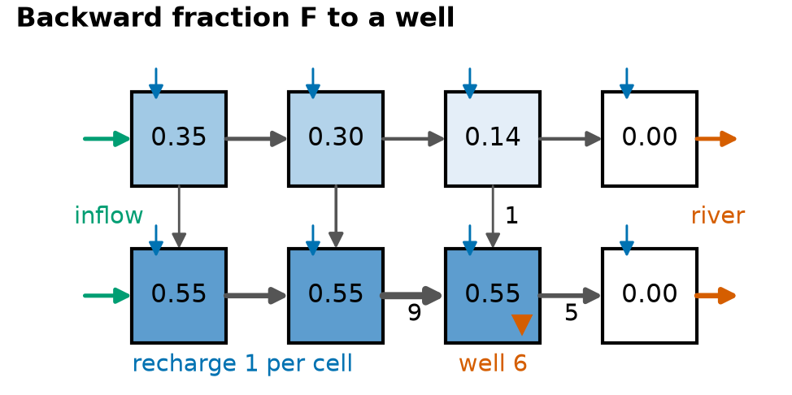
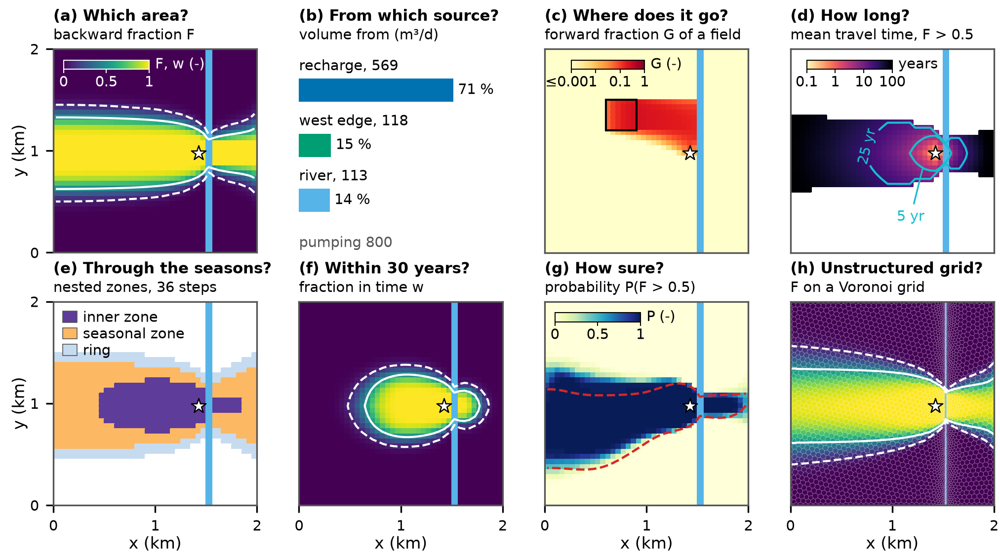
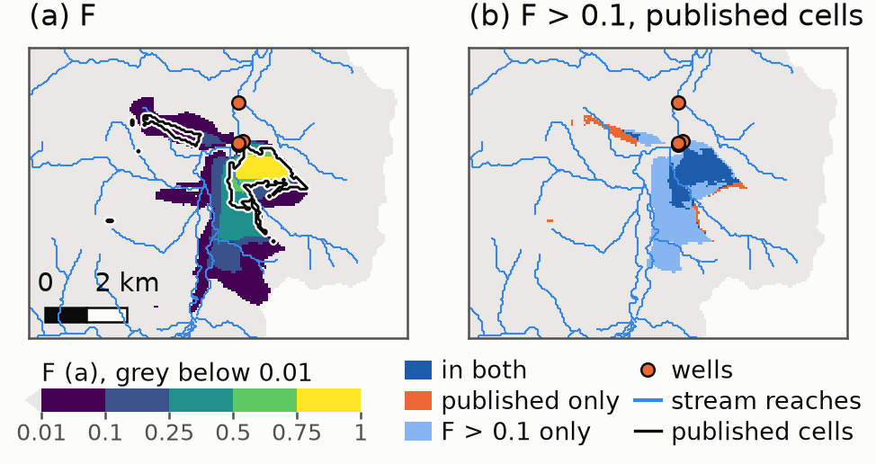
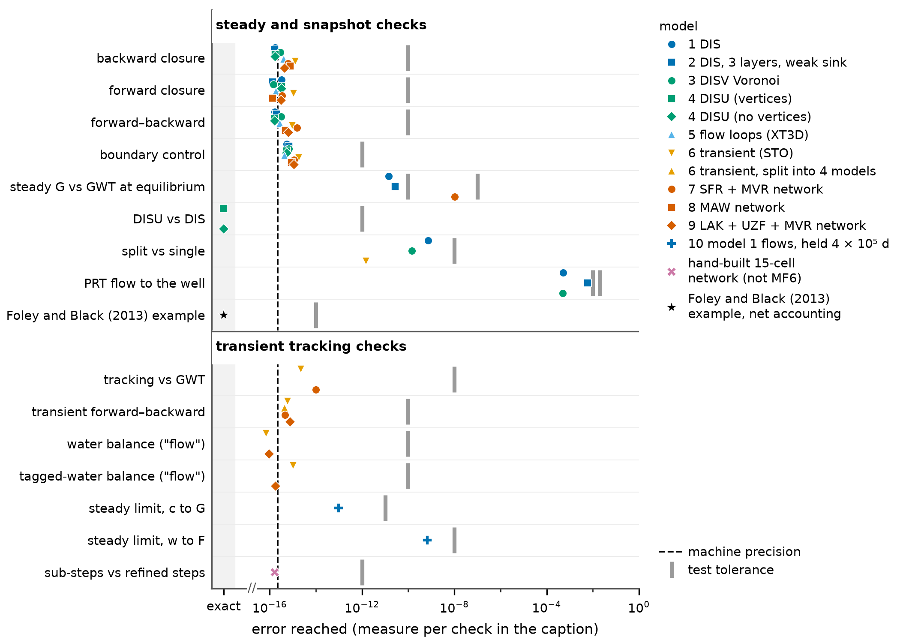
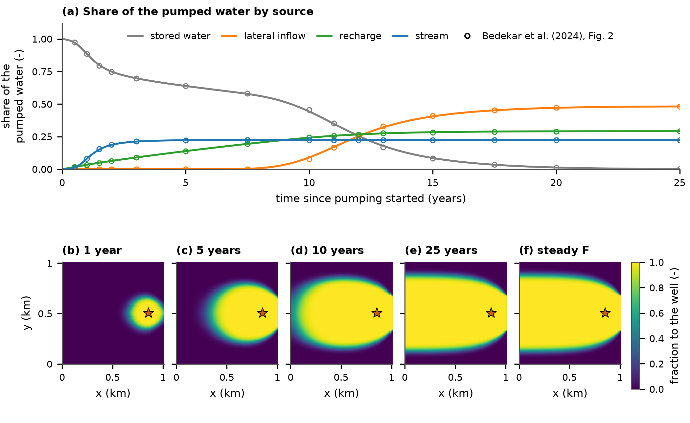
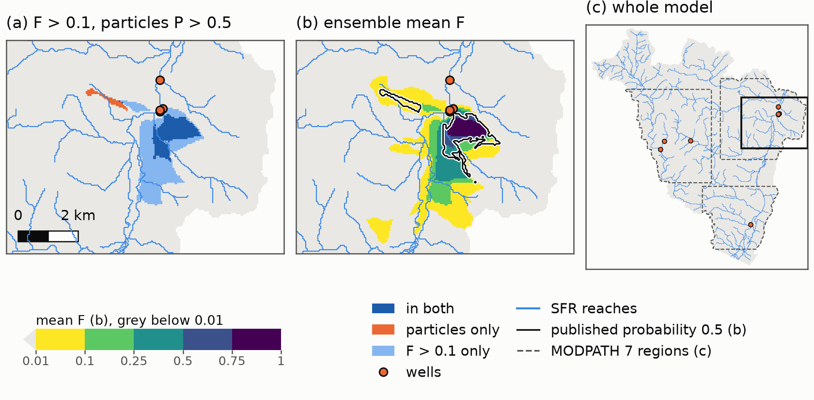
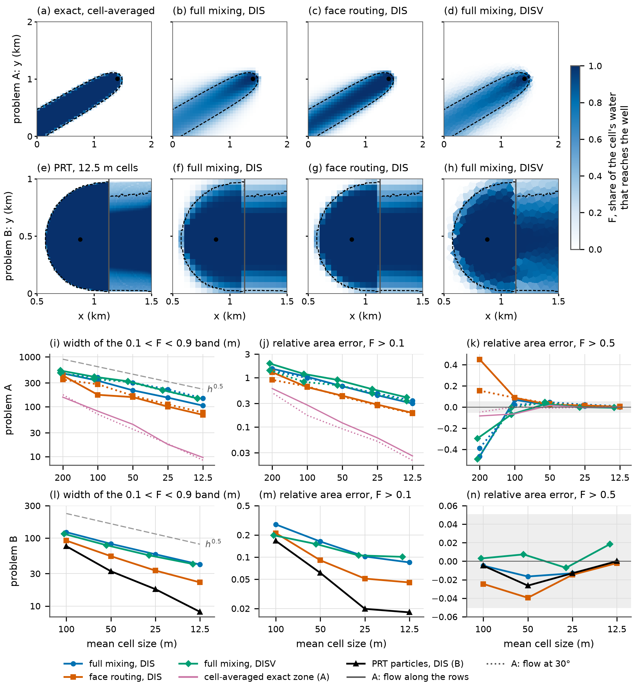

# Where does it come from and where does it go? Fast, open-source flow tracing for MODFLOW 6 models

**Article Impact Statement:** Open-source code turns saved MODFLOW 6 flows into contributing areas, water sources and travel times for any well or stream, in steady-state or transient flow, fast enough for ensembles.

**Abstract:** Groundwater studies often ask where water comes from and where it goes. Which land feeds a well, spring or stream? How much of a well's water is river water? Where does recharge under a polluted field end up? We present open-source code, `gwsource`, that answers such questions from the flows a MODFLOW 6 model saves. The code treats the water in each cell as fully mixed, like earlier methods. It computes the share of each cell's water that ends at a well, a stream or another outlet. The same trace splits a well's water by source and gives mean travel times. The code extends the method to every MODFLOW 6 grid type, stream network and linked model. It handles weak sinks. It carries tagged water through storage between time steps, forward and backward in time. Every result is checked against the flow model's water budget. The paper presents ten worked examples. Each checks an output a practitioner would use against other commonly used approaches. Results matched MODFLOW 6 transport to its solver tolerance with the same water volumes. They matched particle tracking in totals and mean travel times, as any method that conserves water should. At the edges of areas the two differ cell by cell. On a regional model of 1.68 million cells, one trace of eight wells, alone and together, took 2–3 s. That is small next to the model run itself. Tracing is cheap enough to include in history matching and similar analyses. Full-mixing areas are wider than particle-tracked areas. Particle tracking remains better where a sharp edge or first arrival matters.

**Key words:** flow tracing; full mixing; MODFLOW 6; contributing area; sources of water; travel time; transient tracking; ensemble; source protection

# 1. Introduction

Practitioners who ask where groundwater comes from and where it goes also need to know how the answers change through the year and how sure they can be of them.

Methods that answer these questions from a groundwater flow model fall into four families. Particle tracking follows particles of water along flow paths. It is the standard tool for mapping a well's contributing area. This is the land where water enters the aquifer and later reaches the well. In MODFLOW models it runs in MODPATH (Pollock 2016) or in the particle-tracking model of MODFLOW 6 (PRT; Langevin et al. 2026). Transport with tagged water gives the water from one source a concentration of 1 and all other water a concentration of 0. A cell's concentration is then the share of its water that came from that source (Bedekar et al. 2024). In MODFLOW 6 it runs in the Groundwater Transport (GWT) Model, with one model for each source (Langevin et al. 2022). As documented, the unit-concentration method steps forward in time only. It gives the share of each cell's water that came from a source, but not the share that will later reach a well. Adjoint and age methods solve transport equations of their own (Neupauer and Wilson 1999; Goode 1996). Full-mixing flow tracing splits each cell's mixed water among its outflows.

Particle tracking has one difficulty at weak sinks. Sink terms are the boundaries that remove water from a cell, such as a pumping well or a gaining stream. A weak sink is a cell whose sink terms take only part of the cell's outflow. A particle cannot split. It must either stop at a weak sink or pass on. If it stops, all its water is counted as reaching the sink. If it passes, none of it is. The rule chosen changes the contributing area (Section 5).

Under full mixing, a weak sink can take just its share of the cell's water. The rest passes on to the neighbouring cells. Two published full-mixing programs apply different rules at a weak-sink well. FlowSource (Foley and Black 2013) is used to draw source protection zones in England (Environment Agency 2019). These zones restrict activities that could pollute the water a supply well pumps. FlowSource counts all the water passing through a weak-sink well's cell as the well's water. We refer to this as net accounting. For transient models, it traces each time step as a steady-state flow field. We refer to such a trace as a snapshot. MODALL (Potter et al. 2008) applies full mixing to steady-state MODFLOW-88 models. At a weak-sink well it counts only the water the well pumps. We refer to this as gross accounting. All these methods are compared in Supporting Information, Table S1.

This paper presents open-source code, `gwsource`, that extends the full-mixing method of FlowSource to MODFLOW 6. It reads every MODFLOW 6 grid type, stream networks and linked models. It uses gross accounting by default. It checks every result against the water budget. In transient models, it carries tagged water through storage, forward and backward in time. Risk-based studies run an ensemble of model versions that fit the measurements about equally well (Fienen et al. 2022). The code is fast enough to trace every version.

Section 4 works through ten examples. Each checks an output a practitioner would use against another approach. Section 5 applies the code to a published regional model. Section 6 sets out the trade-offs of full mixing.

# 2. Method in brief

The derivations and the solution of the equations are given in Supporting Information, Text S1.

**Full mixing.** Each active model cell is treated as one well-mixed volume of water. Its water leaves through each outflow in proportion to the size of that outflow. The code reads the cell-to-cell flows and the source and sink terms, such as recharge, wells and rivers, from the MODFLOW 6 budget file.

A backward trace follows water to a destination, such as one well or a wellfield. The backward fraction $F_i$ is the share of the water leaving cell $i$ that later leaves the model through the destination. All outflows of a fully mixed cell carry the same water. So

$$F_i = \sum_j \frac{q_{ij}}{O_i}\, F_j + \frac{d_i}{O_i}, \tag{1}$$

where $q_{ij}$ is the flow from cell $i$ to its neighbour $j$. The total outflow of the cell is $O_i$. Its outflow through the destination is $d_i$. In words: a cell's share is the share that leaves directly through the destination plus the outflow-weighted mean of its downstream neighbours' shares. Fig. 1 works through an eight-cell example. The code solves Eq. (1) for all cells at once, in the order the water flows. A contributing area is the set of cells where F exceeds a chosen threshold, such as one half. The backward trace also splits the destination's water by source. This split is the sum over all cells of F times each cell's inflow through source terms.

**Figure 1.** Backward fractions F (in cells) to a 6 m³/d well in an eight-cell example (gross accounting). Water enters from the west and as recharge of 1 m³/d per cell. It leaves through the well and a river. Arrow widths show flows. Only the well cell's flows are numbered (m³/d). In the well cell, F = 6/11 = 0.55.

A forward trace follows water from a source, such as recharge. The forward fraction $G_i$ is the share of the water entering cell $i$ that came from the source.

**Gross and net accounting.** At a weak sink, Eq. (1) needs one of the two rules of Section 1. By default the code uses gross accounting, as a transport model does. Each sink term then takes its share of the cell's outflow. In Fig. 1, gross accounting gives the well the 6 m³/d it pumps. Net accounting adds the 5 m³/d that flow on through the well cell to the river. We would use net accounting to reproduce a FlowSource study.

**Checks and travel time.** Every trace reports whether the traced volumes agree with the saved flows. For example, the closure check requires the source water traced to a well to add up to its pumping. The checks test the solution, not the flow model or the assumption of full mixing. With a porosity, the code also gives mean travel times (Supporting Information, Text S1). A mean travel time is not a first-arrival time.

**Transient flow.** A snapshot traces each time step on its own flows, as if they were steady. Water that enters the aquifer in a step can then reach the well only in that same step. A snapshot cannot show recharge from the wet season reaching the well in the dry season. Water released from storage was already in the aquifer at the start of the step. A snapshot treats it as a source of unknown origin.

Transient tracking extends full mixing through time. Water from the chosen sources is tagged, as a tracer would be. The tagged water is carried through storage from step to step. Hydraulic mixing cells carry mixed water through storage in integrated surface water–groundwater models in a similar way (Partington et al. 2011). Each step is solved as in GWT, without dispersion (Langevin et al. 2022). Transient tracking needs porosity and the budget of every time step. The water in the model at the start can be tagged as its own group. We refer to it as initial water. Backward tracking in time solves the backward counterpart of each step, from the end of the simulation to its start. It gives the share of the water in each cell that leaves through the destination before the simulation ends. A map of this share is a time-limited contributing area (Fig. 2f).

# 3. Software and cost

The method is implemented in `gwsource`. It is an open-source Python package (MIT licence). It reads the binary grid file and the budget file of a MODFLOW 6 Groundwater Flow (GWF) model, on any grid type. Stream reaches, lakes and multi-aquifer wells can be traced as extra cells from their own budget files. The inputs, selections and outputs are listed in Supporting Information, Table S2.

The regional model of Section 5 has 1.68 million cells. On an Apple M4 Max with 64 GB of memory, one trace of its eight wells, alone and together, took 2–3 s. Its memory peaked at 2.5 GB. The MODFLOW 6 run of that model takes 44 s (Supporting Information, Text S2). The package is tested on ten small test models and two published examples (Supporting Information, Figure S1).

# 4. Worked examples

Four of the ten worked examples follow. The last part of this section summarises the other six. Fig. 2 shows one output of each type. All examples start from one small example model. It is a single unconfined layer of 40 × 40 cells of 50 m. Recharge of 5 × 10⁻⁴ m/d falls on every cell. A constant head along the west edge brings in regional groundwater. A river runs north–south 100 m east of a supply well that pumps 800 m³/d. Every example model is described in Supporting Information, Text S2.

**Figure 2.** Outputs for the example well (Section 4). (a) Backward fraction F. White lines: F = 0.1 (dashed) and 0.5 (solid). (b) The well's water by source (m³/d). (c) Forward fraction G of recharge on the outlined field. (d) Mean travel time where F > 0.5. (e) Cells with F > 0.5 in all (inner zone) or some (seasonal zone) of 36 seasonal snapshots. Ring: F > 0.1 in some snapshots. (f) Share of each cell's water pumped within 30 years. (g) Share of 50 posterior realisations with F > 0.5. Red dashed line: true F = 0.5. (h) F on a Voronoi grid. Panels (f) and (h) use the colours and lines of (a). Star: well. Blue cells: river.

**Sources and area.** A protection zone starts from the land whose water reaches the well. Fig. 2a maps F. Cells with F > 0.5 cover 1.143 km². Cells with F > 0.1 cover 1.575 km². The same trace splits the 800 m³/d pumped into 71 % recharge, 15 % inflow at the west edge and 14 % river leakage (Fig. 2b). The traced sources add up to the pumping, as the closure check requires. That check tests the solution but not the position of the area's edge.

The code can run MODFLOW 6 PRT on the same flows to test the edge. Particles start from every source term in cells with F > 0. Each carries a share of its term's flow as a weight. A particle loses weight at every other sink it passes, in proportion to the flow that sink takes. Visser et al. (2009) split particles at weak sinks in a similar way to derive travel times. Winston et al. (2018) reduce particle weights at sinks in a solute-transport method. We refer to these as weight-losing particles. They deliver 799.9 of the 800 m³/d pumped. That total says little about the area, because particles that conserve water must deliver what the well pumps. The particle share of a cell is the share of the weight released there that reaches the well. Cells with a particle share above 0.5 cover 1.168 km². The F > 0.5 area is 2.1 % smaller. The F > 0.1 area is 35 % larger. It holds every cell of the particle area. In the 372 cells with F between 0.05 and 0.95, the particle share and F differ by 0.164 on average (Supporting Information, Figure S2). In those cells, most particles either reach the well or miss it. Full mixing gives the cell an in-between value.

The choice between gross and net accounting (Section 2) matters only at weak sinks. In a three-layer version of the model, a small well pumps 5 m³/d from a cell that carries 33.7 m³/d. Gross accounting attributes the 5 m³/d it pumps to the well. Net accounting attributes all 33.7 m³/d. This is 6.7 times what the well pumps. Net accounting also reproduces the worked example of Foley and Black (2013) to 1 × 10⁻¹⁴ (Supporting Information, Text S3).

**Transient tracking.** A manager may ask how much of the water pumped over the coming decades is already in the aquifer today. This example makes the model transient, with seasonal recharge and pumping. It runs for 30 years, with one time step per season. The run starts from a steady state in which the well already pumps. Initial water is therefore not water from before pumping began.

Averaged over time, snapshots give the well's water as about 60 % recharge and 15 % storage release (Supporting Information, Figure S3a). With transient tracking, the well's water in the last season of year 30 is 51.6 % initial water, 32.9 % recharge and 15.5 % river water. Of all the water pumped in the first 10 years, 81 % was initial water. New recharge mixes into a large volume of older water, because a column of this aquifer holds about 64 years of recharge. With one layer, the model cannot hold young water above old water. A layered model may therefore give other shares.

Backward tracking in time shows that only the water near the well and along the main flow path reaches the well within 30 years (Fig. 2f). Most of the water in the steady-state contributing area is still on its way at the end. The code's default water volumes keep every cell's water balance exact. Where porosity differs from specific yield, as here, they differ from the volumes GWT uses. With GWT's volumes and one transport step per flow step, transient tracking matched a GWT run with tagged recharge to 9.8 × 10⁻¹⁴ in every cell and step (Supporting Information, Text S3). Here the default volumes change the fractions by less than 0.004.

**Ensembles.** Many sets of parameters can fit the measured heads about equally well. We refer to each set as a realisation. A set of realisations is an ensemble. Here 50 realisations of the example model each have a random hydraulic conductivity field. No measurements have shaped these fields. We refer to such an ensemble as a prior. The probability of contribution of a cell is the share of realisations in which F > 0.5.

History matching adjusts a model's parameters until it fits measurements. PEST++ IES does this for every realisation of an ensemble (White 2018; White et al. 2020). A separate random field stands for the true aquifer. Its heads in 40 cells, with added noise, are the measurements (Supporting Information, Text S2). The history-matched ensemble is the posterior. History matching narrows the probability of contribution (Fig. 2g; Supporting Information, Figure S4). The probability lies between 0.1 and 0.9 over 1.10 km² in the prior and 0.35 km² in the posterior. The middle 90 % of river shares narrows from 0–33 % to 5–13 %. The true share is 9.4 %.

A narrower posterior is not necessarily a correct one. The posterior gives a probability of at least 0.5 to 93 % of the true F > 0.5 area, against 79 % for the prior. In both ensembles, 86 to 87 % of the cells with a probability of at least 0.9 lie inside the true area. That share did not improve. One synthetic case cannot show how reliable posteriors are in general. Here the trace ran on each realisation after PEST++ had finished. We have not tested running it inside each PEST++ model run.

**Further examples.** Of the recharge on a 300 m × 300 m field, 39 % reaches the well (Fig. 2c). The forward fractions of river leakage match a GWT run at equilibrium to 4.2 × 10⁻¹³ in every cell (Supporting Information, Text S3).

On a fully unstructured (DISU) grid that holds the regular cells, F equals the regular-grid result in every cell. On a Voronoi grid the contributing area has the same shape (Fig. 2h). Its edge is wider. F falls from 0.5 to 0.1 over 186 m north of the well, against 121 m on the regular grid (Supporting Information, Text S3).

In seasonal snapshots, the F > 0.5 area grows from 0.59 km² in the wet season to 1.35 km² in the dry season. Cells with F > 0.5 in all or some of 36 snapshots form nested zones (Fig. 2e; Supporting Information, Text S3).

With a porosity, the backward trace also gives mean travel times (Fig. 2d). Weight-losing particles give a mean travel time to the well of 45.7 years, against 45.9 years for full mixing (Supporting Information, Text S3). Both means follow from nearly the same water volume. This agreement is therefore not an independent test. Cell by cell, the two differ most outside the F > 0.5 area.

Tracing stream reaches as cells turns 32 % of the well's water from stream leakage into upstream inflow and recharge (Supporting Information, Text S3). The example model split into three linked models gives F within 2 × 10⁻¹³ of the single model.

For the unit-concentration example of Bedekar et al. (2024), transient tracking gives the well's water after 25 years as 48.2 % lateral inflow, 29.2 % recharge and 22.5 % stream water, against the published 48 %, 29 % and 23 % (Supporting Information, Text S3; Supporting Information, Figure S5).

# 5. A regional model: Neversink

This section tests the method on a published regional model. The USGS Neversink/Rondout model (Fienen et al. 2022) is a steady-state model of 1.68 million cells, with 12,316 reaches of the Streamflow Routing (SFR) package. Its 358 realisations come from history matching with PEST++ IES. We refer to the realisation with the base parameters as the calibrated model. The published study mapped the contributing areas of eight priority wells with MODPATH 7 (Pollock 2016). One particle started in the uppermost active cell of each column near the wells. We refer to these cells as the start cells. The published contributing cells are the 980 start cells whose particle ends in a priority well.

We traced the eight wells in the calibrated model with gross accounting. The stream reaches were left as source and sink terms of the aquifer cells. These full-mixing areas differ from the published ones. We measure the difference with an overlap score. It is the number of cells in both areas divided by the number in either. The published area comes from one reasonable choice of particle settings. These settings fix where recharge enters a cell, where particles stop and how particles that start in dry cells are handled. PRT on the same flow field reproduces the published area (overlap 0.998) only with all three published settings. Among particle runs that conserve water, the settings alone move the overlap from 0.62 to 0.998 (Supporting Information, Text S4).

The full-mixing areas where F exceeds 0.5 and 0.1 agree less, with overlaps of 0.41 and 0.30. We infer that the main reason is that full mixing splits each cell's water among all its outflows, while a particle follows one path. On average, the published cells send 42 % of their water to the wells. So under full mixing many published cells fall below F = 0.5. The F > 0.1 area holds 73 % of them (Fig. 3; Supporting Information, Text S4). Weight-losing particles lose water at each sink as full mixing does. The F > 0.1 area holds 87 % of the 691 start cells where these particles deliver more than half their water to the wells (Supporting Information, Figure S6).

**Figure 3.** F and the published contributing cells of the Neversink model, in a 7.1 × 9.25 km window around four of the priority wells. The window holds 688 of the 980 published cells. (a) F in the calibrated model, with the published cells outlined. (b) The F > 0.1 area against the published cells. Dark blue: in both (538 cells). Orange: published only (150). Light blue: F > 0.1 only (1,090).

Weak sinks add to the difference. A buried stream cell has an SFR reach and another active cell above it. A particle cannot leave such a cell through its top face. Where the reach gains water, the stream is a weak sink. A published particle then stops in the cell. All its water counts as reaching the stream. Published particles stop in the same way at weak-sink wells. Full mixing passes the rest of the cell's water on (Supporting Information, Text S4). Net accounting treats weak-sink wells as stopping particles do. It raises the F > 0.5 overlap only from 0.41 to 0.44 (Supporting Information, Text S4). For a practitioner, an overlap of 0.41 should be read against the range of 0.62 to 0.998 that particle settings alone produce.

# 6. Trade-offs and conclusions

Full-mixing areas are wider and more diffuse than particle areas (Section 5). Their edge is a band of cells where F lies between 0.1 and 0.9. In two simple test problems, halving the cell size made the band only about 30 % narrower (Supporting Information, Text S5; Supporting Information, Figure S7). On squares turned by 45° to the flow, the band was 1.8 times as wide as on squares aligned with it (Supporting Information, Text S5). Where the edge of an area matters, finer cells along it and a grid aligned with the main flow narrow the band.

No single threshold on F therefore reproduces a particle area everywhere. The threshold is a judgement about the purpose of the area. Both the threshold and the accounting should be reported with the area. In the test problems, on cells of 50 m or less, the F > 0.5 area was within 5 % of the size of the reference area. The F > 0.1 area missed at most 0.1 % of the reference area. It was 8 to 90 % larger. On Neversink, the F > 0.1 area still missed cells that weight-losing particles assign to the wells (Section 5). So a low threshold does not guarantee a cautious area on a regional model.

Transient tracking has so far been tested on synthetic models only. Its memory grows with the number of time steps. Movers between models (the MVE package) are not implemented yet. Without cell vertices, the code cannot map results on a DISU grid. A well's water by source and the mean travel time of all its water depend much less on mixing than the edge of its area does (Section 4). We would therefore use particles where a sharp edge or a first arrival matters, such as a short time-of-travel zone. We would use GWT where dispersion, sorption or decay matter, because transient tracking moves water by advection only (Langevin et al. 2022). Full mixing suits questions about many sinks, unstructured grids, package networks or many realisations.

# 7. Code and Data Availability

The code, `gwsource`, is open source under the MIT licence at https://github.com/rhugman/gw-source [check: public URL]. This paper uses version 0.0.1 [check: release version and tag]. Each example ships with the code as a Jupyter notebook that reproduces its numbers and figure (Supporting Information, Text S2). The same release holds the verification tables (docs/verification.md), the test models (tests/models/README.md) and the notes of the Neversink study (docs/neversink_study.md). The Neversink model is in a USGS data release (Fienen and Corson-Dosch 2021). The files behind every figure will be archived on Zenodo [check: DOI].

# References

Bedekar, V., C. Neville, M.J. Tonkin, R.D. Bartlett, and P. Plato. 2024. A unit-concentration method to quantify source contribution. *Groundwater* 62, no. 2: 303–309. https://doi.org/10.1111/gwat.13333

Environment Agency. 2019. *Manual for the Production of Groundwater Source Protection Zones*. Bristol, UK: Environment Agency. https://assets.publishing.service.gov.uk/media/5d41a020e5274a0a0bf7757c/Manual-for-the-production-of-Groundwater-Source-Protection-Zones.pdf

Fienen, M.N., and N.T. Corson-Dosch. 2021. Groundwater model archive and workflow for Neversink/Rondout Basin, New York, source water delineation. U.S. Geological Survey data release. https://doi.org/10.5066/P9HWSOHP

Fienen, M.N., N.T. Corson-Dosch, J.T. White, A.T. Leaf, and R.J. Hunt. 2022. Risk-based wellhead protection decision support: A repeatable workflow approach. *Groundwater* 60, no. 1: 71–86. https://doi.org/10.1111/gwat.13129

Foley, C., and A. Black. 2013. Efficiently delineating volumetric capture areas and flow pathways using directed acyclic graphs and MODFLOW; description of the algorithms within FlowSource. In *Proceedings of MODFLOW and More 2013: Translating Science into Practice*, Golden, Colorado, June 2–5, 2013, 571–581 [check: pages against the proceedings]. Golden, Colorado: IGWMC, Colorado School of Mines. https://groundwater-science.co.uk/wp-content/uploads/2013_FSv6_DAGPaper.pdf

Goode, D.J. 1996. Direct simulation of groundwater age. *Water Resources Research* 32, no. 2: 289–296. https://doi.org/10.1029/95WR03401

Langevin, C.D., A.M. Provost, S. Panday, and J.D. Hughes. 2022. Documentation for the MODFLOW 6 Groundwater Transport Model. U.S. Geological Survey Techniques and Methods, book 6, chap. A61. Reston, Virginia: USGS. https://doi.org/10.3133/tm6A61

Langevin, C.D., J.D. Hughes, A.M. Provost, M.J. Russcher, M.J. Reno, W.P. Bonelli, E.D. Morway, S. Titus, R.G. Niswonger, S. Panday, D. Merrick, and E.R. Banta. 2026. MODFLOW 6 Modular Hydrologic Model version 6.8.1. U.S. Geological Survey Software Release, 23 September 2026. https://doi.org/10.5066/P1PGE9XW

Neupauer, R.M., and J.L. Wilson. 1999. Adjoint method for obtaining backward-in-time location and travel time probabilities of a conservative groundwater contaminant. *Water Resources Research* 35, no. 11: 3389–3398. https://doi.org/10.1029/1999WR900190

Partington, D., P. Brunner, C.T. Simmons, R. Therrien, A.D. Werner, G.C. Dandy, and H.R. Maier. 2011. A hydraulic mixing-cell method to quantify the groundwater component of streamflow within spatially distributed fully integrated surface water–groundwater flow models. *Environmental Modelling & Software* 26, no. 7: 886–898. https://doi.org/10.1016/j.envsoft.2011.02.007

Pollock, D.W. 2016. User guide for MODPATH Version 7—A particle-tracking model for MODFLOW. U.S. Geological Survey Open-File Report 2016–1086. Reston, Virginia: USGS. https://doi.org/10.3133/ofr20161086

Potter, S.T., E. Moreno-Barbero, and C.E. Divine. 2008. MODALL: A practical tool for designing and optimizing capture systems. *Ground Water* 46, no. 2: 335–340. https://doi.org/10.1111/j.1745-6584.2007.00410.x

Visser, A., R. Heerdink, H.P. Broers, and M.F.P. Bierkens. 2009. Travel time distributions derived from particle tracking in models containing weak sinks. *Ground Water* 47, no. 2: 237–245. https://doi.org/10.1111/j.1745-6584.2008.00542.x

White, J.T. 2018. A model-independent iterative ensemble smoother for efficient history-matching and uncertainty quantification in very high dimensions. *Environmental Modelling & Software* 109: 191–201. https://doi.org/10.1016/j.envsoft.2018.06.009

White, J.T., R.J. Hunt, M.N. Fienen, and J.E. Doherty. 2020. Approaches to highly parameterized inversion: PEST++ Version 5, a software suite for parameter estimation, uncertainty analysis, management optimization and sensitivity analysis. U.S. Geological Survey Techniques and Methods 7C26. Reston, Virginia: USGS. https://doi.org/10.3133/tm7C26

Winston, R.B., L.F. Konikow, and G.Z. Hornberger. 2018. Volume-weighted particle-tracking method for solute-transport modeling; Implementation in MODFLOW–GWT. U.S. Geological Survey Techniques and Methods, book 6, chap. A58. Reston, Virginia: USGS. https://doi.org/10.3133/tm6A58

# Supporting Information (draft)

## Table S1. Comparison of methods

**Table.** Five ways to compute the share of each cell's water that reaches a destination, or that came from a source, from the flows of a groundwater flow model. The columns are MODALL (Potter et al. 2008), FlowSource (Foley and Black 2013; Black and Foley 2013), this paper's code, unit-concentration transport in GWT (Bedekar et al. 2024; Langevin et al. 2022) and hydraulic mixing cells as published by Partington et al. (2011). Section 2 and Text S1 define the fractions F, G, c and w, and gross and net accounting. The MODALL and FlowSource columns describe the programs as published in 2008 and 2013. Years in parentheses date a statement to the 2013 papers. We found no published description of later versions. The sources of each column are listed after the footnotes.

| | MODALL (Potter et al. 2008) | FlowSource (Foley and Black 2013; Black and Foley 2013) | This paper's code | GWT unit concentration (Bedekar et al. 2024; Langevin et al. 2022) | Hydraulic mixing cells (Partington et al. 2011) |
|-------------|---------------|-------------------|-----------------|------------------|------------------|
| What is solved, and how | Cell by cell, outward from each well; cell order not described | Fractions cell by cell in flow order; one pass per time step | Linear equations in flow order; transient tracking: implicit steps | Implicit time steps, iterative solver; no documented steady-state option¹ | Explicit, on the flow model's steps; stable only for short steps² |
| Mixing in a cell | Full mixing | Full mixing | Full mixing | Full mixing with upstream weighting and no dispersion | Modified mixing cell; tends to full mixing as steps shorten³ |
| Accounting at weak sinks | Gross: well cell's fraction is pumping over inflow | Net: all water passing through a destination cell counted as reaching it | Gross (default); net as an option | Gross: sinks remove water at the cell's concentration | Outflow at the previous step's mix; gross in effect (our reading) |
| Flow loops | Not described | Smallest-flow connection in each loop deleted (2013) | Solved exactly; closed recirculation loops set to F = 0⁴ | None needed: one implicit solution over all cells (our inference) | Not discussed; fixed stream flow direction assumed |
| Outputs | Capture fraction (F) per well and summed over wells | F, volumes through and from; particle travel time | F, G and volumes by term; transient tracking: c and w | Concentration, read as the share of water from the tagged source | Fractions by flow component per stream cell, plus initial water |
| Transient models: water carried through storage? | No: steady-state MODFLOW-88 models only | No: each step traced as a steady state (snapshots) | Yes, transient tracking (needs porosity); snapshots also | Yes (needs porosity) | Yes: stream-cell water volumes carried step to step |
| Backward in time? | No | No | Yes, solved from the end of the simulation | No⁵ | No |
| Destinations or sources per run | One well per calculation; source fractions said possible, not described | One destination group (any number of cells) per calculation | Gross: all groups in one solve per direction; net: one group per solve | One tagged source per GWT model; several models per simulation | All flow components together; not user-chosen terms |
| Built-in water-budget checks | Not described | None described; flow loops reported (2013) | Closure, forward–backward, travel-time closure; more in transient tracking | Mass budget, a tagged-water balance; no backward closure or forward–backward check | Sum-of-fractions error; global volume error, gaining reaches only |
| Grids and packages | MODFLOW-88 finite-difference grids; wells, drains, rivers, recharge | Structured MODFLOW grids; method said to apply to unstructured grids (2013); package networks not documented | All MODFLOW 6 grid types, multi-model simulations, package networks | DIS, DISV, DISU; SFR, LAK, MAW, UZF and MVR transport | HydroGeoSphere stream cells; said to apply to other codes |
| Open implementation | Free from the authors; source code not mentioned | No; VB.NET source for academic use on request (2013) | Yes (`gwsource`, MIT) | Yes (MODFLOW 6, USGS) | Excel (Visual Basic) post-processor; availability not stated |

¹ Steady state is reached by running transient steps until concentrations stabilise (Langevin et al. 2022). In our test, one step with porosity 0 gave the steady-state G to 1 × 10⁻¹². This use of porosity 0 is not documented.

² The update is stable only while a step's inflow or outflow volume does not exceed the cell's storage (Partington et al. 2011). Later versions add sub-steps (Partington et al. 2013) and aquifer cells (Schilling et al. 2017). All of them step forward in time only.

³ After Campana and Simpson (1984): water leaving a cell over a step carries the previous step's mix.

⁴ A closed recirculation loop is a group of cells with no outflow to any sink or to a cell outside the group. Such loops are reported. No connections are deleted.

⁵ No backward option is documented (Langevin et al. 2022). Bedekar et al. (2024) read well capture forward in time, from the concentration simulated at the well.

**Sources.** We read every source below in full unless a page range is given. The two 2013 conference papers have no page numbers, so we cite them by section heading.

- **MODALL.** Potter et al. (2008, pp. 335–340) describe full mixing on a steady-state MODFLOW-88 model (p. 336). At the sink cell the capture fraction is the pumping divided by the cell's inflow (p. 336, Fig. 1). We read this as gross accounting. The other cells follow one at a time, outward from the well. Source fractions, the reversed-flow MT3DMS run and the free distribution are on pp. 336–338. McLane and Cecan (2009, pp. 172–173) comment on the spread of the fractions on coarse grids.
- **FlowSource.** Foley and Black (2013, Method and Evaluation) give the flow-order pass and the deletion of the smallest flow in each loop. Their section "Description of Calculation" gives the full mixing and the net accounting at destination cells. The snapshot treatment of transient models is in Foley and Black (2013, Introduction) and Black and Foley (2013, Introduction and Problem Description). The outputs, the checks and the availability on request are in the Introduction and end matter of both papers.
- **This paper's code.** The entries rest on Sections 2–4, on Text S1 and on the open code.
- **GWT unit concentration.** Langevin et al. (2022) was read in part. The steady-state statement is in its abstract and on p. 1–7. Upstream weighting is described on pp. 4–1 to 4–2. The flow-imbalance correction is on p. 2–6 (eq. 2–14). The removal of water at the cell's concentration is on p. 5–3 (eq. 5–7). The grids and the transport in packages are listed on pp. 1–6 to 1–7. Bedekar et al. (2024, pp. 303–309) give the method, its uses and the forward reading of well capture (p. 306, Fig. 2).
- **Hydraulic mixing cells.** The column rests on the authors' manuscript of Partington et al. (2011). The update and its stability limit are given in Section 3.1 (Eqs 8–10). The mixing rule is in Section 3.2. The two checks are in Section 3.3.1 (Eqs 13–14). Partington et al. (2012, 2013), Schilling et al. (2017) and Nogueira et al. (2022) describe later versions.

Footnote 1 rests on our own test. We ran a GWT model with MODFLOW 6 (6.9.0.dev0) on the saved flows of test model 1, with upstream weighting, no dispersion and the flow-imbalance correction on. Without the storage package (MST) the run stops at input. With one transport step of 1 day and an MST porosity of 0, the largest difference from G over the 594 active cells was 9.5 × 10⁻¹³ with recharge tagged and 9.7 × 10⁻¹³ with the river tagged.

## Text S1. Method in full

This text derives the equations of Section 2 and shows how they are solved. Equation numbers without an S refer to the main text.

Two fractions describe where a cell's water goes and where it came from. The backward fraction $F_i$ is the share of the water in cell $i$ that later leaves the model through a chosen destination, such as a well. The forward fraction $G_i$ is the share of the water in cell $i$ that entered the model through a chosen source, such as recharge on one field. A weak sink is a cell whose sink terms take only part of the cell's outflow. The rest of its water flows on to the neighbouring cells.

### The backward and forward fractions

Cells exchange water through the cell-to-cell flows of the MODFLOW 6 budget file (FLOW-JA-FACE; Langevin et al. 2017). The flow from cell $i$ to its neighbour $j$ is $q_{ij} \ge 0$. All other budget terms, such as recharge, wells, rivers and storage, are kept separate by package and boundary. A term that brings water into a cell is a source term. A term that takes water out is a sink term. If $\mathrm{Src}_i$ and $\mathrm{Snk}_i$ are the totals of a cell's source and sink terms, its total inflow, total outflow and cell budget error are

$$I_i = \sum_j q_{ji} + \mathrm{Src}_i, \qquad O_i = \sum_j q_{ij} + \mathrm{Snk}_i, \qquad r_i = I_i - O_i. \tag{S1}$$

The cell budget of a MODFLOW model never balances exactly, so $r_i$ is small but not zero. The outflow of cell $i$ through the destination is $d_i$. The inflow of cell $i$ through the source is $s_i$.

Full mixing means that all water leaving a cell has the same mix of origins and fates. Take the water that leaves cell $i$ in one day. The part $d_i$ leaves through the destination directly. The part $q_{ij}$ goes to neighbour $j$. A share $F_j$ of that part later leaves through the destination. So the volume of water leaving cell $i$ that ends at the destination is

$$F_i\, O_i = \sum_j q_{ij}\, F_j + d_i . \tag{S2}$$

Dividing by $O_i$ gives Eq. (1). Let $P_{ij} = q_{ij}/O_i$ be the share of cell $i$'s outflow that goes to cell $j$. For all cells together, Eq. (1) is then

$$(\mathbf{I} - \mathbf{P})\,\mathbf{F} = \mathbf{S}\,\mathbf{D}. \tag{S3}$$

Here $\mathbf{I}$ is the identity matrix. $\mathbf{S}$ holds the share of each cell's outflow that leaves through each of its sink terms. $\mathbf{D}$ marks which sink terms belong to which destination group. Each column of $\mathbf{F}$ holds the fractions to one destination group, so one solve gives every group. Under gross accounting, a sink term $k$ in cell $i$ takes the share $|q_k|/O_i$ of the cell's outflow. These shares are the entries of $\mathbf{S}$. A cell with no outflow is given $F = 0$.

The forward fraction follows from the inflow in the same way. The water entering cell $i$ in one day comes from the neighbours and from the source and sink terms. A share $G_j$ of the water from neighbour $j$ came from the source. All of $s_i$ came from it. So

$$G_i\, I_i = \sum_j q_{ji}\, G_j + s_i . \tag{S4}$$

Dividing by $I_i$ and writing the result for every cell, with the inflow shares $Q_{ij} = q_{ji}/I_i$, gives

$$(\mathbf{I} - \mathbf{Q})\,\mathbf{G} = \mathbf{R}\,\mathbf{T}. \tag{S5}$$

$\mathbf{R}$ holds the share of each cell's inflow that enters through each source term. $\mathbf{T}$ marks which source terms belong to which source group. A cell with no inflow is given $G = 0$.

### Volumes

A fraction times a flow gives a volume of water per unit time. The volume through cell $i$ is $F_i O_i$. It is the part of the water passing through the cell that reaches the destination. The volume from cell $i$ is $F_i$ times the cell's inflow through its source terms. Its sum over all cells, package by package, splits the destination's water by source (Section 4, Fig. 2b). A forward trace gives the matching volumes from $G$.

### Why the water-budget checks hold exactly

The checks of Section 2 follow from adding up Eqs. (S2) and (S4) over all cells. On the right of Eq. (S2), each flow $q_{ij}$ appears once, multiplied by the $F$ of the cell it enters. The flows into cell $j$ add up to $I_j - \mathrm{Src}_j$. With $r_i = I_i - O_i$, the sum of Eq. (S2) over all cells becomes the backward closure check

$$\sum_i F_i\, \mathrm{Src}_i - \sum_i F_i\, r_i = \sum_i d_i. \tag{S6}$$

It says that the source water traced to the destination, corrected for the cell budget errors, adds up to the water the destination takes. Adding Eq. (S4) over all cells gives the forward closure check in the same way:

$$\sum_i G_i\, \mathrm{Snk}_i + \sum_i G_i\, r_i = \sum_i s_i . \tag{S7}$$

The forward–backward check links the two systems. Multiply Eq. (S2) by $G_i$ and Eq. (S4) by $F_i$, and add each over all cells. Both results then hold the same double sum of the cell-to-cell flows, $\sum_i \sum_j q_{ij}\, G_i\, F_j$. It cancels when one result is subtracted from the other. What remains is the forward–backward check

$$\sum_i F_i\, s_i - \sum_i G_i\, d_i = \sum_i F_i\, G_i\, r_i. \tag{S8}$$

So the volume from a source to a destination is the same whether it is traced backward or forward, once the cell budget errors are included.

The boundary-control check traces every sink term of the model, each as its own destination. The sum of their fractions solves Eq. (1) with $d_i$ replaced by the total sink outflow $\mathrm{Snk}_i$. A value of 1 in every cell solves that equation, because $\sum_j q_{ij} + \mathrm{Snk}_i = O_i$. The solution is unique outside closed recirculation loops, which are described below. So the fractions to all sinks add up to 1 in every other cell with outflow.

The checks include the cell budget errors $r_i$. So they hold exactly for any flow field, also one that does not balance. The errors reported by the code are then round-off, unless the tracing itself is wrong. The code also reports the errors without the budget error terms.

### Solution of the linear systems

Equation (1) gives a cell's $F$ from the $F$ of the cells downstream of it. Where water never returns to a cell it has left, the cells can be solved one at a time along the flow paths, as in FlowSource (Foley and Black 2013). A flow loop is a group of cells among which water circulates. Loops arise with the XT3D option of MODFLOW 6 (Provost et al. 2017) and where stream reaches and aquifer cells exchange water in both directions. Foley and Black (2013) report loops as rare, mostly in unstable multilayer models. FlowSource deletes the smallest flow in each loop. Foley and Black (2013) expect this to change the results very little. We keep every flow and solve each loop exactly. The matrix is ordered so that the cells come in flow order, with each loop as one block. It is then factorised once by sparse LU decomposition. A model of a million cells with thousands of small loops is factorised in well under a second.

The matrix $\mathbf{I} - \mathbf{P}$ is singular only on a closed recirculation loop. No cell of such a loop has outflow to a sink or to a cell outside the loop, so its water never reaches a sink. These loops are given $F = 0$ and reported. The code also reports every other flow loop and the flow that goes round it. Under gross accounting, one factorisation serves every destination group and the travel times of Eq. (S10).

### Net accounting

Net accounting reproduces the way FlowSource attributes water (Foley and Black 2013). It works from the cell-to-cell flows only. With $I^e_i$ and $O^e_i$ the cell-to-cell inflow and outflow of cell $i$, the water passing through the cell is $T_i = I^e_i + \max(O^e_i - I^e_i, 0)$. Outside the destination cells, the backward fraction is

$$f_i = \frac{1}{T_i} \sum_j q_{ij}\, f_j . \tag{S9}$$

The destination cells are fixed at $f = 1$. Their outflows to other cells are ignored. A forward trace works in the same way on the reversed flows.

Which cells are fixed depends on how the group was selected. A selection by cells or by zone fixes all its cells, as FlowSource does (Foley and Black 2013). A selection by package, boundary name or term fixes only the cells where a selected term flows in the traced direction. In a backward trace these are the cells where the term is a sink. A well listed at zero rate is therefore not fixed in a backward trace. The same holds for a drain above the water table and a losing river cell.

Net accounting has no cell budget error term. It solves one destination group at a time, because each group fixes its own cells. As an option, it can delete the smallest flow in each flow loop, to compare with studies made with FlowSource.

### Mean travel time

Fractions say how much water arrives, not when. Let $V_i$ be the volume of water in cell $i$. It is porosity times the saturated volume of the cell. Fractions need no porosity, but travel times do. A parcel of water stays in a fully mixed cell for a random time with the mean $\tau_i = V_i/O_i$. Under full mixing, the time a parcel spends in a cell does not depend on the route by which it leaves. Let $m_i$ be the mean travel time from entering cell $i$ to leaving the model, counted only for water that leaves through the destination, and weighted by $F_i$. A parcel spends on average $\tau_i$ in cell $i$ and then moves to cell $j$ with probability $P_{ij}$. So

$$m_i = \tau_i\, F_i + \sum_j P_{ij}\, m_j . \tag{S10}$$

In matrix form this is $(\mathbf{I} - \mathbf{P})\,\mathbf{m} = \boldsymbol{\tau} \circ \mathbf{F}$, where $\circ$ is the cell-by-cell product. The mean travel time of the water that reaches the destination is $m_i/F_i$. It is defined only under gross accounting, and only where $F_i$ is above a small threshold.

The travel times have a closure check of their own. Multiplying Eq. (S10) by each cell's outflow and adding over all cells gives

$$\sum_i \mathrm{Src}_i\, m_i - \sum_i r_i\, m_i = \sum_i V_i F_i . \tag{S11}$$

The right-hand side is the volume of water that will end at the destination. The check says that this volume, divided by the destination's inflow, equals the flow-weighted mean travel time of all the water reaching the destination, once the cell budget errors are included.

The mean travel time $m_i/F_i$ includes the time spent in the cell where the water leaves, for a well its own cell. Particle trackers that stop particles on entering a sink cell (MODFLOW 6 PRT, MODPATH) measure the time until the water enters that cell. The code also gives this time, as $(m_i - x_i)/F_i$, where $x$ solves $(\mathbf{I} - \mathbf{P})\,\mathbf{x} = \boldsymbol{\tau} \circ (\mathbf{S}\,\mathbf{D})$. It is the full-mixing time that Text S3 compares with particles.

### Transient tracking

Transient tracking carries tagged water from step to step (Section 2). Each cell, and each reach, lake or well added as an extra cell (Section 3), is a fully mixed volume of water. The storage terms of the flow model are not traced as source or sink terms. Instead they change the volume of water in the cell. Over step $n$, of length $\Delta t$, the volume changes from $V_i^{\mathrm{old}}$ to $V_i^{\mathrm{new}}$. Let $c_i$ be the share of a cell's water that is tagged. The tagged water at the end of the step is the tagged water at the start, plus what arrives, less what leaves:

$$V_i^{\mathrm{new}} c_i^n - V_i^{\mathrm{old}} c_i^{n-1} = \Delta t \Big[ \sum_j q_{ji}\, c_j^n + s_i^n - (O_i + r_i)\, c_i^n \Big], \tag{S12}$$

where $O_i$ now leaves out storage.

As in MODFLOW 6 GWT, the scheme is implicit in time. So outflows over the step carry the cell's mix at the end of the step. Inflows carry the mix of the cell they come from. The scheme adds no dispersion. It runs on the flow model's own time steps, so the budget of every step must be saved (SAVE BUDGET ALL).

The cell budget error $r_i$ leaves the cell, or enters it, at the cell's own mix of water. GWT treats the error in the same way, which Langevin et al. (2022) call the flow-imbalance correction. With this correction, Eq. (S12) leaves every tagged fraction at 1 when every source and the initial water are tagged.

For all cells, step $n$ is one set of linear equations,

$$\mathbf{A}^n \mathbf{c}^n = \mathbf{B}^n \mathbf{c}^{n-1} + \Delta t\, \mathbf{s}^n . \tag{S13}$$

$\mathbf{B}^n$ holds the start volumes $V_i^{\mathrm{old}}$ on its diagonal. $\mathbf{A}^n$ holds the other terms of Eq. (S12). Each step is solved in flow order as above. Because every cell holds water, no flow loop makes the matrix singular. One factorisation per step serves every tagged group.

The water in the model at the start of the simulation can be tagged as its own group, the initial water. It starts with $c = 1$ in every cell and has no source.

**Water volume options.** In the default, called "flow", each cell's water volume starts at porosity times saturated volume. It then changes only by the storage flows of the flow model, so every water balance closes exactly. In the "gwt" option, the volume is reset to porosity times saturated volume at the end of each step, as in MODFLOW 6 GWT. Forward transient tracking with this option is unit-concentration transport in GWT (Bedekar et al. 2024; Langevin et al. 2022). Where porosity differs from specific yield, tagged water then appears or disappears at step boundaries. We recommend the default unless a result must match a GWT run.

**Transport sub-steps.** Long implicit time steps make tagged water arrive too early (Text S3). Sub-steps reduce this effect without a change to the flow model. Each flow step is split into $m$ equal transport sub-steps. The flows stay constant within the flow step. The water volumes change linearly between the start and end of the step.

### Backward tracking in time

Backward tracking in time solves the adjoint of Eq. (S13) (Neupauer and Wilson 1999; Cornaton and Perrochet 2006). The adjoint holds the same flows with the roles of inflow and outflow swapped. The tagged water that the destination takes over the whole simulation is $J = \sum_n \Delta t^n\, \mathbf{d}^n \cdot \mathbf{c}^n$, where $\mathbf{d}^n$ holds the destination outflow of each cell in step $n$. The backward fraction in time $\mathbf{w}^n$ solves, from the last step $N$ back to the first,

$$\left(\mathbf{A}^n\right)^{\mathsf T} \mathbf{w}^n = \Delta t^n\, \mathbf{d}^n + \mathbf{B}^{n+1} \mathbf{w}^{n+1}, \qquad \mathbf{w}^{N+1} = \mathbf{0} . \tag{S14}$$

The solve runs from the end of the simulation back to the start. $w_i^n$ is the share of the water in cell $i$ at the start of step $n$, together with the water entering the cell during the step, that leaves through the destination before the simulation ends. The implicit scheme mixes these two kinds of water alike, so one value describes both.

The same backward equations give the fraction that leaves through the other sinks and the fraction still stored at the end. The three fractions add up to 1 in every cell and step, apart from a small remainder that the code reports.

The transient forward–backward check follows from Eqs. (S13) and (S14) in the same way as Eq. (S8):

$$\sum_n \Delta t^n\, \mathbf{d}^n \cdot \mathbf{c}^n = \sum_n \Delta t^n\, \mathbf{s}^n \cdot \mathbf{w}^n + \sum_i V_i^{\mathrm{old},1}\, c_i^0\, w_i^1 . \tag{S15}$$

The check says that the tagged water the destination takes equals the tagged inflow and the tagged initial water, each multiplied by its share that later reaches the destination. It holds exactly for either volume option and with or without sub-steps.

With flows held constant for long enough, the tagged fraction $c$ tends to the steady-state forward fraction $G$. The fraction $w$ at the first step tends to the steady-state backward fraction $F$. Test model 10 checks this limit (Figure S1).

## Text S2. Software, verification and models

This text describes how the code is tested and the models behind the worked examples of Section 4, so that a reader can rebuild them without the code. All example models are small and synthetic. Each example ships with the code as a Jupyter notebook that builds its model, runs MODFLOW 6 and reproduces its numbers and figure (Section 7). Lengths are in metres and times in days. Rows and columns are counted from 1, from the north-west corner, and layers from the top.

### Inputs and cost

Table S2 lists what the code reads, how destinations and sources are chosen and what it returns. On the regional model of Section 5, one MODFLOW 6 run takes 44 s. One full-mixing trace of the nine destination groups takes 2–3 s. For comparison, PRT on the same flows took about 5 min for 122,112 particles released at one height, with full particle tracks.

### Verification

The automated tests run on ten small test models and two hand-built networks. Figure S1 shows the largest error of each check. The test models cover the DIS, DISV and DISU grids, the XT3D option, storage, streams (SFR), the water mover (MVR), multi-aquifer wells (MAW), lakes (LAK), the unsaturated zone (UZF) and simulations split into linked models. Test model 1 is the base case. It is one layer of 20 × 30 cells of 50 m, with constant heads on the west edge, a river along one column, recharge and a well pumping 800 m³/d. The two hand-built networks are the worked example of Foley and Black (2013) and a network of 15 cells with flow loops. The archived code release (Section 7) describes the test models in tests/models/README.md. It lists the error of each check on each model in docs/verification.md.

### The example model

The example model is one convertible layer (DIS) of 40 × 40 cells of 50 m, 2 km on each side. The top is at 20 m and the bottom at −30 m. The hydraulic conductivity is 5 m/d everywhere. Constant heads of 10 m (CHD) fill the 40 cells of column 1. A river (RIV) fills the 40 cells of column 31, with a stage of 6 m, a bottom of 4 m and a conductance of 500 m²/d per cell. Recharge of 5 × 10⁻⁴ m/d (RCH) falls on every cell. The supply well (WEL) pumps 800 m³/d from row 21, column 29. Its cell centre is 100 m west of the river cell centres. The model is steady state. Travel times and particle tracking use a porosity of 0.3.

The weight-losing PRT particles of Section 4 are released from every source term of every cell with $F > 10^{-6}$. Each source term gets 16 release points, spread over the cell in plan. This gives 18,208 particles from 1,133 cells.

### Variants of the example model

Each variant below names only what changes from the example model.

- **Three-layer model.** The layer bottoms are at 0, −12 and −30 m. The horizontal hydraulic conductivity is 10, 1 and 15 m/d from the top. The vertical conductivity is one tenth of the horizontal. The constant heads fill column 1 of every layer. The supply well pumps from layer 3. A small well pumps 5 m³/d from layer 3 at row 17, column 13, 800 m west and 200 m north of the supply well.
- **Field and GWT run.** The forward example traces the recharge on a field of 6 × 6 cells in rows 11–16 and columns 13–18. The GWT model reads the saved flows and runs for 10⁶ days in 10 steps, with a porosity of 0.3, upstream weighting, no dispersion and the flow-imbalance correction. River leakage has a concentration of 1. All other water has a concentration of 0.
- **Grids.** The Voronoi grid (DISV) is built with vorflow version 0.2.0 (Hugman and Sanchez 2026). Its cells are about 50 m across away from the well and the river. They shrink to 10 m at the well and 12.5 m along the river. The grid has 3,241 cells. Two DISU models hold the 1,600 cells of the example model, one with cell vertices and one without. The XT3D model adds the XT3D option and a random, anisotropic hydraulic conductivity, with a ratio of 20:1 and an axis that rotates across the model.
- **Seasonal model.** The layer has a specific yield of 0.2 and a specific storage of 10⁻⁵ m⁻¹. A steady-state period of 1 day is followed by seasons of 91.3 days. The recharge is multiplied by 1.8 in the wet season, 1.0 in the wet-to-dry transition, 0.1 in the dry season and 1.1 in the dry-to-wet transition. The well pumps 640, 800, 1,120 and 640 m³/d in the same seasons. The snapshot example runs 3 years with three time steps per season. The transient-tracking example runs 30 years with one time step per season, 121 time steps in all. Its well already pumps at its mean rate in the steady-state period. Its tracking uses a porosity of 0.3, four transport sub-steps and the default "flow" water volumes.
- **Streams, drains and linked models.** The river becomes an SFR stream with one reach per row, flowing from north to south. The first reach receives 300 m³/d. Two drains in column 15, at rows 9 and 23, pass 80 % and 100 % of their water to the first reach through the water mover (MVR). The split model divides the example model into three models joined by exchanges, with the FloPy model splitter (Hughes et al. 2024). The well and the river then lie in different models.

### The ensemble and history matching

The 50 realisations of the ensemble differ only in their hydraulic conductivity. Each field is set at 100 pilot points, 200 m apart, and interpolated to every cell by simple kriging of $\ln K$ around $\ln 5$. The correlation between two points a distance $r$ apart is $\exp(-(r/400\ \mathrm{m})^2)$. The prior draws the pilot-point values as $K = 5 \exp(0.8\, z)$, where $z$ is a correlated standard normal variable.

The true aquifer is a random field with the same statistics. It is made by smoothing white noise, not from pilot points. A kriged field is smoother between the pilot points than the true field. So no realisation can reproduce the true field exactly. The river supplies 9.4 % of the water the true model pumps. Its steady-state heads in 40 random cells are the measurements. Each head has added noise with a standard deviation of 0.05 m. PEST++ IES adjusts the 100 pilot-point values of each realisation to fit these heads, with weights of one over the noise. After three iterations, the mean weighted sum of squared head residuals had fallen from 3,491.7 to 55.5. A fit within the noise would give about 40, the number of measurements. The 50 posterior realisations are then rerun and traced in the same way as the prior.

### The rebuilt model of Bedekar et al. (2024)

We rebuilt the MODFLOW-2005 model of Bedekar et al. (2024, pp. 305–306 and Fig. 1) in MODFLOW 6. The grid has 101 × 101 cells of 10 m and three layers of 10 m, with the top at 30 m. The horizontal hydraulic conductivity is 10 and the vertical conductivity 1. The specific storage is 10⁻⁵ m⁻¹, the specific yield 0.1 and the porosity 0.1. Lateral inflow of 454.5 m³/d enters along the west column of all three layers. Recharge of 3 × 10⁻⁴ m/d falls on layer 1. A stream (RIV) fills the east column, with a stage of 30 m and a conductance of 1,000 m²/d per cell. The well pumps 700 m³/d for 25 years after a steady-state period of 1 day without pumping. The paper leaves some values open. We made the following choices.

- The paper gives the hydraulic conductivity in feet per day and the other inputs in metric units. We read it as metres per day. A rerun in feet per day moved the long-run shares by at most 0.1 percentage points.
- All three layers are convertible. The river bottom is at the bottom of each cell.
- The well is in layer 2, where Fig. 1 of the paper draws its screen, at row 51, column 86. That is 150 m west of the stream cell centres.
- The pumping period has 300 equal steps of 30.4 days. The tracking uses the "gwt" water volumes.
- All the water in the model at the start is tagged as initial water. The paper instead fixes the concentration of the stored water at 1 during the first period.

For the comparison, four MODFLOW 6 GWT models carry one tagged group each. They have the settings of the GWT run of the field example, except a porosity of 0.1.

## Table S2. Inputs, selections and outputs

**Table.** What the code reads, how destinations and sources are chosen, and what it returns. The last column gives where each item is shown, in the main text (Section 4) or in Text S3. MODFLOW 6 option names are given where a user must set them.

| | Item | What it is or needs | Shown in |
|---------|-----------------|--------------------------------------------------------|------------------|
| **Inputs** | Binary grid file | Cell connections of a DIS, DISV or DISU grid. Written by MODFLOW 6 by default | Section 4, Text S3 |
| | GWF budget file | Cell-to-cell flows and every source and sink term. SAVE_FLOWS in each package, budget saved in Output Control | Section 4 |
| | Every time step saved | Needed for transient tracking (SAVE BUDGET ALL) | Section 4, Text S3 |
| | Saturated thickness | For travel times and transient tracking. NPF SAVE_SATURATION, or the head file | Section 4, Text S3 |
| | Porosity | Given by the user. Needed for travel times and transient tracking, not for fractions | Section 4, Text S3 |
| | Package budget files | SFR, LAK, MAW, UZF and MVR budgets (BUDGET FILEOUT), to trace through package networks | Section 4, Text S3 |
| | Linked models | GWF models joined by exchanges, read as one system (SAVE_FLOWS in the exchange) | Section 4, Text S3 |
| **Selections** | Package | All terms of a package, such as all recharge or all wells | Section 4 |
| | Boundname | Terms with a given boundname, such as one well. Read from the package input files | Section 4 |
| | Boundary number | Terms with given boundary numbers in a package | – |
| | Cells | All terms in the given cells (gross accounting), or the cells themselves (net accounting) | Text S3 |
| | Zone | Cells with a given zone value, alone or with a package, such as the recharge on one field | Section 4, Text S3 |
| **Outputs** | Backward fraction F | Share of each cell's water that ends at the destination | Section 4 |
| | Forward fraction G | Share of each cell's water that came from the source | Section 4, Text S3 |
| | Volumes | Volume through, volume from and volume to, and their split by package | Section 4 |
| | Gross and net accounting | Water attributed to a weak-sink well under each rule. Boundary-control maps | Section 4, Text S3 |
| | Budget checks | Closure, forward–backward and boundary-control checks with every trace | Section 4, Text S3 |
| | Mean travel time | Mean time to the destination under full mixing | Section 4, Text S3 |
| | Snapshot statistics | Minimum, mean and maximum F over time steps. Cells always, sometimes or never above a threshold | Section 4, Text S3 |
| | Transient tracking | Tagged fractions c (forward) and w (backward in time). Destination's water by source, time step and initial water | Section 4, Text S3 |
| | Ensemble statistics | Mean, probability of exceeding a threshold, and exact or histogram quantiles over realisations | Section 4 |
| | PRT release points | Particle runs on the same flows, for comparison | Section 4, Text S3 |
| | Export | NumPy and netCDF files. GeoPackage polygons for GIS | – |

## Figure S1. Verification checks on the test models

{width=90%}

**Figure.** Largest error of each verification check of the automated tests. Each row is one check. Each marker is the largest error of that check on one case. The cases are the ten test models, the worked example of Foley and Black (2013) and a hand-built network of 15 cells. Markers in the "exact" column have an error of zero. The dashed line is machine precision, the size of rounding error. Light grey bars are the tolerances of the automated tests. A row with two bars has a looser tolerance for one model. Upper block: steady-state and snapshot checks. Lower block: transient tracking checks. Its last row tests transport sub-steps. The closure checks are relative to the destination or source inflow. The forward–backward checks are relative to the volume traced from the source to the destination. These three are absolute, in m³/d, where that flow is below 1 m³/d. The comparisons with GWT, the boundary-control check, the published example and the steady-state limits are absolute differences of fractions. DISU against DIS, split against single models and sub-steps against refined steps are relative to the largest output value. PRT is relative to the well's inflow. The water balance is relative to the cell's water volume. The tagged-water balance is relative to its largest term.

## Text S3. The worked examples in brief

This text gives, for each worked example of Section 4, what changes in the model, the main results and the checks. Text S2 describes the models. The figures of this text follow it.

**Sources and area.** Figure S2 maps F and the particle share of weight-losing PRT particles on the example model. The F > 0.5 area covers 1.143 km². The area with a particle share above 0.5 covers 1.168 km². In the 372 cells with F between 0.05 and 0.95, the particle share and F differ by 0.164 on average.

**Accounting at a small well.** The two accountings of Section 2 differ only at weak sinks. A small well in strong regional flow is a typical weak sink. This example shows how much the choice of accounting changes the water attributed to such a well. It uses the three-layer model, where a small well pumps 5 m³/d upgradient of the supply well. The small well's cell carries 33.7 m³/d. Gross accounting counts only the 5 m³/d that the well pumps. F in the well's cell is then 5/33.7 = 0.149. Net accounting fixes F = 1 in the cell. It attributes all 33.7 m³/d to the well. This is 6.7 times what the well pumps. Under gross accounting, 82 % of the water in the small well's cell flows on to the supply well. The supply well takes all the water that flows into its cell. Both accountings therefore give it the same water.

Net accounting reproduces the worked example of Foley and Black (2013) in every cell to 1 × 10⁻¹⁴. This check is independent of the code, because the example's fractions, volumes through and volumes from are published. On the three-layer model, the fractions to all sinks add up to 1 within 1 × 10⁻¹⁵, as the boundary-control check of Section 2 requires.

**Transient tracking.** Figure S3 compares snapshots with transient tracking on the 30-year seasonal model. Over 30 years the well pumped 8.77 million m³. Backward tracking in time splits this into 13.8 % river leakage, 18.5 % recharge and 67.7 % initial water. Initial water made up 98 % of all the water pumped in the first year and 81 % of the water pumped in the first 10 years. Over 30 years its share fell to 68 %. This matches the 67.7 % of the backward split.

The table lists the checks of transient tracking on this model.

| check | largest error |
|--------------------------------------------------------------------------------|--------------------|
| forward tracking against backward tracking in time, tagged volumes of every tag | 4.3 × 10⁻¹⁶ |
| tracked recharge fraction against a GWT run, "gwt" volumes, one transport step per flow step | 9.8 × 10⁻¹⁴ |
| fractions to the well, to the river and still stored, which must add up to 1 in every cell | 2.5 × 10⁻¹¹ |
| backward closure | 0 |
| tagged-water balances, one transport step per flow step | 8.0 × 10⁻¹⁶ |

The two water volume options of Text S1 give nearly the same result here. With "gwt" volumes, about 5,300 m³ of the 45.6 million m³ of initial water is lost over 30 years. The year-30 share of initial water is then 0.5166, against 0.5167 with the default "flow" volumes. With one transport step per flow step, the two options differ by up to 1.9 × 10⁻⁴ in the forward fractions and up to 3.7 × 10⁻³ in the backward fractions.

Long transport steps make tagged water arrive too early. With one transport step per flow step, new recharge made up 0.0078 of the well's water in the first step, against 0.0042 with 16 sub-steps. With one, four and 16 sub-steps, the river supplied 3.6, 3.1 and 3.0 % of the well's water in the last season of year 1. From four sub-steps to 16, the year-1 shares moved by at most 0.2 percentage points. The main runs therefore use four.

**Ensembles.** Figure S4 maps the probability of contribution before and after history matching. The area where it lies between 0.1 and 0.9 shrinks from 1.10 km² in the prior to 0.35 km² in the posterior. The posterior gives a probability of at least 0.5 to 93 % of the true F > 0.5 area, against 79 % for the prior.

**Where each source's water goes.** A forward trace starts at a source rather than at a well. Of the 45 m³/d of recharge on the field, 39 % reaches the well. G in the well cell gives the pumped water by source. The shares are 14 % river water, 15 % regional inflow and 71 % recharge, as the backward trace of Section 4 found. The forward and backward traces give the same volume from each source to the well within 1 × 10⁻⁶ m³/d. The difference equals the cell budget error term of Eq. (S8). The GWT run reaches equilibrium after 10⁶ days. Its concentrations of river water then equal G in every cell to 4.2 × 10⁻¹³.

**The same trace on different grids.** The two DISU models give the DIS result in every cell. On the Voronoi grid, the contributing area has the same shape and reach. Its expected area is 1.178 km², against 1.173 km² on the regular grid. The expected area is the sum of F times the cell area over all cells. North of the well, F falls from 0.5 to 0.1 over 186 m on the Voronoi grid, against 121 m on the regular grid. On the regular grid the water flows along the rows, so each cell passes nearly all its water to one neighbour. Each Voronoi cell splits its water among two or three downstream cells, because its faces lie at many angles to the flow. We read the wider edge as a sideways spread of F by these splits. Text S5 tests this reading on squares turned to the flow.

With the XT3D option, the flow across a face depends on the heads of the surrounding cells as well. Water can then go round in flow loops. The trace of the XT3D model found five groups of cells with flow loops, 40 cells in all. Together they circulate 4.4 m³/d. That is 0.016 % of the summed outflow of all cells in the model. The block solve of Text S1 equals a plain sparse solve of the whole system to 3.3 × 10⁻¹⁶. Under net accounting, deleting the smallest flow of each loop, as FlowSource does, changes F by up to 0.155 on this model.

**The contributing area through the seasons.** Each of the 36 seasonal steps of the 3-year seasonal model is traced as a snapshot. The F > 0.5 area is smallest in the wet season, at 0.59 km². In that season the well pumps least. The rising water table also puts water into storage. Storage then acts as a sink that takes part of each cell's water. In the dry season the F > 0.5 area grows to 1.35 km². Statistics over the 36 steps give nested zones (Fig. 2e). Cells with F > 0.5 in every step form an inner zone of 0.52 km². Cells with F > 0.5 in some steps add a seasonal zone of 0.93 km². Cells with F > 0.1 in at least one step add a further 0.41 km². These nested zones are one way to combine the maps. They are not a rule for drawing protection zones. In every snapshot, the traced sources add up to the pumping within 1 × 10⁻⁶ m³/d.

**Mean travel time.** The mean travel time of Text S1 needs a porosity, here 0.3. Weight-losing PRT particles stop when they enter the well cell. The full-mixing times are therefore also taken to the point where the water enters the well cell. Over all the water reaching the well, the mean full-mixing time is then 45.9 years. The mean particle time is 45.7 years, 0.5 % shorter. This agreement is not an independent test. In both methods, the mean travel time of all the water is close to the volume of water that will end at the well divided by the pumping rate. That volume is nearly the same in both. The comparison cell by cell is the informative one. In the 456 cells with F > 0.5, apart from the well cell itself, the median ratio of particle time to full-mixing time is 0.96. In the 676 cells with F < 0.5, it is 5.7. A particle from a cell with small F follows one slow path around the edge of the area. Full mixing averages over all the paths that the cell's water takes.

**Streams, drains and linked models.** On the aquifer cells alone, the trace stops at the stream. Stream leakage then supplies 32 % of the well's water. With the reaches traced as cells, that water splits into 129 m³/d of upstream stream inflow and 126 m³/d of recharge. That recharge reached the stream through the drains and the mover. The traced volumes add up to the pumping to round-off, with and without the reaches as cells. The split model gives F to within 2 × 10⁻¹³ of the single model. Both simulations solve the same flow equations, so this is a consistency test. It shows that no water is lost where the models meet.

**A new well's source mix.** Bedekar et al. (2024) showed with the unit-concentration method how a new well's water changes from stored water to water from its sources. Their synthetic example ran in MODFLOW-2005 and MT3D-USGS without dispersion. It therefore tests transient tracking against a published result made with other codes.

One forward run with four tags gives the share of the pumped water from each source (Figure S5a). Stream water arrives within the first year. Lateral inflow first appears after about 7 years. At year 25 the well's water is 48.2 % lateral inflow, 29.2 % recharge and 22.5 % stream water. The paper gives 48 %, 29 % and 23 %. The independent check is Figure 2 of the paper, read off to about one percentage point. Over 15 read-off times, the largest difference is 1.3 percentage points, on the lateral-inflow front at year 10. With transport sub-steps of 7.6 days, the largest difference over the first 15 years falls to 0.6 percentage points. Four MODFLOW 6 GWT runs, one per source, give the same fractions to 1.5 × 10⁻¹⁰ in every cell and step. The two codes solve the same equations, so this is a consistency test.

Backward tracking in time adds the time-limited contributing area (Figure S5b–e). In layer 2, where the well is screened, the well pumps more than half the water of 841 cells within 1 year. Within 25 years the area covers 6,825 cells of that layer. That is nearly the 6,829 cells of the steady-state F > 0.5 area of the final flows. We expect that a forward unit-concentration model would need one run per zone of the aquifer to give such a map.

## Figure S2. Contributing area against particle tracking

**Figure.** Where the well's water comes from in the example model (Section 4). F is the share of a cell's water that ends at the well. Star: supply well. Blue cells: river. (a) F in every cell. Dashed white line: F = 0.1. Solid white line: F = 0.5. (b) Particle share in each release cell, on the colour scale of (a). The particle share is the share of the water released in a cell that weight-losing PRT particles deliver to the well. White line: F = 0.5 from (a). Cells without particles are blank. (c) The well's water by source: recharge, inflow at the west edge and river leakage.

## Figure S3. Snapshots and transient tracking over 30 years

{width=80%}

**Figure.** Snapshots and transient tracking on the 30-year seasonal example model (Section 4). Star: supply well. In (c–f), sky-blue cells mark the river. White contours mark fractions of 0.1 (dashed) and 0.5 (solid). (a) Snapshots: the well's water by source, each step traced on its own flows. (b) Forward transient tracking: the well's water by tagged source, including initial water. The dashed line is the initial water's share of all water pumped so far. Its labels give this share after 1, 10 and 30 years. (c) Steady-state F for the first step's flows. (d–f) Backward tracking in time: for the water in each cell at the start, the fractions that leave through the well (w) or the river within 30 years, and the fraction still stored.

## Figure S4. Probability of contribution before and after history matching

**Figure.** Probability of contribution before and after history matching on the example model (Section 4). The probability of contribution of a cell is the share of realisations in which more than half of the cell's water ends at the well (F > 0.5). (a) Probability of contribution over 50 prior realisations of the hydraulic conductivity field. (b) The same over the 50 realisations after history matching to heads with PEST++ IES. Black lines: probabilities of 0.1, 0.5 and 0.9. Red dashed line: F = 0.5 in the synthetic true model, which supplied the measured heads. White circles: the 40 cells with head measurements. (c) Share of the pumped water that comes from the river, in each prior and posterior realisation. Each dot is one realisation. Boxes span the 25 to 75 % range and whiskers the 5 to 95 % range. Red dashed line: the river share of the true model.

## Figure S5. The unit-concentration example rebuilt

{width=80%}

**Figure.** The unit-concentration example of Bedekar et al. (2024), rebuilt in MODFLOW 6. (a) Share of the pumped water from stored water, lateral inflow, recharge and the stream, against time since pumping started. Lines: forward transient tracking. Open circles: values read off Figure 2 of Bedekar et al. (2024). Grey: stored water. Orange: lateral inflow. Green: recharge. Blue: stream. (b–e) Backward tracking in time, in layer 2, where the well is screened. For the water in each cell at the start, colour gives the fraction that the well pumps within 1, 5, 10 and 25 years. (f) Steady-state backward fraction F for the flows of the last time step, for comparison. The well is marked in (b–f).

## Text S4. The Neversink comparison

Section 5 compares full mixing with the published particle tracking of the Neversink/Rondout model (Fienen et al. 2022; Corson-Dosch et al. 2022). This text gives the terms of that comparison, the delineations behind its overlaps and how the published particles end. The model is in a USGS data release (Fienen and Corson-Dosch 2021). Its 358 realisations come from history matching with PEST++ IES (White 2018; White et al. 2020). We refer to the realisation with the base parameters as the calibrated model.

The published runs start one MODPATH 7 particle in the uppermost active cell of each column near the wells. We refer to these cells as the start cells. The published contributing cells are the 980 start cells whose particle ends in one of the eight priority wells. Two areas are compared by their overlap. It is the number of cells in both areas divided by the number of cells in either. The expected area of a map of F is the sum of F over the start cells. It is a size of the contributing area that needs no threshold. All Neversink cells are 50 m squares, so expected areas are given as numbers of cells.

### Delineations on one flow field

The table compares the delineations of the eight wells' contributing area on the calibrated model, with streams as cells. Each is compared with the 980 published contributing cells.

| method | delineation | overlap | expected area (cells) | flow attributed to the wells (m³/d) |
|------------------------|------------------------------------|---------|-------------|------------------|
| Full mixing, gross accounting | F > 0.1 | 0.30 | 910 | 3,671 |
| | F > 0.5 | 0.41 | 910 | 3,671 |
| | area-matched (980 cells) | 0.41 | 910 | 3,671 |
| Full mixing, net accounting | F > 0.1 | 0.28 | 978 | 3,944 |
| | F > 0.5 | 0.44 | 978 | 3,944 |
| | area-matched (980 cells) | 0.40 | 978 | 3,944 |
| PRT, flow-weighted, weight-losing | released over the cell volume, P > 0.5 | 0.62 | 794 | 3,736 |
| | released mid-cell, P > 0.5 | 0.62 | 781 | 3,722 |
| | released at the water table, P > 0.5 | 0.39 | 592 | 2,413 |
| PRT, flow-weighted, losing weight only at wells | released over the cell volume, P > 0.5 | 0.29 | 2,857 | 9,555 |
| PRT, published starts | MODFLOW 6 default, dry starts dropped to the water table | 0.62 | 730 | – |
| | MODFLOW 6 default, dry starts draped | 0.65 | 754 | – |
| | top face where open, dry starts dropped | 0.96 | 969 | – |
| | top face where open, dry starts draped (published settings) | 0.998 | 982 | – |

Thresholds are strict. The area-matched delineation takes the 980 start cells with the largest F. For flow-weighted PRT, the expected area is the particle weight that reaches the wells, in cells. For published starts, it is the number of start cells whose particle ends in a priority well. The flow-weighted particles were released from the source terms of the 30,180 cells with F > 10⁻⁶, in all layers. P is the share of the water released in a start cell that the particles deliver to the wells. The published-start runs use one unweighted particle per published start, stopped at every weak sink. "MODFLOW 6 default" spreads recharge and stream flows through the cell. "Top face where open" puts them on the top face through IFLOWFACE, the MODFLOW 6 setting that assigns a boundary flow to one cell face.

The wells take 3,671 m³/d. Gross accounting attributes exactly this flow to them. Net accounting attributes 3,944 m³/d, because it also counts the water that passes on from the well cells. Weight-losing particles deliver within 2 % of the wells' inflow. Particles that lose weight only at the wells deliver 9,555 m³/d. That is 2.6 times the wells' inflow. They keep the weight that streams and other sinks take on the way. Their delivery is therefore water the particles assign to the wells, not water that flows into them.

The F > 0.1 area holds 711 of the 980 published contributing cells (73 %). It holds 602 (87 %) of the 691 start cells where weight-losing particles released over the cell volume deliver more than half their water to the wells. The particles deliver 227 m³/d to the wells from the 89 cells that the F > 0.1 area misses. That is 6 % of the water they deliver in all.

### End states of the published particles

Each published MODPATH 7 particle on the calibrated model ends in one of three ways. We classed each end cell on the MODFLOW 6 budget. A strong sink sends all of its outflow to boundary sinks. A weak sink sends only part of it.

| end state (MODPATH status) | particles | end cells | particles ending in a priority well |
|----------------------------|-----------|---------------------------------------------|----------------|
| leaves the model through a cell face (2) | 89,920 | top face of a stream cell with no active cell above: 88,781; side face next to a dry cell: 1,139 | 0 |
| stopped on entering a weak-sink cell (3) | 27,631 | buried stream cells: 26,828; wells: 612; constant heads: 191 | 466 |
| ends in a cell with no exit face (5) | 4,470 | wells: 2,570; buried stream cells: 1,472; constant heads: 428 | 514 |

The 980 published contributing cells are the 514 particles that end in the three priority wells that take all of their cell's outflow. They also include the 466 particles stopped in the five priority wells that take only part of it.

A buried stream cell is a cell with an SFR reach and another active cell above it. The published runs put recharge and stream flows on the top face of the cell. MODPATH 7 does this only where the top face has no active neighbour. Elsewhere the flow stays spread through the cell. A particle that reaches a stream cell with no active cell above therefore leaves through the top face (status 2). A particle that reaches a buried stream cell is stopped there as at a weak sink (status 3). Every particle that stops in a stream cell has an active cell above it. None of those that leave through a stream cell's top face has.

At the weak-sink wells, the published particles and full mixing treat the cell's water differently. The well of U\_\_\_7 takes 44 % of its cell's outflow. All the water of a published particle that enters the cell still counts as reaching U\_\_\_7. Under full mixing, the other 56 % of the cell's outflow passes on, most of it to U\_\_\_8 and U\_917. So 97 % of the water in the cell reaches a priority well (F = 0.97).

### The ensemble

Each of the 358 realisations took about 50 s for the MODFLOW 6 run and 9 s for two traces, one with streams as cells and one with the stream network. The whole ensemble took 76 min in six parallel processes. Closure held to 3 × 10⁻¹² m³/d in every realisation. The published study maps a probability of contribution. It is the share of 357 published Monte Carlo contributing areas that contain a cell. Mean F over the realisations, with streams as cells, is the full-mixing counterpart (Figure S6b). It correlates with the published probability at r = 0.80. Its expected area is 0.90 times the published one. The stored published areas lie one row south of their cells, so we moved them one row north before this comparison. The archived code release (Section 7) explains this offset in docs/neversink_study.md.

## Figure S6. Neversink particle area and ensemble mean F

**Figure.** The eight priority wells of the Neversink/Rondout model, in the 7.1 × 9.25 km window of main-text Fig. 3. All maps show the uppermost active cell, with streams as cells and gross accounting. (a) The F > 0.1 area against the area where weight-losing PRT particles, released over the cell volume, deliver more than half their water to the wells (P > 0.5). Dark blue: in both (495 cells in this window). Orange: particles only (86). Light blue: F > 0.1 only (1,133). (b) Mean F over 358 realisations, with the published probability of contribution 0.5 outlined. Grey: below 0.01. (c) The model, the three regions of the published particle runs (dashed) and the window. Orange dots: wells. Blue lines: SFR reaches. Scale bar (a): 2 km.

## Text S5. Numerical dispersion test problems

Full mixing spreads the edge of a contributing area over a band of cells, because each cell mixes the water it receives. This spreading comes from the grid, not from the aquifer. We refer to it as numerical dispersion. Two test problems measure how wide the band is and how it changes with cell size $h$.

Problem A is a confined aquifer, 2 km × 2 km, with a transmissivity of 500 m²/d, a regional hydraulic gradient of 0.002 and one well pumping 500 m³/d. The perimeter cells hold the analytical head of uniform flow plus a well. The reference is the analytical capture zone of Javandel and Tsang (1986). The regional flow runs along the grid rows or at 30° to them. The grids have square cells of 200 to 12.5 m (DIS) or Voronoi cells of about the same mean size (DISV). Problem B is test model 1 without its inactive cells (Text S2). It is one unconfined layer of 1.5 km × 1 km, with recharge, a river, a constant-head west edge and a well pumping 800 m³/d. Its grids have cells of 100 to 12.5 m. Its reference is PRT on the 12.5 m grid, with about 94,000 flow-weighted particles released at the water table. East of the river, all water passes the gaining river. The river is a weak sink there. So the areas of problem B are compared west of the river only.

Across cell sizes, the band where F lies between 0.1 and 0.9 was 1.2–12 cells wide (Figure S7). In metres, it narrowed only as about the square root of $h$, with fitted rates of 0.4–0.6. For cells of 50 m or less, the size of the F > 0.5 area was within 5 % of the reference area. The F > 0.1 area missed at most 0.1 % of the reference area in every run. For cells of 12.5–50 m, it was 30–90 % larger than the reference area in problem A and 8–16 % larger in problem B. Voronoi grids spread the edge no less than square cells. Face-to-face routing (Chowdhury 2016) is an experimental 2D option that passes water between cell faces instead of mixing it across the whole cell. It removed 35–70 % of the excess spreading. It did not change how fast the band narrows with $h$, because water still mixes across each cell face.

The orientation of the grid matters as well. On the example model, F falls from 0.5 to 0.1 north of the well over 121 m on the regular grid, whose rows run along the flow. On squares of 47 m turned by 45° to the flow, the same band is 215 m wide. That is 1.8 times as wide. On a Voronoi grid with cells of about 25 m, it is 126 m wide.

Totals depend much less on mixing. On the same grid, the well's shares by source were the same to three digits under full mixing, face routing and particles. For cells of 50 m or less, the flow-weighted mean travel time of all the water reaching the well was within 2 % of particle tracking in problem B and within 4 % of the analytical value in problem A.

The dispersion study draws areas with F ≥ 0.1 and F ≥ 0.5, while the main text writes F > 0.1 and F > 0.5. No full-mixing cell in these tests has F exactly 0.1 or 0.5, so both forms select the same full-mixing cells.

## Figure S7. Numerical dispersion maps and cell size

**Figure.** Numerical dispersion of full mixing. F is the share of a cell's water that reaches the well (dot). (a–d) Problem A on 50 m cells, with uniform flow at 30° to the grid rows. The first map is the exact capture zone averaged over each cell, the best a cell-based method can do. Dashed: the analytical capture-zone edge. (e–h) Problem B: PRT on the 12.5 m grid and the three methods on 50 m cells. Dashed: the PRT F = 0.5 edge. Grey line: the gaining river. DIS: square cells. DISV: Voronoi cells. (i–n) The width of the band where 0.1 < F < 0.9, and the relative error in the size of the F > 0.1 and F > 0.5 areas, against the mean cell size h. Top row: problem A, with flow along the grid rows (solid) or at 30° to them (dotted). Bottom row: problem B. Dashed guide: $h^{0.5}$. Grey band: ±5 %.

## References cited only in the Supporting Information

Black, A., and C. Foley. 2013. FlowSource: A program to efficiently delineate volumetric capture areas, pathways and source areas in groundwater models. In *Proceedings of MODFLOW and More 2013: Translating Science into Practice*, Golden, Colorado, June 2–5, 2013, 652–663. Golden, Colorado: IGWMC, Colorado School of Mines. https://groundwater-science.co.uk/wp-content/uploads/2013_FSv6_ApplicationPaper.pdf

Campana, M.E., and E.S. Simpson. 1984. Groundwater residence times and recharge rates using a discrete-state compartment model and C-14 data. *Journal of Hydrology* 72, no. 1–2: 171–185. https://doi.org/10.1016/0022-1694(84)90190-2

Chowdhury, M.A. 2016. Assessing the connectivity of groundwater wells to surface-water using a volumetric capture delineation tool. MASc thesis, University of Waterloo, Waterloo, Ontario, Canada. http://hdl.handle.net/10012/10981

Cornaton, F., and P. Perrochet. 2006. Groundwater age, life expectancy and transit time distributions in advective–dispersive systems: 1. Generalized reservoir theory. *Advances in Water Resources* 29, no. 9: 1267–1291. https://doi.org/10.1016/j.advwatres.2005.10.009

Corson-Dosch, N.T., M.N. Fienen, J.S. Finkelstein, A.T. Leaf, J.T. White, J. Woda, and J.H. Williams. 2022. Areas contributing recharge to priority wells in valley-fill aquifers in the Neversink River and Rondout Creek drainage basins, New York. U.S. Geological Survey Scientific Investigations Report 2021–5112. Reston, Virginia: USGS. https://doi.org/10.3133/sir20215112

Hughes, J.D., C.D. Langevin, S.R. Paulinski, J.D. Larsen, and D. Brakenhoff. 2024. FloPy workflows for creating structured and unstructured MODFLOW models. *Groundwater* 62, no. 1: 124–139. https://doi.org/10.1111/gwat.13327

Hugman, R., and O. Sanchez. 2026. vorflow: Voronoi mesh generation for MODFLOW 6. Version 0.2.0. Software, released 5 October 2026. https://github.com/rhugman/vorflow

Javandel, I., and C.-F. Tsang. 1986. Capture-zone type curves: A tool for aquifer cleanup. *Ground Water* 24, no. 5: 616–625. https://doi.org/10.1111/j.1745-6584.1986.tb03710.x

Langevin, C.D., J.D. Hughes, E.R. Banta, R.G. Niswonger, S. Panday, and A.M. Provost. 2017. Documentation for the MODFLOW 6 Groundwater Flow Model. U.S. Geological Survey Techniques and Methods, book 6, chap. A55. Reston, Virginia: USGS. https://doi.org/10.3133/tm6A55

McLane, C., and L. Cecan. 2009. Comment on "MODALL: A practical tool for designing and optimizing capture systems," by S.T. Potter, E. Moreno-Barbero, and C.E. Divine. *Ground Water* 47, no. 2: 172–173. https://doi.org/10.1111/j.1745-6584.2008.00527_1.x

Nogueira, G.E.H., C. Schmidt, D. Partington, P. Brunner, and J.H. Fleckenstein. 2022. Spatiotemporal variations in water sources and mixing spots in a riparian zone. *Hydrology and Earth System Sciences* 26, no. 7: 1883–1905. https://doi.org/10.5194/hess-26-1883-2022

Partington, D., P. Brunner, C.T. Simmons, A.D. Werner, R. Therrien, H.R. Maier, and G.C. Dandy. 2012. Evaluation of outputs from automated baseflow separation methods against simulated baseflow from a physically based, surface water–groundwater flow model. *Journal of Hydrology* 458–459: 28–39. https://doi.org/10.1016/j.jhydrol.2012.06.029

Partington, D., P. Brunner, S. Frei, C.T. Simmons, A.D. Werner, R. Therrien, H.R. Maier, G.C. Dandy, and J.H. Fleckenstein. 2013. Interpreting streamflow generation mechanisms from integrated surface-subsurface flow models of a riparian wetland and catchment. *Water Resources Research* 49, no. 9: 5501–5519. https://doi.org/10.1002/wrcr.20405

Provost, A.M., C.D. Langevin, and J.D. Hughes. 2017. Documentation for the "XT3D" option in the Node Property Flow (NPF) Package of MODFLOW 6. U.S. Geological Survey Techniques and Methods, book 6, chap. A56. Reston, Virginia: USGS. https://doi.org/10.3133/tm6A56

Schilling, O.S., C. Gerber, D.J. Partington, R. Purtschert, M.S. Brennwald, R. Kipfer, D. Hunkeler, and P. Brunner. 2017. Advancing physically-based flow simulations of alluvial systems through atmospheric noble gases and the novel ³⁷Ar tracer method. *Water Resources Research* 53, no. 12: 10465–10490. https://doi.org/10.1002/2017WR020754
